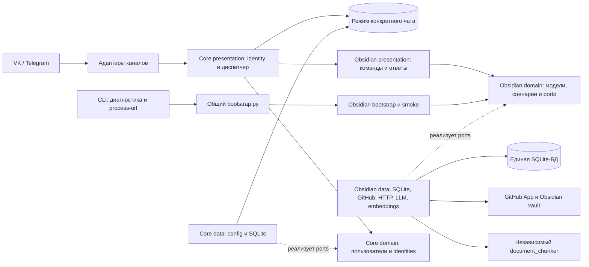

# Compadre Assistant

Compadre Assistant — личный ассистент в Telegram и VK с возможностями Obsidian и Ask. В режиме Obsidian он помогает превращать статьи в пополняемый vault. Он принимает ссылку, извлекает и анализирует материал, ищет связанные заметки, предлагает изменение в Markdown и записывает его в GitHub только после явного подтверждения пользователя.

## Статус

Проект выпущен. Production-развёртывание на VPS завершено для VK: регистрация, синхронизация vault, обработка статьи и GitHub write-back проверены в полном сценарии. Telegram работает через отдельный WireGuard-туннель и SOCKS5-прокси: Bot API, polling и ответ на пользовательскую команду проверены.

Ветка `codex/assistant-rebirth` содержит автономно проверенные режимы по чатам,
адресные операции, независимые настройки каналов/возможностей и Ask.
Локальное переименование в Compadre Assistant выполнено. Создан новый
Telegram-бот `@CompadreAssistant_bot`, сообщество VK доступно по адресу
`vk.com/compadre_assistant`, репозиторий переименован в
[`karateka-git/compadre-assistant`](https://github.com/karateka-git/compadre-assistant).
Существующая GitHub App переименована в **Compadre Assistant**, её действующий
slug — `compadre-assistant`; прежний App ID и доступ к vault сохранены.
Описанный ниже новый контракт относится к этой ветке;
его production deployment и полный живой пользовательский сценарий ещё не проверены.
Production runtime использует прежний `@KnowledgeCatcher_bot`. Новый
`@CompadreAssistant_bot` прошёл локальную live-проверку на временной БД:
`/start`, `/register` с сохранением имени и `/ask`; пять ответов доставлены
без ошибок. Проверочный polling после этого остановлен.
Итоговая проверка 2026-10-10: 548 unittest, три автономных
smoke и healthcheck локального профиля с временной БД прошли. Read-only API
подтвердили внешние имена и чтение существующего vault через прежний PEM после
переименования App. Telegram `/help`, `/obsidian`, `/exit`, живые сценарии VK,
Device Flow и запись в тестовый vault остаются открытыми. Контейнерная сборка,
CLI smoke и healthcheck прошли без сети на временной БД и фиктивном профиле;
контейнерный polling не запускался.

Дальнейшая работа перечислена в [бэклоге](docs/BACKLOG.md): среди возможных задач — фоновое ревью статей и переход на внешнюю PostgreSQL для App Platform. Завершённые работы сохранены в [истории](docs/HISTORY.md).

## Как это работает для пользователя

1. Отправьте `/register` в доступном канале и задайте имя профиля.
2. Войдите через `/obsidian`, подготовьте [обязательные правила vault](docs/GITHUB_APP.md#подготовить-vault), пришлите ссылку на GitHub-репозиторий и пройдите предложенную ботом авторизацию GitHub. Бот проверит права GitHub App и синхронизирует заметки.
3. Отправьте ссылку на статью. Бот извлечёт текст, подготовит анализ и найдёт связанные заметки vault.
4. Бот покажет proposal: добавить заметку, обновить существующую или пропустить запись.
5. Подтвердите или отмените предложение командой из ответа в исходном чате и режиме Obsidian. При единственном ожидании этого чата можно ответить `да` или `нет`; при нескольких используйте команду с ID и версией. При подтверждении бот запишет предложенное добавление или обновление commit в GitHub; предложение `skip` завершится без записи. При отмене vault останется без изменений.

После выхода или в другом чате отправьте `/obsidian`, чтобы выбрать работу с vault.
Повторная отправка той же статьи внутри режима использует сохранённый результат, если он уже есть. Для ручной синхронизации vault доступна команда `/github_sync`.
Разные статьи связанных TG/VK-чатов проходят анализ независимо и имеют отдельные предложения. `/exit` сохраняет ожидающие действия; повторный `/obsidian` показывает только ожидания исходного чата. Перенос identity подтверждается отдельной командой `/confirm core identity …`, которую возвращает `/link`.

По умолчанию новые заметки из предложений `add` получают служебный Obsidian-тег
`knowledge-catcher` в YAML frontmatter. Inline-marker в тексте не добавляется.
При `update` пользовательская заметка не получает этот тег задним числом, а
уже помеченная ботом заметка сохраняет marker. Существующие старые заметки
автоматически не маркируются.

Команда `/ask <вопрос>` даёт разовый ответ без истории переписки и не меняет
режим чата. Доступные возможности и команды перечислены в `/help`.

## Техническая схема

Этапы 1–2 и автономная реализация Ask завершены: модули разделены на `domain`, `data` и
`presentation`; возможности явно регистрируются по конфигурации. Регистрация
завершается созданием профиля и именем. `/obsidian [текст или URL]` включает
режим текущего чата и обрабатывает аргумент, `/exit` завершает его без удаления
данных. Подключение GitHub/vault выполняется внутри Obsidian. Вне режима текст
и URL предлагают доступные входы. Режим сохраняется между процессами по
пользователю, каналу и ID чата. `ENABLED_CAPABILITIES=obsidian` включает Obsidian;
пустое значение отключает возможности, сохраняя общие команды профиля.
`ENABLED_CHANNELS=telegram,vk` выбирает каналы для scripts и общего healthcheck;
отдельный запуск бота проверяет только его канал. При отключённом Obsidian
его настройки полностью игнорируются и клиенты не создаются. Пустые группы
GitHub/LLM позволяют пользоваться профилем; Obsidian сообщает о недоступном
провайдере. Частичные или некорректные включённые группы блокируют запуск.
Без embeddings используется FTS fallback; ключи LLM и embeddings независимы.
Ask доступен через `/ask <вопрос>` после регистрации и имени, без GitHub/vault.
Для включения задайте `ENABLED_CAPABILITIES=ask` либо `obsidian,ask` и отдельные
`ASK_BASE_URL`, `ASK_API_KEY`, `ASK_MODEL` (см. [SETUP](docs/SETUP.md#настройка-ask)).
Каждый вопрос независим; бот подтверждает приём и присылает ответ частями.
Режим Obsidian и ожидающие подтверждения сохраняются. Автономно прошли 548 тестов и один
реальный API запрос Ask. Дополнительно на новом Telegram-боте проверены
`/start`, регистрация с именем и `/ask` на временной БД. Живые сценарии VK и
полный Obsidian flow после изменений не проверялись. Подробная схема находится в
[ARCHITECTURE.md](docs/ARCHITECTURE.md).

## Быстрый старт

Для локальной подготовки смотрите [SETUP.md](docs/SETUP.md), для запуска и проверок — [RUN.md](docs/RUN.md). Подключение GitHub App и vault описано в [GITHUB_APP.md](docs/GITHUB_APP.md). Секреты хранятся только в локальном `.env` и каталоге `data/`, в Git они не попадают.

## Production VPS

Порядок эксплуатации production-сервиса, обновления, диагностика и резервные копии описаны в [OPERATIONS.md](docs/OPERATIONS.md).

## Документация

- [ASSISTANT REBIRTH ROADMAP](docs/ASSISTANT_REBIRTH_ROADMAP.md) — план перехода к модульному личному ассистенту.
- [Архитектура](docs/ARCHITECTURE.md) — слои, компоненты и потоки данных.
- [Подготовка](docs/SETUP.md) — установка, `.env`, выбор канала и среда разработки.
- [Запуск и проверки](docs/RUN.md) — локальный запуск, healthcheck и smoke-сценарии.
- [Эксплуатация](docs/OPERATIONS.md) — production VPS, обновления, логи и backup.
- [Production VPS](docs/PRODUCTION.md) — контекст доступа и текущее состояние сервера без секретов.
- [GitHub App](docs/GITHUB_APP.md) — настройка прав и подключение Obsidian vault.
- [Бэклог](docs/BACKLOG.md) — задачи, которые ещё не начаты.
- [История](docs/HISTORY.md) — завершённые задачи и прежние критерии разработки.
- [Журнал решений](docs/DECISIONS.md) — архитектурные решения и их причины.
- [Document chunker](docs/DOCUMENT_CHUNKER.md) — выделенный модуль разбиения документов.
