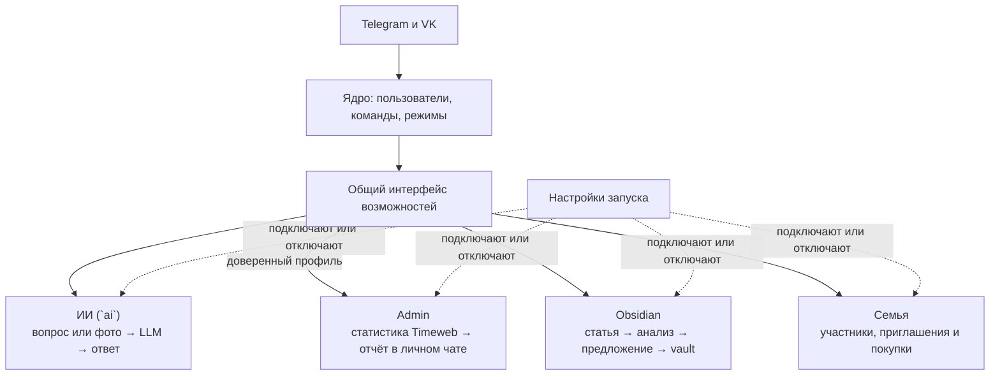
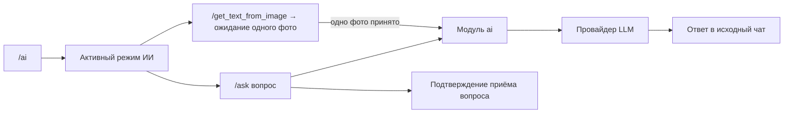
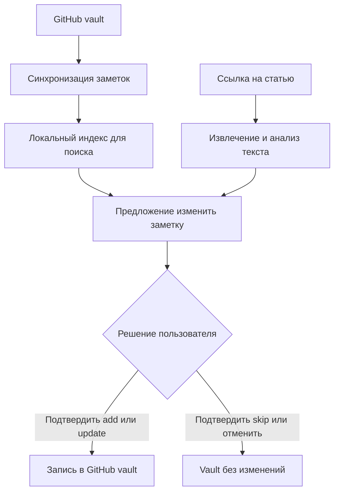

# Compadre Assistant

Compadre Assistant — личный ассистент в Telegram и VK. Он отвечает на вопросы,
распознаёт текст с фото и помогает пополнять Obsidian vault статьями. Бот
предлагает изменение заметки в Markdown и записывает его в GitHub после явного
подтверждения пользователя.

## Состояние проекта

Реализованы общие профили Telegram и VK, режимы по чатам, независимые
возможности ИИ (`ai`), Admin, Obsidian, «Семья» (`family`) и настройки профиля (`settings`),
индекс vault и подтверждаемая запись в GitHub.
В снимке VPS за 19.11.2026 зафиксированы установленная `v4.2.5`, первый
принятый Deployment v2 и работа Telegram и VK.
[Снимок VPS](docs/PRODUCTION.md#последний-проверенный-снимок-19112026-1607-utc)
Перед эксплуатационным действием состояние сервера проверяют заново.
Изменения опубликованных версий перечислены в
[GitHub Releases](https://github.com/karateka-git/compadre-assistant/releases),
открытые задачи — в [BACKLOG.md](docs/BACKLOG.md).

## Как это работает для пользователя

1. Отправьте `/register` в доступном канале и задайте имя профиля.
2. Войдите через `/obsidian`, подготовьте [обязательные правила vault](docs/GITHUB_APP.md#подготовить-vault), пришлите ссылку на GitHub-репозиторий и пройдите предложенную ботом авторизацию GitHub. Бот проверит права GitHub App и синхронизирует заметки.
3. Отправьте ссылку на статью. Бот извлечёт текст, подготовит анализ и найдёт связанные заметки vault.
4. Бот покажет proposal: добавить заметку, обновить существующую или пропустить запись.
5. Подтвердите или отмените предложение командой из ответа в исходном чате и режиме Obsidian. При единственном ожидании этого чата можно ответить `да` или `нет`; при нескольких используйте команду с ID и версией. При подтверждении бот запишет предложенное добавление или обновление commit в GitHub; предложение `skip` завершится без записи. При отмене vault останется без изменений.

После регистрации главное меню показывает доступные входы. Откройте
`/settings`, чтобы изменить имя, связать Telegram и VK или управлять
возможностями. До регистрации второго канала можно сразу отправить
`/link <code>`. В любом чате `/help` показывает команды для текущего состояния.

После выхода или в другом чате отправьте `/obsidian`, чтобы выбрать работу с vault.
Повторная отправка той же статьи внутри режима использует сохранённый результат, если он уже есть. Для ручной синхронизации vault доступна команда `/vault_sync`.
Разные статьи связанных TG/VK-чатов проходят анализ независимо и имеют отдельные предложения. `/exit` сохраняет ожидающие действия; повторный `/obsidian` показывает только ожидания исходного чата. Перенос identity подтверждается отдельной командой `/confirm core identity …`, которую возвращает `/link`.

По умолчанию новые заметки из предложений `add` получают служебный Obsidian-тег
`knowledge-catcher` в YAML frontmatter. Inline-marker в тексте не добавляется.
При `update` пользовательская заметка не получает этот тег задним числом, а
уже помеченная ботом заметка сохраняет marker. Существующие старые заметки
автоматически не маркируются.

Войдите в режим ИИ командой `/ai` в текущем чате. Отправьте `/ask <question>`,
чтобы получить ответ на один вопрос без истории переписки. Если отправить
`/ask` без вопроса, бот запросит его следующим сообщением. Чтобы распознать
текст, вызовите `/get_text_from_image` и пришлите одно фото. `/cancel`
отменяет ввод, а `/exit` завершает режим. Доступные сейчас команды показывает
контекстная `/help`. Действующие ответы и ограничения собраны в
[реестрах сообщений](docs/USER_MESSAGES.md).

Включённый режим администрирования позволяет доверенному профилю посмотреть
расходы по статистике выделенного ключа Timeweb. В личном чате отправьте
`/admin`, затем `/llm_costs` для сводки или `/llm_costs DAY` для текущих суток.
[Условия и варианты отчёта](docs/RUN.md#посмотреть-расходы-ии).

Если сервер предоставил «Семью», отправьте `/family` в личном чате.
Создайте семью или вступите по приглашению и откройте «Покупки».
Участники ведут один общий список, а один связанный профиль может работать
с ним из Telegram и VK. [Команды и порядок действий](docs/RUN.md#вести-семейный-список-покупок).

## Устройство ассистента

Ядро обрабатывает общие команды и выбирает маршрут сообщения. Каждая
возможность хранит сценарии и зависимости в своём модуле. При запуске
приложение подключает возможности из `ENABLED_CAPABILITIES` и добавляет
`/settings` каждому зарегистрированному профилю. Данные отключённых
возможностей сохраняются. В режиме настроек пользователь проверяет доступ через
`/capabilities` и меняет личный выбор через `/enable <id>` или `/disable <id>`.
Порядок команд описан в
[RUN.md](docs/RUN.md#13-посмотреть-доступные-команды).

### Режим ИИ

Модуль ИИ отвечает на отдельный вопрос без истории переписки и доступа к vault или
возвращает текст с одного фото. После ответа режим ИИ остаётся активным в том же
чате. Длинный ответ отправляется частями. [Как получить текст с фото](docs/RUN.md#получить-текст-с-фото-в-режиме-ии).

### Возможность Obsidian

После входа через `/obsidian` пользователь подключает vault и отправляет ссылку
на статью. Модуль использует связанные заметки для предложения; запись в GitHub
требует явного подтверждения в исходном чате. `/exit` завершает режим только
этого чата и не удаляет данные или ожидающие предложения. При недоступных
embeddings поиск использует FTS fallback.

Схема модулей и путь сообщения описаны в [обзоре архитектуры](docs/ARCHITECTURE.md).
Подробности обработки статьи, индекса и записи в vault — в [архитектуре Obsidian](docs/architecture/OBSIDIAN.md).
Настройка возможностей и каналов — в [SETUP.md](docs/SETUP.md).

## Быстрый старт

Для локальной подготовки смотрите [SETUP.md](docs/SETUP.md), для запуска и проверок — [RUN.md](docs/RUN.md). Подключение GitHub App и vault описано в [GITHUB_APP.md](docs/GITHUB_APP.md). Секреты хранятся только в локальном `.env` и каталоге `data/`, в Git они не попадают.

## Production VPS

Для PATCH полный CI проверяет SHA релизной ветки. Для первого выпуска новой
линии он проверяет SHA в `main`, на котором создают `release/X.Y`. Оператор
вручную запускает `Production release` из защищённой `main`. Workflow
подтверждает immutable Release, координирует установку на VPS и записывает
результат в Deployment. [Маршрут выпуска](docs/RELEASES.md#маршрут-выпуска) ·
[Выпуск из GitHub Actions](docs/OPERATIONS.md#выпустить-обычную-версию-из-github-actions)

## Документация

- [Карта кода](docs/CODE_MAP.md) — с какой части кода и каких тестов начать типовую задачу.
- [Архитектура](docs/ARCHITECTURE.md) — границы модулей, путь сообщения и документы отдельных возможностей.
- [Правила сообщений и реестры](docs/USER_MESSAGES.md) — условия, тексты и оформление ответов.
- [Подготовка](docs/SETUP.md) — установка, `.env`, выбор канала и среда разработки.
- [Запуск и проверки](docs/RUN.md) — локальный запуск, healthcheck и smoke-сценарии.
- [Эксплуатация](docs/OPERATIONS.md) — production VPS, обновления, логи и backup.
- [Релизы](docs/RELEASES.md) — CI, релизные линии, версии и аварийный маршрут.
- [Итог проверки выпуска](docs/RELEASE_REVIEW.md) — результаты v3.2.0, замеры и оставшиеся ограничения.
- [Правила документации](docs/DOCUMENTATION_GUIDELINES.md) — структура, схемы, точность и проверка текстов.
- [Production VPS](docs/PRODUCTION.md) — контекст доступа и текущее состояние сервера без секретов.
- [GitHub App](docs/GITHUB_APP.md) — настройка прав и подключение Obsidian vault.
- [Бэклог](docs/BACKLOG.md) — задачи, которые ещё не начаты.
- [GitHub Releases](https://github.com/karateka-git/compadre-assistant/releases) — изменения опубликованных версий.
- [Действующие решения](docs/DECISIONS.md) — причины архитектурных и эксплуатационных решений.
- [Document chunker](docs/DOCUMENT_CHUNKER.md) — выделенный модуль разбиения документов.
