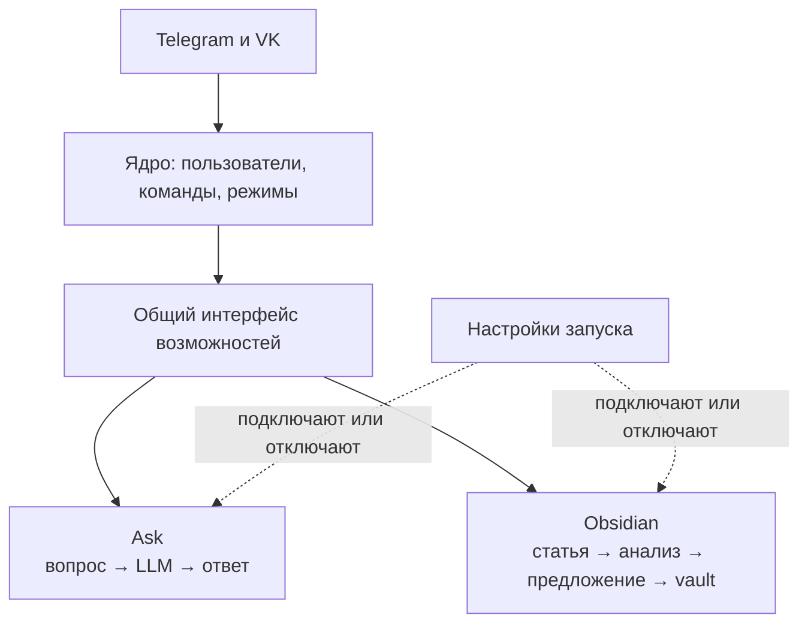
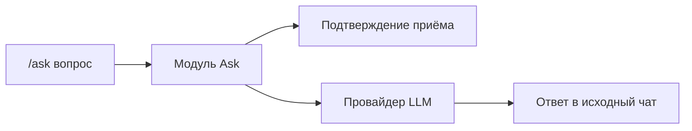
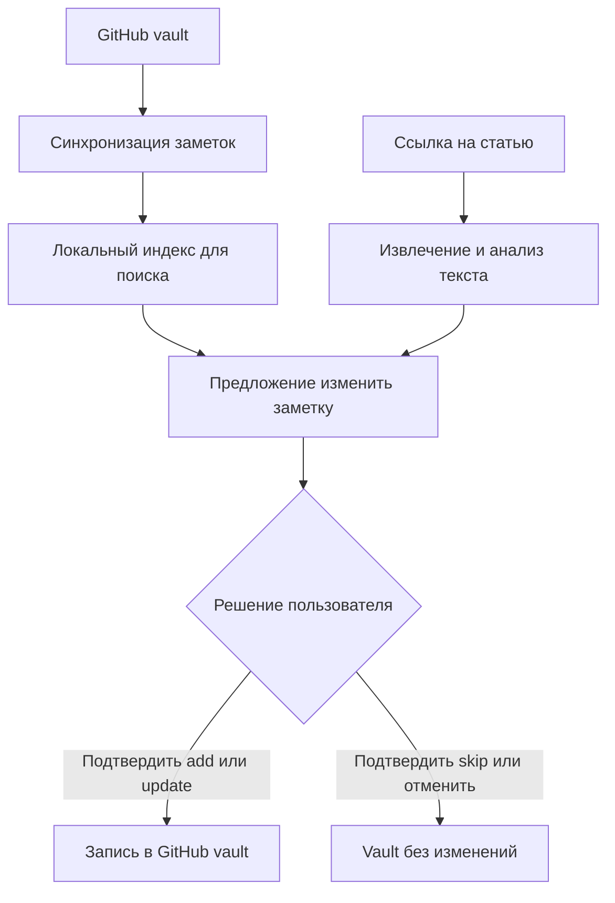

# Compadre Assistant

Compadre Assistant — личный ассистент в Telegram и VK с возможностями Obsidian и Ask. В режиме Obsidian он помогает превращать статьи в пополняемый vault. Он принимает ссылку, извлекает и анализирует материал, ищет связанные заметки, предлагает изменение в Markdown и записывает его в GitHub только после явного подтверждения пользователя.

## Состояние проекта

Реализованы общие профили Telegram и VK, режимы по чатам, независимые
возможности Ask и Obsidian, индекс vault и подтверждаемая запись в GitHub.
Последний документированный снимок VPS относится к 20.10.2026:
[v1.0.4](docs/PRODUCTION.md#последний-проверенный-снимок--20102026).
Перед эксплуатационным действием состояние сервера проверяют заново.
Изменения опубликованных версий перечислены в
[GitHub Releases](https://github.com/karateka-git/compadre-assistant/releases),
открытые задачи — в [BACKLOG.md](docs/BACKLOG.md).

## Как это работает для пользователя

1. Отправьте `/register` в доступном канале и задайте имя профиля.
2. Войдите через `/obsidian`, подготовьте [обязательные правила vault](docs/GITHUB_APP.md#подготовить-vault), пришлите ссылку на GitHub-репозиторий и пройдите предложенную ботом авторизацию GitHub. Бот проверит права GitHub App и синхронизирует заметки.
3. Отправьте ссылку на статью. Бот извлечёт текст, подготовит анализ и найдёт связанные заметки vault.
4. Бот покажет proposal: добавить заметку, обновить существующую или пропустить запись.
5. Подтвердите или отмените предложение командой из ответа в исходном чате и режиме Obsidian. При единственном ожидании этого чата можно ответить `да` или `нет`; при нескольких используйте команду с ID и версией. При подтверждении бот запишет предложенное добавление или обновление commit в GitHub; предложение `skip` завершится без записи. При отмене vault останется без изменений.

После выхода или в другом чате отправьте `/obsidian`, чтобы выбрать работу с vault.
Повторная отправка той же статьи внутри режима использует сохранённый результат, если он уже есть. Для ручной синхронизации vault доступна команда `/github_sync`.
Разные статьи связанных TG/VK-чатов проходят анализ независимо и имеют отдельные предложения. `/exit` сохраняет ожидающие действия; повторный `/obsidian` показывает только ожидания исходного чата. Перенос identity подтверждается отдельной командой `/confirm core identity …`, которую возвращает `/link`.

По умолчанию новые заметки из предложений `add` получают служебный Obsidian-тег
`knowledge-catcher` в YAML frontmatter. Inline-marker в тексте не добавляется.
При `update` пользовательская заметка не получает этот тег задним числом, а
уже помеченная ботом заметка сохраняет marker. Существующие старые заметки
автоматически не маркируются.

Команда `/ask <вопрос>` даёт разовый ответ без истории переписки и не меняет
режим чата. Доступные возможности и команды перечислены в `/help`.

## Устройство ассистента

Ядро обрабатывает общие команды и выбирает маршрут сообщения. Ask и Obsidian —
отдельные модули со своими сценариями и внешними зависимостями. При запуске
приложение собирает только возможности из `ENABLED_CAPABILITIES`; отключённая
возможность не принимает команды, а её данные сохраняются. Выбор возможностей
самим пользователем запланирован отдельно в [бэклоге](docs/BACKLOG.md#выбор-возможностей-пользователем).

### Возможность Ask

Ask отвечает на один вопрос без истории переписки и доступа к vault. Он не
меняет активный режим чата; длинный ответ отправляется частями.

### Возможность Obsidian

После входа через `/obsidian` пользователь подключает vault и отправляет ссылку
на статью. Модуль использует связанные заметки для предложения; запись в GitHub
требует явного подтверждения в исходном чате. `/exit` завершает режим только
этого чата и не удаляет данные или ожидающие предложения. При недоступных
embeddings поиск использует FTS fallback.

Подробное устройство слоёв `domain`, `data`, `presentation`, хранилища и
зависимостей описано в [ARCHITECTURE.md](docs/ARCHITECTURE.md). Настройка
возможностей и каналов — в [SETUP.md](docs/SETUP.md).

## Быстрый старт

Для локальной подготовки смотрите [SETUP.md](docs/SETUP.md), для запуска и проверок — [RUN.md](docs/RUN.md). Подключение GitHub App и vault описано в [GITHUB_APP.md](docs/GITHUB_APP.md). Секреты хранятся только в локальном `.env` и каталоге `data/`, в Git они не попадают.

## Production VPS

Разработка идёт через PR с быстрыми проверками в `main`, затем полный CI
проверяет кандидата для `release/X.Y`. Защищённый тег и GitHub Release
фиксируют конкретную версию; VPS обновляется только отдельной командой
оператора. Схема веток, версий и допуска — в [RELEASES.md](docs/RELEASES.md),
порядок обновления и возврата — в [OPERATIONS.md](docs/OPERATIONS.md).

## Документация

- [Архитектура](docs/ARCHITECTURE.md) — слои, компоненты и потоки данных.
- [Подготовка](docs/SETUP.md) — установка, `.env`, выбор канала и среда разработки.
- [Запуск и проверки](docs/RUN.md) — локальный запуск, healthcheck и smoke-сценарии.
- [Эксплуатация](docs/OPERATIONS.md) — production VPS, обновления, логи и backup.
- [Релизы](docs/RELEASES.md) — CI, релизные линии, версии и аварийный маршрут.
- [Правила документации](docs/DOCUMENTATION_GUIDELINES.md) — структура, схемы, точность и проверка текстов.
- [Production VPS](docs/PRODUCTION.md) — контекст доступа и текущее состояние сервера без секретов.
- [GitHub App](docs/GITHUB_APP.md) — настройка прав и подключение Obsidian vault.
- [Бэклог](docs/BACKLOG.md) — задачи, которые ещё не начаты.
- [GitHub Releases](https://github.com/karateka-git/compadre-assistant/releases) — изменения опубликованных версий.
- [Действующие решения](docs/DECISIONS.md) — причины архитектурных и эксплуатационных решений.
- [Document chunker](docs/DOCUMENT_CHUNKER.md) — выделенный модуль разбиения документов.
