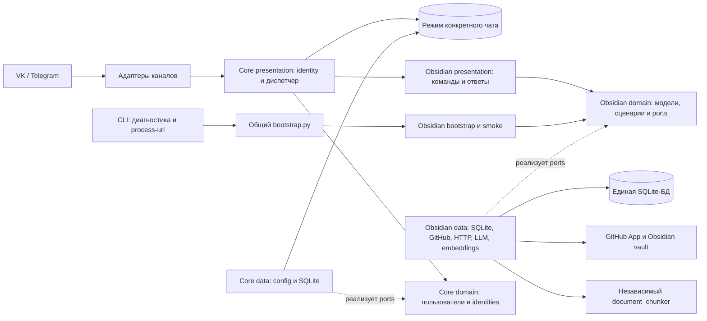

# Knowledge Catcher

Knowledge Catcher — бот, который помогает превращать статьи в пополняемый Obsidian vault. Он принимает ссылку, извлекает и анализирует материал, ищет связанные заметки, предлагает изменение в Markdown и записывает его в GitHub только после явного подтверждения пользователя.

## Статус

Проект выпущен. Production-развёртывание на VPS завершено для VK: регистрация, синхронизация vault, обработка статьи и GitHub write-back проверены в полном сценарии. Telegram работает через отдельный WireGuard-туннель и SOCKS5-прокси: Bot API, polling и ответ на пользовательскую команду проверены.

Дальнейшая работа перечислена в [бэклоге](docs/BACKLOG.md): среди возможных задач — фоновое ревью статей и переход на внешнюю PostgreSQL для App Platform. Завершённые работы сохранены в [истории](docs/HISTORY.md).

## Как это работает для пользователя

1. Отправьте `/register` в доступном канале и задайте имя профиля.
2. Подготовьте [обязательные правила vault](docs/GITHUB_APP.md#подготовить-vault), пришлите ссылку на GitHub-репозиторий и пройдите предложенную ботом авторизацию GitHub. Бот проверит права GitHub App и синхронизирует заметки.
3. Отправьте ссылку на статью. Бот извлечёт текст, подготовит анализ и найдёт связанные заметки vault.
4. Бот покажет proposal: добавить заметку, обновить существующую или пропустить запись.
5. Ответьте `да` или `нет`. При `да` бот запишет предложенное добавление или обновление commit в GitHub; предложение `skip` завершится без записи. При `нет` vault останется без изменений.

После выхода или в другом чате отправьте `/obsidian`, чтобы выбрать работу с vault.
Повторная отправка той же статьи внутри режима использует сохранённый результат, если он уже есть. Для ручной синхронизации vault доступна команда `/github_sync`.

По умолчанию новые заметки из предложений `add` получают служебный Obsidian-тег
`knowledge-catcher` в YAML frontmatter. Inline-marker в тексте не добавляется.
При `update` пользовательская заметка не получает этот тег задним числом, а
уже помеченная ботом заметка сохраняет marker. Существующие старые заметки
автоматически не маркируются.

## Техническая схема

Шаги 2.1–2.3 перехода завершены: модули разделены на `domain`, `data` и
`presentation`; возможности явно регистрируются по конфигурации. Регистрация
завершается созданием профиля и именем. `/obsidian [текст или URL]` включает
режим текущего чата и обрабатывает аргумент, `/exit` завершает его без удаления
данных. Подключение GitHub/vault выполняется внутри Obsidian. Вне режима текст
и URL предлагают доступные входы. Режим сохраняется между процессами по
пользователю, каналу и ID чата. `ENABLED_CAPABILITIES=obsidian` включает Obsidian;
пустое значение отключает возможности, сохраняя общие команды профиля.
Новые подтверждения, разделение конфигурации/healthcheck и Ask остаются
следующими шагами. Автономно прошли 467 тестов. Живые внешние интеграции после
изменений не проверялись. Подробная схема находится в
[ARCHITECTURE.md](docs/ARCHITECTURE.md).

## Быстрый старт

Для локальной подготовки смотрите [SETUP.md](docs/SETUP.md), для запуска и проверок — [RUN.md](docs/RUN.md). Подключение GitHub App и vault описано в [GITHUB_APP.md](docs/GITHUB_APP.md). Секреты хранятся только в локальном `.env` и каталоге `data/`, в Git они не попадают.

## Production VPS

Порядок эксплуатации production-сервиса, обновления, диагностика и резервные копии описаны в [OPERATIONS.md](docs/OPERATIONS.md).

## Документация

- [ASSISTANT REBIRTH ROADMAP](docs/ASSISTANT_REBIRTH_ROADMAP.md) — план перехода к модульному личному ассистенту.
- [Архитектура](docs/ARCHITECTURE.md) — слои, компоненты и потоки данных.
- [Подготовка](docs/SETUP.md) — установка, `.env`, выбор канала и среда разработки.
- [Запуск и проверки](docs/RUN.md) — локальный запуск, healthcheck и smoke-сценарии.
- [Эксплуатация](docs/OPERATIONS.md) — production VPS, обновления, логи и backup.
- [Production VPS](docs/PRODUCTION.md) — контекст доступа и текущее состояние сервера без секретов.
- [GitHub App](docs/GITHUB_APP.md) — настройка прав и подключение Obsidian vault.
- [Бэклог](docs/BACKLOG.md) — задачи, которые ещё не начаты.
- [История](docs/HISTORY.md) — завершённые задачи и прежние критерии разработки.
- [Журнал решений](docs/DECISIONS.md) — архитектурные решения и их причины.
- [Document chunker](docs/DOCUMENT_CHUNKER.md) — выделенный модуль разбиения документов.
