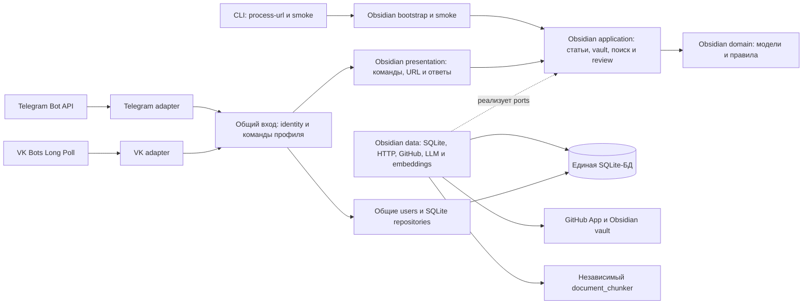
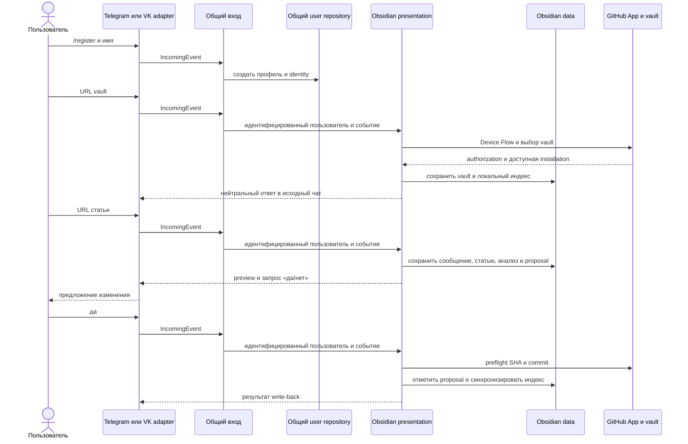

# Архитектура Knowledge Catcher

## Назначение

Knowledge Catcher принимает ссылки на статьи из мессенджера, извлекает и
анализирует их текст, сопоставляет материал с Obsidian vault в GitHub и готовит
предложение изменения заметки. Изменение попадает в vault только после явного
подтверждения пользователя.

Каждый пользовательский профиль может быть доступен из нескольких внешних
каналов; данные профилей изолированы друг от друга. До рефакторинга на VPS
проверили полный VK-сценарий и ответ на команду в Telegram через отдельный
исходящий путь WireGuard и SOCKS5. Описанная ниже структура этапа 1 проверена
локально и пока не развёрнута на VPS; прежние результаты записаны в
[истории](HISTORY.md#доступ-telegram-bot-api-с-российских-vps).

## Текущая структура после этапа 1

| Часть | Ответственность |
| --- | --- |
| `capabilities/obsidian/domain/` | Модели и правила статей, vault, поиска и proposals. |
| `capabilities/obsidian/application/` | Временное расположение use cases и ports Obsidian до этапа 2. |
| `capabilities/obsidian/data/` | Предметные SQLite DTO, mapper-функции и repositories; HTTP, GitHub, LLM, embeddings, extraction и adapter `document_chunker`. |
| `capabilities/obsidian/presentation/` | Команды, обработка текста и подтверждений, форматирование ответов Obsidian. |
| `capabilities/obsidian/bootstrap.py` | Сборка зависимостей возможности и её публичного входа. |
| `application/incoming/`, `application/users/`, `domain/users/` | Общее событие, identity, команды профиля и связывания каналов. |
| `data/config.py`, `data/sqlite/` | Общая конфигурация, подключение и инициализация SQLite, repositories пользователей. |
| `presentation/telegram/`, `presentation/vk/`, `presentation/cli/` | Адаптеры каналов и CLI вне Obsidian presentation. |

Общий `IncomingEvent` несёт текст и адрес канала. `ProcessIncomingMessageUseCase`
разрешает identity, обрабатывает команды профиля и приоритет подтверждения
смены связи каналов, после чего передаёт сообщение публичному входу Obsidian.
Он не анализирует ссылки или предметные подтверждения. Внутри Obsidian находятся
`incoming_messages` и `processing_errors`: это журнал и ошибки обработки статьи,
а не хранилище каждого общего события. Telegram и VK получают готовый
`IncomingResponse` и доставляют фоновый ответ в исходный чат.

Одна начальная SQL-схема остаётся в
`obs_chat_bot/data/sqlite/migrations/0001_initial_schema.sql`. Общие подключение
и порядок инициализации не дублируются внутри возможности. Таблицы
пользователей и identities общие; таблицы статей, GitHub, vault, индексов,
proposals и журнала статьи принадлежат Obsidian. Библиотека
`document_chunker/` остаётся вне возможности, а её adapter — внутри Obsidian.

Это промежуточная структура: `core`, реестр и сохранённый режим конкретного
чата появятся на этапе 2. Возможность Ask запланирована на этап 3. Сейчас
общий вход подключает только Obsidian, поэтому обычный текст после общих
команд поступает ему.

### Composition root

`obs_chat_bot/bootstrap.py` собирает общие identity-зависимости, открывает
SQLite-соединение для отдельного сообщения и подключает публичный вход Obsidian.
Его предметные фабрики находятся в `capabilities/obsidian/bootstrap.py`.
`presentation/cli/main.py` запускает адаптеры и диагностические команды через
эту сборку; автономные smoke-сценарии Obsidian находятся в
`capabilities/obsidian/smoke.py`.

Docker Compose запускает два независимых worker-контейнера из одного образа:
`tg_catcher` с Telegram polling и `vk_catcher` с VK Long Poll. Оба используют
общий том `data/` с SQLite и ключом GitHub App. Каждый adapter преобразует
сообщение платформы в `IncomingEvent`. Для долгой операции он может отправить
раннюю квитанцию по предикату, полученному при сборке Obsidian. Результат и
фоновое завершение форматируются до нейтрального ответа каналу.

## Основные компоненты

### Пользователи и каналы

`UserIdentityService` создаёт внутреннего пользователя через `/register` и
хранит отдельные внешние identities для Telegram и VK. Команда `/link_code`
создаёт короткий код, а `/link <код>` связывает второй канал с тем же
пользователем. Статьи, vault, заметки и поисковые индексы ограничены
`app_user_id`, поэтому данные разных пользователей не смешиваются.

### GitHub App и подключение vault

GitHub Device Flow подтверждает, что пользователь авторизовал свой
GitHub-аккаунт. `GitHubConnectionCoordinator` ожидает результат в фоне и
сохраняет account и IDs доступных App installations в SQLite. Для проверки,
чтения и записи выбранного vault GitHub App выпускает installation token с
доступом к конкретному репозиторию. Такой token не хранится в БД и не выводится
в логи.

Пользователь отправляет URL репозитория после `/register`. Сервис проверяет,
что App установлено на этот репозиторий с правом `Contents: read and write`,
затем сохраняет выбранный vault и запускает первую синхронизацию. В корне
vault ожидается `.knowledge-catcher.yml` версии 1 с путями к instruction-файлам.

Device Flow session, включая challenge и callback исходного чата, хранится
только в памяти процесса. Межпроцессный SQLite claim предотвращает
одновременный запуск для одного пользователя. После перезапуска прежняя
session не восстанавливается; когда истечёт claim, пользователь может начать
новую попытку Device Flow. Это не продолжение прежней авторизации.

### Локальная копия vault и поиск

GitHub-репозиторий является источником истины для Obsidian vault. SQLite хранит
его локальную рабочую копию: Markdown-заметки, файлы правил, метаданные,
chunks, FTS5 и embeddings. При большом числе изменившихся файлов GitHub
snapshot скачивается одним ZIP-архивом конкретного commit при соблюдении
безопасных лимитов; иначе читаются только изменившиеся blobs. Новый snapshot
проверяется до применения, поэтому ошибка конфигурации или загрузки не
заменяет последнюю пригодную локальную копию.

Markdown разбирается пакетом `document_chunker` в устойчивые chunks с
заголовочным контекстом и хешем содержимого. SQLite FTS5 даёт лексический
поиск по chunks. Semantic-индекс хранит вектор как `float32` BLOB, связанный
с chunk, его хешем и моделью. Неизменившиеся chunks переиспользуют сохранённые
embeddings. Гибридный поиск сочетает BM25 и cosine similarity через
Reciprocal Rank Fusion. Если semantic-индекс не готов или embeddings временно
недоступны, используется явный FTS fallback; его статус показывается в
ответах синхронизации.

### Pipeline статьи и proposal

1. HTTP-adapter безопасно загружает страницу, не допуская private, loopback и
   link-local адреса даже после redirect.
2. `trafilatura` извлекает содержательный текст. Статья и связанное с ней
   входящее сообщение сохраняются в SQLite.
3. OpenAI-compatible LLM создаёт и сохраняет анализ статьи.
4. Obsidian проверяет актуальность vault до обработки URL (не чаще раза в
   шесть часов). После анализа hybrid search подбирает релевантные заметки,
   а LLM с правилами vault готовит `add`, `update` или `skip`.
5. Пользователь видит preview Markdown и отвечает `да` либо `нет`. До `да`
   GitHub не меняется.

### Подтверждённый write-back

`ObsidianProposalConfirmationService` применяет только pending proposal.
Перед записью он читает актуальное состояние target-файла в GitHub и проверяет
SHA. Если другой автор уже изменил файл, proposal переходит в `conflict`, а
чужой Markdown сохраняется. При неоднозначном ответе сети сервис сопоставляет
remote Markdown с ожидаемым: если commit уже создан, локальная транзакция
завершается без повторной записи. После удачного commit запускается
синхронизация vault, чтобы SQLite, FTS и embeddings соответствовали GitHub.

## Гарантии и ограничения

- **Согласованность локального индекса.** Source SHA snapshot продвигается
  после успешной проверки и сохранения. Marker готовности semantic-индекса
  публикуется после полного набора vectors; частичные checkpoints будут
  продолжены при следующей синхронизации и не используются semantic search.
- **Один владелец операции.** SQLite lease координирует Telegram и VK: для
  одного vault одновременно выполняется одна синхронизация или write-back.
  Истёкший lease можно захватить повторно.
- **Явное изменение GitHub.** LLM не пишет в vault напрямую. Сначала
  сохраняется proposal, затем пользователь подтверждает его. Ошибка write-back
  оставляет proposal pending для повтора; конфликт не затирает изменения.
- **Сохранность данных.** Production SQLite и PEM находятся на постоянном
  диске VPS вне Docker-образа. На сервере выполняется ежедневная SQLite
  backup-копия с проверкой целостности и хранением семи последних экземпляров.
  Резервирование VM вне сервера остаётся отдельной задачей эксплуатации.
- **Граница проверок.** После выделения Obsidian прошли автономные unittest,
  SQLite/pipeline/analysis smoke и healthcheck на временной БД. Живые каналы,
  GitHub Device Flow, sync/write-back и внешние LLM/embeddings API с новой
  структурой без credentials и тестового vault не проверялись. Прежние
  production-проверки описаны в [истории](HISTORY.md).

## Связанные документы

- [ASSISTANT REBIRTH ROADMAP](ASSISTANT_REBIRTH_ROADMAP.md) — этапы перехода.
- [RUN.md](RUN.md) — локальный запуск, smoke-проверки и команды.
- [OPERATIONS.md](OPERATIONS.md) — эксплуатация VPS, обновление, логи и backup.
- [GITHUB_APP.md](GITHUB_APP.md) — создание и настройка GitHub App.
- [DOCUMENT_CHUNKER.md](DOCUMENT_CHUNKER.md) — правила разбиения Markdown.
- [DECISIONS.md](DECISIONS.md) — прежние архитектурные решения.
- [BACKLOG.md](BACKLOG.md) — открытые задачи.
- [HISTORY.md](HISTORY.md) — завершённые задачи и прежние критерии.
