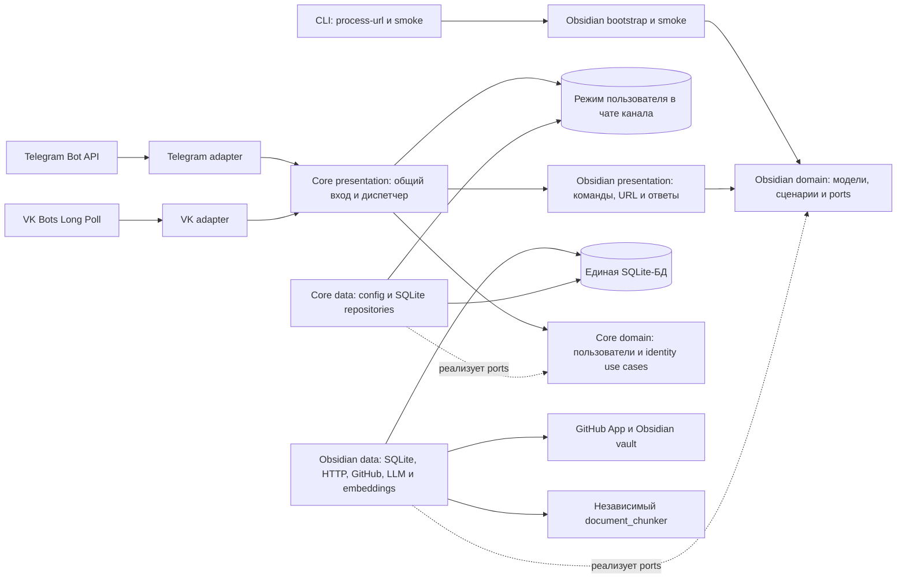
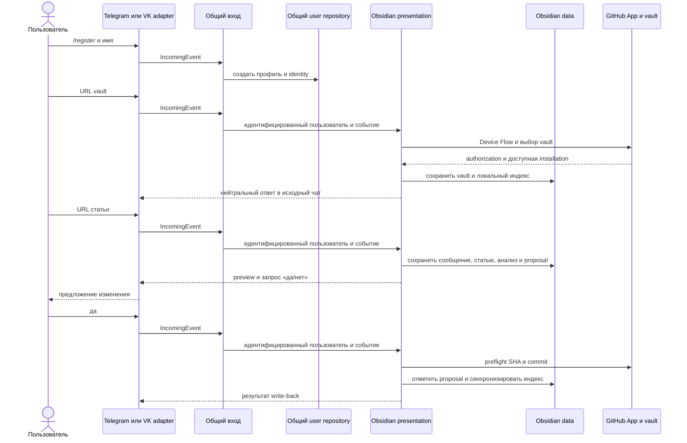

# Архитектура Compadre Assistant

## Назначение

Compadre Assistant — модульный личный ассистент в Telegram и VK.
Возможность Ask отвечает на отдельные вопросы без истории переписки,
а Obsidian принимает ссылки на статьи, извлекает и
анализирует их текст, сопоставляет материал с Obsidian vault в GitHub и готовит
предложение изменения заметки. Изменение попадает в vault только после явного
подтверждения пользователя.

Каждый пользовательский профиль может быть доступен из нескольких внешних
каналов; данные профилей изолированы друг от друга. До рефакторинга на VPS
проверили полный VK-сценарий и ответ на команду в Telegram через отдельный
исходящий путь WireGuard и SOCKS5. Описанная ниже структура шага 2.5 проверена
локально и пока не развёрнута на VPS; прежние результаты записаны в
[истории](HISTORY.md#доступ-telegram-bot-api-с-российских-vps).

## Текущая структура после шага 2.6.7

| Часть | Ответственность |
| --- | --- |
| `core/domain/` | Пользователи, identities, общие use cases и ports; ключ и ID активного режима чата. |
| `core/data/` | Общая конфигурация каналов и списка возможностей, SQLite connection/schema lifecycle, отдельные DTO, mappers и repositories профилей и режимов. |
| `core/presentation/` | Нейтральное событие, общие команды, диспетчер и форматирование общих ответов. |
| `capabilities/obsidian/domain/` | Модели, правила, use cases и ports статей, vault, поиска и proposals. |
| `capabilities/obsidian/data/` | Профиль настроек Obsidian, предметные SQLite DTO, mappers и repositories; HTTP, GitHub, LLM, embeddings, extraction, YAML-конфигурация vault и adapter `document_chunker`. |
| `capabilities/obsidian/presentation/` | Команды, обработка текста и подтверждений, форматирование ответов Obsidian и статический пример правил vault. |
| `capabilities/obsidian/bootstrap.py` | Сборка зависимостей возможности и её публичного входа. |
| `presentation/telegram/`, `presentation/vk/`, `presentation/cli/` | Адаптеры каналов и CLI вне presentation возможностей. |

Общий `IncomingEvent` несёт источник, внешнюю идентичность и `ReplyAddress`
без `article_id` и полей хранения. `IncomingMessageDispatcher` разрешает identity
и передаёт проверенного пользователя в `HandlerContext`. Общие команды и входы
обрабатываются до активного режима. Перенос identity подтверждается адресной
общей командой `/confirm core identity <id> <версия> <yes|no>`. Обычный текст
вне режима только предлагает доступные входы; URL не выбирает возможность.

`CapabilityRegistry` получает явно собранные обработчики из composition root.
`CapabilityDescriptor` задаёт устойчивый ID, команду входа и справку. Реестр
проверяет конфликты ID, команд и зарезервированных общих имён при сборке.

`core/data/config.py` читает только `APP_ENV`, путь SQLite, выбранные каналы,
их credentials/proxy, debug-флаг и список ID возможностей. Отдельный
`capabilities/obsidian/data/configuration/config.py` владеет профилем LLM,
GitHub App, embeddings, chunking и тега заметок. Главный composition root
вызывает его loader только при включённом Obsidian; CLI передаёт профиль
сборке процесса и healthcheck. При отключении ошибочные предметные переменные
окружения не разбираются. У Ask собственный профиль `AskConfig` и loader;
добавление его полей не потребует изменений общей модели `AppConfig`.
Обработчики `enter(context, event)` и `handle(context, event)` вызывают предметные
use cases и возвращают `CapabilityResult(IncomingResponse, CapabilityMode)`.
Неожиданное исключение любого из этих входов диспетчер логирует с ID возможности
и преобразует в безопасный общий ответ. Исключение `handle` не очищает режим
и не меняет его ревизию: предметное действие могло уже произвести внешний эффект,
поэтому ядро не повторяет вызов автоматически. Перед ручным повтором пользователь
должен проверить состояние действия. Уже отправленные `BackgroundReply` сохраняют
свой адрес и не отменяются этим ответом.
Предметные модели форматируются внутри presentation возможности. Общий ответ
содержит текст, ошибку и необязательные `ConfirmationAction` с командами
`/confirm <модуль> <операция> <id> <версия> <yes|no>`. Ядро проверяет выбранный
режим для адресного действия возможности, а предметные проверки выполняет
соответствующий обработчик.

Telegram и VK отображают общий ответ, включая текстовые команды действий.
Через `ReplyDeliveryPort` возможность отправляет `BackgroundReply` с сохранённым
адресом и уже оформленным ответом. Device Flow продолжает исходный Obsidian
сценарий на новом коротком SQLite-соединении после закрытия соединения сообщения.
Выход из режима не отменяет ожидающую операцию и её доставку. Ранняя квитанция
исходит из выбранного обработчика через ту же общую доставку.
`incoming_messages`, `processing_errors` и преобразование события в модель
статьи остаются внутри Obsidian; ядро не журналирует каждое сообщение.

Одна начальная SQL-схема находится в
`compadre_assistant/core/data/sqlite/migrations/0001_initial_schema.sql`. Ядро владеет
таблицами пользователей, identities и `active_chat_modes`. Ключ режима —
`app_user_id`, `channel`, `chat_id`; значение — nullable `capability_id`,
положительная `revision` и технический `updated_at`. Отсутствие строки означает
ревизию 0. После `/exit` строка остаётся с `capability_id = NULL` и увеличенной
ревизией: поздний результат не может принять очищенный чат за новый.
Состояние vault, GitHub, индексов, proposals и журнала статьи
принадлежит Obsidian. Отключение возможности не очищает эти данные.
`document_chunker/` остаётся независимой библиотекой.

Текущая сборка подключает Obsidian командой `/obsidian [текст или URL]`.
Аргумент передаётся presentation возможности отдельно от исходного события;
ядро разбирает только команду входа. Без аргумента Obsidian объясняет действия
и предлагает подключение vault, если он ещё не выбран.
Успешный длительный `enter` заменяет режим только текущего чата. Ошибка или
одноразовый вход сохраняет прежний режим. Успешно завершённый `handle` очищает
маршрут; `/exit` очищает только выбор этого чата без удаления предметных данных.
Перед `enter` и `handle` ядро читает ревизию чата. После вызова обработчика
смена режима или завершение применяются только при той же ревизии. Короткая
SQLite write-транзакция сериализует проверку и запись между процессами TG/VK;
внешний обработчик выполняется без этой транзакции. Отключённый вход не меняет
режим. Новый вход читает актуальные vault, proposals и ожидающие операции.
Сохранённый ID отключённой возможности даёт подсказку о `/exit` и доступных
возможностях и не заменяется
по обычному сообщению. Разные пользователи, каналы и чаты имеют отдельные режимы;
SQLite восстанавливает выбор после перезапуска.

Регистрация завершается созданием профиля и сохранением имени без выбора режима.
Создание `app_user` и первой `external_identity` выполняется одной короткой
SQLite-транзакцией. Повторный запрос того же канала возвращает существующий
профиль, в том числе после конкурирующей регистрации. `/link <код>` погашает
код и создаёт связь также одной транзакцией: конфликт identity или ошибка
вставки сохраняет код непогашенным.
`/start`, `/register`, `/name`, `/status`, команды связи каналов и справка
не читают vault и доступны при отключённом Obsidian. `ProfileSetupPort` и прежние
общие onboarding-модели удалены. Подключение GitHub/vault принадлежит Obsidian.

`ENABLED_CAPABILITIES` выбирает явный список входов (по умолчанию `obsidian`,
пустая строка отключает все). Core разбирает форму списка, а конкретные допустимые
сборки проверяет composition root. Метаданные отключённых входов также приходят
из composition root, без предметных ID и команд в core. Явный отключённый вход
отличается от ненастроенного провайдера внутри Obsidian и отсутствующего vault
пользователя. Проверка vault выполняется только внутри Obsidian. Отсутствующая
LLM-конфигурация не создаёт adapters при сборке входа. `да`/`нет` относится
только к однозначной локальной операции Obsidian. Ask реализован как одноразовая возможность этапа 3.

В шаге 2.5 `load_config` читает только настройки выбранных каналов и включённых
возможностей. `ENABLED_CHANNELS` выбирает Telegram/VK для scripts и общей
диагностики; флаги запуска конкретного бота выбирают только его канал.
Отключённый Obsidian не разбирает даже некорректные `OPENAI_*`, `GITHUB_*`,
`EMBEDDING_*`, `CHUNK_*` и `OBSIDIAN_CREATED_NOTE_TAG` и не создаёт клиентов.
Полностью пустые GitHub/LLM-группы разрешают запуск профиля и общих команд;
Obsidian отдельно сообщает о ненастроенном провайдере. Частичные группы,
небезопасные endpoint и непригодный PEM останавливают startup до polling.
Пустая embedding-группа сохраняет FTS fallback, частичная считается ошибкой.
Compose передаёт LLM/embedding keys независимо, без неявной подстановки.
Healthcheck проверяет выбранные каналы, провайдеры и SQLite отдельно, без
внешних API и без проверки пользовательского vault. Отсутствующие провайдеры
отмечаются как недоступные функции при работоспособном общем входе.

Шаг 2.4 сохраняет владельца pending-действия Obsidian по `app_user_id`
и добавляет исходный адрес `(channel, chat_id)`: продолжение, подтверждение
и отмена конкретного интерактивного действия доступны только в исходном чате.
Разные статьи одного профиля из Telegram/VK независимо проходят fetch, analysis
и review и имеют отдельные pending proposals. Другой связанный чат, включая
другой чат того же канала, не показывает чужое ожидание и не блокируется им;
только попытка выполнить чужое действие получает короткий отказ без его
содержимого. Повторная отправка той же статьи использует dedup по пользователю
и нормализованному URL без дубликата статьи/proposal для того же цикла.

`да`/`нет` выбирает только однозначный pending текущего чата; при нескольких
локальных ожиданиях требуется ID операции. Проверки ID, TTL, владельца, статуса
и версии дополняются исходным адресом и атомарным захватом выполнения.
`/exit` сохраняет ожидания, повторный вход в исходном чате показывает их
актуальное состояние; общие команды профиля доступны из каждого чата,
режимы и переключение режима независимы.

Взаимное исключение относится к общим ресурсам: одна активная конфигурация vault
пользователя и её replace/disconnect, один Device Flow claim на пользователя,
последовательные sync/write-back одного vault под SQLite lease и SHA preflight.
Конфликтующая смена конфигурации не подменяет чужое ожидание и получает короткое
объяснение занятого ресурса. Два write-back могут независимо ожидать подтверждения,
но не записывают одновременно; устаревший proposal получает `conflict` и требует
пересчёта с новым подтверждением. Ожидание само по себе не захватывает ресурс
записи и не блокирует независимые article flows; универсальная очередь не вводится.

`obsidian_proposals` хранит исходный адрес, версию и временный execution claim.
Статус `executing` захватывается CAS до внешнего эффекта; финализация проверяет
его версию. При сетевом сбое claim возвращается в `pending` с новой версией,
а повторная адресная команда старой версии отклоняется. После потери процесса
истёкший execution claim можно восстановить с актуальной версией; write-back
при этом сначала получает общий vault lease и повторяет SHA preflight.
Уникальность активного proposal ограничена статьёй, а не пользователем.
SQLite lease по `(app_user_id, normalized_url)` охватывает полный fetch/analysis/review
и `/reanalyze`, предотвращая конкурирующие циклы одной статьи. Другие URL
не занимают этот ресурс. `/reanalyze` требует сначала завершить активный proposal
этой статьи и не подменяет его новым.

Подтверждения конфигурации имеют отдельные неизменные IDs, исходный адрес,
версию, TTL и ID исходного vault. Один pending резервирует конфигурацию профиля;
replace/disconnect не перезаписывают его, в том числе из того же чата.
Решение и смена/удаление vault выполняются одной транзакцией с проверкой версии,
адреса, TTL и отсутствия активного sync/write lease. Ожидание конфигурации
не блокирует анализ другой статьи. Device Flow challenge доступен только
исходному чату; другой чат видит лишь занятость общего claim и продолжает
сценарии, которым уже сохранённой авторизации достаточно.

Перенос identity хранит собственные адрес, источник/цель, версию и TTL в core.
Решение, погашение link token, перенос identity и удаление пустого предыдущего
профиля атомарны. Устаревший ID не подтверждает новое ожидание. Обычный текст
Obsidian не перехватывается ожиданием identity.

В шагах 2.2 и 2.4 расширена начальная схема SQLite. Уже созданная development-БД требует
пересоздания перед отдельным запуском по правилам `AGENTS.md`: изменение
`0001` не обновляет существующую БД. Во время этой реализации рабочая БД
не открывалась и не очищалась; проверки использовали временные файлы.

### Composition root

`compadre_assistant/bootstrap.py` один раз при старте процесса регистрирует включённые
входы в `ChannelMessageProcessor`. Для каждого события он открывает отдельное
core SQLite-соединение для identity, общих команд и режима чата. Зарегистрированный
`ObsidianCapability` не хранит SQLite-соединение или repositories: только при
`enter`/`handle` он открывает собственный operation scope и собирает связанные
repositories. Поэтому `/help`, `/status` и другие общие команды не открывают
предметный scope. Фоновое завершение GitHub Device Flow также получает отдельное
соединение; SQLite repositories не переходят между потоками.

Процессный runtime владеет общими GitHub HTTP и настроенными LLM/embedding SDK
клиентами, закрывая их после остановки polling. Неизменяемый Markdown
`DocumentChunker` с parser и policy также собирается один раз на процесс:
`split` хранит промежуточные blocks/chunks только в локальных переменных вызова.
Предметные use cases, SQLite repositories и embedding adapter создаются в
scope операции, поэтому их изменяемые поля не разделяются между worker threads.
Лёгкие HTTP fetcher и text extractor для статьи остаются локальными операции:
они не владеют открытым клиентом, а их возможное внутреннее состояние не нужно
разделять. Отключённый Obsidian не создаёт runtime или клиентов.
Публичная фабрика диспетчера принимает произвольные реализации общего protocol;
добавление fake-возможности не требует изменений ядра или TG/VK-адаптеров.
Его предметные фабрики находятся в `capabilities/obsidian/bootstrap.py`.
`presentation/cli/main.py` проверяет конфигурацию до запуска адаптеров и запускает
диагностические команды через эту сборку; `--process-url` читает только общие
настройки без токенов каналов и провайдеров. Автономные smoke-сценарии Obsidian находятся в
`capabilities/obsidian/smoke.py`.

Docker Compose запускает два независимых worker-контейнера из одного образа:
`tg_assistant` с Telegram polling и `vk_assistant` с VK Long Poll. Каждый контейнер
проверяет в healthcheck только свой канал. Scripts выбирают сервисы по
`ENABLED_CHANNELS` (по умолчанию оба). Оба используют
общий том `data/` с SQLite и ключом GitHub App. Каждый adapter преобразует
сообщение платформы в `IncomingEvent`. Для долгой операции он может отправить
раннюю квитанцию по предикату, полученному при сборке Obsidian. Результат и
фоновое завершение форматируются до нейтрального ответа каналу.

VK Long Poll получает updates и передаёт `message_new` в пул из четырёх
workers. Адаптер хранит отдельную FIFO-очередь для каждого `peer_id`: следующий
update чата начинает выполняться после завершения предыдущего, в том числе
между разными ответами Long Poll. Разные чаты могут выполняться одновременно.
Общая очередь ограничена 128 ожидающими updates; при заполнении поток Long Poll
ждёт освобождения места и не отбрасывает события. Ошибка обработки update
логируется внутри worker и не останавливает остальные сообщения. При выходе из
polling пул перестаёт принимать события и дожидается завершения всех уже
принятых updates до закрытия процессного runtime.

## Основные компоненты

### Пользователи и каналы

`UserIdentityService` создаёт внутреннего пользователя через `/register` и
хранит отдельные внешние identities для Telegram и VK. Команда `/link_code`
создаёт короткий код, а `/link <код>` связывает второй канал с тем же
пользователем. Статьи, vault, заметки и поисковые индексы ограничены
`app_user_id`, поэтому данные разных пользователей не смешиваются.

### GitHub App и подключение vault

GitHub Device Flow подтверждает, что пользователь авторизовал свой
GitHub-аккаунт. `GitHubConnectionCoordinator` ожидает результат в фоне и
сохраняет account и IDs доступных App installations в SQLite. Для проверки,
чтения и записи выбранного vault GitHub App выпускает installation token с
доступом к конкретному репозиторию. Такой token не хранится в БД и не выводится
в логи.

Пользователь отправляет URL репозитория после `/register`. Сервис проверяет,
что App установлено на этот репозиторий с правом `Contents: read and write`,
затем сохраняет выбранный vault и запускает первую синхронизацию. В корне
vault ожидается `.knowledge-catcher.yml` версии 1 с путями к instruction-файлам.

Device Flow session, включая challenge и callback исходного чата, хранится
только в памяти процесса. Межпроцессный SQLite claim предотвращает
одновременный запуск для одного пользователя. После перезапуска прежняя
session не восстанавливается; когда истечёт claim, пользователь может начать
новую попытку Device Flow. Это не продолжение прежней авторизации.

### Локальная копия vault и поиск

GitHub-репозиторий является источником истины для Obsidian vault. SQLite хранит
его локальную рабочую копию: Markdown-заметки, файлы правил, метаданные,
chunks, FTS5 и embeddings. При большом числе изменившихся файлов GitHub
snapshot скачивается одним ZIP-архивом конкретного commit при соблюдении
безопасных лимитов; иначе читаются только изменившиеся blobs. Новый snapshot
проверяется до применения, поэтому ошибка конфигурации или загрузки не
заменяет последнюю пригодную локальную копию.

Markdown разбирается пакетом `document_chunker` в устойчивые chunks с
заголовочным контекстом и хешем содержимого. SQLite FTS5 даёт лексический
поиск по chunks. Semantic-индекс хранит вектор как `float32` BLOB, связанный
с chunk, его хешем и моделью. Неизменившиеся chunks переиспользуют сохранённые
embeddings. Гибридный поиск сочетает BM25 и cosine similarity через
Reciprocal Rank Fusion. Если semantic-индекс не готов или embeddings временно
недоступны, используется явный FTS fallback; его статус показывается в
ответах синхронизации.

### Pipeline статьи и proposal

1. HTTP-adapter безопасно загружает страницу, не допуская private, loopback и
   link-local адреса даже после redirect.
2. `trafilatura` извлекает содержательный текст. Статья и связанное с ней
   входящее сообщение сохраняются в SQLite.
3. OpenAI-compatible LLM создаёт и сохраняет анализ статьи.
4. Obsidian проверяет актуальность vault до обработки URL (не чаще раза в
   шесть часов). После анализа hybrid search подбирает релевантные заметки,
   а LLM с правилами vault готовит `add`, `update` или `skip`.
5. Пользователь видит preview Markdown и адресные команды решения. `да`/`нет`
   выбирает единственное ожидание этого чата, при нескольких требуется ID
   с версией. До явного подтверждения GitHub не меняется.

### Подтверждённый write-back

`ObsidianProposalConfirmationService` применяет только pending proposal.
Перед записью он читает актуальное состояние target-файла в GitHub и проверяет
SHA. Если другой автор уже изменил файл, proposal переходит в `conflict`, а
чужой Markdown сохраняется. При неоднозначном ответе сети сервис сопоставляет
remote Markdown с ожидаемым: если commit уже создан, локальная транзакция
завершается без повторной записи. После удачного commit запускается
синхронизация vault, чтобы SQLite, FTS и embeddings соответствовали GitHub.

## Гарантии и ограничения

- **Согласованность локального индекса.** Source SHA snapshot продвигается
  после успешной проверки и сохранения. Marker готовности semantic-индекса
  публикуется после полного набора vectors; частичные checkpoints будут
  продолжены при следующей синхронизации и не используются semantic search.
- **Один владелец операции.** SQLite lease координирует Telegram и VK: для
  одного vault одновременно выполняется одна синхронизация или write-back.
  Истёкший lease можно захватить повторно.
- **Явное изменение GitHub.** LLM не пишет в vault напрямую. Сначала
  сохраняется proposal, затем пользователь подтверждает его. Ошибка write-back
  оставляет proposal pending для повтора; конфликт не затирает изменения.
- **Сохранность данных.** Production SQLite и PEM находятся на постоянном
  диске VPS вне Docker-образа. На сервере выполняется ежедневная SQLite
  backup-копия с проверкой целостности и хранением семи последних экземпляров.
  Резервирование VM вне сервера остаётся отдельной задачей эксплуатации.
- **Граница проверок.** После шага 2.5 прошли 493 автономных unittest.
  SQLite/pipeline/analysis smoke входят в набор тестов; healthcheck проверен
  на временной БД и тестовом PEM без live API. Проверены матрицы выбранных
  каналов и включения Obsidian с пустой, корректной и ошибочной конфигурацией,
  отдельные ошибки провайдеров и FTS-сборка. Проверены реестр, fake-вход TG/VK,
  перезапуск, отключение, one-shot, ошибки входа и фоновые ответы. Живые каналы,
  GitHub Device Flow, sync/write-back и внешние LLM/embeddings API с новой
  структурой без credentials и тестового vault не проверялись. Прежние
  production-проверки описаны в [истории](HISTORY.md).

## Связанные документы

- [ASSISTANT REBIRTH ROADMAP](ASSISTANT_REBIRTH_ROADMAP.md) — этапы перехода.
- [RUN.md](RUN.md) — локальный запуск, smoke-проверки и команды.
- [OPERATIONS.md](OPERATIONS.md) — эксплуатация VPS, обновление, логи и backup.
- [GITHUB_APP.md](GITHUB_APP.md) — создание и настройка GitHub App.
- [DOCUMENT_CHUNKER.md](DOCUMENT_CHUNKER.md) — правила разбиения Markdown.
- [DECISIONS.md](DECISIONS.md) — прежние архитектурные решения.
- [BACKLOG.md](BACKLOG.md) — открытые задачи.
- [HISTORY.md](HISTORY.md) — завершённые задачи и прежние критерии.

### Одноразовый Ask

`capabilities/ask` содержит domain port `AskModel`, use case `AskQuestion`,
отдельный data adapter OpenAI-compatible API и presentation `AskCapability`.
Composition root управляет клиентом и регистрирует вход только при включении.
Ask возвращает `COMPLETE`: диспетчер сохраняет прежний режим. Общий descriptor
помечает одноразовый вход `persistent_mode=False`, чтобы справка не предлагала
выход. Этот признак описывает справку; фактический переход задаёт `CapabilityResult`.

После валидации вопроса use case уведомляет вызывающую сторону через callback.
Presentation отправляет раннее подтверждение через существующий `ReplyDeliveryPort`.
Адаптеры TG/VK доставляют общий ответ; предметных ветвлений Ask в них нет.
Новые таблицы и универсальная очередь не нужны, ответы не становятся командами.
