# Архитектура Compadre Assistant

Compadre Assistant обрабатывает сообщения из Telegram и VK через общее ядро
и явно зарегистрированные возможности. Здесь показаны границы модулей и путь
сообщения. Настройка каналов и возможностей — в [SETUP.md](SETUP.md),
команды запуска и проверки — в [RUN.md](RUN.md).

## Границы модулей

```mermaid
flowchart TB
    Channels["Адаптеры Telegram и VK"]
    CLI["CLI"]
    Bootstrap["Сборка приложения: compadre_assistant/bootstrap.py"]

    subgraph Core["Модуль core"]
        CP["presentation<br/>Общий вход, диспетчер и меню"]
        CD["domain<br/>Профили, доступ и режимы чатов"]
        CT["data<br/>Конфигурация и хранилища ядра"]
        CP --> CD
        CT -. реализует порты .-> CD
    end

    subgraph Settings["Модуль settings"]
        SP["presentation<br/>Режим настроек профиля"]
    end

    subgraph AI["Модуль ai"]
        AP["presentation<br/>Режим ИИ"]
        AD["domain<br/>Вопросы и распознавание текста на фото"]
        AT["data<br/>Клиент LLM"]
        AP --> AD
        AT -. реализует порт .-> AD
    end

    subgraph Obs["Модуль obsidian"]
        OP["presentation<br/>Команды и подтверждения"]
        OD["domain<br/>Статьи, vault, поиск и предложения"]
        OT["data<br/>HTTP, GitHub, SQLite, LLM и embeddings"]
        OP --> OD
        OT -. реализует порты .-> OD
    end

    subgraph Admin["Модуль admin"]
        MP["presentation<br/>Допуск в режиме администрирования"]
        MD["domain<br/>Отчёт о расходах"]
        MT["data<br/>Клиент статистики Timeweb"]
        MP --> MD
        MT -. реализует порт .-> MD
    end

    subgraph Family["Модуль family"]
        FP["presentation<br/>Семейный режим и список покупок"]
        FD["domain<br/>Членство, приглашения и покупки"]
        FT["data<br/>Семейный репозиторий SQLite"]
        FP --> FD
        FT -. реализует порты .-> FD
    end

    Channels -->|IncomingEvent| CP
    CLI -->|точки сборки и служебные сценарии| Bootstrap
    Bootstrap -->|регистрирует обработчики| CP
    CP -->|публичный вход| SP
    CP -->|публичный вход| AP
    CP -->|публичный вход| OP
    CP -->|публичный вход| MP
    CP -->|публичный вход| FP
    SP -->|операция профиля через HandlerContext| CP

    CT --> DB[(Общая SQLite-БД)]
    OT --> DB
    FT --> DB
    OT --> GH["GitHub App и Obsidian vault"]
    OT --> Chunker["document_chunker"]
    AT --> LLM["OpenAI-совместимый API"]
    OT --> LLM
    MT --> Timeweb["Timeweb Cloud API"]
```

Стрелка «публичный вход» показывает передачу события через
`IncomingCapabilityPort` во время работы приложения. Сборка передаёт
конкретные обработчики реестру ядра. Пунктир показывает, какой data-адаптер
реализует порт своего domain. Адаптеры Telegram и VK преобразуют события
и ответы канала, а CLI вызывает сборку приложения и отдельные сценарии
Obsidian через её точки входа.

У `settings` есть только `presentation`. Операции профиля, связей между
каналами и личного выбора выполняет ядро через `HandlerContext.profile_operation`.

## Как проходит сообщение

1. Адаптер канала преобразует событие в `IncomingEvent` с внешней
   идентичностью и адресом ответа. Ядро определяет профиль и обрабатывает
   общие команды, включая регистрацию, справку и выход из режима.
2. Явная команда входа открывает доступную возможность в текущем чате.
   Для команд режима диспетчер проверяет активный режим этого чата и допуск
   профиля. Обычный текст, включая URL, направляется в уже выбранную возможность.
3. Обработчик формирует общий ответ. Адаптер доставляет его в исходный чат.
   Предметные действия и подтверждения обрабатывает модуль-владелец.
   Подробности допуска, меню и подтверждений описаны в [документе ядра](architecture/CORE.md).

## Правила зависимостей

- `presentation` вызывает сценарии `domain`, а `data` реализует его порты.
  Предметный `domain` зависит от моделей и контрактов, без SDK, SQL и чтения
  окружения. Сборка связывает реализации с портами вне `domain`.
- Ядро знает публичные контракты возможностей. Сборка приложения передаёт
  ему обработчики. Telegram, VK и CLI остаются внешними точками входа.
- Модуль владеет своими таблицами, DTO, mapper-функциями и repositories.
  Ядро, Obsidian и «Семья» используют общую SQLite-БД. Предметные данные
  отдельных профилей разделяет `app_user_id`. Семейное членство связано
  с профилем, покупки принадлежат семье, режим хранится отдельно для чата.
- `/settings` открывает настройки зарегистрированного профиля. Обработчик
  работает через [операции ядра](architecture/CORE.md#настройки-профиля-и-каналов)
  для профиля, связи Telegram и VK и личного выбора возможностей.

## Документы модулей

- [Ядро](architecture/CORE.md) — маршрутизация, профили, доступ, режимы,
  меню, кнопки и адаптеры каналов.
- [Obsidian](architecture/OBSIDIAN.md) — подключение vault, индекс, анализ
  статей и подтверждённая запись в GitHub.
- [ИИ](architecture/AI.md) — обработка отдельных вопросов и распознавание фото.
- [Admin](architecture/ADMIN.md) — доступ доверенных профилей и отчёт по Timeweb.
- [Семья](architecture/FAMILY.md) — членство, приглашения, покупки и обновление ответа.

## Связанные документы

- [Карта кода](CODE_MAP.md) — файлы и тесты для типовых задач.
- [Правила ответов](USER_MESSAGES.md) — тексты и реестры сценариев.
- [GitHub App](GITHUB_APP.md) — настройка доступа к vault.
- [Document chunker](DOCUMENT_CHUNKER.md) — правила разбиения Markdown.
- [Релизы](RELEASES.md) — допуск и публикация версий.
- [Эксплуатация](OPERATIONS.md) — установка на VPS, резервирование и восстановление.
- [Production VPS](PRODUCTION.md) — датированные проверки сервера.
- [Действующие решения](DECISIONS.md) — причины выбранных границ.
