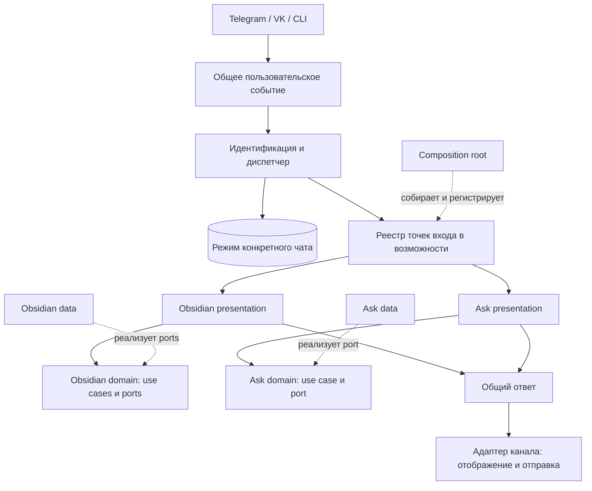

# ASSISTANT REBIRTH ROADMAP

Дата: 2026-09-30. Рабочая ветка: `codex/assistant-rebirth`.

Статус: этапы 0, 1 и шаги 2.1–2.5 завершены по автономным проверкам.
Шаг 2.6 запланирован, этап 3 не начат. Внешние интеграции требуют отдельной
проверки с рабочими credentials.

## Цель и границы

Превратить Knowledge Catcher в модульного личного ассистента. Существующая
работа со статьями и Obsidian становится одной подключаемой возможностью.
Второй возможностью будет независимый запрос к модели: один вопрос — один ответ.

Основной порядок работ:

1. Выделить существующую работу с Obsidian в отдельную возможность.
2. Перестроить архитектуру вокруг модулей с `data`, `domain`, `presentation`
   и общего диспетчера подключённых возможностей.
3. Добавить возможность «Вопрос — ответ к модели».
4. После проверки обеих возможностей обновить название проекта, Python-пакета
   и ботов; отдельно решить вопрос переименования GitHub-репозитория.

Перед переносом исходного кода обновить архитектурные правила `AGENTS.md`.
Каждый этап должен завершаться работоспособным приложением и проверками.

В этот переход не входят:

- напоминания, расписания, scheduler, универсальная очередь задач и outbox;
- история диалогов для LLM, память, персонализация и долгосрочный контекст;
- LLM-маршрутизация, автономное планирование и последовательности tool calls;
- новые функции Obsidian, включая редактирование заметок из произвольного диалога;
- динамическая установка плагинов и включение модулей без перезапуска;
- смена БД и платформы размещения production.

Существующий журнал сообщений, относящихся к статьям, остаётся внутри Obsidian.
Общий вход передаёт событие в выбранную возможность без обязательной записи
каждого сообщения в БД. Этот журнал не становится памятью модели. Имеющиеся
фоновые операции GitHub сохраняются; новый универсальный фоновый движок не
проектируется. Общая защита от повторной доставки событий вынесена в
[бэклог](BACKLOG.md#идемпотентная-обработка-входящих-событий-в-ядре).

## Целевая структура

```text
obs_chat_bot/
  core/
    domain/                    # Пользователи, identities, общие use cases и ports
    data/                      # Пользователи, активный режим чата, конфигурация, SQLite
    presentation/              # События, входы в возможности, диспетчер, справка

  capabilities/
    obsidian/
      domain/
        entities/              # Статьи, vault, заметки, proposals
        use_cases/             # Анализ, поиск, sync, review, подтверждение
        ports/
      data/
        sqlite/
        github/
        llm/
        http/
        extraction/
        chunking/
        embeddings/
      presentation/            # Команды, обработчики и ответы Obsidian
      bootstrap.py             # Сборка этой возможности

    ask/
      domain/
        use_cases/
        ports/
      data/
        llm/
      presentation/            # /ask и оформление результата
      bootstrap.py

  presentation/
    telegram/                  # Протокол Telegram и отображение общих ответов
    vk/                        # Протокол VK и отображение общих ответов
    cli/                       # Точка запуска и CLI-входы

  bootstrap.py                 # Сборка приложения и подключение возможностей

document_chunker/              # Существующая независимая библиотека
```

`obs_chat_bot` здесь обозначает текущее имя пакета для этапов 1–3. После
проверки новой структуры пакет переименовывается на этапе 4; окончательное
имя выбирается до начала этого этапа.

Это схема ответственности, а не требование создать каждый каталог заранее.
Простой модуль может хранить use case и port в отдельных файлах непосредственно
в `domain`. Общие части выделяются только при реальной общей ответственности.

`domain` включает модели, правила, use cases и ports. Он не импортирует
`data`, `presentation`, SDK, SQL или конфигурацию окружения. `presentation`
вызывает use cases, `data` реализует ports. Конкретные реализации связываются
в composition root за пределами чистых слоёв.

Диспетчер и контракты входа в возможности принадлежат `core/presentation`.
Ядро распознаёт общие команды и команду входа, а все остальные сообщения
передаёт активной возможности. Внутри неё находятся собственные команды,
ссылки, подтверждения и правила обычного текста. Ядро не импортирует конкретные
возможности; их регистрирует composition root. Универсальная идентификация
пользователя остаётся в `core/domain`.

Активный режим хранится для пары «внутренний пользователь + конкретный чат
канала»: один и тот же связанный пользователь может одновременно находиться
в Obsidian в Telegram и в другом режиме во VK. Это состояние маршрутизации,
которое переживает перезапуск процесса, а не история диалога для LLM.

Одна SQLite-БД допустима. Каждая возможность владеет своими таблицами, DTO,
mapper-функциями и repositories; другая возможность не читает их напрямую.
Подключение SQLite и последовательность инициализации схемы могут быть общими.
Для этого этапа сохраняется единая начальная SQL-схема; отдельный механизм
миграций для каждой возможности не нужен. Отключение возможности не удаляет данные.
Это правило относится к development-БД. Изменённая начальная схема сама по себе
не обновит уже развёрнутую production-БД. Для этого перехода пользователь
разрешил пересоздать production-БД без переноса данных. Это выполняется только
при отдельном развёртывании после остановки процессов, использующих БД.



## Этап 0. Подготовить правила перехода

- [x] Полностью перечитать `AGENTS.md` перед задачей с исходным кодом и проверить
  рабочую ветку и состояние файлов. Работать в `codex/assistant-rebirth`.
- [x] Обновить раздел «Архитектурные правила» в `AGENTS.md`:
  - основная единица организации — модуль/возможность;
  - внутри модуля используются `domain`, `data`, `presentation`;
  - use cases и ports располагаются в `domain`;
  - отделить адаптеры каналов от presentation конкретных возможностей;
  - хранить активный режим отдельно для каждого чата и передавать сообщения
    выбранной возможности без анализа их предметного содержания в ядре;
  - зафиксировать зависимости, владение данными и регистрацию в composition root;
  - сохранить требования к DTO, явным mapper-функциям и наследованию от Protocol;
  - запретить прямой доступ к внутренним таблицам и реализациям другого модуля;
  - ядро не должно зависеть от конкретных возможностей.
- [x] Описать временное правило перехода: на этапе 1 разрешены и прежние общие
  каталоги со слоем `application`, и `application` внутри выделяемого модуля.
  На этапе 2 сценарии и ports переходят в `domain`, прежние каталоги удаляются,
  а переходное исключение убирается из `AGENTS.md`.
- [x] Сохранить правила Git, русских docstrings, запуска, development-БД и доступа
  к production. Если путь начальной схемы изменится, обновить его одновременно
  в коде, документации и `AGENTS.md`.
- [x] Зафиксировать исходное состояние автоматических тестов и доступных smoke-
  проверок в [baseline](ASSISTANT_REBIRTH_BASELINE.md). Отдельно записать
  существующие сбои и проверки, требующие внешних API.

Критерий готовности: новые правила явно разрешают согласованную архитектуру и
промежуточный этап переноса; существующее поведение ещё не изменено.

## Этап 1. Выделить Obsidian в отдельную возможность

Задача этапа — провести границу модуля и сохранить текущий пользовательский
сценарий. Общий диспетчер и новая семантика регистрации вводятся на этапе 2.

- [x] Составить [карту переноса](ASSISTANT_REBIRTH_STAGE1_MAP.md) текущих
  `articles`, `vaults`, `search`, `reviews` и связанных data-реализаций в
  `capabilities/obsidian`.
- [x] Включить в возможность весь существующий процесс: загрузку и извлечение
  статьи, анализ, подключение GitHub, выбор vault, синхронизацию, индексацию,
  поиск, подготовку proposal, подтверждение и write-back.
- [x] Перенести use cases и ports сначала с сохранением внутреннего
  `application`, чтобы отделить выделение модуля от изменения границ слоёв.
- [x] Вынести универсальную идентификацию пользователя и связи каналов из
  ответственности статей. Общий вход принимает транспортно-независимое
  событие, но не обязан сохранять каждый запрос.
- [x] Оставить `incoming_messages`, `processing_errors`, их `article_id`, DTO
  и repositories внутри Obsidian: они описывают существующий процесс статьи.
  Ядро не импортирует эти модели и не обращается к их таблицам. Сам перенос
  файлов не требует изменения схемы сообщений.
- [x] Разделить `ProcessIncomingMessageUseCase`: вынести Obsidian-сценарии и их
  ответы в модуль. Оставшийся входной обработчик вызывает публичный вход модуля.
- [x] Перенести Obsidian-команды и форматирование их результатов в presentation
  возможности. Общие команды профиля и связывания каналов оставить вне неё.
- [x] Выделить сборку зависимостей Obsidian в его `bootstrap.py`; главный
  composition root вызывает эту сборку. Общую конфигурацию и SQLite lifecycle
  не дублировать.
- [x] Обновить imports, callers, CLI и тесты. Удалять старые публичные пути
  после переноса, не оставляя wrappers для поддержки прежних импортов тестов.
- [x] Сохранить работу `document_chunker` как независимой библиотеки и её adapter
  внутри Obsidian. Перенос файлов сам по себе не требует пересоздания БД.

Принятые решения для реализации этапа 1:

- Сначала закрепить границу данных, затем переносить use cases, общий вход,
  presentation и сборку; в Obsidian временно допустим `application`.
- Шаг 2 (2026-10-04): предметные модели `articles`, `vaults`, `search`,
  `reviews`, все Obsidian SQLite DTO, mapper-функции, repositories и внешние
  adapters физически перенесены в `capabilities/obsidian/{domain,data}`.
  Общие `domain/users`, SQLite connection/migration lifecycle,
  `user_identity_repository` и `data/config.py` остаются на прежнем месте.
  Для `processing_errors` добавлен явный mapper из параметров recorder в DTO;
  для proposals введены отдельный DTO и mapper-функции вместо прямого
  преобразования SQLite row в domain-модель.
  Старые пути удалены, вызывающие модули и тесты переведены на новые импорты;
  SQL-схема и `data/app.db` не изменялись. Полный unittest: 411 тестов успешно;
  SQLite, pipeline и analysis smoke прошли.
  Разделение общего входа от Obsidian-журнала остаётся отдельным шагом.
- Шаг 3 (2026-10-04): все сценарии, ports и вспомогательные модели
  `application/{articles,vaults,search,reviews}` физически перенесены в
  `capabilities/obsidian/application/` без совместимых wrappers. Это сохраняет
  временный слой `application` до этапа 2 и даёт data adapters, сборке,
  обработчику входа, каналам, CLI и тестам единый путь импортов. Смешанную
  модель `IncomingMessage` перенесли вместе с article flow без изменения
  контракта; разделение общего события и журнала относится к шагу 4.
  `document_chunker` остаётся независимой библиотекой, SQLite-схема и рабочая
  БД не менялись. Полный unittest: 411 тестов успешно; SQLite, pipeline и
  analysis smoke прошли.
- Шаг 4 (2026-10-04): общий `IncomingEvent` содержит только текст и адрес
  канала; он не несёт `app_user_id`, `article_id` и поля SQLite-журнала.
  `ProcessIncomingMessageUseCase` отвечает за identity, общие команды,
  onboarding и приоритет rebind, затем передаёт идентифицированного
  пользователя и событие через `IncomingCapabilityPort` в
  `ObsidianMessageHandler`. Вся обработка URL, GitHub/vault, proposal и
  подтверждений возможности находится в `capabilities/obsidian/presentation/`.
  Предметная модель `ArticleIncomingMessage` и `SavedIncomingMessage` остаётся
  внутри Obsidian; запись в `incoming_messages` выполняется только для article
  pipeline. Общий результат больше не содержит моделей статьи, vault или
  proposal. Для onboarding возможность возвращает нейтральный `OnboardingState`.
  Сохранены формат ответов, приоритет rebind, фоновый callback и каналы.
  На шаге 5 предстоит перенести предметное форматирование и разделить реестр
  команд/типов результата; прямое использование article URL extractor для
  раннего ack в Telegram/VK остаётся временным до этого шага. Полный unittest:
  415 тестов успешно; SQLite, pipeline и analysis smoke прошли. SQL-схема и
  рабочая БД не менялись.
- Шаг 5 (2026-10-04—2026-10-06): `ObsidianCommand`, `ObsidianResultType` и форматирование
  GitHub/vault/article/proposal перенесены в `capabilities/obsidian/presentation/`.
  Общий реестр и formatter содержат только регистрацию, профиль, связывание
  каналов и нейтральные поля справки/onboarding. Для сохранения прежних текстов
  возможность отдаёт общему входу готовые onboarding-подсказки, разделы `/help`
  и подсказку пустого подтверждения. Composition root преобразует оба типа
  результата в `IncomingResponse(text, error)`; Telegram/VK получают только этот
  нейтральный ответ, а фоновый callback преобразуется до отправки в исходный чат.
  Раннюю квитанцию определяет инъецированный предикат Obsidian, без импорта URL
  extractor каналами. Сообщение при отсутствии текста также передаётся каналам
  из сборки возможности, сохраняя прежний текст. Режимы/диспетчер этапа 2 не
  вводились. Полный unittest: 421 тест успешно; SQLite, pipeline и analysis
  smoke прошли. SQL-схема и рабочая БД не менялись.
- Шаг 6 (2026-10-06): предметные фабрики HTTP, extraction, LLM, GitHub,
  vault, search, review и SQLite repositories перенесены в
  `capabilities/obsidian/bootstrap.py`. Он собирает публичный вход для одного
  сообщения и процессные GitHub gateway/coordinator для всего запуска бота.
  Общий `bootstrap.py` собирает identity, открывает отдельное соединение на
  сообщение и подключает вход Obsidian через общий контракт. CLI вызывает
  общую сборку; `--process-url` получает нейтральный отчёт, а автономные
  smoke-сценарии перенесены в возможность. Старые функции сборки и путь
  `presentation/cli/smoke.py` удалены; тесты обновлены. Полный unittest:
  423 теста успешно; SQLite, pipeline, analysis smoke и healthcheck на
  временной БД прошли. Схема и рабочая БД не менялись.
- Шаг 7 (2026-10-06): сквозная автономная регрессия подтвердила границу
  Telegram/VK/CLI, article pipeline, поиск, vault и proposal. Добавлены тесты
  повторного захвата истёкшего SQLite claim новым процессным store, запуска
  новой попытки Device Flow новым coordinator после утраты процесса и TTL, записи
  installations фоновым worker после закрытия входного соединения и доставки
  двух VK callback в исходные peer. Полный unittest: 427 тестов успешно;
  SQLite, pipeline, analysis smoke и healthcheck на временной БД прошли.
  Поиск старых импортов и зависимостей чистых слоёв от `data`/`presentation`,
  `git diff --check` нарушений не выявили. Схема и рабочая БД не менялись.
  Живые Telegram/VK, GitHub Device Flow, sync/write-back, загрузка внешней
  статьи и LLM/embeddings API не запускались без credentials и тестового vault;
  их поведение подтверждено только автономными тестами с fake-зависимостями.
- Device Flow session с challenge и callback хранится только в памяти процесса.
  Перезапуск утрачивает прежнюю session; SQLite claim до истечения TTL мешает
  новому запуску. После TTL можно начать новую попытку, но нельзя возобновить
  прежнюю авторизацию или доставить её прежний callback.
- Общее пользовательское событие отделить от журнала `incoming_messages`;
  журнал, `processing_errors` и все `github_*` таблицы принадлежат Obsidian.
- Общий вход сохраняет регистрацию, идентификацию и приоритет rebind;
  Obsidian владеет подтверждениями vault/proposal, URL и своими командами.
  Публичный вход модуля нужен уже на этапе 1, реестр режимов — на этапе 2.
- Сохранить единую начальную SQL-схему и общие SQLite connection/migration
  lifecycle. GitHub background flow продолжает пользоваться отдельными
  соединениями и межпроцессным claim; callback возвращает ответ в исходный чат.
- Перенести форматирование Obsidian из общего formatter; Telegram/VK и CLI
  должны вызывать общий контракт, не импортируя внутренние модели возможности.

Критерии готовности:

- [x] Telegram/VK и CLI выполняют существующий Obsidian-сценарий через выделенный
  модуль, без копирования бизнес-логики в адаптеры каналов.
- [x] Фоновое завершение GitHub Device Flow в живом процессе возвращает ответ
  в исходный канал; отдельное SQLite-соединение фоновой операции и координация
  между Telegram/VK-процессами проверены автономными тестами. После перезапуска
  in-memory session теряется; тест подтверждает возможность начать новую
  попытку после истечения TTL SQLite claim, а не восстановление прежней.
- [x] Сохранены изоляция пользователей, обработка дубликатов статей, FTS fallback,
  leases, preview, явное подтверждение, проверка SHA и обработка конфликтов записи.
- [x] Проходят существующие тесты обработки статей, vault, поиска, proposals,
  repositories и сценариев обоих каналов с обновлёнными импортами.
- [x] В документации отражена фактическая промежуточная структура.

## Этап 2. Перестроить приложение вокруг режимов возможностей

### 2.1. Завершить переход на три слоя

- [x] Перенести use cases и ports из `application` в `domain` соответствующих
  модулей. Проверить чистоту зависимостей; перенос не должен занести SDK или
  конкретные repositories в `domain`.
- [x] Оставить общую модель пользовательского события без `article_id` в
  `core/presentation`; её преобразование в модель обработки статьи принадлежит
  Obsidian. Не вводить общий repository входящих сообщений для `/ask`.
- [x] Собрать общую идентификацию, конфигурацию, события и диспетчер в `core`
  согласно их ответственности. Удалить прежние каталоги и импорты `application`.
- [x] Добавить хранение активного режима по `app_user_id`, каналу и ID чата.
  Сохранять только ID возможности и необходимые технические данные перехода;
  предметное состояние сценария остаётся внутри возможности. Режим должен
  восстанавливаться после перезапуска любого из Telegram/VK-процессов.
- [x] Сохранить отдельные DTO и mapper-функции внутри `data` модулей.
- [x] Удалить временное архитектурное исключение из `AGENTS.md`.

Результат шага 2.1 (2026-10-06): общие части находятся в `core`, use cases и
ports — в `domain` своих модулей; прежние каталоги `application`, общие
`domain` и `data` удалены без wrappers. YAML-разбор правил vault вынесен в
Obsidian data с DTO/mapper, статический пример — в presentation. Пользователи
и активный режим также проходят отдельные SQLite DTO и mappers.
Общий вход называется `IncomingMessageDispatcher` и принадлежит presentation.

Минимальная граница до шага 2.2: composition root внедряет единственный вход
и его ID; при первом предметном сообщении сохраняется прежний default Obsidian.
`active_chat_modes` атомарно хранит `(app_user_id, channel, chat_id)` и ID
возможности; неизвестный сохранённый ID остаётся на месте и блокирует
предметную передачу нейтральным ответом. Реестр, новые команды, вход/выход,
адресные подтверждения и конфигурация включения возможностей не реализованы.
Существующий onboarding и приоритет rebind сохранены.

Проверка: 436 unittest успешно; SQLite, pipeline, analysis smoke и healthcheck
на временной БД прошли. Новые тесты подтверждают изоляцию чатов, чтение после
закрытия соединения и создания нового диспетчера, гонку двух SQLite-соединений,
подключение хранилища реальным bootstrap и чистоту domain/core. Изменённая
начальная схема не обновляет ранее созданную БД: её пересоздание требуется
перед отдельным запуском. Рабочая БД и VPS не изменялись; живые внешние API
не проверялись.

### 2.2. Ввести контракты и реестр точек входа

- [x] Определить минимальные типизированные контракты:
  - пользовательское событие с источником, внешней идентичностью и адресом ответа;
  - контекст обработчика с проверенным внутренним пользователем;
  - описание возможности с устойчивым ID, командой входа и справкой;
  - обработчики `enter(сообщение)` и `handle(сообщение)`; результат сообщает,
    остаётся ли чат в режиме или сценарий логически завершён;
  - общий ответ: содержимое и, когда нужны, адресные действия подтверждения;
  - способ отправить последующий общий ответ в сохранённый адрес канала после
    фонового завершения GitHub Device Flow, без Obsidian-логики в TG/VK-адаптерах.
- [x] Обработчики возможности вызывают domain use cases и переводят их результаты
  в общий ответ. Не расширять общий результат полями всех предметных областей.
- [x] Регистрировать возможности явно в composition root, по конфигурации
  запуска. Реестр не должен искать плагины в файловой системе.
- [x] Проверять уникальность ID возможностей и команд входа при сборке;
  конфликт приводит к понятной ошибке запуска. Для каждой включённой
  возможности указать её команду входа и способ выхода в общей справке.
- [x] Зарезервировать общие команды `/help`, `/exit`, команды профиля и команды
  входа в возможности. После идентификации пользователя они обрабатываются
  до активного режима; всё остальное получает presentation активной возможности.
- [x] `/exit` очищает режим конкретного чата, не удаляя предметные данные и
  ожидающие операции. При повторном входе возможность показывает их актуальное
  состояние. Успешный переход в другой длительный режим меняет активный режим
  только этого чата. Одноразовая возможность выполняется и возвращает чат в
  прежний режим. Сбой входа оставляет прежний режим без изменений.
- [x] Если режим не выбран, обычный текст и ссылка дают подсказку о доступных
  возможностях; не запускать Obsidian или LLM по содержимому сообщения.
- [x] Если сохранённый режим относится к отключённой возможности, ядро выдаёт
  понятное сообщение и предлагает `/exit` или другую доступную возможность;
  отключение модуля не удаляет его данные.

Проверки шага 2.2: общий реестр и маршрутизация, конфликты ID/команд,
изоляция чатов, восстановление SQLite, one-shot и ошибочный вход, отключение
Obsidian без удаления статьи, fake-возможность через настоящие адаптеры TG/VK,
последующие общие ответы и Device Flow после закрытия исходного соединения.
`/obsidian` пока принимает только вход без аргумента. Первое сохранение имени
по-прежнему переводит этот чат в прежний Obsidian onboarding через отдельный
временный контракт; отделение регистрации остаётся в 2.3. Общий тип адресных
действий введён, новый сценарий подтверждений из 2.4 ещё не реализован.
`ENABLED_CAPABILITIES` выбирает включённые входы; обязательность credentials и
healthcheck ещё не разделены (2.5). Схема SQLite в 2.2 не менялась.

### 2.3. Отделить профиль от Obsidian

- [x] Завершать регистрацию созданием профиля и заданием имени. Подключение
  GitHub/vault становится самостоятельным действием Obsidian-возможности.
- [x] Добавить `/obsidian [текст или URL]` как точку входа. Аргумент передаётся
  Obsidian вместе с событием входа; без аргумента возможность объясняет свои
  действия и при необходимости предлагает подключить vault.
- [x] Сохранить внутри режима Obsidian обработку ссылок на статьи, GitHub URL,
  `да`/`нет` и существующих `/github_status`, `/github_sync`,
  `/github_disconnect`, `/reanalyze`. Вне режима голая ссылка не запускает
  Obsidian и получает подсказку о `/obsidian`.
- [x] Разделить ошибки: возможность отключена, провайдер не настроен, vault
  пользователя не подключён. Проверки vault выполняются только внутри Obsidian.
- [x] Обеспечить работу профиля и общих команд при отключённом Obsidian.

Профиль завершается сохранением имени без выбора режима и без чтения vault.
Временные `ProfileSetupPort`, `OnboardingState` и ответы регистрации Obsidian
удалены. `/start`, повторный `/register`, `/name`, `/status`, `/link_code`,
`/link` и `/help` остаются общими командами. Они доступны и при пустом списке
возможностей.

`enter(context, event, arguments)` получает исходное событие и отдельно текст
после команды входа. Obsidian разбирает аргумент своим presentation, сохраняет
исходные метаданные/текст в журнале статьи и использует общий адрес доставки.
Ошибочный аргумент не заменяет прежний режим. Внутренние команды, article URL,
GitHub URL и прежние подтверждения `да`/`нет` остаются внутри выбранного режима.

Отключённые входы передаются ядру из composition root только как общие
`CapabilityDescriptor`; конкретных Obsidian ID и команд в core нет. Отличаются
ответы об отключённой возможности, ненастроенном GitHub/LLM-провайдере и
неподключённом пользовательском vault. При пустой обязательной LLM-конфигурации
сборка входа не создаёт LLM adapters. Это минимальная граница шага 2.3:
разделение групп конфигурации, startup-валидации и healthcheck остаётся в 2.5.
На момент завершения 2.3 адресный confirmation flow ещё не был реализован;
его реализация описана в следующем шаге.

Проверено 467 автономных тестов, включая регистрацию без vault во всех каналах,
профиль при отключённом Obsidian, отсутствие проверок vault в общих командах,
аргумент входа с исходным событием, изоляцию режимов, ошибки аргумента и
различение disabled/no-provider/no-vault. Старый fake Device Flow/article/review
flow сохранён. Telegram/VK adapters и CLI используют общий обновлённый контракт.
Схема не менялась; рабочая БД, production и живые API не использовались.

### 2.4. Ограничить ожидания областью конкретной операции

Шаг реализован 2026-10-07. Правило «завершить начатое в исходном чате» относится
к конкретному интерактивному действию и не блокирует остальные чаты профиля.
Адресная команда содержит модуль, тип операции, неизменный ID, версию и решение:
`/confirm obsidian <proposal|replace|disconnect> <id> <version> <yes|no>`.
Для identity ядро использует `/confirm core identity <id> <version> <yes|no>`.

- [x] Перенести состояние onboarding GitHub и подтверждений Obsidian в модуль,
  а подтверждения привязки и переноса identity оставить в общем ядре. Простое
  `да`/`нет` внутри Obsidian относится только к Obsidian; операции профиля
  подтверждаются адресной общей командой или действием.
- [x] Pending-действие Obsidian сохраняет владельца `app_user_id` и исходный
  адрес `(channel, chat_id)`. Продолжение, подтверждение и отмена доступны только
  в том же исходном чате. Другой связанный чат, включая другой чат того же
  канала, не показывает чужой pending, не получает его действия и продолжает
  собственные сценарии. Только попытка подтвердить, отменить или продолжить
  чужое действие получает короткий отказ с указанием завершить его в исходном
  чате, без раскрытия содержимого.
- [x] Разрешить разным статьям одного `app_user_id` независимо проходить
  fetch, analysis и review из Telegram/VK и иметь разные pending proposals.
  Удалить общий unique-индекс pending proposal на пользователя и глобальное
  блокирование article flow ожиданием другой статьи; обновить repositories,
  ports и callers для выбора конкретной операции и её исходного чата.
  Повторная отправка той же статьи использует dedup по пользователю и
  нормализованному URL, не создаёт дубликат статьи или конкурирующий proposal
  для того же цикла обработки.
- [x] `/exit` очищает режим текущего чата без отмены pending. Повторный вход
  в Obsidian в исходном чате показывает актуальное ожидание. Pending не блокирует
  общие команды профиля и переключение режима. Режимы связанных чатов
  независимы; команды профиля доступны из каждого из них.
- [x] Адресовать подтверждение конкретной операции: передавать ID возможности,
  тип операции, устойчивый ID ожидающей записи и выбранное решение. Для
  подтверждений с TTL проверять также срок действия. При исполнении повторно
  проверять внутреннего владельца, совпадение исходного `(channel, chat_id)`,
  актуальный статус и версию операции; изменение статуса и захват выполнения
  делать атомарно.
  В исходном чате действие обрабатывается только в режиме Obsidian;
  иначе пользователь получает подсказку снова войти в возможность.
  Сохранить межпроцессную координацию Telegram/VK.
- [x] Оставить текстовые `да`/`нет` внутри Obsidian для однозначно определённой
  pending-операции именно текущего `(channel, chat_id)`; при нескольких
  ожиданиях в этом чате требовать ID операции внутри режима. Ожидания других
  чатов не участвуют в выборе и не делают локальный ответ неоднозначным.
  Старый ответ после замены ожидающей операции не должен подтвердить новую.
  Повторное подтверждение не применяет изменение второй раз; подтверждение
  из другого связанного чата отклоняется без раскрытия содержимого pending.
  Достаточно адресной текстовой команды, если канал не предоставляет
  удобную кнопку.
- [x] Сохранить ограничения общих ресурсов: одна активная конфигурация vault
  на пользователя; replace/disconnect этой конфигурации взаимно исключаются
  и не перезаписывают чужое ожидание. Для конфликтующей операции показывать
  короткое объяснение занятого ресурса без чужого pending. Device Flow
  сохраняет один межпроцессный claim на пользователя, не блокируя независимые
  сценарии, которым текущая авторизация не нужна.
- [x] Синхронизация и write-back одного vault выполняются последовательно
  под общим SQLite lease с повторным SHA preflight. Два предложения записи
  могут независимо ожидать решения в разных чатах, но не записываются
  одновременно. Занятый lease не отменяет независимый pending; устаревший
  proposal получает `conflict` и требует пересчёта с новым явным подтверждением.
  Это координация ресурса, без универсальной очереди задач.
- [x] Не вводить для этого историю разговоров или универсальную машину диалогов.
  Существующая связь proposal со статьёй остаётся: новые источники изменений
  заметок в данный план не входят.

Проверено 481 автономным тестом, включая 16 интеграционных проверок шага
на временных SQLite-БД: независимые TG/VK и чаты одного канала, несколько
локальных pending, чужие адреса и владельцы, выход/повторный вход, нормализованный
URL и конкурирующий article flow, атомарный claim и повторные решения,
конкурирующие записи и настоящий sync под общим lease, SHA conflict с новым
review, взаимоисключение replace/disconnect, TTL, неизменные identity ID и версии.
Device Flow проверен отдельными тестами на один claim и отсутствие чужого challenge.
Схема изменена в `0001_initial_schema.sql`: перед запуском со старой development-БД
нужно пересоздать её по `AGENTS.md`. Рабочая БД, production и живые API не использовались.

### 2.5. Разделить конфигурацию и проверки готовности

- [x] Проверять настройки только выбранных каналов и включённых возможностей.
  Отключённый Obsidian не создаёт GitHub/embedding/Obsidian LLM-клиенты и не
  требует их ключей. Общие команды должны запускаться без LLM.
- [x] Зафиксировать поведение включённой возможности при неполной конфигурации:
  либо отказ запуска с явным указанием отсутствующей настройки, либо доступная
  команда с конкретной ошибкой провайдера. Сохранить существующие опциональные
  части Obsidian, включая FTS fallback при отсутствии embeddings.
- [x] Сделать healthcheck зависимым от выбранной конфигурации; ошибки одной
  функции не должны маскироваться общим сообщением об отсутствии vault.
- [x] Обновить CLI, scripts и сборку контейнеров под новые импорты и настройки.
  Убрать безусловную подстановку `OPENAI_API_KEY` из `EMBEDDING_API_KEY` в
  `docker-compose.yml`, чтобы профиль Ask не зависел от embeddings Obsidian.
  Сохранить привычные команды запуска проекта.

Результат шага 2.5 (2026-10-07): `ENABLED_CHANNELS` выбирает каналы для scripts
и общего healthcheck; bot-флаг и `--channels` ограничивают текущую проверку.
Отключённый Obsidian не читает даже некорректные настройки своих провайдеров,
chunking/tag и не создаёт клиентов. Полностью пустые GitHub/LLM-группы допускают
запуск общих команд, Obsidian возвращает конкретную ошибку провайдера.
Частичные или невалидные включённые группы блокируют startup до polling.
Отсутствие embeddings сохраняет FTS fallback. Healthcheck выводит отдельные
результаты каналов/провайдеров/SQLite и не читает пользовательский vault.

Compose больше не подставляет LLM key из embedding key; контейнерные healthcheck
выбирают собственный канал. Scripts сохраняют прежние команды и debug-режим,
выбирают сервисы из Compose-конфигурации и прерываются при ошибке Docker.
`--process-url` использует только общие настройки, smoke — временные БД без `.env`.

Проверено 493 автономных unittest, включая 12 новых тестов с матрицами
startup и healthcheck «TG/VK × Obsidian включён/выключен ×
пустая/корректная/неверная конфигурация», неполные группы, unsafe URLs,
непригодный PEM, отдельную диагностику, профиль без LLM и FTS composition.
SQLite/pipeline/analysis smoke прошли отдельно. Compose config и синтаксис
PowerShell проверены; все scripts выполнены с подменным Docker для проверки
выбора сервисов и отказа при ошибках. Docker Engine недоступен в текущей
сессии, поэтому фактическая сборка образа и runtime контейнеров не проверены.
Схема не менялась; рабочая БД, production и live API не использовались.

Критерии готовности:

- [x] Obsidian включается/отключается при запуске; отключение скрывает его команды
  и оставляет данные в БД. Повторное включение использует сохранённые данные.
- [x] Простая тестовая возможность с точкой входа, обработкой сообщения и
  завершением режима регистрируется без изменений ядра и адаптеров TG/VK.
- [x] Одинаковая команда входа из TG/VK запускает один сценарий; реестр
  обнаруживает конфликты и корректно формирует справку.
- [x] Проверена матрица «канал × включённая возможность ×
  корректная/отсутствующая конфигурация». Некорректные настройки
  отключённой возможности не мешают запуску выбранного набора функций.
- [x] Проверена изоляция режимов по чатам: вход в Obsidian в Telegram не
  переводит связанный VK-чат в Obsidian, и наоборот. Перезапуск процесса
  восстанавливает режим; `/exit` очищает только текущий чат.
- [x] Внутри Obsidian одинаково работают в TG/VK адресное действие, URL статьи,
  GitHub URL, простое `да`/`нет` и внутренние команды. Вне Obsidian эти ссылки
  не запускают сценарий; неизвестная slash-команда не становится URL или
  LLM-запросом. Пустой ввод вне режима не подсказывает статью.
- [x] Пользователь без vault пользуется общими командами. Ожидающий proposal
  или перенос identity не блокируют команду входа в другую возможность.
- [x] Разные статьи из связанных TG/VK-чатов независимо проходят fetch,
  analysis и review, сохраняют разные pending proposals одного пользователя
  и подтверждаются каждая в своём исходном чате. Вход и обработка статьи
  в другом чате не показывают чужой pending и не блокируются им. Повторная
  отправка той же статьи проверена через dedup без дубликата статьи/proposal.
- [x] При нескольких pending в текущем чате простое `да` не выполняет ни одного
  из них и требует ID; одно локальное ожидание допускает `да`/`нет`, даже если
  в другом чате есть своё. Адресное подтверждение старой операции не применяет
  новую. Проверено
  повторное и конкурирующее подтверждение в исходном чате, а также отклонение
  подтверждения/отмены из другого связанного TG/VK-чата и другого чата того же
  канала: только такая попытка получает короткий отказ без содержимого pending.
  После `/exit` и повторного входа
  исходный чат видит актуальное ожидание; общие команды и смена режима доступны.
- [x] Проверены реальные конфликты общих ресурсов между TG/VK: взаимоисключение
  replace/disconnect единственного vault без подмены ожидания, один Device Flow
  claim на пользователя, lease для конкурирующих sync/write-back. Два ожидающих
  write-back сохраняются независимо, запись выполняется последовательно;
  второй устаревший proposal получает `conflict` и пересчёт вместо перезаписи.
- [x] Проверены границы импортов: `domain` не зависит от инфраструктуры,
  ядро не импортирует конкретные возможности, адаптеры каналов не знают их
  сценарии, а одна возможность не импортирует внутренние модули другой.

### 2.6. Рефакторинг жизненного цикла возможностей

Приоритеты уточнены по двум независимым аудитам архитектуры и качества кода.
Реализация каждого пункта остаётся отдельной задачей; этап 3 не начат.

- [x] Собирать каждую включённую возможность и её долгоживущие зависимости один
  раз при запуске процесса, а не заново для каждого входящего сообщения.
  Диспетчер передаёт сообщение уже зарегистрированному обработчику выбранной
  возможности. Возможность сама открывает короткое соединение с SQLite и создаёт
  связанные с ним repositories только для операции, которой нужны её данные;
  общие команды не должны собирать Obsidian-обработчик. Ядро при необходимости
  по-прежнему читает identity и сохранённый режим чата до маршрутизации.
  Сохранить раздельные соединения для конкурентных и фоновых операций,
  межпроцессную координацию и независимое отключение возможности. Явно определить
  владение и закрытие долгоживущих HTTP/LLM-клиентов; не разделять между потоками
  mutable состояние одной операции. Проверить, что общие команды не создают
  Obsidian scope, а несколько сообщений переиспользуют один обработчик.
- [x] Усилить lease общего vault: продление либо fencing для долгого sync/write-back,
  проверка владения перед публикацией локальных Markdown, FTS, markers и SHA,
  а также перед внешней записью. После потери lease старый worker не должен
  менять состояние. Проверить задержку одного worker дольше TTL и захват lease
  другим процессом на временной SQLite-БД.
  Реализация 2026-10-08: локальные Markdown, instructions, chunks/FTS,
  embedding markers и source SHA проверяют владельца и продлевают lease внутри
  своей SQLite-транзакции. После долгого fetch старый worker останавливается.
  Захват lease, replace/disconnect и GitHub commit используют общий
  межпроцессный OS lock-файл конкретного vault; перед HTTP commit lease
  проверяется, а после ответа продлевается до освобождения lock. Lock-файл
  сохраняется после crash, OS lock освобождается автоматически. Другие vault
  продолжают писать в SQLite во время HTTP commit. Автономно проверены takeover
  после TTL, SHA preflight, задержанный commit, crash/retry и независимый vault
  на двух соединениях и в отдельном процессе. 504 unittest и SQLite, pipeline,
  analysis smoke прошли; рабочая БД, production и live API не открывались.
- [x] Сделать изменение режима чата версионным: поздний результат долгого
  `enter` или завершившегося `handle` не должен перезаписывать более свежий
  `/exit` либо вход в другую возможность. Сохранять ревизию и после очистки
  режима; проверить обе гонки с управляемой задержкой обработчика.
- [ ] Сделать регистрацию профиля и первую привязку identity атомарными:
  создание `app_user` вместе с `external_identity`, а погашение link-кода —
  вместе с созданием связи. При параллельных запросах не оставлять пустой
  профиль или погашенный без привязки код; проверить на двух SQLite-соединениях.
- [ ] Не блокировать весь VK Long Poll долгой операцией одного чата. Выполнять
  обработку в ограниченном числе workers с определённым порядком событий
  одного чата, ограничением накопления задач, обработкой ошибок и остановкой.
  Проверить, что задержанный запрос чата A не задерживает чат B.
- [ ] Вынести настройки Obsidian из `core/data/config.py` в data/configuration
  самой возможности; composition root собирает её только при включении.
  Оставить в core общие настройки каналов и список включённых возможностей.
  Перед Ask проверить, что его профиль настроек добавляется без предметных
  ветвей и полей Obsidian в ядре.
- [ ] Добавить общую границу ошибок для `handle` зарегистрированной возможности,
  как для `enter`: логировать неожиданную ошибку и возвращать безопасный ответ,
  не очищая режим и не повторяя автоматически действие с внешним эффектом.
  Проверить одинаковое поведение TG/VK на подменной возможности.

## Этап 3. Добавить возможность «Вопрос — ответ к модели»

- [ ] Создать `capabilities/ask` с `domain`, `data`, `presentation` и сборкой.
- [ ] В `domain` определить сценарий `AskQuestion` и port модели. Вход — один
  непустой вопрос; выход — текст ответа либо типизированная ошибка. Правило о
  фиксированной инструкции модели также принадлежит Ask, а не адаптеру канала.
- [ ] В `data` реализовать обращение к совместимому LLM API через этот port.
  Использовать отдельный профиль настроек Ask: модель, endpoint, credentials,
  timeout и ограничения объёма. Значения могут совпадать с Obsidian, но наличие
  его конфигурации не является условием работы Ask.
- [ ] В `presentation` добавить `/ask <вопрос>` как одноразовый вход в Ask.
  После ответа активный длительный режим чата остаётся прежним. Каждый вызов
  независим:
  отправляются текущий вопрос и фиксированная инструкция, без истории,
  материалов vault, результатов прошлых ответов и инструментов.
- [ ] На первом этапе обычный текст автоматически не отправлять в LLM.
  Сохранить `/ask` как явный вход; неизвестные команды не превращать в вопросы.
- [ ] Обработать пустой/слишком большой запрос, timeout, ошибку API и пустой
  ответ. Возвращать понятное сообщение, не раскрывая ключи или внутренний ответ API.
- [ ] Использовать существующие механизмы отправки длинных сообщений каналов.
  Для долгого запроса сразу показывать подтверждение приёма или индикатор
  обработки в Telegram/VK. Не добавлять обязательный streaming для первого варианта.
- [ ] Подключить возможность через реестр и добавить настройки в пример окружения,
  справку и документацию.

Критерии готовности:

- [ ] `/ask` работает в Telegram и VK после регистрации, без GitHub и vault.
- [ ] Два последовательных запроса независимы: во втором запросе к провайдеру
  отсутствуют первый вопрос и ответ. Это проверяется на подменном LLM port/client.
- [ ] `/ask` с URL не запускает обработку статьи; pending proposal не блокирует
  вопрос, а ответ модели не подтверждает изменение Obsidian. Если чат был в
  режиме Obsidian, после ответа `/ask` он остаётся в этом режиме.
- [ ] Проверены комбинации включения: только общие команды, только Obsidian,
  только Ask, обе возможности. Справка и обязательные настройки соответствуют им.
- [ ] Отключённый Ask не создаёт клиент, не вызывает API и отсутствует в `/help`.
- [ ] Добавление Ask не потребовало предметных ветвлений в ядре и TG/VK-адаптерах.

## Этап 4. Переименовать проект и внешние точки входа

Начать после проверки Obsidian и Ask в новой структуре. Сначала согласовать
одно новое имя проекта, техническое имя Python-пакета, отображаемые имена
Telegram/VK-ботов и, если потребуется, их публичные адреса. Проверить
доступность имён и ограничения каналов до изменения внешних настроек.

- [ ] Переименовать Python-пакет `obs_chat_bot`, импорты, `python -m ...`, имя CLI,
  Docker image и названия сервисов, если они видны пользователю или оператору.
  Обновить скрипты, тесты, пути к ресурсам и правила с путями в `AGENTS.md`.
- [ ] Обновить название и описания ботов в Telegram и VK, справку и
  пользовательские тексты. Отдельно решить, менять ли публичный адрес/username
  бота: новое отображаемое имя не требует смены существующей учётной записи.
  Изменить имя и описание также в настройках самих существующих учётных записей
  Telegram/VK и проверить их публичные профили. Сохранить токены и связи
  пользователей с действующими каналами.
- [ ] Проверить связанные с прежним названием элементы: GitHub App, URL
  установки, `.knowledge-catcher.yml`, служебный тег `knowledge-catcher`,
  переменные окружения и команды развёртывания. Для пользовательских данных
  выбрать осознанную политику совместимости или переноса; не менять формат vault
  одним лишь переименованием продукта.
- [ ] По выбранному имени отдельно подготовить переименование GitHub-репозитория:
  проверить ссылки в документации, `origin`, CI/CD, настройки GitHub App,
  deploy key, настройки развёртывания и внешние интеграции. Проверить systemd
  unit, backup timer и другие файлы VPS, которых нет в репозитории, по
  `docs/PRODUCTION.md`. Само изменение имени на GitHub,
  настройку remote и проверку доступности выполнить как отдельный шаг после
  согласования точного нового имени.
- [ ] Перед работой с production прочитать `docs/PRODUCTION.md` и соблюдать
  правила доступа. Не связывать локальный рефакторинг с незапланированным
  развёртыванием; `git push` выполнять только с явного согласия пользователя.

Критерии готовности:

- [ ] Код и документация используют выбранное название; импорт нового пакета,
  CLI, тесты и локальный запуск проходят проверку.
- [ ] Telegram и VK отображают новые имена, существующие пользовательские
  identities и работа Obsidian/Ask сохранены.
- [ ] Если GitHub-репозиторий переименован, новый `origin`, документация и
  связанные интеграции проверены. Если переименование отложено, оно явно
  остаётся отдельным пунктом бэклога.

## Завершение и проверки

- [ ] Выполнить полный набор автоматических тестов после завершения перехода.
  Тесты внешних ошибок и маршрутизации использовать с подменными зависимостями.
- [ ] Перед отдельным production-развёртыванием изменений схемы прочитать
  `docs/PRODUCTION.md`, остановить процессы, использующие SQLite, и пересоздать
  только файлы БД по новой начальной схеме. PEM и другие файлы в `data/` не
  удалять. Запланировать повторную регистрацию пользователей, привязку каналов,
  подключение GitHub/vault и синхронизацию: прежние данные, индексы и ожидающие
  подтверждения после пересоздания будут утрачены. Проверить запуск и новый
  пользовательский сценарий на чистой production-БД.
- [ ] Выполнить применимые healthcheck, SQLite, pipeline и analysis smoke-проверки
  по правилам запуска из `AGENTS.md`. `check-all` не заменяет полный набор тестов.
- [ ] Проверить реальный ответ Ask в доступных настроенных каналах и существующий
  Obsidian flow на тестовом vault; внешние непроверенные сценарии явно перечислить.
- [ ] Обновить `README.md`, `ARCHITECTURE.md`, `RUN.md`, `SETUP.md`, `DECISIONS.md`,
  `BACKLOG.md` и при завершении задач `HISTORY.md`. Старые идеи бэклога не считать
  обязательными компонентами нового ассистента.
- [ ] Проверить отсутствие старых импортов, неиспользуемых wrappers и глобальных
  настроек, которые требуют отключённые возможности.
- [ ] Сверить конечную структуру с `AGENTS.md` и отметить выполненные пункты roadmap.

Git-коммиты можно делать по логически завершённым шагам с русскими сообщениями.
Push требует отдельного явного согласия пользователя. Работы на production VPS
в этот план реализации не включены; перед отдельной задачей развёртывания
обязательно прочитать `PRODUCTION.md`. Разрешение пересоздавать development-БД
не распространяется на production. При чистом переносе кода БД не очищается.

Итог готовности: ассистент собирается из общего ядра и двух независимо включаемых
возможностей. Obsidian сохраняет свой рабочий процесс, Ask выполняет независимые
запросы к модели, а подключение новой команды не требует изменений каналов связи.
Название проекта и ботов соответствует его новому назначению.
