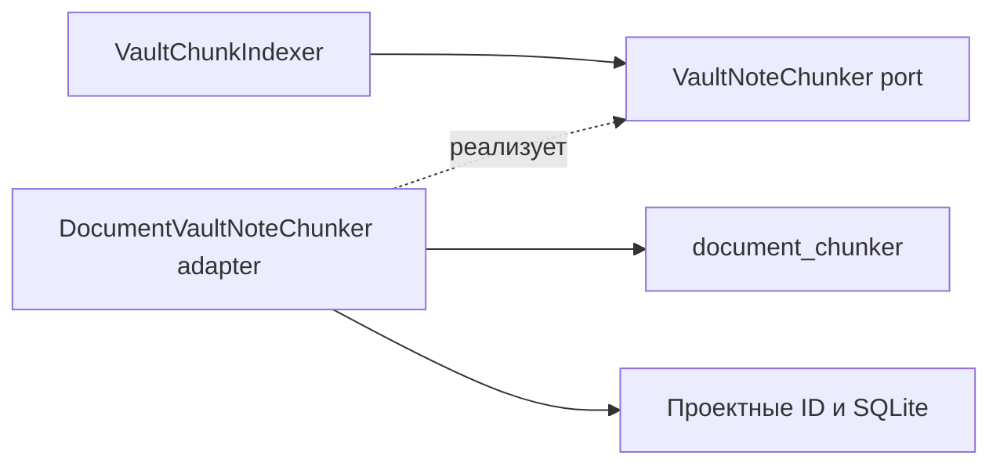

# Document chunker: граница библиотеки и приложения

Статус: библиотека, SQLite persistence и инкрементальная индексация реализованы
в подэтапах 10.1–10.2; FTS5, embeddings и hybrid search также реализованы.

Этот документ объясняет, какие данные получает независимая библиотека разбиения,
что она возвращает и где приложение добавляет свои ID и индексы. Настройки
локального запуска — в [RUN.md](RUN.md#настройки-document-chunker), история
реализации RAG и write-back — в [ARCHITECTURE.md](ARCHITECTURE.md).

## Результат и пределы

Создать детерминированный инструмент, который разбирает структурированный текст
на стабильные chunks. Один и тот же документ, parser и policy должны давать один
и тот же результат без обращения к LLM, SQLite, GitHub или сети.

Библиотека допускает другие форматы, но сейчас реализован только parser
Markdown/Obsidian. Другие форматы добавляются при появлении реального
потребителя.

## Размещение и границы

На первом этапе библиотека остаётся отдельным Python-пакетом внутри текущего
репозитория:

```text
document_chunker/
├── __init__.py
├── core/
│   ├── models.py
│   ├── ports.py
│   ├── policy.py
│   ├── engine.py
│   ├── assembler.py
│   └── hashing.py
└── formats/
    └── markdown/
        ├── parser.py
        └── normalizer.py
```

Отдельный repository или публикация в PyPI откладываются до появления второго
потребителя. Пакет не импортирует `compadre_assistant` и не знает о его domain-моделях.

`Compadre Assistant` использует библиотеку через собственный application-port и
data-adapter:

```text
compadre_assistant/capabilities/obsidian/domain/search/ports.py
compadre_assistant/capabilities/obsidian/domain/search/indexing.py
compadre_assistant/capabilities/obsidian/data/chunking/document_note_chunker.py
```

Направление зависимости:



`VaultChunkIndexer` работает через port. Adapter переводит данные между
предметной заметкой и универсальными `SourceDocument`/`DocumentChunk`;
`document_chunker` не импортирует приложение.

## Универсальный контракт

Вход библиотеки содержит только данные документа:

```python
SourceDocument(
    text=markdown,
    format=DocumentFormat.MARKDOWN,
    source_name="Programming/JWT.md",
    metadata={"title": "JWT", "tags": "auth, security"},
)
```

Выход содержит универсальные структурные данные:

```python
DocumentChunk(
    position=1,
    heading_path=("JWT", "Подпись RSA"),
    part_index=0,
    text="...",
    chunk_key="...",
    content_hash="...",
)
```

Библиотека не принимает и не возвращает:

- `app_user_id`;
- `vault_id`;
- SQLite `note_id` и `chunk_id`;
- repository/installation ID;
- FTS5 или embedding-модели.

Если позднее появится пакетная обработка, разрешается добавить непрозрачный
`document_reference`, который библиотека только возвращает вызывающей стороне и
не интерпретирует.

## Как документ превращается в chunks

Формат задаётся явно через `DocumentFormat`, а не определяется только по
расширению файла. Общий pipeline имеет вид:

```text
SourceDocument
    -> format-specific DocumentParser
    -> DocumentBlock[]
    -> общий ChunkAssembler
    -> DocumentChunk[]
```

Parser отвечает за синтаксис формата. Assembler отвечает за размеры, объединение
и деление блоков, нумерацию и hashes. В Этапе 10 регистрируется только
`MarkdownDocumentParser` с профилем Obsidian.

## Правила Markdown-разбиения

- Frontmatter отделяется от основного текста; полезные metadata передаются
  отдельно.
- Разделы строятся по заголовкам `#`–`######` с полным `heading_path`.
- Заголовок внутри fenced code block не считается структурным заголовком.
- Текст дочернего раздела не дублируется в родительском chunk.
- Пустые разделы не создают chunks.
- Заметка без заголовков становится одним разделом с title из metadata или
  `source_name`.
- Большой раздел дополнительно делится по Markdown-блокам и абзацам.
- Небольшие code blocks, таблицы, списки, цитаты и Obsidian callouts не
  разрываются без необходимости.
- Искусственный overlap в первой версии не используется.
- Разбиение выполняется программно; LLM не выбирает границы chunks.

## Policy и конфигурация

Библиотека объявляет и валидирует `ChunkingPolicy`, а конкретные значения
выбирает вызывающее приложение через dependency injection.

Начальные значения:

```text
minimum_size_chars = 300
target_size_chars = 3000
maximum_size_chars = 6000
```

`minimum` и `target` являются мягкими ориентирами; `maximum` — жёсткая граница
для обычного делимого текста. Структурная корректность parser не превращается в
набор пользовательских флагов.

`Compadre Assistant` читает необязательные переменные:

```env
CHUNK_MINIMUM_SIZE_CHARS=300
CHUNK_TARGET_SIZE_CHARS=3000
CHUNK_MAXIMUM_SIZE_CHARS=6000
```

Размеры chunks являются технической настройкой приложения и не попадают в
`.knowledge-catcher.yml`, который остаётся source of truth для содержательных
правил конкретного vault.

## Как chunks получают ID и сохраняются

Последовательность для новой или изменённой заметки:

1. `VaultNoteRepository` сохраняет заметку и возвращает `VaultNote` с `note_id`.
2. `DocumentVaultNoteChunker` сохраняет контекст `app_user_id`, `vault_id`,
   `note_id` и преобразует заметку в универсальный `SourceDocument`.
3. Библиотека возвращает `DocumentChunk` без проектных ID.
4. Adapter добавляет проектные ID и создаёт `VaultNoteChunkDraft`.
5. SQLite назначает технический `chunk_id` при сохранении.

`chunk_key` описывает структурное место chunk внутри заметки и не строится
только из глобальной позиции. Он учитывает heading path, повтор одинакового
заголовка и `part_index`. Область уникальности в приложении:

```text
(app_user_id, vault_id, note_id, chunk_key)
```

| Значение | Для чего нужно | Чего не гарантирует |
| --- | --- | --- |
| `chunk_key` | Находит прежний chunk в пределах `(app_user_id, vault_id, note_id)` при повторной индексации. | Не является глобальным ID и не определяется одной позицией. |
| `content_hash` | Сравнивает фактически индексируемое содержимое и решает, обновлять ли FTS и embedding. | Не даёт доступа и не служит дедупликацией между пользователями. |
| `chunk_id` | Связывает сохранённый chunk с SQLite и производными индексами. | Библиотека его не создаёт. |

## Инкрементальная индексация

- Новый `chunk_key` создаётся.
- Существующий `chunk_key` с новым `content_hash` обновляется.
- Неизменившаяся пара `chunk_key/content_hash` переиспользуется.
- Исчезнувший `chunk_key` удаляется.
- Удаление заметки каскадно удаляет её chunks и производные индексы.

Приложение хранит версию chunker/parser и hash фактической policy. Изменение
версии алгоритма или policy запускает полную переиндексацию vault, даже если
GitHub blob SHA заметок не изменились. Нельзя смешивать chunks, построенные по
разным правилам.

## Связь с RAG

FTS5, embeddings и hybrid search работают с сохранёнными проектными chunks, а
не вызывают parser напрямую:

```text
document_chunker
    -> VaultNoteChunkDraft
    -> obsidian_note_chunks
        -> FTS5
        -> embeddings
            -> Reciprocal Rank Fusion
```

FTS5 и embedding storage всегда ограничиваются `app_user_id` и `vault_id`.
Embedding связывается с SQLite `chunk_id`, document model, dimension и
`content_hash`, а generation marker дополнительно учитывает query model и
signature текущего chunk index. Vector кодируется как little-endian float32
BLOB. Неизменившийся `chunk_id/content_hash` переиспользуется без внешнего
запроса; marker удаляется до потенциально частичного обновления.

## Как проверять контракт

- Пакет `document_chunker` тестируется без Docker, SQLite и сети.
- Повторный запуск на одинаковом input даёт идентичные chunks и hashes.
- Тесты покрывают frontmatter, вложенные и повторяющиеся заголовки, fenced code,
  таблицы, списки, callouts, пустые и слишком большие разделы.
- Adapter отдельно проверяет mapping проектных ID.
- Интеграционный тест подтверждает инкрементальное обновление SQLite.
- Docker image явно включает независимый пакет `document_chunker`.
