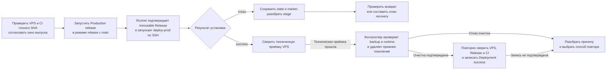
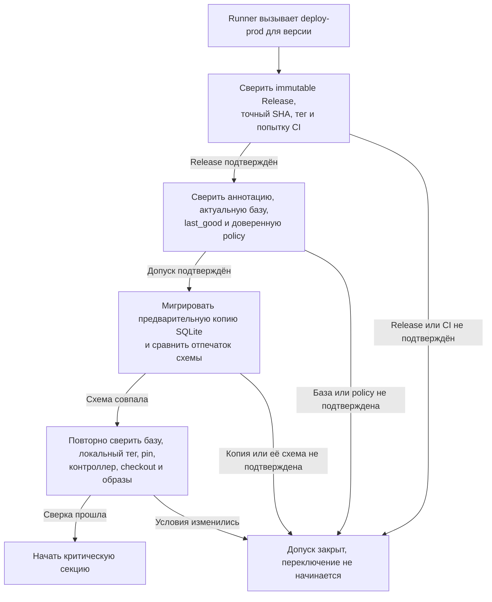
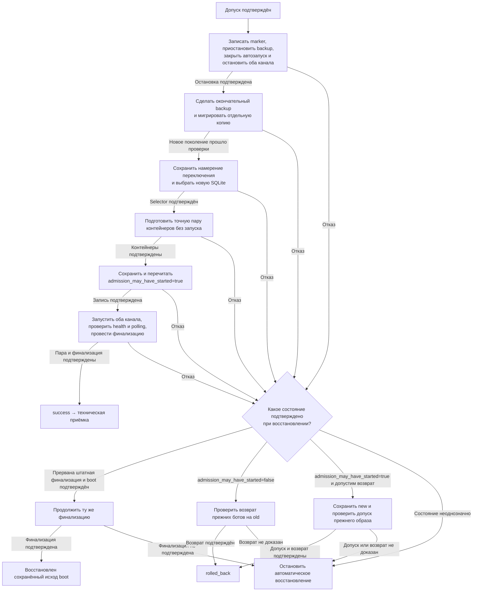
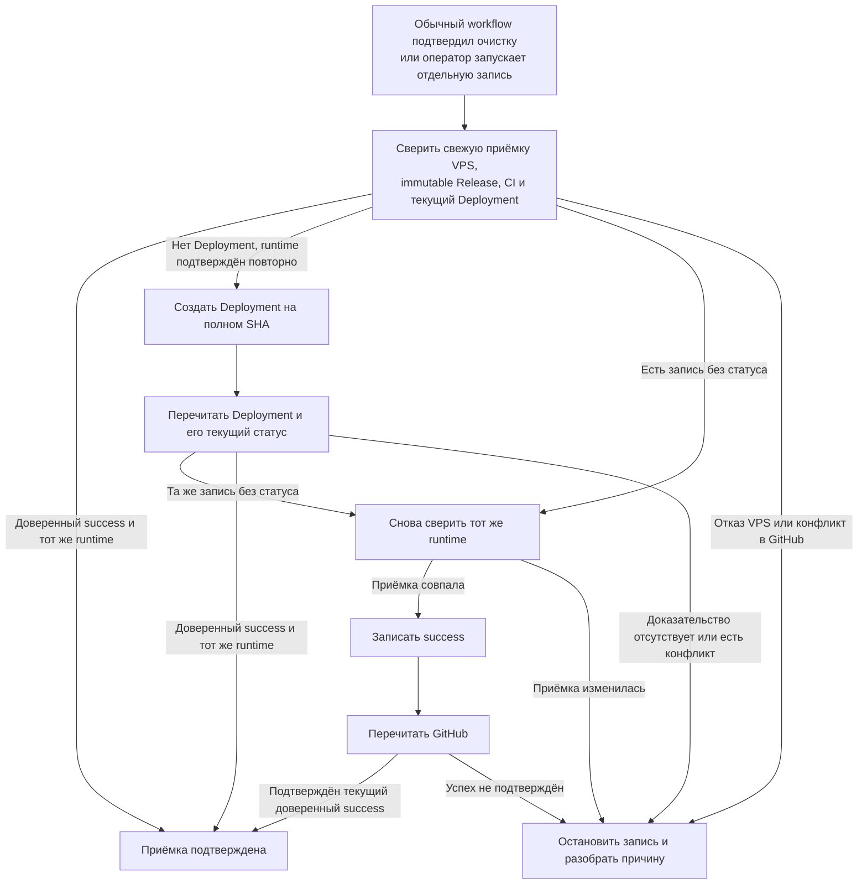

# Эксплуатация Compadre Assistant

Здесь описаны установка опубликованного выпуска на VPS, диагностика и
восстановление. Локальную рабочую копию подготовьте по [SETUP.md](SETUP.md)
и запускайте по [RUN.md](RUN.md). Условия допуска релиза описаны в
[RELEASES.md](RELEASES.md), а последний зафиксированный снимок сервера — в
[PRODUCTION.md](PRODUCTION.md). Результаты проверки выпуска v3.2.0 и
сопоставимые замеры — в [RELEASE_REVIEW.md](RELEASE_REVIEW.md).

| Задача | С чего начать |
| --- | --- |
| Запустить и проверить локальную копию | [RUN.md](RUN.md) |
| Подключить GitHub vault | [GITHUB_APP.md](GITHUB_APP.md) |
| Найти причину сбоя | [Диагностика embeddings](#диагностика-embeddings), [Obsidian write-back](#диагностика-obsidian-write-back), [Частые проблемы](#частые-проблемы) |
| Выпустить обычную версию на VPS | [Подготовка](#подготовка-и-запуск-версии) → [GitHub Actions](#выпустить-обычную-версию-из-github-actions) → [Отказ выпуска и возврат](#отказ-выпуска-и-возврат) |

Локальная разработка и production используют разные правила для SQLite.
Разрешение пересоздать development-БД **не относится к VPS**.

## Production VPS

Перед работой прочитайте [контекст и правила production](PRODUCTION.md).
Описанное ниже состояние сервера требует проверки при подключении.



Согласованный ручной запуск обычного выпуска включает техническую очистку
после подтверждения перехода на новую SQLite. При отказе установки дальнейшее
действие определяет сохранённый `stage`. Состояние `degraded` закрывает новую
выкладку до ручного восстановления. Следующий полный CI автоматически выберет
базу по текущему `success` принятого выпуска в GitHub Deployments.

По снимку от 20.10.2026 production развёрнут в `/opt/obs-chat-bot` на H3llo VPS. Конфигурация
`.env`, PEM GitHub App и SQLite не хранятся в Git. VK работает напрямую,
Telegram Bot API доступен через выделенный VPN и прокси. Пользовательский
ответ на `/status` был подтверждён после включения.

Для Telegram подготовлен отдельный WireGuard-интерфейс `wgobs` между H3LLO
(`10.77.77.2`) и Timeweb (`10.77.77.1`). На Timeweb SOCKS5-прокси Dante
принимает подключения только по адресу туннеля `10.77.77.1:1080` от H3LLO.
В серверный `.env` уже добавлено
`TELEGRAM_PROXY_URL=socks5://10.77.77.1:1080`; получение данных бота и polling
проверены. Прокси применяется только к Bot API, прочие
интеграции используют обычный маршрут.

Проверка сетевого пути без токена и без изменений в БД:

```bash
sudo systemctl is-active wg-quick@wgobs
curl --socks5-hostname 10.77.77.1:1080 -I --max-time 10 https://api.telegram.org/
```

На Timeweb проверить `systemctl is-active wg-quick@wgobs danted`. Если туннель
или прокси недоступны, проверить `wg show wgobs`, состояние двух systemd-сервисов
и доступность UDP `51831` между VPS. Закрытые ключи и содержимое `.env` в
журналы и отчёты не копировать.

Проверить службу и контейнеры:

```bash
sudo systemctl is-active obs-chat-bot.service obs-chat-bot-backup.timer
sudo docker ps --filter label=com.docker.compose.project=obs-chat-bot \
  --format '{{.Names}} {{.Image}} {{.Status}}'
```

Обычный выпуск требует успешного полного CI точного коммита.
`pre-release-check-full` проверяет новую линию из `main`, а `release-check-full`
проверяет новый SHA существующей релизной линии. После осмотра VPS и
согласования окна оператор вручную запускает
[workflow обычного выпуска](#выпустить-обычную-версию-из-github-actions).
Runner подтверждает опубликованный Release и вызывает `deploy-prod` по SSH.
Контроллер выполняет [допуск до остановки каналов](#проверить-допуск-на-vps),
затем [переключает поколение SQLite](#переключить-поколение-sqlite) и
проверяет запуск обоих каналов.
Связь движущейся релизной ветки, точного тега и фактической версии VPS описана
в [RELEASES.md](RELEASES.md).
Повтор того же выпуска должен завершиться `already_installed` без пересоздания.
При проверке тега, который отстаёт от вершины релизной ветки, GitHub Compare
может вернуть `status=ahead` без поля `head_commit`. Точный head берётся из
отдельно прочитанного ref и передаётся в compare-запросе; допуск подтверждают
`status=ahead`, `base_commit` и `merge_base_commit` с SHA тега. Требование
`head_commit` блокировало первый выпуск до исправления в `v1.0.4`.
При `degraded` новый запуск блокируется до ручной проверки и восстановления
по [порядку ниже](#отказ-выпуска-и-возврат).
Не удалять production-БД по development-инструкции: изменения её схемы требуют
миграции с сохранением данных.

### Доступ systemd к выбранному поколению SQLite

Внешний каталог `/var/lib/compadre-assistant-deploy` принадлежит root и имеет
права `0700`; `runtime.env` и оба Compose override внутри него — root:root
`0600`. Основной `obs-chat-bot.service` задаёт `User=user` и `Group=user`.
Действующий `zz-deploy-pinned.conf` задаёт `ExecStart` и `ExecStop` через
`/usr/bin/python3 -P -B -m scripts.deploy_runtime start|stop` из
`/usr/local/lib/compadre-assistant-deploy`. Backup drop-in
`zz-deploy-selector.conf` вызывает `scripts.deploy_backup` тем же Python
контрактом. `-P` не даёт рабочему каталогу checkout подменить установленный
controller; его отсутствие привело к отказу финализации v3.2.0. Префикс `!`
у команд systemd снимает только ограничения `User=`/`Group=` для этих команд;
остальные настройки службы сохраняются. Права приватного каталога и файлов
не ослаблять ради запуска Compose.

Перед первым start/stop после изменения unit, drop-in или прав проверить
`systemd-analyze verify`, `NeedDaemonReload=no`, порядок `DropInPaths` и
итоговые D-Bus `ExecStartEx` **и** `ExecStopEx`: точные аргументы и единственный
флаг `no-setuid`. Также сверить `User=user`, `Group=user`, рабочий каталог,
путь `EnvironmentFiles` к `runtime.env`, `ConditionPathExists` для
`deploy-in-progress` и backup selector. Контроллер `deploy-prod` выполняет
эти проверки перед обычным выпуском. Если хоть одна не проходит, остановиться
до перезапуска; подмена прав `0700`/`0600` или одного только `ExecStart` не
исправляет путь остановки службы.

Если helper запускается как `user`, root-private pin недоступен и unit не
подтвердит работу. Поэтому до restart проверяют обе итоговые команды и флаг
`no-setuid`, а не только имя позднего файла. Docker restart policy каналов
в этом режиме — `no`: только selector-aware systemd boot может запустить
сохранённые точные container ID после проверки state, DB selector и image.
Последний проверенный снимок — в [PRODUCTION.md](PRODUCTION.md).

### Архив контроллера с Windows: точные байты Git

При подготовке snapshot для VPS не упаковывать файлы из рабочей копии Windows:
на ней переводы строк могут стать CRLF, хотя опубликованный Git-коммит хранит
LF. 18 октября 2026 года такой архив остановился на проверке SHA256
`scripts/deploy_prod.py` **до** замены действующего snapshot. Контрольную сумму
в установочном скрипте под изменённые байты не подгонять.

Автономный архив создавать из точного проверенного commit SHA:
для обычной подготовки это может быть SHA Release, для отдельного исправления
контроллера — SHA проверенного merge. Записать источник snapshot отдельно от
SHA устанавливаемого приложения.

```powershell
$snapshotSha = "PASTE_VERIFIED_40_CHAR_SHA"
$archivePath = "C:\Temp\release-snapshot.tar"
$python = "C:\Users\compadre\Documents\obsChatBot\.venv\Scripts\python.exe"
& $python -B -m scripts.controller_snapshot build --sha $snapshotSha --archive $archivePath
# Сохранить выданные controller_sha и archive_sha256 во внешний протокол.
& $python -B -m scripts.controller_snapshot unpack --sha $snapshotSha --archive $archivePath --digest PASTE_SHA256 --directory C:\Temp\controller-staging-UNIQUE
```

Архив только `scripts/` + `deploy/` недостаточен для этапов 5–6: imports
используют `runtime_schema.py` и `migration_runner.py` приложения. Сборщик
добавляет минимальные Git-зависимости и manifest, отвергает CR и links;
`unpack` проверяет digest, SHA, все файлы, синтаксис и imports через отдельный
`python -I -B` вне release checkout. Это локальная проверка, а не допуск CI.

Перед передачей сверить SHA256 всего архива и **каждого обычного файла** в нём
с `git show <SHA-релиза>:<путь-файла>`; отклонить неожиданные symlink/hardlink.
Для передаваемых shell/Python-скриптов проверить отсутствие `CR` и синтаксис.
На VPS повторно сверить SHA256 архива и распакованных файлов в отдельном
root-owned staging-каталоге. Если хоть один файл не совпал, остановиться до
атомарной замены snapshot и проверить источник архива. Незавершённый staging
удалять только после проверки его точного пути и неизменности действующих
snapshot, drop-in, marker и состояния ботов.

### Обновить отдельно установленный controller snapshot

`/usr/local/sbin/deploy-prod` запускает Python из
`/usr/local/lib/compadre-assistant-deploy`, а не из checkout выпуска.
Поэтому исправление контроллера для новой миграции надо установить в этот
отдельный snapshot **до** повтора `deploy-prod`. SHA snapshot и SHA
устанавливаемого Release могут различаться; оба записывают отдельно.

1. После PR и проверки точного merge SHA в полном CI выбрать проверенный
   commit контроллера. Из него создать автономный архив сборщиком
   [выше](#архив-контроллера-с-windows-точные-байты-git). Сверить каждый
   файл с `git show <SHA>:<путь>`, отсутствие лишних типов записей и SHA256
   архива; записать SHA commit, digest и точный CI run/attempt. После merge
   пересобрать архив для точного прошедшего полный CI merge SHA.
2. Получить отдельное согласование на перенос архива и изменение VPS. Перед
   записью заново проверить [production](PRODUCTION.md): `git status`,
   `state.json`/marker, работу двух каналов и backup timer. Не запускать
   установку snapshot при активном deploy или `degraded`; сначала разбирать
   такое состояние. После отказа `failed_preflight` старые каналы должны
   работать, marker должен отсутствовать. На всё время установки удерживать
   существующий inode `/var/lib/compadre-assistant-deploy/deploy.lock` через
   `flock -n`; файл не удалять и не переименовывать. Под lock повторно сверить
   stage/marker, cooldown и отсутствие работающего backup service.
3. На VPS проверить digest перенесённого архива, безопасно распаковать его в
   новый root-owned staging вне checkout и сверить хеш каждого файла с
   manifest проверенного commit. Проверить Python syntax/imports, права,
   wrapper `deploy-prod` и отсутствие symlink/hardlink, путей вне staging и
   CR в скриптах. Подготовить staging через `controller_snapshot unpack`
   с внешними `--sha`/`--digest` и `--require-root`; проверить root:root и отсутствие чужой записи.
   Не выводить `.env`, SQLite, ключи и полные логи.
4. Сохранить действующий snapshot как отдельную неизменяемую копию и
   переключить каталог `/usr/local/lib/compadre-assistant-deploy` на
   проверенный staging через переименование в том же filesystem. Сохранить
   также прежние wrapper, `controller.sha`, digests и точные пути копий.
   Два rename не являются одной атомарной транзакцией: имя установки временно
   отсутствует; в это окно никто не запускает controller. Если
   переключение не завершилось, вернуть старый каталог до любого deploy.
   Сверить установленный каталог через `controller_snapshot verify` с архивом,
   внешними SHA/digest, `--directory` и `--require-root`; проверить изолированный import и
   установить проверенный wrapper как root:root 0755. Его `-B` запрещает
   создание pycache внутри snapshot. Атомарно записать SHA в `controller.sha`
   (root:root 0600, fsync файла и каталога); новый controller сверяет его с
   manifest и собственными байтами. До конца проверки lock не отпускать.
   **Не менять** release checkout, image pin, БД, marker или state ради
   установки контроллера.
5. После свежего read-only осмотра, отдельного допуска к установке и окна
   backup проверить точный Release/SHA/CI выбранной версии, текущий `retry_after` и
   отсутствие `degraded`. Только затем повторять
   [команду выкладки и записи Deployment](#установить-выпуск-и-записать-deployment).
   Сохранить cooldown/state.
   Записать оба SHA (controller и Release) и результат новой команды.

Этот порядок готовит установку, но не разрешает её автоматически. После
успешной миграции или отказа проверить фактические stage, schema, backup,
image ID и оба канала по [порядку возврата](#отказ-выпуска-и-возврат).

При отказе установки под тем же lock вернуть прежние каталог, wrapper и
`controller.sha`, сверить сохранённые digests/imports, затем pin, state,
marker и timer с исходным осмотром. Если новый controller уже записал v2
state/selector, возврат к legacy controller запрещён: он не понимает границу
приёма. Нужен отдельный совместимый recovery; старая БД не является откатом
snapshot. Незавершённый staging сохранять до разбора.

### Подготовить backup и штатный запуск для SQLite v2

`scripts.deploy_backup` выбирает terminal-поколение через `active-db.json`,
сверяет runtime pin, копирует SQLite через API и проверяет integrity/FK. Он
удерживает тот же `deploy.lock` до конца backup и отвергает marker даже при
прямом вызове. Действующий backup drop-in
`/etc/systemd/system/obs-chat-bot-backup.service.d/zz-deploy-selector.conf`
заменяет только `ExecStart`; timer и marker guard сохраняются. При изменении
drop-in проверить `daemon-reload`, effective command, service/timer и копию
именно выбранного поколения.

Первый production переход SQLite v2 завершён на v3.2.0 через forward recovery;
действующие selector-aware main/backup units и snapshot указаны в
[PRODUCTION.md](PRODUCTION.md). Для каждого следующего deploy условный rollout
gate проверяет точные файлы snapshot, effective units/guards, отсутствие
известных сторонних writers и повторный exact-pair CI/image admission до
marker. Ручного CLI/env обхода нет. `deploy_runtime` при занятом lock только
принимает уже работающую точную пару; при свободном запускает сохранённые
durable container ID без create/up. Docker restart policy остаётся `no`.

После [переключения](#переключить-поколение-sqlite) обычный workflow
[очищает старую SQLite](#удалить-прежнее-поколение-sqlite-после-приёмки)
только после завершённого `success` и свежей технической приёмки.
Marker, selector, state и timer вручную не менять ради повтора. Команда
`verify-pinned` для v2 проверяет durable boot и работающую пару, но не
выполняет legacy stop/start.

Во время согласованного окна выпуска администратор не запускает ручной SQLite
CLI, `docker run/compose run` и другой writer или polling с теми же credentials.
Проверка существующих writable Docker mounts обнаруживает известные контейнеры,
но не блокирует новый writer после осмотра. Перед каждым rollout инвентарь
проверяют заново. Reboot и потерю питания единственного VPS не испытывали;
process-crash на копии не доказывает их поведение.

Проверить ежедневные SQLite-копии и их журнал:

```bash
sudo systemctl list-timers obs-chat-bot-backup.timer
sudo journalctl -u obs-chat-bot-backup.service --since today
sudo ls -l /var/backups/obs-chat-bot
```

Timer запускает copy в 03:15 UTC, хранит семь последних файлов и выполняет
backup через SQLite API. Копии лежат на том же диске VPS; защита от потери
всей VM требует отдельного backup/snapshot у провайдера или внешнего хранилища.

### Проверить допуск на VPS

`deploy-prod` под общей блокировкой сверяет исходный checkout, образ и
работающую пару с `last_good`. Затем он выбирает immutable Release, точный
тег и успешную попытку CI кандидата, собирает образ и сверяет его OCI
revision. До переключения контроллер проверяет SQLite, префикс применённых
миграций, наличие места для копий и отсутствие дублирующего polling.
Обычный аннотированный выпуск SQLite v2 проходит следующий маршрут.



Аннотация тега версии 2 закрепляет принятый SHA, ID Release, Deployment и
текущего статуса базы, SHA policy, точный run/attempt кандидата и отпечаток
его схемы. Контроллер читает доверенный `success`, сверяет его с аннотацией
и фактическим `last_good`. Байты `main-full.yml`, `release-full.yml` и
`full-suite.yml` в Git кандидата сравниваются с закреплённым коммитом
policy. Если VPS уже обновился, а приёмка ещё не записана, для обычного
workflow используйте [режим resume](#выпустить-обычную-версию-из-github-actions)
той же версии и SHA. Он завершит очистку или подтвердит её завершение,
затем запишет Deployment. Для отдельной установки действуйте по
[порядку повтора записи](#установить-выпуск-и-записать-deployment).
После подтверждения приёмки
[повторите полный CI](#повторить-полный-ci-для-точного-sha) кандидата на
новой базе.

Для обычного аннотированного выпуска SQLite v2 ожидаемый отпечаток берётся
из тега. Маршрут с артефактом действует для аварийной установки, выпусков
без аннотации и прежнего протокола SQLite. Он дополнительно проверяет
происхождение, срок хранения и SHA-256 единственного ZIP точной попытки,
поля `evidence.json`, контрольные суммы его файлов, полный результат и
точный список тестов по policy. Отчёт сверяет схемы свежей БД кандидата,
обновлённой БД, БД при тестах прежнего кода и БД при проверке кандидатом
сделанных прежним кодом записей. Контроллер снова сверяет артефакт после
миграции копии и, для SQLite v2, перед marker. Аннотация версии 1 и
policy v1 сохраняют исторический формат проверки ранее выпущенных версий
и сохранённого состояния.

Для исторической policy v1 проверка обычного выпуска занимала 19 запросов
к API при одной странице на список. Три запроса подтверждали workflow и CI,
шесть читали policy и проверочные файлы, два читали Release и тег базы, шесть
сверяли байты workflow и два получали метаданные и ZIP. В маршруте SQLite v2
с таким артефактом три вызова давали 57 запросов. Дополнительные страницы
увеличивали число запросов, перенаправление ZIP добавляло HTTP-запрос к
хранилищу. Селектор релиза, `git fetch` и recovery считались отдельно.
Для policy v2 число зависит также от чтения Deployments, статусов и
проверочных файлов. Повтор после копии обнаруживает истёкший артефакт или
изменившийся pin, последняя сверка проверяет актуальность допуска у границы
остановки каналов.

При отказе GitHub до остановки ботов устраните причину, подтвердите
сохранность работающей пары и отсутствие marker, дождитесь окончания паузы
контроллера. При `403` проверьте права токена, при `403` или `429` из-за
лимита дождитесь срока, указанного GitHub в `Retry-After` или
`X-RateLimit-Reset`, если заголовки присутствуют. При сетевом отказе или
`5xx` сначала подтвердите доступ с VPS. Повтор той же версии заново
проверяет допуск и предварительную копию. Если возврат checkout или
состояние прежней установки не подтверждены, действуйте по
[порядку восстановления](#отказ-выпуска-и-возврат).
[Разобрать SAFE-код](#разобрать-отказ-predeploy-по-safe-коду)
· [Проверки контроллера](../scripts/deploy_prod.py).

### Переключить поколение SQLite

Контроллер начинает переключение после подтверждённого допуска.
Предварительную копию проверяют, пока боты ещё работают. Окончательный
снимок получают после остановки обоих каналов и backup, чтобы сохранить
записи, поступившие после предварительной проверки.



При подтверждённом `false` можно вернуть прежних ботов на прежнюю SQLite.
После durable `true` новые боты уже могли записать данные, даже если
команда запуска отказала. Контроллер сохраняет новую SQLite. Старый образ
можно запустить на ней только после повторной проверки совместимости.
Если контроллер прервался в подтверждённой стадии финализации, он может
продолжить ту же финализацию по сохранённому boot-контракту.

После `success` обычный workflow сверяет установку, выполняет
[очистку](#удалить-прежнее-поколение-sqlite-после-приёмки) и подтверждает
запись Deployment. Условия и команды для остальных исходов приведены в
[инструкции по восстановлению](#отказ-выпуска-и-возврат).
[Протокол переключения в коде](../scripts/deploy_database_switch.py).

### Подготовка и запуск версии

Подготовьте точный SHA и release notes до запуска GitHub Actions.
Новый `release/X.Y` предварительно создаётся из проверенного
`main` через `scripts.create_release_branch`: `--check-only`, затем
локальное создание без флага и, после разрешения записи, `--publish-remote`.
Каждый вызов принимает имя ветки и полный SHA. Для PATCH использовать
действующую линию.

| Этап | Условие перехода |
| --- | --- |
| Подготовить кандидата | Полный CI точного SHA и ветка соответствуют [правилам допуска](RELEASES.md#2-получить-полный-ci-для-точного-коммита). |
| Согласовать и запустить выпуск | Перед запуском заново проверены VPS, controller snapshot и окно backup. [Workflow](#выпустить-обычную-версию-из-github-actions) публикует Release, устанавливает его, очищает прежнюю SQLite и записывает Deployment. |

Для предварительной проверки и просмотра текста можно использовать локальные
`--check` и `--dry-run` из чистого checkout.

```powershell
$env:GITHUB_TOKEN = gh auth token
python -m scripts.publish_release v1.0.5 <полный-SHA> --change patch --notes-file <путь-к-notes> --check
python -m scripts.publish_release v1.0.5 <полный-SHA> --change patch --notes-file <путь-к-notes> --dry-run
```

Пример номера не предписывает следующий фактический выпуск. После read-only
проверок и согласования окна по [правилам VPS](PRODUCTION.md) запустите
[выпуск из GitHub Actions](#выпустить-обычную-версию-из-github-actions).
Для отдельной публикации используйте `scripts.publish_release --publish`.

Для диагностики технической приёмки отдельно выполните на VPS её
read-only команду для ожидаемого SHA. Она проверяет отсутствие marker,
точный SHA и image ID обоих работающих healthy-контейнеров без рестартов,
выбранную SQLite и её целостность, основной сервис и исходное состояние
таймера backup. Успешный старт polling проверяется при установке.

```bash
sudo deploy-prod vX.Y.Z --verify-installed <полный-SHA>
```

Успешная повторная приёмка возвращает JSON со сведениями о версии, SHA,
Release, попытке CI, поколении SQLite, последней миграции и идентификаторе
работающей пары.

### Выпустить обычную версию из GitHub Actions

Перед первым запуском настройте окружение `production-release` с допуском
только защищённой ветки `main`. Укажите секреты
`PRODUCTION_RELEASE_TOKEN` и `PRODUCTION_VPS_SSH_PRIVATE_KEY`, а также
переменные `PRODUCTION_VPS_HOST` и `PRODUCTION_VPS_KNOWN_HOSTS`. Используйте
выделенный ключ runner, заранее проверенный ключ хоста и отдельный
fine-grained PAT доверенного владельца. Проверьте, что runner может читать
правила релизных тегов и CI и записывать Release и Deployment. На VPS
должен быть установлен проверенный controller snapshot с режимом
`deploy-prod --cleanup-old` и настроен ограниченный SSH-доступ.
В **Deployment branches and tags** окружения выберите **Selected branches
and tags** и добавьте правило типа **Branch** с именем `main`. Параметр
`deployment: false` оставляет запись о приёмке оркестратору. Режимы `release`
и `resume` используют общую группу concurrency `production-release`.
Активный запуск не отменяется новым. Выделенный SSH-вход разрешает только
штатную установку, `--verify-installed` и `--cleanup-old`. Используйте
[правила SSH-доступа](PRODUCTION.md#доступ) и
[инструкцию установки snapshot](#обновить-отдельно-установленный-controller-snapshot).
Настройки запуска закреплены в [production-release.yml](../.github/workflows/production-release.yml).

Токену runner нужны `Contents: write`, `Deployments: write`, чтение Actions,
Variables, Pull requests и Administration для проверки immutable releases.
При создании Release для коммита, затрагивающего файлы workflow, требуется
также `Workflows: write`. До первого выпуска подтвердите, что этот токен
читает правила релизных тегов и видит пустой `bypass_actors` правила. При
отсутствии поля публикатор останавливается до записи.
[Права токенов GitHub](https://docs.github.com/en/rest/authentication/permissions-required-for-fine-grained-personal-access-tokens)
· [Создание Release](https://docs.github.com/en/rest/releases/releases#create-a-release)
· [Чтение ruleset](https://docs.github.com/en/rest/repos/rules#get-a-repository-ruleset).

1. После согласования выпуска и окна выберите **Actions → Production release
   → Run workflow**, ветку `main` и режим `release`. Укажите `version`, полный
   `sha` кандидата, `change` и `notes`. Для новой публикации нужна существующая
   релизная ветка и успешный полный CI точного SHA.
2. Runner подтверждает или публикует immutable Release и вызывает штатную
   установку по SSH. После свежей технической приёмки контроллер проверяет
   backup и очищает прежнее поколение. Согласование выпуска покрывает эту
   очистку. Затем runner повторно сверяет приёмку и записывает доверенный
   `success` в GitHub Deployments.
3. Проверьте итог workflow `state: success` и `cleanup: completed`.
   Идентификаторы Deployment и статуса указывают на ту же запись приёмки.
   На VPS подтвердите сохранность active SQLite, selector и backup по
   [проверке результата очистки](#удалить-прежнее-поколение-sqlite-после-приёмки).
   Следующий полный CI выберет принятый выпуск из Deployments.
   Сохраните время выкладки и результат по [методике метрик](DEPLOY_METRICS.md#как-снять-замер).

Если установка уже завершилась, а очистка или запись Deployment требуют
повтора, выберите `resume` с теми же `version` и `sha`. Он перечитывает приёмку,
завершает или подтверждает очистку и записывает Deployment без новой установки.
При прерывании после первого
`unlink` переходите к [повтору сохранённой очистки](#удалить-прежнее-поколение-sqlite-после-приёмки).
Если установка не подтверждена, сначала проверьте фактическое состояние VPS
по [порядку восстановления](#отказ-выпуска-и-возврат).

### Установить выпуск и записать Deployment

Для отдельной установки уже опубликованной версии используйте команду
оператора. Согласуйте окно, проверьте текущее состояние VPS и
опубликованный immutable Release точной версии и SHA. На машине оператора
задайте локальный `GITHUB_TOKEN` доверенной учётной записи с
`Deployments: write` и правами чтения Release и CI. Укажите адрес VPS из
[PRODUCTION.md](PRODUCTION.md#доступ), файл `known_hosts` с ранее проверенным
ключом хоста и локальный SSH-ключ. Операторский вход на VPS должен позволять
вызвать `sudo -n deploy-prod`. Для одного выпуска используйте один сеанс
записи. Для автоматического и отдельного маршрутов действует один
[контракт записи](#проверить-запись-приёмки).

```powershell
$deploymentArgs = @('vX.Y.Z', '<полный-SHA>', '--ssh-host', '<user@host>',
    '--known-hosts', '<файл-known_hosts>', '--identity', '<локальный-ключ-SSH>')
python -m scripts.publish_deployment_acceptance @deploymentArgs --deploy
```

Команда проверяет Release и доверенного автора, запускает контроллер по SSH
и после успешной установки читает свежую техническую приёмку. Она проверяет
точную успешную попытку CI, повторно сверяет тот же runtime перед записью и
подтверждает один Deployment с текущим `success` повторным чтением GitHub.
Результат содержит `deployment_id`, `status_id` и `state=success`. Этот вызов
завершается на записи Deployment. Для обычного выпуска `resume` выполняет
очистку перед записью Deployment по [порядку GitHub Actions](#выпустить-обычную-версию-из-github-actions).

Если установка завершилась успешно, а GitHub или техническая сверка
отказали, устраните причину и повторите только запись. Используйте тот же
режим после отдельно согласованного и успешно завершённого forward recovery
того же выпуска.

```powershell
python -m scripts.publish_deployment_acceptance @deploymentArgs --publish
```

Команда заново читает VPS и существующую запись GitHub перед любым POST.
Проверенный `success` завершает повтор без записи, для существующего
Deployment без статуса создаётся только `success`. Конфликт, дубликат или
`403` разберите с владельцем. Для диагностики запустите команду с теми же
аргументами без `--deploy` и `--publish`. Она выводит техническую приёмку
и состояние Deployment без записи. Если контроллер не подтвердил установку
или SSH прервался, проверьте фактическое состояние VPS и действуйте по
[порядку восстановления](#отказ-выпуска-и-возврат).

#### Проверить запись приёмки

В `karateka-git/compadre-assistant` запись имеет `environment=production`,
`task=compadre:acceptance` и `ref`, равный полному SHA принятого коммита.
Токен записи принадлежит `karateka-git` (ID `42288695`), тот же автор
должен быть у Deployment и текущего статуса. Сценарий сверяет автора токена
через `/user` до первой записи. Токен VPS только читает Actions, Contents,
Variables и Deployments. Изменение доверенного автора требует проверенного
изменения контракта.

Payload версии 1 содержит `schema_version`, `version`, `sha`, `kind`,
`release_id`, `run_id`, `run_attempt`, `generation_id` и `migration`. Эти поля
сверяются с технической приёмкой, immutable Release, точной попыткой CI и
последней миграцией коммита. `runtime_id` связывает сверки VPS в одном сеансе
и остаётся вне записи GitHub. При создании задаются `auto_merge=false`,
`required_contexts=[]`, `transient_environment=false` и
`production_environment=true`. Статус `success` содержит ссылку на
проверенный запуск CI и `auto_inactive=false`, чтобы не менять старые записи.
Подписи и URL служат навигацией. Допуск опирается на проверенные поля и
текущий статус записи.



При потере ответа на POST сначала перечитайте GitHub. Проверенный
`success` завершает повтор, а запись без статуса позволяет дописать его после
свежей сверки VPS. Конфликт, дубликат, неподтверждённый ответ чтения или
изменившийся runtime останавливают текущий сеанс. Группа concurrency
защищает только workflow, поэтому отдельную команду оператора выполняют
без параллельной записи для того же выпуска.
[Проверки и повторы в коде](../scripts/publish_deployment_acceptance.py).

### Удалить прежнее поколение SQLite после приёмки

В обычном выпуске workflow вызывает очистку после свежей технической
приёмки точных версии и SHA. Согласованного запуска достаточно для этой
очистки. Отдельно ту же операцию можно выполнить после успешной аварийной
установки или завершённого forward recovery. После очистки обычный workflow
повторно сверяет приёмку и записывает Deployment.

Под общим deploy lock контроллер проверяет следующие условия.

| Что подтвердить | Условие |
| --- | --- |
| Переход завершён | SQLite v2, `stage=success`, `boot.outcome=success`, `admission_may_have_started=true`, согласованные ID перехода и поколения. Marker и `recovery-blocked.json` отсутствуют. |
| Выбрана новая SQLite | Selector указывает на `state.new`, идентичность файла и схема совпадают, проверки integrity и foreign keys проходят. Прежняя SQLite зарегистрирована отдельно. |
| Работает тот же выпуск | `last_good`, candidate, boot и точный Release совпадают. Два канала работают на том же образе и выбранной БД, основной unit и backup timer восстановлены. `runtime_id` совпадает со свежей приёмкой либо сохранённым intent. |
| Окончательный снимок пригоден | `state.snapshot.path` совпадает с `last_good.backup_id`. SHA-256, схема, integrity и foreign keys снимка подтверждены. |
| Прежняя БД закрыта | Путь, device и inode старой БД и присутствующих sidecars подтверждены. Linux `/proc` не показывает открытых дескрипторов, проверка runtime исключает чужие writable mounts. В согласованном окне исключите открытие файла внешним процессом или host CLI. |

Перед первым удалением контроллер сохраняет `old_generation_cleanup_intent`
с идентичностью удаляемых файлов. Удаляются зарегистрированные sidecars,
затем старая БД. После каждого удаления контроллер синхронизирует каталог,
после последнего записывает `old_generation_cleanup`. Активная SQLite,
selector, окончательный снимок, прочие backup и recovery-файлы сохраняются.

Пока запись завершения отсутствует, обычные читатели требуют подтверждения
обоих поколений. После очистки техническая приёмка, штатный boot и backup
проверяют `new` и допускают отсутствие `old` при точной записи завершения,
selector на `new` и подтверждённом состоянии выпуска. Отсутствие `old` без
записи завершения либо одновременное наличие intent и записи завершения
закрывает штатное чтение. При подготовке следующего выпуска без marker
контроллер ещё читает завершённый переход по прежней записи очистки.
После допуска он берёт исходную БД из прежнего `new` и привязывает её
к новому переходу через `selector_rebind`.
[Проверки очистки](../scripts/deploy_cleanup_old.py)
· [Правила чтения selector](../scripts/deploy_database_switch.py).

После завершения проверьте `old_generation_cleanup` в durable state, отсутствие
зарегистрированной старой БД и её sidecars и сохранность активной БД,
selector, окончательного snapshot и остальных backup. Заново выполните
`sudo deploy-prod vX.Y.Z --verify-installed PASTE_FULL_SHA` и сравните
`runtime_id`, поколение SQLite, оба контейнера, unit и backup timer с
приёмкой до удаления. Подтвердите, что обычный backup читает выбранную новую
БД. Не выводите данные SQLite и секреты в журнал проверки.

При отказе сохраните `state`, selector, snapshot и диагностику. Если
прервана очистка и уже исчезла часть зарегистрированных файлов, режим
`resume` может остановиться на технической приёмке. Для прямого продолжения
очистки по intent оператор с root-доступом читает на VPS только
`old_generation_cleanup_intent.runtime_id` из приватного
`/var/lib/compadre-assistant-deploy/state.json`. Повторите штатную команду с
теми же версией, SHA и идентификатором из intent:

```sh
sudo -n /usr/local/sbin/deploy-prod vX.Y.Z --cleanup-old PASTE_FULL_SHA "$RUNTIME_ID"
```

Команда продолжит только сохранённую операцию после проверки оставшихся
inode, выбранной новой SQLite, backup и текущего runtime. После подтверждения
записи завершения запустите `resume` для обычного workflow, чтобы подтвердить
очистку и записать Deployment. При ручном разборе сохраняйте runtime и
полный state в приватном контуре VPS вне журналов Actions.
При новом sidecar, смене inode или runtime, отказе backup либо неоднозначном
состоянии остановитесь и согласуйте ручной разбор. Файлы, selector и копии
оставьте в том состоянии, которое зафиксировал контроллер.

### Зафиксировать приёмку тегом установки

Этот порядок остаётся для исторического `v3.2.0` и разбора ранее созданных
тегов. Для последующих выпусков применяйте
[запись Deployments](#установить-выпуск-и-записать-deployment). Если она
отсутствует, завершите публикацию через `--publish`.

После технической приёмки SQLite v2 выполните `--check` на машине
оператора. Укажите точные версию и SHA, адрес VPS из
[PRODUCTION.md](PRODUCTION.md#доступ) и локальный файл `known_hosts`
с ранее проверенным ключом хоста. SSH выполняет только повторную
техническую приёмку. Если `sudo -n` или сверка не прошли, остановитесь
и разберите причину.

```powershell
$installationArgs = @('vX.Y.Z', '<полный-SHA>', '--ssh-host', '<user@host>',
    '--known-hosts', '<файл-known_hosts>', '--identity', '<локальный-ключ-SSH>')
python -m scripts.publish_installation_tag @installationArgs --check
```

Владелец отдельно проверяет живые ответы Telegram и VK для полученного
`runtime_id`. После его явного решения о создании тега повторите команду
в режиме записи. Используйте локальный `GITHUB_TOKEN` владельца с правом
записи Contents в репозиторий.

```powershell
python -m scripts.publish_installation_tag @installationArgs --publish --confirm-live '<runtime_id>'
```

Команда заново сверяет VPS и опубликованный Release. Если состояние пары
контейнеров или БД изменилось, повторите техническую и живую приёмку.
Подтверждённый тег `production/vX.Y.Z` указывает на тот же коммит, что
релизный тег `vX.Y.Z`. Аннотация нового тега фиксирует ID Release, точную
попытку CI, поколение SQLite и последнюю применённую миграцию. Скрипт
сверяет миграцию с коммитом выпуска до создания тега. Повтор подтверждает
существующий тег на том же SHA, если совпадают его данные приёмки. Команда
создаёт ref один раз и при конфликте передаёт разбор владельцу. Защиту ref
от изменений другими средствами определяют права и правила GitHub.

### Посмотреть SQLite опубликованной версии

После публикации откройте сводку по версии и точному SHA. Для этой команды
достаточно чтения репозитория через GitHub.

```powershell
python -m scripts.publish_installation_tag vX.Y.Z <полный-SHA> --summary
```

В JSON `expected_migration` берётся из точного Git-коммита. Для `v3.2.0`
сводка читает исторический тег установки. Для более новых выпусков сводка
читает GitHub Deployments. При `accepted` доступны `generation_id` и
`applied_migration`. Для аварийного выпуска номер прогона появляется после
приёмки и берётся из подтверждённой записи. Сводка показывает состояние на
момент приёмки. При расхождении с текущим VPS отдельно проверьте
`last_good`, запись и состояние runtime.

### Повторить полный CI для точного SHA

Если изменилась принятая база или прежняя попытка завершилась отказом,
откройте **Actions → Run workflow**. Выберите `pre-release-check-full` для
`main` или `release-check-full` для нужной `release/X.Y`. Получите полный SHA
текущей вершины выбранной ветки и передайте его в `expected_sha`. Вручную
можно запустить новый полный CI того же SHA даже при старом успешном
результате. При движении ветки получите её новый SHA и повторите запуск.

В успешной точной попытке проверьте `check-full-repository-compatibility-check`,
`check-full-suite` и сводку с SHA и ID Release, Deployment и статуса принятой
базы. Если база изменилась во время проверки, запустите новый полный CI на
актуальной базе до публикации. Если VPS уже обновлён, а запись о его
приёмке не подтверждена, сначала завершите приёмку установленного выпуска.
Для обычного выпуска используйте
[режим resume](#выпустить-обычную-версию-из-github-actions).

### Обновить доверенную политику полного CI

`COMPATIBILITY_POLICY_SHA` в GitHub и файл
`/var/lib/compadre-assistant-deploy/compatibility-policy.sha` на VPS
закрепляют проверенный коммит с матрицей, скриптами и байтами workflow.
Обновляйте оба значения при изменении этого контракта, включая разовый
переход на policy v2. Следующие установки автоматически меняют базу
через доверенный `success` в Deployments.

1. Подготовьте PR в защищённую `main` с новой policy и связанными файлами.
   Проверьте точные изменения, обязательный `pr-check` и полный набор
   проверок в Linux. Получите точный merge SHA с новой policy. Если
   существующая релизная линия использует старые workflow, перенесите туда
   проверенные изменения по обычному
   [порядку связанных PR](RELEASES.md#исправления-поддерживаемых-линий)
   до следующего выпуска из этой линии.
2. Согласуйте окно изменения и поставьте выпуск на паузу. Сохраните оба
   прежних pin и проверьте на VPS чистый checkout, завершённый `last_good`,
   marker, оба канала и backup. Текущий `success` в Deployments должен
   совпадать с точным immutable Release и технической приёмкой
   установленной версии. Существующий `github-read-token` должен читать
   Deployments и их статусы. Для штатной работы токен VPS читает Actions,
   Contents и Deployments. Храните токен и pin вне checkout с правами
   root:root/0600. Токен оператора в SSH не передаётся.
3. Установите GitHub repository variable `COMPATIBILITY_POLICY_SHA` в
   reviewed merge SHA и прочитайте её обратно. Запустите
   `pre-release-check-full` для `main` с `expected_sha`, равным полному SHA
   текущей вершины, и `expected_policy_sha`, равным новому pin. При отказе
   перечитайте переменную GitHub. Возвращайте прежнее значение, если
   переменная всё ещё указывает на новый pin этой операции. При другом
   значении остановитесь для сверки изменений. При успехе сверьте точные SHA,
   run/attempt и идентификаторы принятой базы из артефакта CI с состоянием VPS.
4. Установите проверенный
   [controller snapshot](#обновить-отдельно-установленный-controller-snapshot)
   из точного SHA прошедшего прогона. Под тем же существующим deploy lock
   переключите локальный pin на подтверждённый GitHub pin. Проверьте
   байты и изолированный import snapshot, новый локальный pin, принятое
   CI evidence на том же `last_good`, отсутствие marker, состояние
   обоих каналов и backup timer. При отказе верните предыдущие snapshot,
   wrapper, `controller.sha` и локальный pin под lock. Затем проверьте
   текущее значение GitHub pin по правилу из предыдущего шага и верните
   прежнее значение, если оно всё ещё закреплено за этой операцией.
   Возобновляйте выпуски после подтверждения согласованного состояния.

Для изменения переменной нужен доступ Variables write, для запуска прогона
через API — Actions write. На VPS переход касается только snapshot и pin.
Уже установленный выпуск служит проверкой без переустановки.

### Проверить живое переключение двух каналов

После технически успешной установки проверить живые ответы отдельно: статус
контроллера и `healthy` контейнеров не доказывает работу команд. Использовать
согласованные тестовые Telegram/VK identities одного `AppUser A` и отдельный
`AppUser B`; не публиковать внешние ID, тексты вопросов и ответов. Если
каналы A ещё не связаны, выполнить [привязку](RUN.md#13-посмотреть-доступные-команды)
и проверить профиль назначения до переключений.

1. До личных команд снять для обоих сервисов container ID, image ID, PID и
   `StartedAt` read-only командой ниже. Указать версию, SHA и время снимка.
2. У A сравнить `/capabilities` в Telegram и VK, у B записать исходный выбор.
   Включить Obsidian у A в Telegram, проверить выбор в VK и вход `/obsidian`.
   Выключить Obsidian у A в VK: следующий текст исходного Telegram-чата
   должен получить подсказку, а `/status` — сохранить прежний режим.
   Выбор B должен остаться прежним.
3. Повторно включить Obsidian у A через VK; проверить прежний режим и заранее
   согласованные сохранённые данные без записи в vault. Для Ask принять
   длительный вопрос у A, затем до результата отключить Ask во втором канале:
   начатый ответ приходит в исходный чат, следующий вход получает отказ.
   Если ответ пришёл до disable, порядок не доказан и сценарий повторяют
   в согласованное окно.
4. Снять те же Docker поля после переключений и сравнить с первым снимком.
   Изменение личного выбора не должно перезапустить ни один канал. Записать
   отдельно наблюдаемые технические признаки и пользовательское подтверждение
   сценариев; без подтверждения человека живую приёмку не объявлять.

```bash
cd /opt/obs-chat-bot
for service in tg_assistant vk_assistant; do
  cid=$(docker compose ps -q "$service")
  docker inspect --format '{{.Name}} {{.Id}} {{.Image}} {{.State.Pid}} {{.State.StartedAt}}' "$cid"
done
```

Не отключать действующий vault ради живой проверки Device Flow. Если Ask не
настроен или нет безопасного тестового профиля, отметить непроверенную часть,
не подменяя её локальным fake-тестом.

### Отказ выпуска и возврат

Состояния `state.json` в `/var/lib/compadre-assistant-deploy` описывают
ход одной команды; marker `deploy-in-progress` удерживает systemd от
самостоятельного запуска во время критической секции. Не удалять marker,
lock, state или backup для «повтора». Сначала сверить состояние, оба
контейнера, pin, checkout, службу, timer и SQLite integrity/schema без
вывода секретов и содержимого БД.

| Stage | Действие |
| --- | --- |
| `failed_preflight` | Проверка остановилась до переключения. Убедиться, что старые каналы работают и marker отсутствует; устранить причину. `failed_version`/`retry_after` временно закрывают повтор той же версии. |
| `preparing`, `ready` без marker | После прерывания один повтор той же команды восстанавливает прежний checkout и **завершается отказом**. Проверить прежние SHA, pin и оба канала перед новой попыткой. |
| Legacy-переход с `migration_started`, `schema_verified`, `candidate_pinned` или `rollback_started` и marker | При миграции прежнего файла даже отсутствие новой строки `schema_migrations` не доказывает исходную схему. Контроллер оставляет `degraded`; повтор команды служит разбору recovery, а не новой установке. |
| SQLite v2 до durable admission | Сверить `admission_may_have_started=false`, selector и оба поколения под lock. Проверенный recovery может выбрать прежнюю БД; stage сам по себе не доказывает направление возврата. |
| SQLite v2 после durable admission (`admission_recorded`, `candidate_started`, `finalization_intent`, `runtime_adopted`) | Новая БД остаётся выбранной. Прежний образ допустим только на новой схеме при точном compatibility evidence; старую БД не включать из-за возможных новых записей. Отказ доказательств закрывает запуск. |
| `rolled_back` | Старый runtime подтверждён контроллером; проверить его независимо. Новая выкладка — отдельное решение. |
| `pinned_verified` | Проверка закреплённого прежнего образа завершена; это не установка новой версии. |
| `success` | Сверить `last_good` с фактическим checkout и двумя контейнерами. Повтор уже установленной версии даёт `already_installed` без пересоздания. |
| `degraded` либо несовместимая/неизвестная схема | Сохранить marker и проверить фактическую остановку обоих writers и таймера. Если остановка не подтверждена, восстановить защиту по отдельному плану. Новая установка заблокирована. |
| Нечитаемый state или `recovery-blocked.json` | Сохранить повреждённые файлы, не заменять state. Подтвердить остановку writers и таймера, независимо сверить selector и сохранённые снимки. |

Возврат **не** восстанавливает SQLite из backup автоматически. Для v2 сначала
проверяют `admission_may_have_started`, `active-db.json`, durable intent,
целостность обоих поколений и точную пару image/CI. После admission
возвращать selector на старую БД нельзя. Если прежний код отвергает новую
схему, его нельзя запускать на выбранной БД; нужен отдельный план продолжения
на совместимом коде либо восстановления backup с оценкой записей после копии
и возможных изменений GitHub vault. При повторной проверке совместимости v2 контроллер
перечитывает сохранённую пару ID Deployment и статуса, проверяет тот же `success` и
сопоставляет его с Release, pin и точным доказательством операции.

Если один канал восстановился первым, контроллер ограниченно ждёт ту же
пару без повторного создания или запуска. Для обоих каналов нужны health,
точные образ и OCI revision, ноль рестартов и подтверждённый polling.
При устойчивом сбое контроллер закрывает запуск. Проверьте фактические
container ID, `Running`, restart policy, дублирующий polling, marker и
состояние таймера. Значение `degraded` само по себе не доказывает, что
команды остановки успешно завершились.

При прерывании автоматического возврата повтор той же команды использует
сохранённое направление recovery. Контроллер может остановить и подготовить
пару заново, если предыдущий запуск не подтверждён. Такой вызов разбирает
незавершённый переход. Перед отдельным повтором установки подтвердите
исход восстановления, выбранную SQLite, образ, оба канала и таймер.
При несовпадении selector, backup, сохранённой границы, Release или попытки
CI оставьте защитную остановку и согласуйте ручное восстановление.

При legacy `degraded` без selector отдельный план может вернуть прежний
runtime только после доказательства точного прежнего manifest, целостности
БД и структуры относительно проверенной backup-копии. При доказанном
состоянии восстановить проверенный systemd/Compose snapshot и прежний pin,
поднять оба канала, сверить health/polling и отсутствие дублей, затем
финализировать marker, unit, timer и `rolled_back`. Эти действия не применять
к v2 вместо selector-aware recovery. Если любой признак не доказан, оставить
`degraded` и оба канала остановленными. Один лишь `active` unit не доказывает
успешный возврат.

Узкий forward recovery доступен только после отказа финализации уже принятого
candidate с выбранной новой SQLite, сохранённым `boot.outcome=success` и
`migration_attempted=false`. После отдельной установки проверенного controller
snapshot и selector units с безопасным Python import администратор повторно
сверяет state/marker, точные ID/image/OCI, integrity/FK/fingerprint выбранной
БД, Release/CI evidence и отсутствие чужих writers. Затем в согласованном
окне выполняет root-only helper установленного snapshot:

```sh
sudo env -i HOME=/root PATH=/usr/bin:/bin PYTHONPATH=/usr/local/lib/compadre-assistant-deploy \
  /usr/bin/python3 -P -B -m scripts.deploy_forward_recovery
```

Helper удерживает существующий deploy lock, сохраняет durable forward intent
до запуска и использует только те же два container ID на выбранной новой БД.
После health/polling он проводит штатную финализацию unit, marker и timer;
process-crash повтор допускается только для того же intent. При отказе
он восстанавливает `degraded` и marker, останавливает известные writers и
отдельно сообщает, если остановка либо guards не подтверждены. Команда не выполняет
новую миграцию, не создаёт контейнеры и не подменяет обычный выпуск. Её
выполнение требует отдельного решения по фактическому состоянию VPS.
После успешного forward recovery завершите техническую приёмку.
Если нужна штатная очистка, выполните
[её процедуру](#удалить-прежнее-поколение-sqlite-после-приёмки) для
восстановленного runtime, затем
[повторите запись Deployments](#установить-выпуск-и-записать-deployment)
без новой установки.

### Аварийная версия

Аварийный путь требует решения владельца, причины, подтверждённого PR merge
и внешней записи утверждённого текста Release. Из чистого checkout
выполнить команду ниже сначала с `--check`, затем с `--dry-run`, затем
с отдельно разрешённым `--publish`:

```powershell
python -m scripts.publish_emergency_release vX.Y.Z <полный-SHA> --change patch --reason "причина" --notes-file <путь-к-notes> --pr N --check
```

Для PATCH указывать
PR выпускаемой линии и связанный main PR, если он создавался. Проверьте тег
и Release после записи. После нового осмотра VPS на машине оператора
укажите версию, SHA и SSH-параметры в
[`$deploymentArgs`](#установить-выпуск-и-записать-deployment).

```powershell
python -m scripts.publish_deployment_acceptance @deploymentArgs --deploy --emergency --reason "причина"
```

Аварийная установка допускает отсутствие успешного полного CI и сохраняет
проверки backup, migration, pin, health, marker и rollback. Для записи
Deployment по-прежнему нужна доверенная успешная попытка полного CI
точного SHA. Если её нет, установленный выпуск продолжает работать, а
публикация `success` закрыта. До подтверждения записи текущая база CI
остаётся прежней, а расхождение с `last_good` закрывает следующую установку.
Настоящий аварийный выпуск на VPS пока не испытан.

Действующий controller в режиме emergency не обходит
`check-full-repository-compatibility-check`: нужны успешные steps этого
job и доверенное evidence точного run/attempt, совпадающие с установленной
базой. Ошибка API, pin/evidence или предварительной SQLite-копии даёт отказ
до marker/остановки. Внешние `compatibility-policy.sha` и
`github-read-token` проверяют заново перед каждой попыткой; наличие файлов
само по себе не даёт допуска.

### Разобрать отказ predeploy по SAFE-коду

Controller записывает статический `SAFE_*` в stderr и поле
`error` состояния `failed_preflight`; приватный `metrics-*.json` сохраняет
его в `predeploy_reason`. Поле `reason` метрик по-прежнему обозначает тип
исключения. Код не включает token, HTTP body, SQL или строки БД. При ошибке
возврата checkout сохранённый `predeploy_reason` объясняет первичный отказ,
а сообщение контроллера требует отдельно разобрать recovery.

| Код | Проверка и дальнейшее действие |
| --- | --- |
| `SAFE_SOURCE_SCHEMA`, `SAFE_CANDIDATE_MANIFEST`, `SAFE_SCHEMA_PREFIX`, `SAFE_CANDIDATE_IMAGE` | Проверить исходный журнал/integrity, manifest SQL кандидата, точный префикс применённых миграций и revision собранного образа до evidence. |
| `SAFE_CONFIG_READ`, `SAFE_CONFIG_PERMISSIONS`, `SAFE_CONFIG_EMPTY` | Проверить наличие и root:root/0600 внешнего pin/token, непустое значение; не выводить token. |
| `SAFE_POLICY_PIN`, `SAFE_POLICY_CONTENT` | Проверить полный SHA внешнего reviewed pin и полноту policy. |
| `SAFE_POLICY_BLOB_MISSING`, `SAFE_POLICY_BLOB_DIGEST` | Получить заново точные Git blobs; проверить доступ API и закреплённый commit. |
| `SAFE_CI_PROVENANCE`, `SAFE_CI_ATTEMPT`, `SAFE_CI_JOB_MISSING`, `SAFE_CI_JOB_FAILED` | Проверить точный run/attempt, repo/ref/SHA и все обязательные steps; исправить CI и rerun. |
| `SAFE_BASELINE_DEPLOYMENT`, `SAFE_INSTALLED_PREVIOUS_SHA` | Сопоставить установленный SHA с текущим доверенным Deployment, его статусом и immutable Release. При изменении базы повторить полный CI точного SHA кандидата. |
| `SAFE_BASELINE_RELEASE` | Для исторического evidence policy v1 сверить прежний immutable Release и тег с сохранённой policy. |
| `SAFE_INSTALLED_LAST_GOOD`, `SAFE_INSTALLED_RUNTIME`, `SAFE_INSTALLED_IMAGE`, `SAFE_INSTALLED_REVISION` | Проверить last_good, systemd/pin, оба контейнера и OCI revision; не продолжать установку при drift. |
| `SAFE_WORKFLOW_BYTES` | Сверить три workflow с внешним policy commit; изменение требует нового reviewed pin. |
| `SAFE_TAG_EVIDENCE` | Сверить объект аннотированного тега, Release и точную попытку CI. Если они расходятся, остановить установку и проверить происхождение выпуска. |
| `SAFE_ARTIFACT_MISSING`, `SAFE_ARTIFACT_METADATA`, `SAFE_ARTIFACT_DIGEST` | Проверить уникальность artifact, run/head SHA, срок хранения и SHA256 ZIP из GitHub metadata; при истечении нужен новый CI run/attempt. |
| `SAFE_ARTIFACT_REDIRECT`, `SAFE_ARTIFACT_SIZE`, `SAFE_ARTIFACT_EXPANDED_SIZE`, `SAFE_ARTIFACT_MEMBER`, `SAFE_ARTIFACT_FORMAT` | Проверить HTTPS download, лимит 64 MiB, структуру ZIP и JSON; повреждённый artifact не принимать. |
| `SAFE_EVIDENCE_IDENTITY`, `SAFE_CANDIDATE_SHA` | Сверить точную пару SHA, policy, run/attempt, результаты и внутренние хеши. |
| `SAFE_TEST_MANIFEST`, `SAFE_REPORT_CONTRACT` | В артефакте сверить полный список тестов из закреплённой policy, результаты, источники импортов и отпечатки схемы. Один `passed=true` не подтверждает прохождение матрицы. |
| `SAFE_EVIDENCE_READ`, `SAFE_EVIDENCE_RECHECK`, `SAFE_EVIDENCE_CHANGED` | Проверить доступ GitHub и доступность metadata; при повторной проверке evidence/pin должны остаться теми же. |
| `SAFE_COPY_BACKUP`, `SAFE_COPY_SOURCE_SCHEMA` | Проверить online backup и исходный журнал/integrity на приватной копии. |
| `SAFE_COPY_MIGRATION`, `SAFE_COPY_CANDIDATE_SCHEMA` | Проверить candidate CLI, timeout и точный журнал/integrity мигрированной копии. |
| `SAFE_COPY_FOREIGN_KEYS`, `SAFE_COPY_FINGERPRINT` | Разобрать FK либо несовпадение схемы копии с CI, не изменяя live-БД. |
| `SAFE_COPY_TABLE_LOSS`, `SAFE_COPY_DATA_LOSS` | Разобрать потерю таблицы/общих колонок либо изменение мультимножества исходных строк. |
| `SAFE_PREDEPLOY_IO` | Прочая ошибка внешней операции predeploy (например, временный каталог); проверить приватное хранилище и окружение. |

Если tests действительно запускались, в CI artifact
`repository-compatibility-<run>-<attempt>` файлы `behavior.json`/`candidate.json`
содержат failed/error test IDs, а соответствующие `.log` — traceback unittest.
Upload выполняется с `always()`, когда файлы уже созданы. При отказе pin,
checkout, API, установки dependencies или импорта до tests имя упавшего test
может отсутствовать; при отказе до создания output может отсутствовать и
artifact. Predeploy не исполняет эти tests повторно и не публикует traceback
candidate migration на production-копии: он сообщает только безопасный код.
После исправления причины повторно проверить допуск точной пары; не создавать
marker и не останавливать каналы вручную для обхода отказа.

## Локальный запуск и проверка

Порядок подготовки среды, пересоздания только development-БД, запуска Docker
и автономных проверок находится в [RUN.md](RUN.md). Перед живой проверкой
остановите второй polling-экземпляр с теми же credentials. Подключение
GitHub App и vault описано в [GITHUB_APP.md](GITHUB_APP.md).

## Диагностика

Начните с типа ошибки и сохранённого `stage`, затем читайте только безопасные
поля журналов и БД. Полные секреты и пользовательские тексты не выводите.

### Обновить тарифы Ask

При изменении тарифа закройте текущий интервал полем `effective_until` и
начните новый с той же границы UTC согласно источнику. Для тарифа
резервной модели используйте её ID из ответа. Укажите источник и правила для
детализации токенов. [Формат каталога](SETUP.md#настроить-тарифы-ask).

Проверьте новые настройки через `--healthcheck`. После успешной проверки
перезапустите оба канала с обновлённым окружением. Для локального Compose
используйте `docker compose up -d --force-recreate` с нужными сервисами,
чтобы пересоздать контейнеры с текущим `.env`. Оценка уже сохранённых
обращений остаётся прежней. Если в истории нет подходящего тарифа на момент
вызова модели, обращение учитывается с неизвестной стоимостью. В журнале
`AI usage recording failed` означает ошибку расчёта или записи, `queue_full`
или `closed` — потерю наблюдения при приёме. `AI usage observation failed`
указывает на ошибку извлечения или передачи метаданных.

После штатного выхода адаптера процесс ждёт обработки принятой очереди.
В Linux Telegram обрабатывает `SIGTERM` во время polling. У VK отдельного
обработчика `SIGTERM` нет, поэтому контейнерная остановка VK может миновать
закрытие очереди. Для обоих каналов принудительное завершение, включая
`SIGKILL` после истечения лимита Docker, может потерять ещё не записанные
наблюдения. Таймаут блокировки SQLite относится к отдельной операции.

### Диагностика SQLite

При одновременном старте `tg_assistant` и `vk_assistant` недостающие миграции
применяются одним процессом под `BEGIN IMMEDIATE`; второй процесс ждёт SQLite
lock, повторно проверяет `schema_migrations` и не выполняет тот же SQL второй
раз. Сообщения вида
`table ... already exists` на чистой базе означают регрессию этой блокировки.

Core-миграция `0002_user_capability_preferences.sql` добавляет
`user_capability_preferences` после уже применённой `0001_initial_schema.sql`.
При установке новой версии контроллер сначала проверяет, что применённые
миграции образуют точный префикс candidate, останавливает оба writer, создаёт
и проверяет backup с прежним manifest, затем применяет недостающие миграции по
[порядку выпуска](#подготовка-и-запуск-версии).
`0001` не редактируется. Пустая новая таблица означает личные defaults и для
ранее зарегистрированных пользователей: Ask выбран, Obsidian выключен; статьи,
vault, identities и `active_chat_modes` сохраняются. Личное или серверное
отключение не удаляет эти данные. При подозрении на сбой проверьте записи
`schema_migrations` и целостность SQLite через контроллер выпуска; не удаляйте
рабочую БД и не применяйте development-порядок пересоздания.

### Debug-режим

Для расширенных логов в консоли сервера добавить в `.env`:

```dotenv
APP_DEBUG=true
```

В debug-режиме приложение пишет безопасные события обработки: тип входящего
сообщения, результат flow, `app_user_id`, `incoming_message_id`, `article_id`,
`analysis_id`, данные внешней identity при регистрации/привязке. Секреты,
полный текст статей, LLM prompt и API keys не логируются.

После проверки вернуть:

```dotenv
APP_DEBUG=false
```

### Диагностика embeddings

Embedding-события используют тот же стандартный Python `logging`, что и весь
проект, и попадают в stdout/stderr контейнеров. Docker собирает этот поток;
отдельной telemetry-БД или специального embedding logger нет.

Посмотреть события обоих каналов:

```powershell
docker compose logs tg_assistant vk_assistant | Select-String "event=embedding_"
```

Только окончательные сбои и переходы на FTS fallback:

```powershell
docker compose logs tg_assistant vk_assistant |
  Select-String "event=embedding_operation_failed|event=embedding_fallback"
```

`operation_id` связывает начало, SDK batches, итог операции и последующий
fallback. Поля `app_user_id`, `vault_id` и `article_id` позволяют найти
конкретный workflow. Для массовой индексации итоговое событие содержит число
batches/texts, usage, latency, errors и оценочную стоимость.

OpenAI SDK сохраняет штатный `max_retries=2`: один логический SDK-вызов может
сделать до трёх HTTP-попыток. Adapter видит и логирует их общую длительность и
окончательный результат, но не выдумывает недоступные ему детали каждой
внутренней попытки. `response.usage` и provider request ID выводятся только при
наличии. API keys, тексты chunks, compact query и vector values не логируются.

Каждый успешный embedding batch сохраняется в SQLite до следующего запроса.
После сбоя или перезапуска `/vault_sync` продолжает только недостающую работу;
частичные vectors не доступны semantic search до публикации полного marker.
Истечение или смена владельца sync lease останавливает запросы и запись,
сохраняя прежние checkpoints для следующей синхронизации.

В `event=embedding_request_failed` различаются `status=invalid_response`
(например, malformed `200 OK`), `status=http_error`, `status=transport_error`
и `status=request_error` для прочих ошибок вызова SDK. Для malformed-ответов
сохраняются `http_status`, `request_id`, `batch_index`, `batch_size`,
`expected_vectors`, `actual_vectors`, `response_type`, `data_present`,
`data_type`, `item_types`, `index_present_count`, `embedding_present_count`,
`index_types`, `embedding_types`, `value_types`. При отсутствии массива `data`
фактическое число vectors равно `unknown`, а не вымышленному нулю.
В логах есть только количества и типы полей, без значений vectors и полного JSON.

Если бот отвечает ошибкой, посмотреть последние диагностические записи:

```powershell
@'
import sqlite3

con = sqlite3.connect("data/app.db")
con.row_factory = sqlite3.Row
for row in con.execute("""
    SELECT id, article_id, incoming_message_id, stage, error_type, error_message, created_at
    FROM processing_errors
    ORDER BY id DESC
    LIMIT 10
"""):
    print(dict(row))
con.close()
'@ | python -
```

Основные таблицы для диагностики (не полный перечень схемы):

- `articles` — сохранённые статьи и их статус;
- `incoming_messages` — сообщения внешних каналов со ссылками;
- `analysis_results` — сохранённые LLM-сводки;
- `processing_errors` — диагностика ошибок загрузки, извлечения и анализа.
- `obsidian_notes` — полные Markdown-заметки активных vault;
- `obsidian_note_chunks` — структурные chunks текущей локальной копии;
- `obsidian_note_chunks_fts` — автоматически обновляемая FTS5-проекция chunks;
- `obsidian_chunk_index_states` — marker согласованного поколения parser/policy.
- `obsidian_note_chunk_index_states` — source blob SHA и signature chunks каждой
  заметки; по ним stale global marker восстанавливается без полного rebuild.
- `obsidian_proposals` — pending и завершённая история решений `add`/`update`/
  `skip`, исходные SHA и commit успешного write-back.

### Диагностика Obsidian write-back

При ответе `да` в логах искать `Obsidian proposal applied` или
`Obsidian proposal commit failed`. Логи содержат proposal/user/article IDs,
действие, target path и SHA, но не installation token и не полный Markdown.
Ошибки write-back также сохраняются в `processing_errors` со stage
`obsidian_write`.

После временного сбоя предложение остаётся `pending`, статья —
`needs_obsidian_review`, а `cleaned_text` и локальные vault SHA не меняются.
Повторить `да`: сервис заново читает remote state. Если commit был создан, но
его HTTP-ответ потерялся, совпадение remote Markdown завершает локальную
транзакцию без второго commit. Если HEAD/blob изменены другим автором, proposal
получает статус `conflict`; нужно повторно прислать исходную ссылку.

Sync и write-back используют одну таблицу lease. Ответ о занятом vault означает,
что операция идёт в другом связанном Telegram/VK-канале; pending proposal не
теряется, `да` можно повторить после завершения операции.

### Повторная отправка ответов каналов

При временном сбое VK Long Poll повторяет получение сервера и updates с
задержкой до 30 секунд. Запись `VK long poll transient failure` содержит
этап, номер попытки и безопасный тип сетевой причины. Постоянная ошибка
доступа завершает процесс; при циклическом restart проверить настройки VK.
Telegram polling тоже повторяет временные сетевые ошибки с задержкой до
30 секунд. Неверный token или конфликт второго polling-экземпляра требуют
исправить конфигурацию или остановить дублирующий процесс.

Telegram и VK выполняют до трёх попыток отправки только при временных ошибках.
Предупреждение `message send retry` содержит канал, номер неудачной попытки,
задержку и тип ошибки. Запись `message send failed` означает, что ошибка постоянная
либо все разрешённые попытки исчерпаны. Текст ответа и credentials в retry-лог не
попадают.

VK использует неизменный `random_id` одной retry-серии. Telegram соблюдает
`TelegramRetryAfter`; из-за отсутствия idempotency key у Telegram редкий дубль
возможен, если API принял сообщение, но HTTP-ответ потерялся.

## Работа с GitHub vault

Подключение, синхронизация и отключение vault описаны ниже. Требования к App,
PEM и `.knowledge-catcher.yml` приведены в [GITHUB_APP.md](GITHUB_APP.md).

### Подключение vault

Регистрация пользователя, Device Flow, выбор repository, права App и
подготовка файлов правил описаны в [GITHUB_APP.md](GITHUB_APP.md).
Здесь приведены действия при эксплуатации уже подключённого vault.

### Синхронизация GitHub vault

Первая синхронизация выполняется сразу после подключения или подтверждённой
замены vault. Ручная проверка запускается в любом связанном канале:

```text
/vault_sync
```

Текущее подключение, количество локальных Markdown-заметок, instruction-файлов
и timestamps:

```text
/vault_status
```

Одновременно один vault синхронизирует только один процесс; второй Telegram/VK
запрос получает сообщение о выполняющейся синхронизации. При ошибке GitHub
сохранённый source SHA не продвигается, lease освобождается, а последняя локальная
копия остаётся доступной. Installation token, содержимое Markdown и HTTP-ответы
GitHub не выводятся в логи.

Первая синхронизация и обновление с 50 или более изменёнными файлами используют
один ZIP snapshot конкретного commit SHA. Небольшое обновление скачивает только
изменённые blobs. В operational log поле `mode=archive` или `mode=blobs`
показывает выбранный путь вместе с количеством файлов и длительностью. GET имеет
read timeout 30 секунд и до трёх попыток; временный HTTP-ответ с `Retry-After`
задаёт задержку следующей попытки. ZIP ограничен 100 MiB и не распаковывается на
диск.

В корне vault обязателен `.knowledge-catcher.yml` версии `1` с непустым списком
`instructions`. Все пути относятся к корню vault и должны вести к существующим
UTF-8 файлам. Конфигурация и каждый instruction-файл проверяются до применения
нового snapshot. При ошибке source SHA не продвигается, последний полный набор
правил сохраняется, а ручной ответ содержит безопасную причину и готовый пример.
Такая ошибка не маскируется fallback и блокирует article pipeline до
исправления repository. Instruction-файлы хранятся отдельно и не считаются
Obsidian-заметками.

Перед каждой статьёй общий incoming flow проверяет возраст `last_checked_at`.
Внутри шестичасового окна GitHub-запросов нет. Если прошло шесть часов или
больше, первая следующая статья выполняет инкрементальную проверку под тем же
SQLite lease. Ошибка автоматической проверки не удаляет локальные заметки и не
останавливает article pipeline: статья обрабатывается с последней локальной
копией, а пользователь получает предупреждение. Занятый другим связанным каналом
lease обрабатывается так же. Ошибка GitHub остаётся в operational log только как
тип исключения без token, URL HTTP-ответа и содержимого Markdown.

Отключение активного vault:

```text
/vault_disconnect
```

Команда не удаляет данные сразу: в SQLite создаётся подтверждение с TTL 10
минут. `да` удаляет строку vault, а SQLite каскадно очищает локальные заметки,
tags, wikilinks и lease. `нет` удаляет только подтверждение. GitHub account,
installation IDs, пользователь, identities, статьи и анализы сохраняются.
Сам GitHub repository команда не изменяет.

### Частые проблемы

- `TelegramConflictError`: уже запущен другой экземпляр бота с тем же token.
  Закрыть старое окно и запустить заново.
- `401 Unauthorized access` на stage `analysis`: неверный AI-agent API key или
  ключ вставлен в `.env` вместе с `Bearer`.
- Ошибка загрузки страницы: сайт недоступен, вернул неуспешный HTTP-статус или
  блокирует загрузку.
- Ошибка извлечения текста: HTML загрузился, но extractor не нашёл содержательный
  текст статьи.
