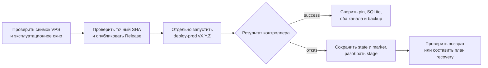

# Эксплуатация Compadre Assistant

Здесь описаны установка опубликованного выпуска на VPS, диагностика и
восстановление. Локальную рабочую копию подготовьте по [SETUP.md](SETUP.md)
и запускайте по [RUN.md](RUN.md). Условия допуска релиза описаны в
[RELEASES.md](RELEASES.md), а последний зафиксированный снимок сервера — в
[PRODUCTION.md](PRODUCTION.md).

| Задача | С чего начать |
| --- | --- |
| Запустить и проверить локальную копию | [RUN.md](RUN.md) |
| Подключить GitHub vault | [GITHUB_APP.md](GITHUB_APP.md) |
| Найти причину сбоя | [Диагностика embeddings](#диагностика-embeddings), [Obsidian write-back](#диагностика-obsidian-write-back), [Частые проблемы](#частые-проблемы) |
| Установить версию на VPS | [Production VPS](#production-vps) → [Подготовка и запуск версии](#подготовка-и-запуск-версии) → [Отказ выпуска и возврат](#отказ-выпуска-и-возврат) |

Локальная разработка и production используют разные правила для SQLite.
Разрешение пересоздать development-БД **не относится к VPS**.

## Production VPS

Перед работой прочитайте [контекст и правила production](PRODUCTION.md).
Описанное ниже состояние сервера требует проверки при подключении.



Публикация Release не является командой установки. При отказе дальнейшее
действие определяется сохранённым `stage`; состояние `degraded` запрещает
новую выкладку до ручного восстановления. Контроллер не заменяет живую
пользовательскую проверку ответов обоих каналов.

По снимку от 20.10.2026 production развёрнут в `/opt/obs-chat-bot` на H3llo VPS. Конфигурация
`.env`, PEM GitHub App и SQLite не хранятся в Git. VK работает напрямую,
Telegram Bot API доступен через выделенный VPN и прокси. Пользовательский
ответ на `/status` был подтверждён после включения.

Для Telegram подготовлен отдельный WireGuard-интерфейс `wgobs` между H3LLO
(`10.77.77.2`) и Timeweb (`10.77.77.1`). На Timeweb SOCKS5-прокси Dante
принимает подключения только по адресу туннеля `10.77.77.1:1080` от H3LLO.
В серверный `.env` уже добавлено
`TELEGRAM_PROXY_URL=socks5://10.77.77.1:1080`; получение данных бота и polling
проверены. Прокси применяется только к Bot API, прочие
интеграции используют обычный маршрут.

Проверка сетевого пути без токена и без изменений в БД:

```bash
sudo systemctl is-active wg-quick@wgobs
curl --socks5-hostname 10.77.77.1:1080 -I --max-time 10 https://api.telegram.org/
```

На Timeweb проверить `systemctl is-active wg-quick@wgobs danted`. Если туннель
или прокси недоступны, проверить `wg show wgobs`, состояние двух systemd-сервисов
и доступность UDP `51831` между VPS. Закрытые ключи и содержимое `.env` в
журналы и отчёты не копировать.

Проверить службу и контейнеры:

```bash
sudo systemctl is-active obs-chat-bot.service obs-chat-bot-backup.timer
sudo docker ps --filter label=com.docker.compose.project=obs-chat-bot \
  --format '{{.Names}} {{.Image}} {{.Status}}'
```

Обычный выпуск выполняется только для опубликованного GitHub Release с
успешным полным CI точного коммита: `main-full` для новой линии из проверенного
`main` либо `release-full` для нового SHA существующей релизной линии. После проверки текущего
состояния и согласования эксплуатационного окна команда
`sudo deploy-prod vX.Y.Z` сама сверяет Release, закрепляет образ, создаёт backup, останавливает
оба канала, при необходимости применяет миграции и проверяет запуск обоих.
Связь движущейся релизной ветки, точного тега и фактической версии VPS описана
в [RELEASES.md](RELEASES.md).
Повтор того же выпуска должен завершиться `already_installed` без пересоздания.
При проверке тега, который отстаёт от вершины релизной ветки, GitHub Compare
может вернуть `status=ahead` без поля `head_commit`. Точный head берётся из
отдельно прочитанного ref и передаётся в compare-запросе; допуск подтверждают
`status=ahead`, `base_commit` и `merge_base_commit` с SHA тега. Требование
`head_commit` блокировало первый выпуск до исправления в `v1.0.4`.
При `degraded` новый запуск блокируется до ручной проверки и восстановления
по [порядку ниже](#отказ-выпуска-и-возврат).
Не удалять production-БД по development-инструкции: изменения её схемы требуют
миграции с сохранением данных.

### Доступ systemd к закреплённому Compose

Внешний каталог `/var/lib/compadre-assistant-deploy` принадлежит root и имеет
права `0700`; `runtime.env` и оба Compose override внутри него — root:root
`0600`. Основной `obs-chat-bot.service` задаёт `User=user` и `Group=user`.
После удаления устаревшего `90-deploy-pinned.conf` действующий порядок
drop-in: `channels.conf`, затем `zz-deploy-pinned.conf`. Поздний файл
должен задавать **обе** итоговые команды:
`ExecStart=!/usr/bin/docker compose up -d --no-build --pull never
vk_assistant tg_assistant` и `ExecStop=!/usr/bin/docker compose stop
vk_assistant tg_assistant`. По [документации systemd](https://www.freedesktop.org/software/systemd/man/257/systemd.service.html)
префикс `!` выполняет только эти команды без ограничений `User=`/`Group=`;
остальные настройки службы сохраняются. Права приватного каталога и файлов
не ослаблять ради запуска Compose.

Перед первым start/stop после изменения unit, drop-in или прав проверить
`systemd-analyze verify`, `NeedDaemonReload=no`, порядок `DropInPaths` и
итоговые D-Bus `ExecStartEx` **и** `ExecStopEx`: точные аргументы и единственный
флаг `no-setuid`. Также сверить `User=user`, `Group=user`, рабочий каталог,
путь `EnvironmentFiles` к `runtime.env` и условие, блокирующее службу при
`deploy-in-progress`. Контроллер `deploy-prod` выполняет эти проверки перед
обычным выпуском. Если хоть одна не проходит, остановиться до перезапуска;
подмена прав `0700`/`0600` или одного только `ExecStart` не исправляет путь
остановки службы.

Если Compose запускается как `user`, root-private pin недоступен:
контейнеры могут запуститься вручную от root, но systemd не подтвердит
службу, а возврат попадёт в `degraded`. Поэтому до restart проверяют
обе итоговые команды и флаг `no-setuid`, а не только имя позднего файла.
Последний проверенный снимок этой конфигурации — в
[PRODUCTION.md](PRODUCTION.md).

### Архив контроллера с Windows: точные байты Git

При подготовке snapshot для VPS не упаковывать файлы из рабочей копии Windows:
на ней переводы строк могут стать CRLF, хотя опубликованный Git-коммит хранит
LF. 18 октября 2026 года такой архив остановился на проверке SHA256
`scripts/deploy_prod.py` **до** замены действующего snapshot. Контрольную сумму
в установочном скрипте под изменённые байты не подгонять.

Архив `scripts/` и `deploy/` создавать из точного проверенного commit SHA:
для обычной подготовки это может быть SHA Release, для отдельного исправления
контроллера — SHA проверенного merge. Записать источник snapshot отдельно от
SHA устанавливаемого приложения.

```powershell
$snapshotSha = "PASTE_VERIFIED_40_CHAR_SHA"
$archivePath = "C:\Temp\release-snapshot.tar"
git -c core.autocrlf=false archive --format=tar --output=$archivePath $snapshotSha scripts deploy
```

Перед передачей сверить SHA256 всего архива и **каждого обычного файла** в нём
с `git show <SHA-релиза>:<путь-файла>`; отклонить неожиданные symlink/hardlink.
Для передаваемых shell/Python-скриптов проверить отсутствие `CR` и синтаксис.
На VPS повторно сверить SHA256 архива и распакованных файлов в отдельном
root-owned staging-каталоге. Если хоть один файл не совпал, остановиться до
атомарной замены snapshot и проверить источник архива. Незавершённый staging
удалять только после проверки его точного пути и неизменности действующих
snapshot, drop-in, marker и состояния ботов.

### Обновить отдельно установленный controller snapshot

`/usr/local/sbin/deploy-prod` запускает Python из
`/usr/local/lib/compadre-assistant-deploy`, а не из checkout выпуска.
Поэтому исправление контроллера для новой миграции надо установить в этот
отдельный snapshot **до** повтора `deploy-prod`. SHA snapshot и SHA
устанавливаемого Release могут различаться; оба записывают отдельно.

1. После PR и проверки точного merge SHA в полном CI выбрать проверенный
   commit контроллера. Из него создать архив `scripts/` и `deploy/` командой
   [выше](#архив-контроллера-с-windows-точные-байты-git). Сверить каждый
   файл с `git show <SHA>:<путь>`, отсутствие лишних типов записей и SHA256
   архива; записать SHA commit и digest. Старый `v2.0.0` tag не содержит
   исправления preflight и не является источником нового snapshot.
2. Получить отдельное согласование на перенос архива и изменение VPS. Перед
   записью заново проверить [production](PRODUCTION.md): `git status`,
   `state.json`/marker, работу двух каналов и backup timer. Не запускать
   установку snapshot при активном deploy или `degraded`; сначала разбирать
   такое состояние. После отказа `failed_preflight` старые каналы должны
   работать, marker должен отсутствовать.
3. На VPS проверить digest перенесённого архива, безопасно распаковать его в
   новый root-owned staging вне checkout и сверить хеш каждого файла с
   manifest проверенного commit. Проверить Python syntax/imports, права,
   wrapper `deploy-prod` и отсутствие symlink/hardlink, путей вне staging и
   CR в скриптах. Не выводить `.env`, SQLite, ключи и полные логи.
4. Сохранить действующий snapshot как отдельную неизменяемую копию и
   переключить каталог `/usr/local/lib/compadre-assistant-deploy` на
   проверенный staging через переименование в том же filesystem. Если
   переключение не завершилось, вернуть старый каталог до любого deploy.
   Сверить хеши установленного кода, import модуля и путь wrapper.
   **Не менять** checkout `v1.0.4`, image pin, БД, marker или state ради
   установки контроллера.
5. После свежего read-only осмотра, отдельного допуска к установке и окна
   backup проверить точный Release/SHA/CI `v2.0.0`, текущий `retry_after` и
   отсутствие `degraded`. Только затем рассматривать повтор
   `sudo deploy-prod v2.0.0`; не стирать cooldown/state для ускорения.
   Записать оба SHA (controller и Release) и результат новой команды.

Этот порядок готовит установку, но не разрешает её автоматически. После
успешной миграции или отказа проверить фактические stage, schema, backup,
image ID и оба канала по [порядку возврата](#отказ-выпуска-и-возврат).

Проверить ежедневные SQLite-копии и их журнал:

```bash
sudo systemctl list-timers obs-chat-bot-backup.timer
sudo journalctl -u obs-chat-bot-backup.service --since today
sudo ls -l /var/backups/obs-chat-bot
```

Timer запускает copy в 03:15 UTC, хранит семь последних файлов и выполняет
backup через SQLite API. Копии лежат на том же диске VPS; защита от потери
всей VM требует отдельного backup/snapshot у провайдера или внешнего хранилища.

### Подготовка и запуск версии

На локальной машине из чистого checkout точного кандидата выполнить
read-only проверку, просмотреть будущие release notes и только затем
опубликовать. Новый `release/X.Y` предварительно создаётся из проверенного
`main` через `scripts.create_release_branch`: `--check-only`, затем
локальное создание без флага и, после разрешения записи, `--publish-remote`.
Каждый вызов принимает имя ветки и полный SHA. Для PATCH использовать
действующую линию.

| Этап | Условие перехода |
| --- | --- |
| Подготовить кандидата | Чистый checkout точного SHA; полный CI и ветка соответствуют [правилам допуска](RELEASES.md#2-получить-полный-ci-для-точного-коммита). |
| Проверить публикацию | `--check` успешен, вывод `--dry-run` и release notes просмотрены. |
| Опубликовать | После `--publish` тег, SHA и GitHub Release совпадают. VPS ещё не менялся. |
| Установить | Перед командой заново проверены VPS и окно backup; после команды проверены `stage`, pin, SQLite, оба канала и timer. |

```powershell
$env:GITHUB_TOKEN = gh auth token
python -m scripts.publish_release v1.0.5 <полный-SHA> --change patch --notes-file <путь-к-notes> --check
python -m scripts.publish_release v1.0.5 <полный-SHA> --change patch --notes-file <путь-к-notes> --dry-run
python -m scripts.publish_release v1.0.5 <полный-SHA> --change patch --notes-file <путь-к-notes> --publish
```

Пример номера не предписывает следующий фактический выпуск. Перед записью
сверить изменения линии, указанный SHA и результаты полного CI; публикация
не запускает VPS. На сервере после свежего read-only осмотра
[PRODUCTION.md](PRODUCTION.md), отдельного эксплуатационного допуска и
проверки окна backup вызвать `sudo deploy-prod vX.Y.Z`. Команда синхронна:
по окончании проверить stage/state, отсутствие marker, точный SHA/image ID
обоих каналов, health и polling, службу, backup timer и SQLite integrity.
Для реальных ответов Telegram/VK требуется пользовательская проверка.
Результат доступен в серверном журнале; внешних уведомлений сейчас нет.

### Проверить живое переключение двух каналов

После технически успешной установки проверить живые ответы отдельно: статус
контроллера и `healthy` контейнеров не доказывает работу команд. Использовать
согласованные тестовые Telegram/VK identities одного `AppUser A` и отдельный
`AppUser B`; не публиковать внешние ID, тексты вопросов и ответов. Если
каналы A ещё не связаны, выполнить [привязку](RUN.md#13-посмотреть-доступные-команды)
и проверить профиль назначения до переключений.

1. До личных команд снять для обоих сервисов container ID, image ID, PID и
   `StartedAt` read-only командой ниже. Указать версию, SHA и время снимка.
2. У A сравнить `/capabilities` в Telegram и VK, у B записать исходный выбор.
   Включить Obsidian у A в Telegram, проверить выбор в VK и вход `/obsidian`.
   Выключить Obsidian у A в VK: следующий текст исходного Telegram-чата
   должен получить подсказку, а `/status` — сохранить прежний режим.
   Выбор B должен остаться прежним.
3. Повторно включить Obsidian у A через VK; проверить прежний режим и заранее
   согласованные сохранённые данные без записи в vault. Для Ask принять
   длительный вопрос у A, затем до результата отключить Ask во втором канале:
   начатый ответ приходит в исходный чат, следующий вход получает отказ.
   Если ответ пришёл до disable, порядок не доказан и сценарий повторяют
   в согласованное окно.
4. Снять те же Docker поля после переключений и сравнить с первым снимком.
   Изменение личного выбора не должно перезапустить ни один канал. Записать
   отдельно наблюдаемые технические признаки и пользовательское подтверждение
   сценариев; без подтверждения человека живую приёмку не объявлять.

```bash
cd /opt/obs-chat-bot
for service in tg_assistant vk_assistant; do
  cid=$(docker compose ps -q "$service")
  docker inspect --format '{{.Name}} {{.Id}} {{.Image}} {{.State.Pid}} {{.State.StartedAt}}' "$cid"
done
```

Не отключать действующий vault ради живой проверки Device Flow. Если Ask не
настроен или нет безопасного тестового профиля, отметить непроверенную часть,
не подменяя её локальным fake-тестом.

### Отказ выпуска и возврат

Состояния `state.json` в `/var/lib/compadre-assistant-deploy` описывают
ход одной команды; marker `deploy-in-progress` удерживает systemd от
самостоятельного запуска во время критической секции. Не удалять marker,
lock, state или backup для «повтора». Сначала сверить состояние, оба
контейнера, pin, checkout, службу, timer и SQLite integrity/schema без
вывода секретов и содержимого БД.

| Stage | Действие |
| --- | --- |
| `failed_preflight` | Проверка остановилась до переключения. Убедиться, что старые каналы работают и marker отсутствует; устранить причину. `failed_version`/`retry_after` временно закрывают повтор той же версии. |
| `preparing`, `ready` без marker | После прерывания один повтор той же команды восстанавливает прежний checkout и **завершается отказом**. Проверить прежние SHA, pin и оба канала перед новой попыткой. |
| `ready`, `critical`, `writers_stopped`, `backup_verified`, `migration_started`, `schema_verified`, `candidate_pinned`, `candidate_started`, `rollback_started` с marker | До попытки новой миграции автоматический возврат допустим только при прежней схеме и целой SQLite. После попытки новой миграции контроллер переводит выпуск в `degraded` даже без новой строки `schema_migrations`: частичное изменение нельзя исключить. Повтор команды служит разбору recovery, а не новой установке. |
| `rolled_back` | Старый runtime подтверждён контроллером; проверить его независимо. Новая выкладка — отдельное решение. |
| `pinned_verified` | Проверка закреплённого прежнего образа завершена; это не установка новой версии. |
| `success` | Сверить `last_good` с фактическим checkout и двумя контейнерами. Повтор уже установленной версии даёт `already_installed` без пересоздания. |
| `degraded` либо несовместимая/неизвестная схема | Оставить marker, остановить оба writer и timer; новая команда заблокирована. Нужен отдельный план ручного восстановления. |

Возврат **не** восстанавливает SQLite из копии автоматически. Если миграции
изменили схему, старый код, отвергающий неизвестную миграцию, запускать нельзя;
решение о восстановлении backup должно учитывать записи после копии и
возможные изменения GitHub vault. При `degraded` под отдельным разрешением
сохранить lock/marker и проверить прежний SHA/image и схему. Возврат на старый
runtime допустим только после доказательства **точного прежнего manifest**,
целостности БД и структуры относительно проверенной backup-копии; при новой
или неопределённой схеме нужен отдельный план
продолжения на совместимом коде либо восстановления проверенной backup-копии
с оценкой записей после неё. При доказанном прежнем manifest установить
проверенный systemd/Compose snapshot, поднять оба старых канала с прежним
pin, сверить health/polling и отсутствие дублей. Лишь после этого вернуть
restart policy, снять marker, запустить unit, проверить оба канала снова,
вернуть timer к сохранённому состоянию и атомарно записать `rolled_back`.
Если любой признак не доказан, оставить `degraded` и оба канала остановленными.
Не считать один лишь `active` unit доказательством успешного возврата.

### Аварийная версия

Аварийный путь требует решения владельца, причины, подтверждённого PR merge
и внешней записи утверждённого текста Release. Из чистого checkout
выполнить команду ниже сначала с `--check`, затем с `--dry-run`, затем
с отдельно разрешённым `--publish`:

```powershell
python -m scripts.publish_emergency_release vX.Y.Z <полный-SHA> --change patch --reason "причина" --notes-file <путь-к-notes> --pr N --check
```

Для PATCH указывать
PR выпускаемой линии и связанный main PR, если он создавался; PR других
линий не включать. Проверить tag/Release после записи. На VPS после нового
осмотра запустить `sudo deploy-prod --emergency vX.Y.Z --reason "причина"`.
Обычный режим аварийный Release отвергает. Аварийная команда пропускает
только допуск по успешному полному CI; backup, migration, pin, health,
marker и rollback действуют как обычно. Настоящий аварийный выпуск на VPS
пока не испытан.

## Локальный запуск и проверка

Порядок подготовки среды, пересоздания только development-БД, запуска Docker
и автономных проверок находится в [RUN.md](RUN.md). Перед живой проверкой
остановите второй polling-экземпляр с теми же credentials. Подключение
GitHub App и vault описано в [GITHUB_APP.md](GITHUB_APP.md).

## Диагностика

Начните с типа ошибки и сохранённого `stage`, затем читайте только безопасные
поля журналов и БД. Полные секреты и пользовательские тексты не выводите.

### Диагностика SQLite

При одновременном старте `tg_assistant` и `vk_assistant` недостающие миграции
применяются одним процессом под `BEGIN IMMEDIATE`; второй процесс ждёт SQLite
lock, повторно проверяет `schema_migrations` и не выполняет тот же SQL второй
раз. Сообщения вида
`table ... already exists` на чистой базе означают регрессию этой блокировки.

Core-миграция `0002_user_capability_preferences.sql` добавляет
`user_capability_preferences` после уже применённой `0001_initial_schema.sql`.
При установке новой версии контроллер сначала проверяет, что применённые
миграции образуют точный префикс candidate, останавливает оба writer, создаёт
и проверяет backup с прежним manifest, затем применяет недостающие миграции по
[порядку выпуска](#подготовка-и-запуск-версии).
`0001` не редактируется. Пустая новая таблица означает личные defaults и для
ранее зарегистрированных пользователей: Ask выбран, Obsidian выключен; статьи,
vault, identities и `active_chat_modes` сохраняются. Личное или серверное
отключение не удаляет эти данные. При подозрении на сбой проверьте записи
`schema_migrations` и целостность SQLite через контроллер выпуска; не удаляйте
рабочую БД и не применяйте development-порядок пересоздания.

### Debug-режим

Для расширенных логов в консоли сервера добавить в `.env`:

```dotenv
APP_DEBUG=true
```

В debug-режиме приложение пишет безопасные события обработки: тип входящего
сообщения, результат flow, `app_user_id`, `incoming_message_id`, `article_id`,
`analysis_id`, данные внешней identity при регистрации/привязке. Секреты,
полный текст статей, LLM prompt и API keys не логируются.

После проверки вернуть:

```dotenv
APP_DEBUG=false
```

### Диагностика embeddings

Embedding-события используют тот же стандартный Python `logging`, что и весь
проект, и попадают в stdout/stderr контейнеров. Docker собирает этот поток;
отдельной telemetry-БД или специального embedding logger нет.

Посмотреть события обоих каналов:

```powershell
docker compose logs tg_assistant vk_assistant | Select-String "event=embedding_"
```

Только окончательные сбои и переходы на FTS fallback:

```powershell
docker compose logs tg_assistant vk_assistant |
  Select-String "event=embedding_operation_failed|event=embedding_fallback"
```

`operation_id` связывает начало, SDK batches, итог операции и последующий
fallback. Поля `app_user_id`, `vault_id` и `article_id` позволяют найти
конкретный workflow. Для массовой индексации итоговое событие содержит число
batches/texts, usage, latency, errors и оценочную стоимость.

OpenAI SDK сохраняет штатный `max_retries=2`: один логический SDK-вызов может
сделать до трёх HTTP-попыток. Adapter видит и логирует их общую длительность и
окончательный результат, но не выдумывает недоступные ему детали каждой
внутренней попытки. `response.usage` и provider request ID выводятся только при
наличии. API keys, тексты chunks, compact query и vector values не логируются.

Каждый успешный embedding batch сохраняется в SQLite до следующего запроса.
После сбоя или перезапуска `/github_sync` продолжает только недостающую работу;
частичные vectors не доступны semantic search до публикации полного marker.
Истечение или смена владельца sync lease останавливает запросы и запись,
сохраняя прежние checkpoints для следующей синхронизации.

В `event=embedding_request_failed` различаются `status=invalid_response`
(например, malformed `200 OK`), `status=http_error`, `status=transport_error`
и `status=request_error` для прочих ошибок вызова SDK. Для malformed-ответов
сохраняются `http_status`, `request_id`, `batch_index`, `batch_size`,
`expected_vectors`, `actual_vectors`, `response_type`, `data_present`,
`data_type`, `item_types`, `index_present_count`, `embedding_present_count`,
`index_types`, `embedding_types`, `value_types`. При отсутствии массива `data`
фактическое число vectors равно `unknown`, а не вымышленному нулю.
В логах есть только количества и типы полей, без значений vectors и полного JSON.

Если бот отвечает ошибкой, посмотреть последние диагностические записи:

```powershell
@'
import sqlite3

con = sqlite3.connect("data/app.db")
con.row_factory = sqlite3.Row
for row in con.execute("""
    SELECT id, article_id, incoming_message_id, stage, error_type, error_message, created_at
    FROM processing_errors
    ORDER BY id DESC
    LIMIT 10
"""):
    print(dict(row))
con.close()
'@ | python -
```

Основные таблицы для диагностики (не полный перечень схемы):

- `articles` — сохранённые статьи и их статус;
- `incoming_messages` — сообщения внешних каналов со ссылками;
- `analysis_results` — сохранённые LLM-сводки;
- `processing_errors` — диагностика ошибок загрузки, извлечения и анализа.
- `obsidian_notes` — полные Markdown-заметки активных vault;
- `obsidian_note_chunks` — структурные chunks текущей локальной копии;
- `obsidian_note_chunks_fts` — автоматически обновляемая FTS5-проекция chunks;
- `obsidian_chunk_index_states` — marker согласованного поколения parser/policy.
- `obsidian_note_chunk_index_states` — source blob SHA и signature chunks каждой
  заметки; по ним stale global marker восстанавливается без полного rebuild.
- `obsidian_proposals` — pending и завершённая история решений `add`/`update`/
  `skip`, исходные SHA и commit успешного write-back.

### Диагностика Obsidian write-back

При ответе `да` в логах искать `Obsidian proposal applied` или
`Obsidian proposal commit failed`. Логи содержат proposal/user/article IDs,
действие, target path и SHA, но не installation token и не полный Markdown.
Ошибки write-back также сохраняются в `processing_errors` со stage
`obsidian_write`.

После временного сбоя предложение остаётся `pending`, статья —
`needs_obsidian_review`, а `cleaned_text` и локальные vault SHA не меняются.
Повторить `да`: сервис заново читает remote state. Если commit был создан, но
его HTTP-ответ потерялся, совпадение remote Markdown завершает локальную
транзакцию без второго commit. Если HEAD/blob изменены другим автором, proposal
получает статус `conflict`; нужно повторно прислать исходную ссылку.

Sync и write-back используют одну таблицу lease. Ответ о занятом vault означает,
что операция идёт в другом связанном Telegram/VK-канале; pending proposal не
теряется, `да` можно повторить после завершения операции.

### Повторная отправка ответов каналов

При временном сбое VK Long Poll повторяет получение сервера и updates с
задержкой до 30 секунд. Запись `VK long poll transient failure` содержит
этап, номер попытки и безопасный тип сетевой причины. Постоянная ошибка
доступа завершает процесс; при циклическом restart проверить настройки VK.
Telegram polling тоже повторяет временные сетевые ошибки с задержкой до
30 секунд. Неверный token или конфликт второго polling-экземпляра требуют
исправить конфигурацию или остановить дублирующий процесс.

Telegram и VK выполняют до трёх попыток отправки только при временных ошибках.
Предупреждение `message send retry` содержит канал, номер неудачной попытки,
задержку и тип ошибки. Запись `message send failed` означает, что ошибка постоянная
либо все разрешённые попытки исчерпаны. Текст ответа и credentials в retry-лог не
попадают.

VK использует неизменный `random_id` одной retry-серии. Telegram соблюдает
`TelegramRetryAfter`; из-за отсутствия idempotency key у Telegram редкий дубль
возможен, если API принял сообщение, но HTTP-ответ потерялся.

## Работа с GitHub vault

Подключение, синхронизация и отключение vault описаны ниже. Требования к App,
PEM и `.knowledge-catcher.yml` приведены в [GITHUB_APP.md](GITHUB_APP.md).

### Подключение vault

Регистрация пользователя, Device Flow, выбор repository, права App и
подготовка файлов правил описаны в [GITHUB_APP.md](GITHUB_APP.md).
Здесь приведены действия при эксплуатации уже подключённого vault.

### Синхронизация GitHub vault

Первая синхронизация выполняется сразу после подключения или подтверждённой
замены vault. Ручная проверка запускается в любом связанном канале:

```text
/github_sync
```

Текущее подключение, количество локальных Markdown-заметок, instruction-файлов
и timestamps:

```text
/github_status
```

Одновременно один vault синхронизирует только один процесс; второй Telegram/VK
запрос получает сообщение о выполняющейся синхронизации. При ошибке GitHub
сохранённый source SHA не продвигается, lease освобождается, а последняя локальная
копия остаётся доступной. Installation token, содержимое Markdown и HTTP-ответы
GitHub не выводятся в логи.

Первая синхронизация и обновление с 50 или более изменёнными файлами используют
один ZIP snapshot конкретного commit SHA. Небольшое обновление скачивает только
изменённые blobs. В operational log поле `mode=archive` или `mode=blobs`
показывает выбранный путь вместе с количеством файлов и длительностью. GET имеет
read timeout 30 секунд и до трёх попыток; временный HTTP-ответ с `Retry-After`
задаёт задержку следующей попытки. ZIP ограничен 100 MiB и не распаковывается на
диск.

В корне vault обязателен `.knowledge-catcher.yml` версии `1` с непустым списком
`instructions`. Все пути относятся к корню vault и должны вести к существующим
UTF-8 файлам. Конфигурация и каждый instruction-файл проверяются до применения
нового snapshot. При ошибке source SHA не продвигается, последний полный набор
правил сохраняется, а ручной ответ содержит безопасную причину и готовый пример.
Такая ошибка не маскируется fallback и блокирует article pipeline до
исправления repository. Instruction-файлы хранятся отдельно и не считаются
Obsidian-заметками.

Перед каждой статьёй общий incoming flow проверяет возраст `last_checked_at`.
Внутри шестичасового окна GitHub-запросов нет. Если прошло шесть часов или
больше, первая следующая статья выполняет инкрементальную проверку под тем же
SQLite lease. Ошибка автоматической проверки не удаляет локальные заметки и не
останавливает article pipeline: статья обрабатывается с последней локальной
копией, а пользователь получает предупреждение. Занятый другим связанным каналом
lease обрабатывается так же. Ошибка GitHub остаётся в operational log только как
тип исключения без token, URL HTTP-ответа и содержимого Markdown.

Отключение активного vault:

```text
/github_disconnect
```

Команда не удаляет данные сразу: в SQLite создаётся подтверждение с TTL 10
минут. `да` удаляет строку vault, а SQLite каскадно очищает локальные заметки,
tags, wikilinks и lease. `нет` удаляет только подтверждение. GitHub account,
installation IDs, пользователь, identities, статьи и анализы сохраняются.
Сам GitHub repository команда не изменяет.

### Частые проблемы

- `TelegramConflictError`: уже запущен другой экземпляр бота с тем же token.
  Закрыть старое окно и запустить заново.
- `401 Unauthorized access` на stage `analysis`: неверный AI-agent API key или
  ключ вставлен в `.env` вместе с `Bearer`.
- Ошибка загрузки страницы: сайт недоступен, вернул неуспешный HTTP-статус или
  блокирует загрузку.
- Ошибка извлечения текста: HTML загрузился, но extractor не нашёл содержательный
  текст статьи.
