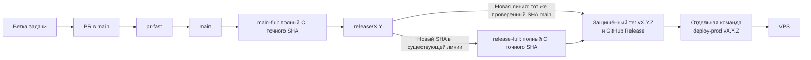
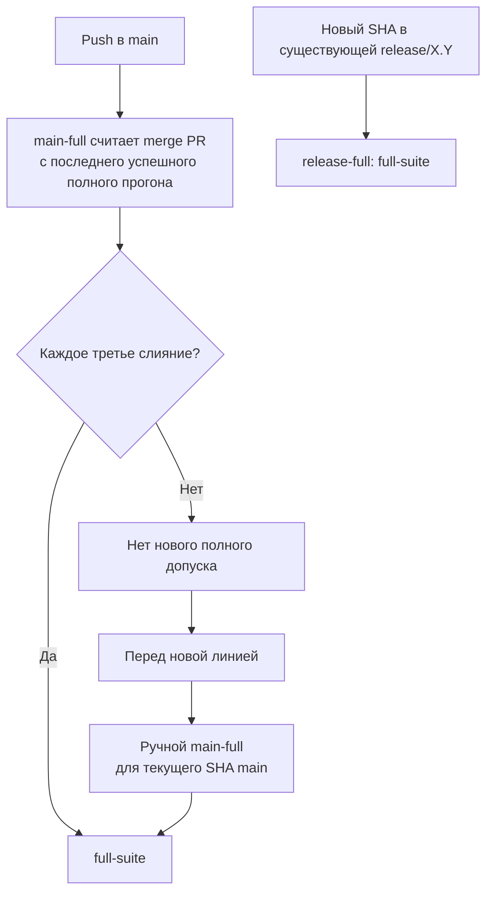

# Релизы и допуск на production

Этот документ объясняет путь изменения до опубликованного релиза и затем до VPS. Практические команды — в [OPERATIONS.md](OPERATIONS.md), фактическое состояние сервера — в [PRODUCTION.md](PRODUCTION.md).

## Маршрут выпуска



Слияние PR, создание тега и публикация GitHub Release **не обновляют VPS**. Для установки нужна отдельная команда `deploy-prod`. Успешный контроллер CI без полного `full-suite` также не даёт допуска к выпуску.

Релизная ветка движется и может содержать несколько уже выпущенных коммитов. Например:

```text
release/1.0: A (v1.0.1) → B (v1.0.2) → C (v1.0.3)
VPS:         A (v1.0.1)
```

`deploy-prod v1.0.2` выберет B и проверит, что B входит в историю `release/1.0`; B не обязан быть вершиной ветки. Контроллер не устанавливает версию с номером ниже уже успешно установленной. Возврат старого runtime выполняется отдельной процедурой.

## 1. Внести изменение через PR

Изменения входят в `main` через PR с **merge commit**. Действующий GitHub ruleset требует:

| Целевая ветка | Обязательные проверки |
| --- | --- |
| `main` | `pr-fast` |
| `release/*` | `pr-fast`, `hotfix-deps` |

Обязательных Approve от людей нет. Перед операцией нужно сверять текущие правила GitHub. Исключение для владельца описано в [аварийном маршруте](#аварийный-маршрут).

`pr-fast` запускается при открытии или повторном открытии PR, новом коммите, изменении описания и смене draft/ready для PR в `main` или `release/*`. Он проверяет тестовое слияние PR с базой, синтаксис Python, отслеживаемые файлы и миграции, ссылки связанных исправлений, фиксированный набор unit-тестов и Compose с синтетической конфигурацией. GitHub отдельно проверяет возможность слияния.

Новый коммит PR запускает новую проверку. Сдвиг `main` без события PR сам по себе **не перезапускает** `pr-fast`. Полный набор тестов на каждом PR не запускается.

## 2. Получить полный CI для точного коммита



При создании линии от уже проверенного SHA `main` полный набор повторно не выполняется. Успешный полный результат того же SHA можно использовать повторно; после неуспешной попытки нужен явный rerun.

`full-suite` проверяет точный checkout, все unittest, три автономных smoke, свежую и предыдущую SQLite-схему, сборку образа и healthcheck. CI работает с тестовыми данными. Он не подтверждает реальные ответы ботов, systemd или production SQLite.

Для обычного выпуска допуск сверяет репозиторий, workflow (`main-full.yml` при создании линии, `release-full.yml` для PATCH), ref, полный SHA, run/attempt и обязательные jobs/steps. `pending`, `skipped`, `failure` и сбой GitHub API закрывают допуск. Проверка другого SHA, даже более позднего в той же линии, не подходит.

## 3. Создать релизную линию и выбрать версию

Новую `release/X.Y` создают через `scripts/create_release_branch.py` из **точного SHA `main`** с успешным полным `main-full`. Скрипт перед записью сверяет вершину `main` и отсутствие занятого имени. Если вершина сдвинулась, нужна новая проверка.

Формат версии — `vMAJOR.MINOR.PATCH`:

| Часть | Когда меняется |
| --- | --- |
| `PATCH` | Исправление существующей линии. |
| `MINOR` | Новая совместимая линия. |
| `MAJOR` | Новая линия с несовместимым публичным поведением или данными. |

Номер выбирают при подготовке выпуска, а не по числу PR. Значения PATCH внутри линии идут последовательно; уже использованную версию не переиспользуют.

## 4. Опубликовать версию

`scripts/publish_release.py` принимает `--change initial|major|minor|patch`, точный SHA вершины линии и файл release notes. Режимы:

| Режим | Результат |
| --- | --- |
| `--check` | Проверяет условия без записи. |
| `--dry-run` | Показывает текст выпуска. |
| `--publish` | Повторяет проверку, создаёт прямой защищённый тег и недрафтовый GitHub Release. |

Нужны чистый checkout, уникальное имя, защита `v*`, Immutable Releases и успешный полный CI **этого SHA**. Для PATCH дополнительно проверяются все merge PR со времени предыдущего выпуска **этой линии** и подтверждённое основание каждого в `main`. Тег, SHA в Release и коммит должны совпадать.

Создание тега и Release не образует транзакцию. При частичном сбое имя остаётся занятым; скрипт не удаляет и не перемещает тег автоматически. Практические команды приведены в [OPERATIONS.md](OPERATIONS.md).

## 5. Установить опубликованный релиз

Обычный `deploy-prod vX.Y.Z` принимает опубликованный GitHub Release с полным допуском точного SHA релизной ветки. Он отдельно проверяет Release и состояние VPS, закрепляет образ, делает backup, останавливает оба канала, при необходимости применяет миграции и проверяет запуск обоих каналов. Перед эксплуатационным действием следуйте [OPERATIONS.md](OPERATIONS.md) и проверьте актуальное состояние по [PRODUCTION.md](PRODUCTION.md).

## Исправления поддерживаемых линий

Владелец выбирает затронутые линии. `main` и каждая выбранная `release/X.Y` получают отдельный PR, если исправления ещё нет в `main`. Все PR группы указывают взаимные **полные URL** в `Hotfix-Links:` своих описаний.

Если исправление уже попало в `main` как часть другой работы, новый PR в `main` не открывают. Каждый релизный PR указывает `Hotfix-Main-Commit:` с URL достижимого коммита `main`; выбранные релизные PR ссылаются друг на друга. Для единственного релизного PR достаточно URL коммита. Эти ссылки помогают найти связанные изменения, но не доказывают смысловую одинаковость патчей.

Порядок слияния:

1. Новый PR в `main` сливают первым после `pr-fast`.
2. Для релизных PR `pr-fast` проверяет код и ссылки, а `hotfix-deps` — фактическое вхождение связанного PR или коммита в `main`.
3. После merge в `main` доверенный workflow повторно запускает актуальный failed `hotfix-deps` всех связанных открытых релизных PR. Он ожидает ещё выполняющиеся checks в ограниченном окне и перед rerun снова сверяет PR и job. `pr-fast` при этом не перезапускается.
4. При заранее включённом GitHub auto-merge методом merge commit GitHub сливает релизный PR после успешных проверок и при отсутствии конфликтов. Можно слить его вручную.

После включения auto-merge связи не редактируют. Чтобы исправить их, сначала отключают auto-merge у **всех** открытых PR группы. Релизные линии независимы: PR другой линии не блокирует слияние, публикацию или deploy текущей.

## Аварийный маршрут

Только владелец может **явно** обойти обязательный `pr-fast` при слиянии PR в защищённую ветку. Это не разрешает прямой или force push. Решение и причину фиксируют отдельно.

`scripts/publish_emergency_release.py` принимает причину и список PR. Он сохраняет проверки ветки, SHA, merge PR, SemVer, защищённого тега и Release, но допускает отсутствующий либо неуспешный полный CI. В Release записываются состояние `pr-fast` на момент merge, обход ruleset, состояние полного CI и непроверенные проверки. PATCH по-прежнему требует подтверждённого основания в `main`; другие линии независимы.

Сервер принимает такой Release только с `--emergency` и `--reason`. Он повторно читает GitHub, различает тип Release и сохраняет проверки SHA, тега, ветки, backup, миграций, здоровья и rollback. Обычный `deploy-prod` аварийный Release отвергает.

GitHub API не доказывает исходный текст изменяемых release notes. Поэтому перед аварийным запуском нужна внешняя запись утверждённого решения и текста. Реальный аварийный Release и переключение VPS пока не испытывались; подтверждены изолированные сценарии. Практический порядок находится в [OPERATIONS.md](OPERATIONS.md).

## Сохранение релизных веток

После выпуска сохраняют активную линию VPS и три предыдущие. Также сохраняют более новые линии и линии, которые поддерживаются, связаны с открытыми PR, незавершённым выпуском или rollback.

`scripts/release_branch_retention.py` строит и повторно проверяет план, но **не удаляет ветки**: GitHub REST delete не принимает expected SHA, так что между чтением и записью остаётся гонка. Удаление требует отдельной безопасной процедуры и разрешения на запись. Это правило не удаляет теги, Releases, образы и серверные записи.
