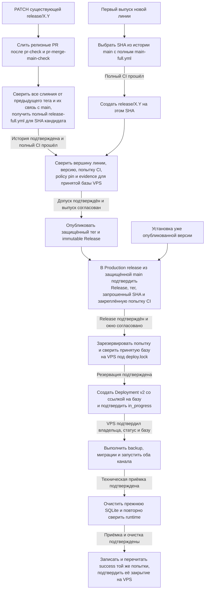
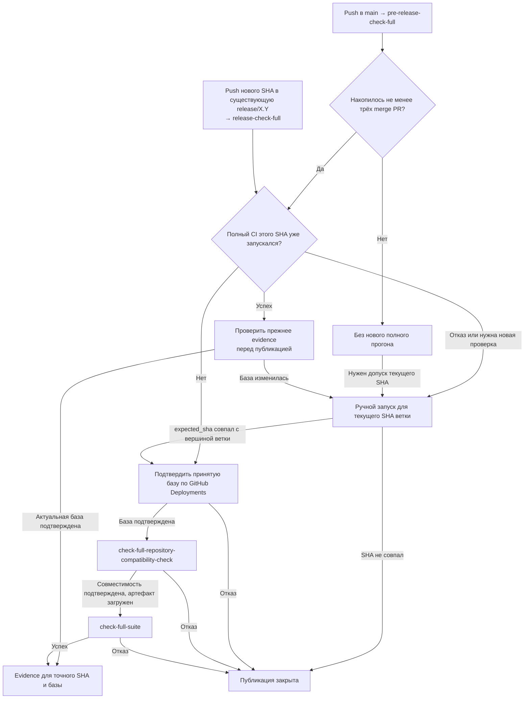

# Релизы и допуск на production

Этот документ объясняет путь изменения до опубликованного релиза и затем до VPS. Практические команды — в [OPERATIONS.md](OPERATIONS.md), фактическое состояние сервера — в [PRODUCTION.md](PRODUCTION.md).

## Маршрут выпуска

Владелец согласует состав выпуска и окно работ. Для действий Codex явное
согласие на `git push` даёт пользователь. Оператор готовит PR, сверяет допуск,
выбирает версию и описание и вручную запускает выпуск. Эту роль может выполнять
человек или Codex с нужными полномочиями. GitHub Actions выполняет проверки и
координирует выпуск, а контроллер на VPS проверяет допуск и установленный runtime.
[Ограничения работы с VPS](PRODUCTION.md#ограничения-для-работы-с-vps)



Маршруты сходятся после проверки опубликованного Release, тега, SHA и
закреплённой попытки CI. Дальше установка, приёмка и восстановление идут
одинаково. Тег предыдущего PATCH задаёт диапазон проверки слияний в линии.
Совместимость SQLite для обоих типов выпуска проверяют относительно последней
принятой установки VPS. После закрытия попытки подтверждённый `success`
даёт принятую базу для следующих полных проверок.

Релизная ветка движется и может содержать несколько уже выпущенных коммитов. Например:

```text
release/1.0: A (v1.0.1) → B (v1.0.2) → C (v1.0.3)
VPS:         A (v1.0.1)
```

Если `v1.0.2` уже опубликован, оператор может указать в `Production release`
эту версию и SHA B. Контроллер проверит вхождение B в историю `release/1.0`
и совместимость выпуска с фактической принятой базой. При установке готового
Release допускается тег, отстающий от вершины ветки. Контроллер отвергает
версии ниже уже успешно установленной. Возврат старого runtime выполняется
[отдельной процедурой](OPERATIONS.md#отказ-выпуска-и-возврат).

## 1. Внести изменение через PR

Изменения входят в защищённые ветки через PR с **merge commit**. Для слияния
GitHub ruleset требует следующие проверки.

| Целевая ветка | Обязательные проверки |
| --- | --- |
| `main` | `pr-check` |
| `release/*` | `pr-check`, `pr-merge-main-check` |

Перед слиянием сверьте актуальные требования GitHub к проверкам и review.
Исключение для владельца описано в [аварийном маршруте](#аварийный-маршрут).

`pr-check` запускается при открытии или повторном открытии PR, новом коммите, изменении описания и смене draft/ready для PR в `main` или `release/*`. Он проверяет тестовое слияние PR с базой, синтаксис Python, отслеживаемые файлы и миграции, ссылки связанных исправлений, фиксированный набор unit-тестов и Compose с синтетической конфигурацией. GitHub отдельно проверяет возможность слияния.

При каждом таком прогоне `pr-check` проверяет все отслеживаемые Git файлы
Markdown в тестовом слиянии. Проверка сверяет внутренние ссылки и якоря
поддерживаемого синтаксиса. Если PR удаляет заголовок, проверка укажет на
ссылки из других документов, даже когда в PR эти документы не менялись.
Способ локального запуска описан в разделе
[Проверить ссылки Markdown](RUN.md#проверить-ссылки-markdown).

Новый коммит PR запускает новую проверку. Сдвиг `main` без события PR сам по себе **не перезапускает** `pr-check`. Полный набор тестов на каждом PR не запускается.

## 2. Получить полный CI для точного коммита



Контроллер `main` считает подтверждённые merge PR по линии первых родителей
с последнего успешного полного прогона или с исходной точки включения workflow.
Успешный контроллер с пропущенным `check-full-suite` нового допуска не даёт.
При создании линии контроллер `release-check-full` проверяет успех
`pre-release-check-full` того же SHA и пропускает повтор полного набора.
Актуальность evidence этого SHA проверяется перед публикацией.

Для ручного повтора выберите `pre-release-check-full` для `main` или
`release-check-full` для существующей `release/X.Y` и укажите текущий полный
`expected_sha` ветки. После смены принятой базы нужен свежий прогон,
даже если прежний результат того же SHA был успешным.
[Как повторить CI](OPERATIONS.md#повторить-полный-ci-для-точного-sha)

Перед каждым полным прогоном CI проверяет последнюю созданную попытку
в окружении `production` и её текущий статус. Для задачи
`compadre:acceptance` доверенный `success` Deployment v2 подтверждает базу
этой записи. `failure` подтверждает прежнюю базу только по прямой ссылке
на её действующий `success` с квитанцией возврата. Попытка v2 без статуса,
с `in_progress` или неизвестным статусом закрывает допуск. Недоверенный
автор, посторонняя запись, неполное чтение и неоднозначность также закрывают
допуск. При истории только v1 читатель выбирает текущий доверенный `success`
с максимальным временем статуса. [Проверить принятую базу](OPERATIONS.md#проверить-принятую-базу)

Читатель сверяет авторов записи и статуса, immutable Release и точный тег.
Доказательство CI версии 3 закрепляет версию и SHA базы, ID Release,
Deployment и статуса, SHA кандидата и политики, run/attempt и результаты
проверок точной пары. Контроллер читает опубликованные доказательства версий
1 и 2 по их закреплённым политикам.

Проверка совместимости выгружает точный принятый коммит и подставляет
миграции кандидата в его временную копию. Она обнаруживает тесты из
принятого коммита стандартным `unittest discover -s tests`, сверяет найденные
и начатые тесты и записывает причины штатных пропусков. Ошибки загрузки,
дубликаты, пропущенный запуск найденного теста и несовместимое поведение
закрывают допуск. Тесты конкретных исторических миграций используют свои
SQL-фикстуры. Рабочие сценарии проверяют код принятого коммита на текущей
схеме кандидата во временных SQLite-БД.

Runner отдельно выполняет дополнительные проверки из доверенной ревизии.
Прежний код должен прочитать и обновить записи кандидата, а кандидат —
прочитать эти обновления. В отчёте сверяются отпечатки схемы чистой установки,
обновления и работы прежнего кода. Затем `check-full-suite` отдельно проверяет
код и тесты точного кандидата, включая smoke-проверки и собранный образ.

Внешний `COMPATIBILITY_POLICY_SHA` закрепляет workflow, проверочные скрипты
и формат проверки. Начиная с версии 3 политика задана в проверочном коде.
Для опубликованных доказательств версий 1 и 2 проверка читает JSON из
соответствующего доверенного коммита. CI определяет состав тестов при каждом
прогоне. При смене принятого коммита или состава его тестов используется
прежний pin.
[Порядок обновления политики](OPERATIONS.md#обновить-доверенную-политику-полного-ci)

Оба полных workflow вызывают [full-suite.yml](../.github/workflows/full-suite.yml)
при необходимости полного прогона. Название задач в GitHub API включает
имя вызывающего workflow, например `pre-release-check-full / check-full-suite`.

| Проверка | Когда и что проверяет |
| --- | --- |
| [`pr-check`](../.github/workflows/pr-fast.yml) | Проверяет пробное слияние PR с базой перед merge в `main` или `release/*`. |
| [`pr-merge-main-check`](../.github/workflows/pr-fast.yml) | Для PR в `release/*` подтверждает, что связанный PR или коммит уже вошёл в `main`. |
| [`pr-merge-main-rerun`](../.github/workflows/hotfix-deps-rerun.yml) | После связанного merge в `main` повторяет актуальную упавшую задачу `pr-merge-main-check` открытого релизного PR. |
| [`pre-release-check-full`](../.github/workflows/main-full.yml) | На push в `main` или при ручном запуске определяет, нужен ли полный CI. Его полный результат нужен для новой релизной линии. |
| [`release-check-full`](../.github/workflows/release-full.yml) | На push в `release/*` или при ручном запуске определяет, нужен ли полный CI. Его полный результат нужен для PATCH. |
| `check-full-repository-compatibility-check` | Сверяет закреплённую политику, запускает полный набор принятой версии на схеме кандидата и сохраняет артефакт с результатами точной пары SHA и отпечатком схемы. |
| `check-full-suite` | После успеха предыдущей задачи и получения хеша её артефакта сверяет checkout, запускает все unittest, три автономные smoke-проверки, проверяет свежую и предыдущую SQLite-схему, собирает образ и проверяет его healthcheck. |
| `ci-metrics` | Собирает длительность и результат задач и шагов после PR или запуска полного workflow, в том числе при пропуске полного набора. Допуск определяется результатами обязательных задач и шагов. |

В шаге `Run three autonomous smoke checks` последовательно выполняются
`sqlite-smoke` для записи и чтения статьи, `pipeline-smoke` для обработки
статьи с подставными загрузчиком и извлекателем, затем `analysis-smoke` с
подставным LLM-анализатором. Все три работают с тестовыми БД. VPS отдельно
выполняет smoke внутри собранного образа при подготовке кандидата.
[Команды smoke](RUN.md#7-проверить-sqlite-контур)

При публикации CI evidence должно соответствовать актуальной принятой базе.
На VPS контроллер сверяет эту же запись и фактический `last_good` под deploy
lock. Затем он мигрирует приватную копию рабочей SQLite и сравнивает её
с отпечатком схемы из CI. Ошибка любой сверки останавливает установку до
переключения БД.

Для обычного выпуска допуск сверяет репозиторий, workflow (`main-full.yml` при создании линии, `release-full.yml` для PATCH), ref, полный SHA, run/attempt и обязательные jobs/steps. `pending`, `skipped`, `failure` и сбой GitHub API закрывают допуск. Проверка другого SHA, даже более позднего в той же линии, не подходит.

## 3. Создать релизную линию и выбрать версию

Новую `release/X.Y` создают через `scripts/create_release_branch.py` из
**точного SHA в истории `main`** с успешным полным `pre-release-check-full`.
Перед записью скрипт повторно сверяет достижимость SHA из текущей вершины
`main` и свободное имя ветки. Для проверки другого SHA получите его
собственный полный CI. [Команды создания ветки](OPERATIONS.md#подготовка-и-запуск-версии)

Формат версии — `vMAJOR.MINOR.PATCH`:

| Часть | Когда меняется |
| --- | --- |
| `PATCH` | Исправление существующей линии. |
| `MINOR` | Новая совместимая линия. |
| `MAJOR` | Новая линия с несовместимым публичным поведением или данными. |

Номер выбирают при подготовке выпуска, а не по числу PR. Значения PATCH внутри линии идут последовательно; уже использованную версию не переиспользуют.

## 4. Опубликовать версию

В обычном выпуске публикацию выполняет workflow. Для предварительного
просмотра можно использовать `--check` и `--dry-run`. Для отдельной
публикации предусмотрен `--publish`.

`scripts/publish_release.py` принимает `--change initial|major|minor|patch`, точный SHA вершины линии и файл release notes. Режимы:

| Режим | Результат |
| --- | --- |
| `--check` | Проверяет условия без записи. |
| `--dry-run` | Показывает текст выпуска. |
| `--publish` | Повторяет проверку, создаёт защищённый аннотированный тег и недрафтовый GitHub Release. |

Для обеих ветвей нужны уникальное имя, защита `v*`, Immutable Releases и
полный CI **этого SHA**. Для PATCH из `Production release` скрипт сверяет
вершину релизной ветки через GitHub API. Он идёт по первым родителям от
кандидата до тега предыдущего выпуска линии и подтверждает для каждого
merge релизный PR и слитый PR в `main` или достижимый `Hotfix-Main-Commit`.
Код runner берётся из защищённой `main`, поэтому SHA этих двух веток могут
различаться.

Для первой публикации новой линии workflow требует, чтобы checkout `main`
совпал с SHA кандидата. Если `main` ушла вперёд, опубликуйте версию отдельно
из чистого checkout кандидата и установите готовый Release через workflow.
Отдельная публикация PATCH также требует чистого checkout кандидата.
Во всех случаях тег, SHA в Release и коммит должны совпадать.

Манифест Release закрепляет ссылку на точные run/attempt. Аннотация тега
обычного выпуска закрепляет те же run/attempt, SHA и идентификаторы базы
из evidence, SHA доверенной policy и отпечаток схемы SQLite. Перед созданием
тега скрипт повторно сверяет принятый Deployment и policy pin. Если база
изменилась, получите свежий полный CI до публикации.
[Проверка допуска на VPS](OPERATIONS.md#проверить-допуск-на-vps)

При публикации обычного выпуска скрипт добавляет в описание последнюю
ожидаемую миграцию SQLite из точного коммита, проверенного в CI. Для
исторического `v3.2.0` фактические поколение и миграция закреплены в теге
`production/v3.2.0`. Начиная с `v3.3.0` их фиксирует запись GitHub
Deployments с текущим доверенным `success`.
[Сводка SQLite](OPERATIONS.md#посмотреть-sqlite-опубликованной-версии)
показывает обе части из источника соответствующего выпуска. При допуске VPS
отдельно подтверждает актуальный runtime и соответствие доказательства CI
записи о принятом выпуске.

Создание тега и Release не образует транзакцию. При частичном сбое имя остаётся занятым; скрипт не удаляет и не перемещает тег автоматически. Практические команды приведены в [OPERATIONS.md](OPERATIONS.md).

## 5. Установить опубликованный релиз

После согласования окна и проверки актуального состояния VPS вручную
запустите `Production release` из защищённой `main` с режимом `release`.
В workflow введите точную версию, полный SHA, тип изменения и release notes.
Runner сверяет опубликованный immutable Release и резервирует попытку на VPS.
До команды установки он создаёт Deployment v2 со ссылкой на принятую базу и
подтверждает его текущий `in_progress`. Контроллер сверяет владельца попытки,
допуск точного SHA и фактическую базу, закрепляет образ и проверяет миграции
на приватной копии SQLite. Затем он останавливает writers, сохраняет backup,
переключает поколение SQLite и проверяет запуск обоих каналов.
[Ручной запуск workflow](OPERATIONS.md#выпустить-обычную-версию-из-github-actions),
[правила доступа к VPS](PRODUCTION.md)

После установки runner сверяет техническую приёмку. Контроллер проверяет
runtime и backup и очищает прежнее поколение в рамках согласованного запуска.
Затем runner повторно сверяет приёмку и точную попытку CI, записывает и
перечитывает `success` этого Deployment и подтверждает закрытие попытки на VPS.
При обрыве дождитесь завершения предыдущего запуска. Для продолжения
зарезервированной попытки выберите `resume` с той же версией и SHA. В
`source_attempt` укажите исходный ключ `run_id:run_attempt`. Проверку живых
ответов ботов выполняет владелец, техническую приёмку выполняет workflow.
После подтверждения `success` следующий полный CI использует принятый выпуск
автоматически. Обновление доверенной политики требуется при изменении
закреплённых workflow, политики или проверочного кода.
[Проверить запись приёмки](OPERATIONS.md#проверить-запись-приёмки) ·
[Возобновить попытку Deployment v2](OPERATIONS.md#возобновить-попытку-deployment-v2)

Controller устанавливается отдельным автономным snapshot из проверенного
commit; его SHA и digest не заменяют SHA/CI приложения. Перед выпуском
проверяют Git-байты snapshot, изолированные imports, точные wrapper и
selector-aware systemd/backup units, права и внешний policy pin. Перед
marker/stop controller повторно сверяет точную Release/CI пару, artifact,
schema fingerprint и image/OCI. Доступ оператора к Docker и `data` сохраняется;
на время установки действует окно без ручных writers и второго polling с теми
же credentials. Наличие snapshot само по себе не разрешает deploy.

Для SQLite v2 контроллер останавливает writers, делает проверенную копию
выбранной БД, применяет миграции к **новому поколению** и публикует selector
только после durable intent. До записи admission возможен проверенный возврат
к прежнему поколению. После durable admission новая БД может содержать записи
новых ботов: автоматическое переключение на старый файл запрещено. При отказе
нужны сохранённые state/marker и отдельный проверенный recovery. Очистка
после подтверждённого выпуска удаляет только зарегистрированное прежнее
поколение и его sidecars. Backup сохраняется. Действующий порядок и узкий
forward recovery описаны в [OPERATIONS.md](OPERATIONS.md#отказ-выпуска-и-возврат).
Установка v3.2.0 завершилась именно forward recovery после отказа исходного
`deploy-prod`; [итог и ограничения](RELEASE_REVIEW.md) записаны отдельно.

### Вывести из использования поле SQLite

1. Если принятый выпуск использует старое поле, сохраните его в переходном
   выпуске и переведите рабочие чтения и записи на новый контракт. Пометьте
   `Deprecated` старое поле в описании схемы и оставшийся переходный код
   рядом с его объявлением. Укажите замену и условие удаления. Если поле
   заменяется, перенесите нужные данные и проверьте совместимость чтения и
   записи с предыдущим принятым выпуском.
2. После технической приёмки переходного выпуска и записи его `success`
   проверьте, что этот выпуск стал базой совместимости и его рабочий код
   больше не зависит от старого поля. В следующем выпуске удалите поле
   новой миграцией и уберите оставшийся переходный код. Пройдите полный CI
   и проверку сохранности данных на копии рабочей SQLite. Уже применённые
   миграции сохраняют свои имена и содержимое.

## Исправления поддерживаемых линий

Владелец выбирает затронутые линии. `main` и каждая выбранная `release/X.Y` получают отдельный PR, если исправления ещё нет в `main`. Все PR группы указывают взаимные **полные URL** в `Hotfix-Links:` своих описаний.

Если исправление уже попало в `main` как часть другой работы, новый PR в `main` не открывают. Каждый релизный PR указывает `Hotfix-Main-Commit:` с URL достижимого коммита `main`; выбранные релизные PR ссылаются друг на друга. Для единственного релизного PR достаточно URL коммита. Эти ссылки помогают найти связанные изменения, но не доказывают смысловую одинаковость патчей.

Порядок слияния:

1. Новый PR в `main` сливают первым после `pr-check`.
2. Для релизных PR `pr-check` проверяет код и ссылки, а `pr-merge-main-check` — фактическое вхождение связанного PR или коммита в `main`.
3. После merge в `main` доверенный workflow повторно запускает актуальный failed `pr-merge-main-check` всех связанных открытых релизных PR. Он ожидает ещё выполняющиеся checks в ограниченном окне и перед rerun снова сверяет PR и job. `pr-check` при этом не перезапускается.
4. При заранее включённом GitHub auto-merge методом merge commit GitHub сливает релизный PR после успешных проверок и при отсутствии конфликтов. Можно слить его вручную.

После включения auto-merge связи не редактируют. Чтобы исправить их, сначала отключают auto-merge у **всех** открытых PR группы. Релизные линии независимы: PR другой линии не блокирует слияние, публикацию или deploy текущей.

По решению владельца ранее выпущенные линии синхронизируют с доверенной
политикой полного CI при подготовке следующего выпуска с соответствующей
ветки. Перед выпуском сверяют `main-full.yml`, `release-full.yml` и
`full-suite.yml` кандидата с действующим `COMPATIBILITY_POLICY_SHA`.
При расхождении включают нужные изменения в релизный PR и получают полный
CI для точного SHA после слияния. Опубликованные теги и их доказательства
сохраняются.

## Аварийный маршрут

Только владелец может **явно** обойти обязательный `pr-check` при слиянии PR в защищённую ветку. Это не разрешает прямой или force push. Решение и причину фиксируют отдельно.

`scripts/publish_emergency_release.py` принимает причину и список PR. Он сохраняет проверки ветки, SHA, merge PR, SemVer, защищённого тега и Release, но допускает отсутствующий либо неуспешный полный CI. В Release записываются состояние `pr-check` на момент merge, обход ruleset, состояние полного CI и непроверенные проверки. PATCH по-прежнему требует подтверждённого основания в `main`; другие линии независимы.

Контроллер аварийной установки повторно читает GitHub, проверяет тип Release,
SHA, тег и ветку и выполняет проверки backup, миграций, здоровья и возврата.
Штатный workflow Deployment v2 принимает обычные Release. Продолжение через
прежний писатель v1 оставило бы несовместимую запись и остановило выбор
принятой базы. Перед аварийной установкой владелец согласует способ приёмки,
совместимый с историей v2. [Публикация и условия аварийной версии](OPERATIONS.md#аварийная-версия)

При аварийной установке действующий контроллер требует успешный
`check-full-repository-compatibility-check` и проверенное evidence точной пары
установленного и устанавливаемого SHA. Отсутствие evidence закрывает допуск
до остановки каналов. [Проверка допуска на VPS](OPERATIONS.md#проверить-допуск-на-vps)

GitHub API не доказывает исходный текст изменяемых release notes. Поэтому перед аварийным запуском нужна внешняя запись утверждённого решения и текста. Реальный аварийный Release и переключение VPS пока не испытывались; подтверждены изолированные сценарии. Практический порядок находится в [OPERATIONS.md](OPERATIONS.md).

## Сохранение релизных веток

После выпуска сохраняют активную линию VPS и три предыдущие. Также сохраняют более новые линии и линии, которые поддерживаются, связаны с открытыми PR, незавершённым выпуском или rollback.

`scripts/release_branch_retention.py` строит и повторно проверяет план, но **не удаляет ветки**: GitHub REST delete не принимает expected SHA, так что между чтением и записью остаётся гонка. Удаление требует отдельной безопасной процедуры и разрешения на запись. Это правило не удаляет теги, Releases, образы и серверные записи.
