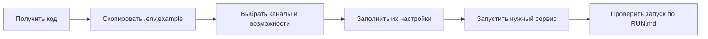

# Подготовка проекта

Здесь описана первая локальная настройка: получить код, выбрать каналы и
возможности, заполнить `.env` и запустить нужный сервис. Проверки и команды
после запуска находятся в [RUN.md](RUN.md); настройка GitHub App — в
[GITHUB_APP.md](GITHUB_APP.md).



Неактивная возможность не читает свой профиль. Для выбранного канала нужны его
credentials; Compose сам не отключает сервис с пустым токеном.

## Получить код

Нужны Git и Docker Engine с Docker Compose (на Windows — Docker Desktop,
настроенный для Linux-контейнеров). Python на хосте нужен только для запуска
и тестов вне Docker; образ уже содержит Python 3.12.

```powershell
git clone https://github.com/karateka-git/compadre-assistant.git
cd compadre-assistant
Copy-Item .env.example .env
```

В Linux/macOS вместо последней команды используйте `cp .env.example .env`.
Все дальнейшие команды выполняются из корня клонированного репозитория.
Для чтения публичного репозитория доступ на push не требуется.

## Заполнить конфигурацию

`.env.example` — шаблон, который нужно заполнить: с `replace-me` или пустыми
токенами выбранных каналов приложение не готово к запуску. Общие переменные
читает [`core/data/config.py`](../compadre_assistant/core/data/config.py), а настройки
Obsidian — [`capabilities/obsidian/data/configuration/config.py`](../compadre_assistant/capabilities/obsidian/data/configuration/config.py).

Сначала выберите `ENABLED_CHANNELS` и `ENABLED_CAPABILITIES`, затем заполните
соответствующие группы переменных. Неполная группа включённой возможности
останавливает запуск. Для Ask используйте [отдельный профиль](#настройка-ask).

| Переменные | Назначение и обязательность |
| --- | --- |
| `APP_ENV`, `DATABASE_PATH` | Обязательны; в шаблоне `local` и `data/app.db`. Путь отсчитывается от рабочей папки процесса; в Docker она `/app`. |
| `ENABLED_CAPABILITIES` | Верхняя серверная граница: список ID через запятую, по умолчанию `obsidian`. Пустая строка отключает все входы и чтение их настроек. Изменение применяется после перезапуска; личное `/enable` не включает отсутствующий в списке ID. |
| `ENABLED_CHANNELS` | `telegram`, `vk` или `telegram,vk` (по умолчанию оба). Выбирает сервисы для scripts и проверки общего healthcheck. Явный флаг бота/`--channels` выбирает канал текущей команды. |
| `APP_DEBUG` | Необязателен, по умолчанию `false`. |
| `TELEGRAM_BOT_TOKEN` | Токен от BotFather; обязателен только для выбранного Telegram. Startup и healthcheck проверяют его форму. |
| `TELEGRAM_PROXY_URL` | Необязательный URL SOCKS5/SOCKS4/HTTP-прокси для запросов Telegram Bot API, например `socks5://10.77.77.1:1080`. Пустое значение сохраняет прямой доступ; VK, GitHub и AI Gateway эту настройку не используют. Если прокси требует пароль, храните URL только в `.env`, вне Git. |
| `VK_BOT_TOKEN`, `VK_GROUP_ID` | Токен сообщества и положительный ID группы для VK. Для бота нужно настроить сообщения сообщества и Bots Long Poll. |
| `OPENAI_BASE_URL`, `OPENAI_API_KEY`, `OPENAI_MODEL` | LLM Obsidian: заполнить все три для анализа/review или оставить все пустыми. Пустая группа разрешает общие команды; Obsidian сообщает о ненастроенном LLM. Частичная группа — ошибка startup. При выключенном Obsidian не читается. |
| `EMBEDDING_BASE_URL`, `EMBEDDING_API_KEY`, `EMBEDDING_DOCUMENT_MODEL`, `EMBEDDING_QUERY_MODEL` | Для semantic search заполнить все четыре. Частично заполненная группа вызывает ошибку. |
| `EMBEDDING_PRICE_PER_MILLION_TOKENS`, `EMBEDDING_PRICE_CURRENCY`, `EMBEDDING_TARIFF_VERSION` | Необязательная группа оценки стоимости: заполнить все три или оставить все пустыми. Цена конечная и неотрицательная, валюта — три заглавные латинские буквы. |
| `CHUNK_MINIMUM_SIZE_CHARS`, `CHUNK_TARGET_SIZE_CHARS`, `CHUNK_MAXIMUM_SIZE_CHARS` | Необязательные положительные целые, по умолчанию `300`, `3000`, `6000`; требуется `minimum <= target <= maximum`. |
| `OBSIDIAN_CREATED_NOTE_TAG` | Необязательное имя служебного Obsidian-тега без `#`. Если переменная отсутствует, используется `knowledge-catcher`; значение `off` без учёта регистра отключает маркировку. Пустое или некорректное заданное значение вызывает ошибку конфигурации. |
| `GITHUB_APP_ID`, `GITHUB_CLIENT_ID`, `GITHUB_APP_SLUG`, `GITHUB_PRIVATE_KEY_PATH` | Заполнить все четыре для работы с vault или оставить всю группу пустой. Для полного сценария бота GitHub App необходима. |

Compose и прямой Python используют независимые `OPENAI_API_KEY` и
`EMBEDDING_API_KEY`; одинаковые значения при общем Gateway задаются явно.
См. примеры endpoint/model в [RUN.md](RUN.md#настройки-embeddings).

Для отключения semantic search оставьте все семь `EMBEDDING_*` пустыми.
Останется FTS-поиск; это начальное значение нового шаблона. При выключенном
Obsidian не читаются GitHub, LLM, embeddings, chunking и тег заметок, включая
неверные значения. При включённом Obsidian частичные группы и неверные настройки
блокируют запуск с конкретной диагностикой; полностью пустой GitHub допустим,
но подключение/sync/write-back будут недоступны. Отсутствующие providers не
превращаются в сообщение об отсутствии vault пользователя.

### Подготовить GitHub App для Obsidian

Создание GitHub App и получение PEM описаны в [GITHUB_APP.md](GITHUB_APP.md).
Поместите PEM в `data/github-app.pem`, а в `.env` задайте
`GITHUB_PRIVATE_KEY_PATH=data/github-app.pem`: каталог `data/` смонтирован в
контейнер как `/app/data`. Путь Windows вне этого тома контейнеру недоступен.
До подключения vault подготовьте обязательные правила по той же инструкции.

### Учесть поведение служебного тега

Служебный тег добавляется только новым заметкам из предложений `add` и только в
YAML frontmatter; при отсутствии frontmatter приложение создаёт его. `update`
не маркирует пользовательские заметки задним числом и сохраняет исходные
frontmatter tags уже существующей заметки. Изменение настройки не выполняет
массовую маркировку старых файлов. При `OBSIDIAN_CREATED_NOTE_TAG=off` приложение
не добавляет marker; для безопасного `update` оно также не принимает новые tags
от LLM, поскольку прежнее имя marker определить невозможно.

## Запустить нужный канал

После запуска Docker Engine:

| Выбранные каналы | Команда из корня проекта |
| --- | --- |
| Только Telegram | `docker compose up --build tg_assistant` |
| Только VK | `docker compose up --build vk_assistant` |
| Telegram и VK | `docker compose up --build` |

Для обоих каналов оба набора channel credentials должны быть заполнены.
Compose не отключает сервис автоматически, если его токен отсутствует.
Для привычных `open-*.cmd` задайте `ENABLED_CHANNELS=telegram` или `vk`;
scripts запускают выбранные сервисы. Отдельные bot-флаги и контейнерный healthcheck
проверяют только канал соответствующего сервиса.
Каталог `data/` хранит рабочую SQLite и PEM вне образа.

Дальнейшие проверки, пользовательские команды и диагностика — в
[RUN.md](RUN.md) и [OPERATIONS.md](OPERATIONS.md).

## Разработка без Docker

Используйте Python 3.12, как в Dockerfile. В Windows:

```powershell
py -3.12 -m venv .venv
.\.venv\Scripts\python.exe -m pip install -r requirements.txt
.\.venv\Scripts\python.exe -m unittest discover -s tests
.\.venv\Scripts\python.exe -m compadre_assistant --sqlite-smoke
.\.venv\Scripts\python.exe -m compadre_assistant --pipeline-smoke
.\.venv\Scripts\python.exe -m compadre_assistant --analysis-smoke
```

В Linux/macOS создайте среду через `python3.12 -m venv .venv` и используйте
`.venv/bin/python`. Активация среды при таких командах не нужна.
Тесты используют `unittest`; отдельная установка pytest не требуется.
Smoke-режимы используют временные базы и fake-зависимости, не требуют `.env`
и не проверяют реальные API. Боты запускаются той же командой Python с флагом
`--telegram-bot` или `--vk-bot`, уже с заполненной `.env`.

Прямые runtime-зависимости закреплены в [requirements.txt](../requirements.txt),
но транзитивные зависимости отдельным lock-файлом не зафиксированы.
SQLite входит в Python; сборка SQLite должна поддерживать FTS5.

## Настройка Ask

В `ENABLED_CAPABILITIES` разрешены четыре сочетания: пустое значение (общие
команды), `obsidian`, `ask`, `obsidian,ask`. После изменения перезапустите ботов.
Это только разрешение серверу собрать входы. Для нового и существующего
`AppUser` без явной личной настройки Ask выбран, а Obsidian выключен;
`/enable obsidian` включает его для профиля без перезапуска. Чтобы новый
пользователь мог вызвать `/ask`, добавьте `ask` в серверный список и задайте
профиль Ask ниже. Если `ask` отсутствует в списке, `/enable ask` получает отказ,
даже когда личный default включён; прежний личный выбор сохраняется в SQLite.
Ask требует собственные `ASK_BASE_URL`, `ASK_API_KEY`, `ASK_MODEL`. Это endpoint
OpenAI-compatible Chat Completions API, ключ и ID модели у провайдера. Настройки
Obsidian `OPENAI_*`, GitHub и embeddings для Ask не нужны. Даже при одном
провайдере значения обоих профилей задаются явно.

| Переменная | Значение по умолчанию и смысл |
| --- | --- |
| `ASK_TIMEOUT_SECONDS` | `60`: положительный timeout сетевых операций SDK в секундах; не общий deadline запроса. |
| `ASK_MAX_QUESTION_CHARS` | `12000`: положительный лимит Unicode-символов после удаления внешних пробелов. |
| `ASK_MAX_RESPONSE_TOKENS` | `2000`: положительный лимит генерации у провайдера. |
| `ASK_MAX_RESPONSE_CHARS` | `16000`: положительный лимит символов ответа; превышение считается ошибкой. |

При включённом Ask пустой или некорректный профиль блокирует startup и проваливает
healthcheck. Отключённый Ask не читает профиль, не создаёт клиент и отсутствует
в `/help` как доступный вход. Healthcheck проверяет профиль и SQLite без вызова
LLM API; успешная проверка не доказывает доступность модели или достаточный
баланс провайдера.
