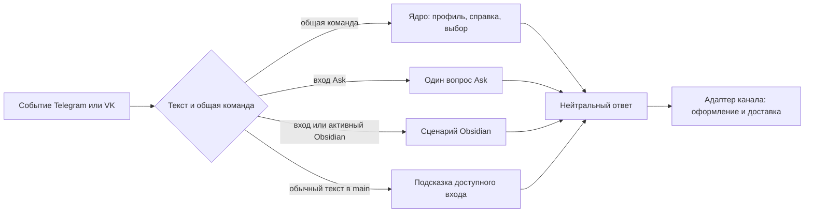

# Пользовательские сообщения

Этот документ задаёт правила для новых ответов ядра, Ask и Obsidian. Действующие
сценарии и формулировки описаны в [реестре ядра](user-messages/CORE.md),
[реестре Ask](user-messages/ASK.md) и
[реестре Obsidian](user-messages/OBSIDIAN.md). Пользовательские команды и
порядок работы приведены в [RUN.md](RUN.md#13-посмотреть-доступные-команды),
а границы модулей и каналов — в [ARCHITECTURE.md](ARCHITECTURE.md).

## Выбрать ответ по состоянию чата

Общий обработчик сначала проверяет команду ядра, профиль, доступность
возможности, активный режим конкретного чата и ожидаемый ввод. После этого
сообщение получает ядро, одноразовый Ask либо presentation выбранной
возможности. Ядро не распознаёт ссылки, статьи и другие предметные данные
Obsidian. Ask отвечает на один вопрос без смены сохранённого режима.

Вложение без текста получает короткую просьбу прислать текст или открыть
`/help` до предметного обработчика. `/help` показывает только действия,
допустимые в текущем состоянии: до регистрации — `/register` и `/link`, после
регистрации — общие команды и доступные входы, в активном Obsidian — команды
режима. Проверенное ожидание значения добавляет к справке конкретный следующий
шаг и `/cancel`. Актуальные адресные подтверждения выводятся отдельным блоком;
неполный снимок не выдаётся за полный.

## Написать текст

- Обращайся к пользователю на «ты». Называй Ask и Obsidian «возможностями», а
  «режимом» — длительное состояние конкретного чата. При первом объяснении
  Obsidian используй «хранилище заметок (vault)», далее — «хранилище».
- Сначала скажи, что произошло или что нужно сделать; затем укажи существенное
  состояние и только необходимый следующий шаг. Короткому результату достаточно
  одного предложения. При ошибке объясни, что осталось неизменным и какое
  конкретное действие доступно дальше, если это известно из сценария.
- Сохраняй точные имена команд, параметры, коды и пути. В справке, подсказке и
  ошибке одна команда должна называться одинаково. Пользовательские команды
  Obsidian используют `/vault_status`, `/vault_sync` и `/vault_disconnect`.
  Подсказки аргументов внутри `<…>` в ответах используют английские слова,
  например `/ask <question>`.
- Не показывай внутренний стек ошибки, технические ID и подробности
  конфигурации без необходимости для следующего действия. Не обещай
  сохранность данных, безопасный повтор или срок, если их не гарантирует
  конкретный сценарий.
- Успех оставляй без лишних поздравлений; запрос ввода должен назвать значение,
  срок и отмену, когда они существуют. Если бот продолжает обработку в фоне,
  скажи, что запрос принят и итог придёт в тот же чат. Справка перечисляет
  доступные сейчас группы команд, а не весь каталог приложения.

## Показать действие и сохранить текстовый путь

Команда без нужного аргумента может начать ожидание следующего сообщения в
этом чате. Ожидание действует десять минут, неверное значение не продлевает
срок; `/cancel` снимает его, не меняя активный режим. Кнопка под ответом
помогает выбрать конкретный вариант, но полный текст команды должен оставаться
доступен и для ручного ввода. Старое меню или кнопка не дают права выполнить
устаревшее действие: выбор снова проверяет профиль, чат, доступ и актуальность.

Для подтверждения показывай короткие `да` и `нет` только при одном однозначном
ожидании Obsidian в исходном чате. При нескольких ожиданиях или переносе
привязки канала показывай полные адресные команды `/confirm … yes` и
`/confirm … no`; `/confirm` без аргументов лишь перечисляет актуальные
действия и ничего не исполняет. Не предлагай `y`/`n` в пользовательском тексте.

## Оформить и доставить ответ

Presentation передаёт `MessageContent`: упорядоченные абзацы и списки из
буквальных `TextSpan` со смысловыми стилями `PLAIN`, `EMPHASIS`, `CODE`.
Текст пользователя, URL, путь, diff, Markdown статьи и ответ модели остаются
данными: HTML и Markdown внутри них не разбираются как доверенная разметка.
Короткий ответ не нуждается в заголовке; списки и пустые строки добавляй там,
где они улучшают чтение. Выделяй короткий смысловой фрагмент, не целый абзац.

Telegram экранирует каждый фрагмент и отправляет HTML, добавляя `<b>` для
`EMPHASIS` и `<code>` для `CODE`. VK отправляет буквальный текст и, где диапазоны
однозначны, `format_data`: жирный для `EMPHASIS`, курсив для `CODE` по
согласованному виду клиента. При emoji и других неоднозначных смещениях VK
использует обычный текст. Это изменение вида не должно удалять символы.
Маркеры `**…**`, обратные кавычки и `<b>…</b>` в исходных данных остаются
буквальными символами.

Длинные ответы делятся по лимиту канала с сохранением порядка, пробелов,
переносов и типичных составных символов. Каждая Telegram-часть содержит
самостоятельно закрытую HTML-разметку; смещения VK пересчитываются для каждой
части. Кнопка ответа прикрепляется к последней части. Если локальная
сериализация кнопки невозможна, весь текст и полные команды отправляются без
неё; сетевой сбой сам по себе не запускает повторную отправку всего ответа.

## Проверить изменение текста

Перед правкой найди владельца формулировки: общие ответы принадлежат ядру,
вопросы — Ask, хранилище и статьи — Obsidian; адаптеры только оформляют и
доставляют готовое содержание. Сверь обычный результат, ошибку, ожидание,
повтор, подтверждение и длинный ответ с кодом и тестами. Проверяй переменные
данные со спецсимволами, кириллицей и emoji, а также точные команды и
доступность текстового пути без кнопок. Автоматические тесты не доказывают
визуальный вид и реальную доставку в клиентах. На 30.10.2026 пользователь
подтвердил `/help` и меню в личных чатах Telegram и VK после recovery; эта
ограниченная приёмка записана в [снимке production](PRODUCTION.md) и не
подтверждает другие ответы или сценарии.
