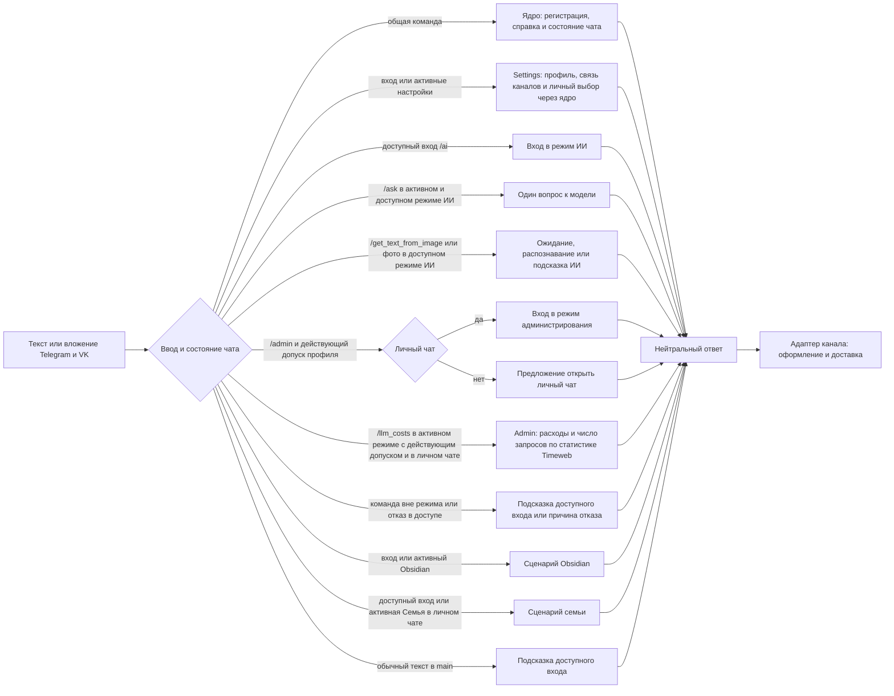

# Пользовательские сообщения

Этот документ задаёт правила для новых ответов ядра, настроек и возможностей.
Действующие сценарии и формулировки описаны в [реестре ядра](user-messages/CORE.md),
[реестре ИИ](user-messages/AI.md), [реестре Admin](user-messages/ADMIN.md),
[реестре Obsidian](user-messages/OBSIDIAN.md) и
[реестре «Семьи»](user-messages/FAMILY.md). Пользовательские команды и
порядок работы приведены в [RUN.md](RUN.md#13-посмотреть-доступные-команды),
а границы модулей и каналов — в [ARCHITECTURE.md](ARCHITECTURE.md).

## Выбрать ответ по состоянию чата

Общий обработчик сначала проверяет команду ядра, профиль, доступность
возможности, активный режим конкретного чата и ожидаемый ввод. После этого
сообщение получает ядро либо presentation допущенной возможности. Ядро
передаёт предметные данные обработчику возможности. `/ai` включает режим ИИ.
В этом режиме `/ask` задаёт вопрос, а `/get_text_from_image` открывает ожидание
одного фото. Оба действия сохраняют активный режим. Доверенный профиль входит
через `/admin` и получает отчёт в личном чате в этом режиме.
`/settings` открывает команды профиля, привязки каналов и личного выбора.
В личном чате `/family` открывает семейный режим. Команды покупок
выполняются после открытия общего списка.

Фото передаётся обработчику активной возможности, когда она поддерживает
изображения и доступна профилю. Подпись фото игнорируется. При текстовом
ожидании, отсутствии режима или поддержки фото бот просит прислать текст
или открыть `/help`. Справка зависит от состояния чата. До регистрации в ней
есть `/register` и `/link`, после регистрации на главной — доступные входы,
в активном режиме — команды режима. В VK справка из меню семьи объясняет
команды покупок и условие их выполнения. `/start` и `/help` можно ввести
вручную. Проверенное ожидание
значения добавляет к справке конкретный следующий
шаг и `/cancel`. Актуальные адресные подтверждения выводятся отдельным блоком.
Справка помечает неполный снимок подтверждений.

Справка и меню показывают `/admin` и команды этого режима только доверенным
профилям в личном чате.

## Написать текст

- Обращайся к пользователю на «ты». Называй ИИ и Obsidian «возможностями», а
  «режимом» — длительное состояние конкретного чата. При первом объяснении
  Obsidian используй «хранилище заметок (vault)», далее — «хранилище».
- Сначала скажи, что произошло или что нужно сделать; затем укажи существенное
  состояние и только необходимый следующий шаг. Короткому результату достаточно
  одного предложения. При ошибке объясни, что осталось неизменным и какое
  конкретное действие доступно дальше, если это известно из сценария.
- Сохраняй точные имена команд, параметры, коды и пути. В справке, подсказке и
  ошибке одна команда должна называться одинаково. Пользовательские команды
  Obsidian используют `/vault_status`, `/vault_sync` и `/vault_disconnect`.
  Подсказки аргументов внутри `<…>` в ответах используют английские слова,
  например `/ask <question>`.
- Не показывай внутренний стек ошибки, технические ID и подробности
  конфигурации без необходимости для следующего действия. Не обещай
  сохранность данных, безопасный повтор или срок, если их не гарантирует
  конкретный сценарий.
- Успех оставляй без лишних поздравлений; запрос ввода должен назвать значение,
  срок и отмену, когда они существуют. Если бот продолжает обработку в фоне,
  скажи, что запрос принят и итог придёт в тот же чат. Справка перечисляет
  доступные сейчас группы команд, а не весь каталог приложения.

## Показать действие и сохранить текстовый путь

Команда без нужного аргумента может начать ожидание следующего сообщения в
этом чате. Ожидание действует десять минут, неверное значение не продлевает
срок; `/cancel` снимает его, не меняя активный режим. Кнопка под ответом
помогает выбрать конкретный вариант, но полный текст команды должен оставаться
доступен и для ручного ввода. Старое меню или кнопка не дают права выполнить
устаревшее действие: выбор снова проверяет профиль, чат, доступ и актуальность.

Для подтверждения показывай короткие `да` и `нет` только при одном однозначном
ожидании Obsidian в исходном чате. Для действий с семьёй, нескольких ожиданий
или переноса привязки канала показывай полные адресные команды `/confirm … yes` и
`/confirm … no`; `/confirm` без аргументов лишь перечисляет актуальные
действия и ничего не исполняет. Не предлагай `y`/`n` в пользовательском тексте.

## Оформить и доставить ответ

Presentation передаёт `MessageContent`: упорядоченные абзацы и списки из
буквальных `TextSpan` со смысловыми стилями `PLAIN`, `EMPHASIS`, `CODE`.
Текст пользователя, URL, путь, diff, Markdown статьи и ответ модели остаются
данными: HTML и Markdown внутри них не разбираются как доверенная разметка.
Короткий ответ не нуждается в заголовке; списки и пустые строки добавляй там,
где они улучшают чтение. Выделяй короткий смысловой фрагмент, не целый абзац.

Telegram экранирует каждый фрагмент и отправляет HTML, добавляя `<b>` для
`EMPHASIS` и `<code>` для `CODE`. VK отправляет буквальный текст и, где диапазоны
однозначны, `format_data`: жирный для `EMPHASIS`, курсив для `CODE` по
согласованному виду клиента. При emoji и других неоднозначных смещениях VK
использует обычный текст. Это изменение вида не должно удалять символы.
Маркеры `**…**`, обратные кавычки и `<b>…</b>` в исходных данных остаются
буквальными символами.

Длинные ответы делятся по лимиту канала с сохранением порядка, пробелов,
переносов и типичных составных символов. Каждая Telegram-часть содержит
самостоятельно закрытую HTML-разметку; смещения VK пересчитываются для каждой
части. Кнопка ответа прикрепляется к последней части. Если локальная
сериализация кнопки невозможна, весь текст и полные команды отправляются без
неё; сетевой сбой сам по себе не запускает повторную отправку всего ответа.

### Обновить нижнее меню VK вместе с сообщением

Прикладывай изменившееся нижнее меню VK к сообщению в том же личном чате.
Сообщение объясняет, что произошло, или предлагает следующий шаг. Когда у
события есть обычный ответ, приложи меню к нему. Если нужны и кнопки под
ответом, для них можно использовать отдельное сообщение с подсказкой или
вопросом по этому действию.

Для фонового события действует то же правило. При истечении ожидания
один раз сообщи об этом, назови команду для повтора и приложи восстановленное
меню. Например, если после `/ask` вопрос не пришёл за десять минут, отправь
«Срок ожидания ввода истёк. Повтори /ask, чтобы начать заново.»

Если у события нет содержательного сообщения, оставь нижнее меню без
изменений. Фраза «Меню команд обновлено.» сама по себе не считается
содержательным сообщением. Если при разработке обнаружится событие,
для которого нужно обновить меню, но подходящего сообщения нет, опиши
этот случай владельцу проекта и обсуди с ним, что показать пользователю.
Команды по-прежнему проходят проверку текущего состояния и доступа.

## Проверить изменение текста

Перед правкой найди владельца формулировки: общие ответы принадлежат ядру,
вопросы и распознавание фото — ИИ, отчёт о расходах — Admin, хранилище и
статьи — Obsidian, членство, приглашения и покупки — «Семье».
Адаптеры оформляют и доставляют готовое содержание.
Сверь обычный результат, ошибку, ожидание, повтор, подтверждение и длинный
ответ с кодом и тестами. Проверяй переменные
данные со спецсимволами, кириллицей и emoji, а также точные команды и
доступность текстового пути без кнопок. Автоматические тесты не доказывают
визуальный вид и реальную доставку в клиентах. На 30.10.2026 пользователь
подтвердил `/help` и меню в личных чатах Telegram и VK после recovery; эта
ограниченная приёмка записана в [снимке production](PRODUCTION.md) и не
подтверждает другие ответы или сценарии.
