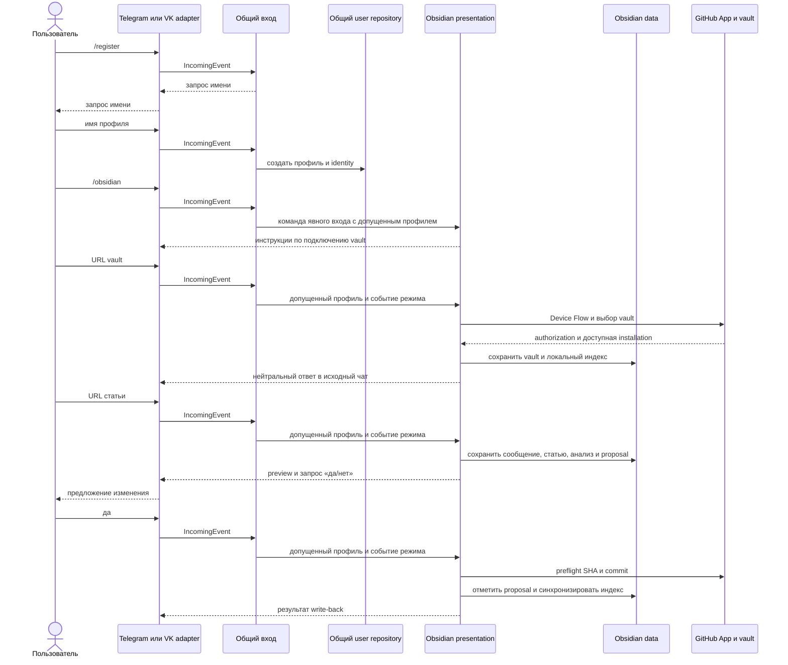

# Архитектура Obsidian

Документ описывает состояние и границы операций Obsidian от подключения vault
до подтверждённого изменения в GitHub. Настройка доступа — в [GITHUB_APP.md](../GITHUB_APP.md),
команды и ответы — в [реестре Obsidian](../user-messages/OBSIDIAN.md). Схема модулей
находится в [общем обзоре](../ARCHITECTURE.md#границы-модулей).

## Вход и ответственность модуля

Модуль владеет SQLite-данными vault, GitHub-связей, индексов, статей,
предложений и предметных журналов `incoming_messages` и `processing_errors`.
Данные ограничены `app_user_id`. Obsidian преобразует событие в предметную
модель статьи и выбирает сценарий по содержимому сообщения.

Явный вход в Obsidian — `/obsidian [текст или URL]`.
Аргумент передаётся presentation возможности отдельно от исходного события;
ядро разбирает только команду входа. Без аргумента Obsidian объясняет действия
и предлагает подключение vault, если он ещё не выбран.

На входе Obsidian читает актуальные vault, proposals и ожидающие операции.
Отсутствие vault или настроек провайдера получает отдельный предметный ответ.

## GitHub App и подключение vault

GitHub Device Flow подтверждает, что пользователь авторизовал свой
GitHub-аккаунт. `GitHubConnectionCoordinator` ожидает результат в фоне и
сохраняет account и IDs доступных App installations в SQLite. Для проверки,
чтения и записи выбранного vault GitHub App выпускает installation token с
доступом к конкретному репозиторию. Такой token не хранится в БД и не выводится
в логи.

Пользователь отправляет URL репозитория после регистрации и входа через `/obsidian`. Сервис проверяет,
что App установлено на этот репозиторий с правом `Contents: read and write`,
затем сохраняет выбранный vault и запускает первую синхронизацию. В корне
vault ожидается `.knowledge-catcher.yml` версии 1 с путями к instruction-файлам.

Device Flow session, включая challenge и callback исходного чата, хранится
только в памяти процесса. Межпроцессный SQLite claim предотвращает
одновременный запуск для одного пользователя. После перезапуска прежняя
session не восстанавливается; когда истечёт claim, пользователь может начать
новую попытку Device Flow. Это не продолжение прежней авторизации.

## Локальная копия vault и поиск

GitHub-репозиторий является источником истины для Obsidian vault. SQLite хранит
его локальную рабочую копию: Markdown-заметки, файлы правил, метаданные,
chunks, FTS5 и embeddings. При большом числе изменившихся файлов GitHub
snapshot скачивается одним ZIP-архивом конкретного commit при соблюдении
безопасных лимитов; иначе читаются только изменившиеся blobs. Новый snapshot
проверяется до применения, поэтому ошибка конфигурации или загрузки не
заменяет последнюю пригодную локальную копию.

Markdown разбирается пакетом `document_chunker` в устойчивые chunks с
заголовочным контекстом и хешем содержимого. SQLite FTS5 даёт лексический
поиск по chunks. Semantic-индекс хранит вектор как `float32` BLOB, связанный
с chunk, его хешем и моделью. Неизменившиеся chunks переиспользуют сохранённые
embeddings. Гибридный поиск сочетает BM25 и cosine similarity через
Reciprocal Rank Fusion. Если semantic-индекс не готов или embeddings временно
недоступны, используется явный FTS fallback; его статус показывается в
ответах синхронизации.

Source SHA snapshot продвигается после успешной проверки и сохранения.
Marker готовности semantic-индекса публикуется после полного набора vectors.
Частичные checkpoints продолжаются при следующей синхронизации, без участия
в semantic search. Подробнее о разбиении — в [DOCUMENT_CHUNKER.md](../DOCUMENT_CHUNKER.md).

## Pipeline статьи и proposal

1. HTTP-adapter безопасно загружает страницу, не допуская private, loopback и
   link-local адреса даже после redirect.
2. `trafilatura` извлекает содержательный текст. Статья и связанное с ней
   входящее сообщение сохраняются в SQLite.
3. OpenAI-compatible LLM создаёт и сохраняет анализ статьи.
4. Obsidian проверяет актуальность vault до обработки URL (не чаще раза в
   шесть часов). После анализа hybrid search подбирает релевантные заметки,
   а LLM с правилами vault готовит `add`, `update` или `skip`.
5. Пользователь видит preview Markdown и адресные команды решения. `да`/`нет`
   выбирает единственное ожидание этого чата, при нескольких требуется ID
   с версией. До явного подтверждения GitHub не меняется.

## Подтверждённый write-back

`ObsidianProposalConfirmationService` применяет только подтверждённый proposal
в состоянии `pending`. LLM подготавливает предложение, а запись выполняет
сервис подтверждения.
Перед записью он читает актуальное состояние target-файла в GitHub и проверяет
SHA. Если другой автор уже изменил файл, proposal переходит в `conflict`, а
чужой Markdown сохраняется. При неоднозначном ответе сети сервис сопоставляет
remote Markdown с ожидаемым: если commit уже создан, локальная транзакция
завершается без повторной записи. После удачного commit запускается
синхронизация vault, чтобы SQLite, FTS и embeddings соответствовали GitHub.
SQLite lease допускает одну синхронизацию или запись для vault одновременно,
включая операции из разных каналов. Истёкший lease можно захватить снова.

## Подтверждения и конкурентные операции

Pending-действие Obsidian хранит владельца по `app_user_id`
и исходный адрес `(channel, chat_id)`: продолжение, подтверждение
и отмена конкретного интерактивного действия доступны только в исходном чате.
Разные статьи одного профиля из Telegram/VK независимо проходят fetch, analysis
и review и имеют отдельные pending proposals. Другой связанный чат, включая
другой чат того же канала, не показывает чужое ожидание и не блокируется им;
только попытка выполнить чужое действие получает короткий отказ без его
содержимого. Повторная отправка той же статьи использует dedup по пользователю
и нормализованному URL без дубликата статьи/proposal для того же цикла.

`да`/`нет` выбирает только однозначный pending текущего чата; при нескольких
локальных ожиданиях требуется ID операции. Проверки ID, TTL, владельца, статуса
и версии дополняются исходным адресом и атомарным захватом выполнения.
`/exit` сохраняет ожидания, повторный вход в исходном чате показывает их
актуальное состояние. У каждого чата собственный режим и его переключение.

Взаимное исключение относится к общим ресурсам: одна активная конфигурация vault
пользователя и её replace/disconnect, один Device Flow claim на пользователя,
последовательные sync/write-back одного vault под SQLite lease и SHA preflight.
Конфликтующая смена конфигурации не подменяет чужое ожидание и получает короткое
объяснение занятого ресурса. Два write-back могут независимо ожидать подтверждения,
но не записывают одновременно; устаревший proposal получает `conflict` и требует
пересчёта с новым подтверждением. Ожидание само по себе не захватывает ресурс
записи и не блокирует независимые article flows; универсальная очередь не вводится.

`obsidian_proposals` хранит исходный адрес, версию и временный execution claim.
Статус `executing` захватывается CAS до внешнего эффекта; финализация проверяет
его версию. При сетевом сбое claim возвращается в `pending` с новой версией,
а повторная адресная команда старой версии отклоняется. После потери процесса
истёкший execution claim можно восстановить с актуальной версией; write-back
при этом сначала получает общий vault lease и повторяет SHA preflight.
Уникальность активного proposal ограничена статьёй, а не пользователем.
SQLite lease по `(app_user_id, normalized_url)` охватывает полный fetch/analysis/review
и `/reanalyze`, предотвращая конкурирующие циклы одной статьи. Другие URL
не занимают этот ресурс. `/reanalyze` требует сначала завершить активный proposal
этой статьи и не подменяет его новым.

Подтверждения конфигурации имеют отдельные неизменные IDs, исходный адрес,
версию, TTL и ID исходного vault. Один pending резервирует конфигурацию профиля;
replace/disconnect не перезаписывают его, в том числе из того же чата.
Решение и смена/удаление vault выполняются одной транзакцией с проверкой версии,
адреса, TTL и отсутствия активного sync/write lease. Ожидание конфигурации
не блокирует анализ другой статьи. Device Flow challenge доступен только
исходному чату; другой чат видит лишь занятость общего claim и продолжает
сценарии, которым уже сохранённой авторизации достаточно.

## Конфигурация и время жизни зависимостей

`capabilities/obsidian/data/configuration/config.py` владеет профилем LLM,
GitHub App, embeddings, chunking и тега заметок. Composition root вызывает
его loader только при включённом Obsidian. CLI передаёт профиль сборке процесса
и healthcheck.

Отключённый Obsidian не разбирает даже некорректные `OPENAI_*`, `GITHUB_*`,
`EMBEDDING_*`, `CHUNK_*` и `OBSIDIAN_CREATED_NOTE_TAG` и не создаёт клиентов.
Полностью пустые GitHub/LLM-группы разрешают запуск профиля и общих команд;
Obsidian отдельно сообщает о ненастроенном провайдере. Частичные группы,
небезопасные endpoint и непригодный PEM останавливают startup до polling.
Пустая embedding-группа сохраняет FTS fallback, частичная считается ошибкой.
Compose передаёт LLM/embedding keys независимо, без неявной подстановки.

Зарегистрированный `ObsidianCapability` открывает отдельный operation scope
с SQLite-соединением и предметными repositories для вызова своего публичного
входа или команды. Фоновое завершение GitHub Device Flow получает новое короткое
соединение после закрытия соединения входного сообщения. Выход из режима
сохраняет операцию и доставку в исходный чат. SQLite repositories остаются
в пределах одного потока.

Процессный runtime Obsidian владеет общими GitHub HTTP и настроенными LLM/embedding SDK
клиентами, закрывая их после остановки polling. Неизменяемый Markdown
`DocumentChunker` с parser и policy также собирается один раз на процесс:
`split` хранит промежуточные blocks/chunks только в локальных переменных вызова.
Предметные use cases, SQLite repositories и embedding adapter создаются в
scope операции, поэтому их изменяемые поля не разделяются между worker threads.
Лёгкие HTTP fetcher и text extractor для статьи остаются локальными операции:
они не владеют открытым клиентом, а их возможное внутреннее состояние не нужно
разделять. Отключённый Obsidian не создаёт runtime или клиентов.

Фабрики возможности находятся в `capabilities/obsidian/bootstrap.py`,
автономные smoke-сценарии — в `capabilities/obsidian/smoke.py`.
