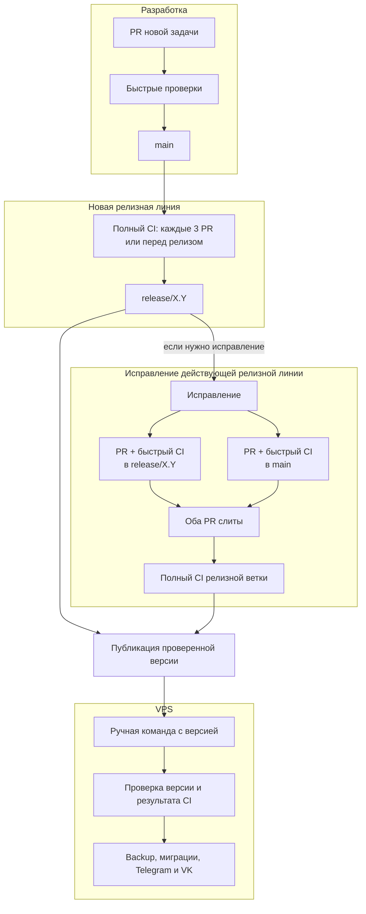

# План этапа: проверенные релизы из `main` на production VPS

Статус: реализация; шаг 1 завершён, результаты в [BASELINE.md](BASELINE.md).
Рабочая ветка: `codex/auto-deploy-production-main`
в отдельном worktree этого чата. Общая рабочая папка остаётся на `main`.

Этот каталог хранит документы только на время этапа. Перед его удалением
перенести все действующие правила, сценарии и ограничения в постоянную
документацию по матрице раздела 8, проверить полноту переноса и ссылки.
После приёмки записать результат в историю и удалить `docs/auto-deploy-main/`
до слияния ветки.

## Цель и согласованная схема

Разработка идёт в отдельных ветках и через PR попадает в `main`. PR проходит
быстрые обязательные проверки. Полный CI на `main` запускается после каждых
трёх слитых PR либо по запросу перед подготовкой релиза. Из конкретного
успешно проверенного коммита `main` создаётся релизная ветка. Она может получать
исправления через PR, причём то же исправление должно попасть и в `main`.
Каждое изменение релизной ветки проходит полный CI. Для каждого выпуска
создаётся версия `MAJOR.MINOR.PATCH`, привязанная к проверенному коммиту.
VPS обновляется только после явной команды с номером опубликованной версии;
команда проверяет допуск, а Telegram и VK используют один образ.

`main` — источник новых линий релизов, но слияние отдельного PR больше не
обязано сразу обновлять production. Релизная ветка — поддерживаемая линия;
конкретный выпуск — её точный коммит и тег. Выпуск может отставать от текущего
`main`, чтобы исправлять production без доставки ещё не выбранных функций.

## Исходное состояние и ограничения

- На VPS сейчас `/opt/obs-chat-bot`, detached HEAD и Compose-сервисы
  `tg_assistant` / `vk_assistant`. Read-only deploy key читает GitHub.
- В репозитории нет CI workflow и механизма автоматического выпуска.
  Docker Compose собирает изменяемый образ `compadre-assistant:dev`.
- `scripts/check-all.ps1` собирает образ и запускает healthcheck и три smoke,
  но не `unittest`; Compose при этом читает локальные `.env` и `data`.
  Этот скрипт нельзя без изменений использовать в GitHub CI.
- Healthcheck проверяет конфигурацию и открывает SQLite, но не применяет
  миграции и не подтверждает работу Telegram/VK/LLM/GitHub. Миграции сейчас
  запускаются при старте обоих ботов, отдельной команды нет.
- Migration runner сверяет номер и имя SQL-файла, не checksum. Изменение уже
  применённого `0001_initial_schema.sql` не обновит production-БД.
- Действующие systemd unit, override и ночной backup script находятся только
  на VPS; их реальное состояние нужно инвентаризировать перед изменениями.
  Старый rollback bundle не содержит копию БД. `docs/OPERATIONS.md`
  описывает устаревший рецепт обновления и требует пересмотра.
- В Git пока нет релизных тегов. Начальную версию этого процесса принять как
  `v1.0.0` после первой приёмки и контролируемого выпуска; не присваивать
  этот номер прежнему развёртыванию задним числом.

## Порядок реализации и контрольные точки

Разделы 1–8 ниже задают требования к компонентам, а не очередность их
написания. Внедрять их следующими законченными шагами:

1. **Зафиксировать исходное состояние и правила работы.** В отдельном
   worktree записать правила новых задач в постоянную документацию; провести
   read-only инвентаризацию VPS, текущего commit, Compose, systemd, backup и
   схемы БД. Проверить доступность GitHub rulesets, прав на bypass и API для
   чтения PR, checks и релизов с предполагаемыми полномочиями. Определить
   точку отсчёта трёх PR, начальный выпуск `v1.0.0`, способ вызова команды
   миграции и пределы безопасного возврата. Результат шага — записанный
   baseline и решения, от которых зависят CI и deploy.
2. **Включить быстрый путь разработки.** Реализовать `pr-fast`, проверить его
   на обычном PR, затем настроить защиту `main` и `release/*` с обязательным
   check и слиянием через PR. Убедиться, что обычный PR блокируется при
   провале и проходит при успехе. Право аварийного bypass настроить и
   проверить отдельно после готовности аварийного маршрута (шаг 6).
3. **Подготовить миграции и полный CI.** Ввести управляемый запуск миграций и
   тестовую схему прошлого выпуска; на них построить общий полный набор.
   Затем включить контроллер «каждые 3 PR», ручной запуск `main-full` и
   `release-full` после слияния в релизную ветку. На этом шаге проверить
   успешный и неуспешный run, новый commit во время проверки и повтор для
   того же SHA. Результат — однозначный допуск по точному commit.
4. **Подготовить выпуск версии.** Реализовать выбор проверенного SHA из `main`,
   создание `release/X.Y`, правила двух PR для исправления, SemVer, защищённый
   тег и публикацию GitHub Release. Проверить, что создание ветки от уже
   проверенного SHA не запускает второй полный прогон, а изменение релизной
   ветки требует нового `release-full`. До работы с VPS проверить запрет
   публикации обычной версии без полного CI.
5. **Собрать и принять обычный deploy.** Реализовать selector, серверное
   состояние, pinned image, backup, миграции, переключение двух контейнеров
   и возврат. Сначала проверить сбои и повторные запуски в изолированном
   окружении, затем провести один контролируемый выпуск на VPS и проверить
   обе платформы, данные, reboot и ночной backup. Только после этой точки
   объявить обычную команду `deploy-prod` рабочим маршрутом.
6. **Добавить аварийный маршрут.** Настроить владельцу bypass через PR,
   аварийную публикацию версии, запись пропущенных проверок и команду
   `deploy-prod --emergency`. Проверить отдельно исправление существующей
   линии через два PR и новую линию из `main`; в изолированном окружении
   убедиться, что обход CI не отключает проверку SHA, backup и защиту БД.
   Обычную команду проверить на отказ для такой версии.
7. **Завершить эксплуатационное оформление.** Заполнить матрицу переноса из
   раздела 8, проверить процедуру хранения трёх старых релизных веток и
   безопасного возврата. После приёмки сверить постоянные документы с
   реализованным поведением, записать результат в историю и только затем
   удалить временный каталог `docs/auto-deploy-main/` до слияния ветки.

Инструкцию ручного выпуска, наблюдения и возврата подготовить до первого
реального переключения VPS на шаге 5; на шаге 7 сверить её с фактическим
результатом. Каждый шаг завершать проверкой указанного результата, прежде
чем опираться на него в следующем.

## 1. Правила разработки новых функциональностей

Закрепить постоянный порядок: отдельная ветка от актуального `main` в worktree
чата разработки; временный каталог в `docs` с планом и решениями; проверка и
приёмка; перенос нужных инструкций в постоянную документацию; удаление
временного каталога до слияния. Переключение ветки, правка файлов и коммиты
касаются только worktree соответствующего чата, не общей папки и других чатов.

Согласовать это с `AGENTS.md`: перед Git-действиями проверять статус, коммит
можно делать самостоятельно с русским сообщением, `git push` — только после
явного согласия пользователя. Отдельно закрепить: development-БД допускает
разрешённое пересоздание лишь на текущем этапе разработки; production-БД
изменяется миграциями с сохранением данных. Постоянные правила останутся
в `AGENTS.md` и эксплуатационных документах после удаления временного каталога.

## 2. Git-ветки и версии

### Защита веток и исправления

`main` и `release/*` защищены от прямого push и force push; изменения проходят
через PR. Для предсказуемого счёта слитых PR и истории веток использовать
GitHub merge commit, отключив squash/rebase для этих веток. Проверить
доступность нужных правил на фактическом плане GitHub перед включением.
Для аварийного случая настроить GitHub ruleset с правом обхода обязательных
проверок только для владельца и только через PR (`For pull requests only`),
как описано в разделе 7. Обычные участники этого права не получают.
Обязательный быстрый check настроить без требования обновлять PR после
каждого изменения базовой ветки: совместное содержимое всё равно будет
полностью проверено на итоговом коммите `main` или релизной ветки.
Создание новой релизной ветки от уже проверенного коммита `main` не меняет код
и не требует второго полного прогона для того же коммита.

Обычным маршрутом релизную ветку `release/X.Y` создавать от полного SHA
успешного CI на `main`,
а не от изменяемого в этот момент имени ветки. Если `main` продвинулся в ходе
проверки, допустимо выпустить прежний проверенный коммит; чтобы включить
новый tip `main`, нужен полный CI именно для него. Прямые доработки только
релизной ветки запрещены.

Для исправления поддерживаемого релиза создать два связанных PR: в
`release/X.Y` и в `main`. Использовать один и тот же commit, если Git позволяет;
иначе переносить патч и явно описывать различия. Перед публикацией новой
версии должны быть слиты оба PR. Автоматика проверяет ссылки на оба PR и,
где возможно, общность commit/patch; при разной адаптации владелец вручную
подтверждает эквивалентность решения. Семантическое равенство разных патчей
невозможно надёжно установить только Git-командой. Полный CI на релизной
ветке запускается после её изменения; на `main` действует обычный порог
трёх PR или проверка перед следующей новой линией релиза.

### Версионирование

Принять `MAJOR.MINOR.PATCH` и описать поддерживаемый контракт: команды ботов,
их наблюдаемое поведение, публичные форматы vault/config и документированные
интеграции. Увеличивать `MAJOR` при намеренной несовместимости этого контракта,
`MINOR` при совместимой новой функциональности, `PATCH` при совместимом
исправлении без новой функции. Внутренний refactor или миграция БД сами по
себе не определяют номер версии; риск возврата БД оценивается отдельно.
Один выпуск имеет одну новую версию, номер и тег не переиспользуются.

Начальная линия: `release/1.0` и `v1.0.0`. Исправления этой линии получают
`v1.0.1`, `v1.0.2` и далее. Совместимый набор новых функций из `main`
открывает `release/1.1` и `v1.1.0`. Намеренная несовместимость открывает
`release/2.0` и `v2.0.0`. Изменение номера `MAJOR` согласуется при выборе
релиза и описывается в release notes; его не нужно менять при каждом
развёртывании.

Для обычного выпуска после полного CI назначить тег `vX.Y.Z` точному
проверенному коммиту и
опубликовать GitHub Release с ссылкой на CI run и перечнем изменений. До
публикации проверить, что коммит принадлежит соответствующей `release/X.Y`
и выполнены условия переноса исправления в `main`. Защитить теги от
перемещения/удаления правилами GitHub; проверить возможность immutable
GitHub Releases и включить её при доступности. Публикация делает версию
доступной для ручной команды, но сама не запускает VPS. Не публиковать тег
непроверенного коммита обычным маршрутом; аварийное исключение описано в
разделе 7. Если deploy не удался, тег остаётся записью о
кандидате со статусом сбоя; следующая попытка использует тот же проверенный
коммит либо новую версию при изменении кода.

После успешного выпуска держать активную релизную ветку и три прежние
релизные ветки. Отдельная процедура cleanup сначала читает текущую версию
с VPS и формирует список кандидатов; удалять разрешено лишь ветки за пределом
трёх, которые не поддерживаются, не содержат открытых PR и не нужны для
незавершённого выпуска или возврата. До проверки серверного состояния
автоматически удалять ветки нельзя. Cleanup выполняется из доверенной
административной среды, не требует GitHub write token на VPS и записывает
удалённые имена в журнал. Теги выпущенных версий, записи VPS и нужные для
возврата образы не удалять по этому правилу. Удаление удалённых веток агентом
подчиняется запрету `git push` без явного согласия пользователя.

## 3. Контракт CI: события, проверки, повторы

В GitHub Actions предусмотреть отдельные `pr-fast`, `main-full` и
`release-full`. Все workflow хранятся в репозитории, используют минимальные
`GITHUB_TOKEN` permissions и закреплённые версии сторонних actions.
Production `.env`, PEM, SSH-ключи, токены и SQLite не попадают в CI.
Для Compose и миграций создаются временные тестовые `.env` и БД.

| Событие | Что запускается | Что разрешает результат |
| --- | --- | --- |
| Открыт/обновлён PR в `main` или `release/*` | `pr-fast` для текущего commit PR | Успех обязателен для обычного merge; аварийный обход описан в разделе 7. |
| В `main` слит PR №1 или №2 после последнего успешного полного CI | Только лёгкий счётчик/контроль истории | Новый релиз от непроверенного SHA не разрешён. |
| В `main` слит третий PR | `main-full` для SHA нового tip | Этот SHA можно взять за основу релиза после успеха. |
| Запрошен релиз до порога трёх PR | Ручной `main-full` для выбранного tip `main` | Успех разрешает создать ветку от проверенного SHA. |
| Создана `release/X.Y` на том же SHA | Сверка и повторное использование успешного `main-full` | Повтор полного набора для тех же байтов не нужен. |
| PR слит в существующую `release/X.Y` | `release-full` для нового SHA ветки | Успех разрешает опубликовать новую PATCH-версию. |
| Владелец вызвал `deploy-prod vX.Y.Z` для опубликованной версии | Серверный selector проверяет CI и тег | Только точный проверенный SHA допускается на VPS. |

### Быстрый CI для PR

`pr-fast` выполняется при `opened`, `reopened`, `synchronize` и смене
целевой ветки; он проверяет тестовый merge PR с базой на момент запуска.
Он проверяет
синтаксис Python через `compileall`; запускает небольшой фиксированный набор
автономных unit-тестов конфигурации, композиции и миграций; проверяет
`docker compose config` на синтетической конфигурации; не допускает добавления
`.env`, PEM, SQLite и приватных ключей в tracked files; проверяет имя новых
миграций и неизменность уже применяемых SQL-файлов. Конкретный набор тестовых
модулей закрепить после измерения длительности и документировать без
эвристики «запускать только тесты изменённых файлов». Для изменений workflow,
deploy-скриптов и миграций предусмотреть обязательный просмотр владельцем.
В описании PR отмечать предполагаемое влияние на `MAJOR.MINOR.PATCH` и
ссылку на парный PR при исправлении поддерживаемого релиза.
Быстрый CI не собирает production-образ и не обращается к внешним API.

При новом коммите PR прежний результат устаревает; новый `pr-fast` обязан
пройти. Старый незавершённый run этого PR можно отменить. Изменение
базовой ветки само по себе не заставляет повторять `pr-fast` и не блокирует
слияние из-за устаревшего base; конфликт Git при merge, конечно, нужно
разрешить. Это осознанный выбор: окончательное сочетание изменений проверяет
полный CI после merge, до создания версии или deploy. Обычное слияние в
`main` или релизную ветку разрешать только при успешном check последнего
commit PR и выполненных правилах PR; аварийное исключение описано в разделе 7.

### Полный CI для `main` и релизных веток

Один и тот же reusable набор шагов выполняет `main-full` и `release-full`:

1. Зафиксировать репозиторий, ref, полный commit SHA, workflow ID и run ID;
   получить чистый checkout именно этого commit, без production-файлов.
2. Запустить `python -m unittest discover -s tests` и три автономных smoke:
   `--sqlite-smoke`, `--pipeline-smoke`, `--analysis-smoke`.
3. Проверить миграции на новой БД и на тестовой копии схемы прошлого выпуска:
   неизменность старых файлов, последовательность новых `0002+`, результат
   `schema_migrations`, целостность SQLite и совместимость с прежним кодом.
   БД CI искусственная: получить прежнюю схему из зафиксированных миграций
   предыдущего опубликованного выпуска и заполнить тестовыми строками.
   Пользовательские данные туда не копируются.
4. Собрать Docker image и запустить candidate healthcheck на временных
   настройках. Сохранить диагностические логи без секретов. Функциональную
   работу реальных Telegram/VK здесь не объявлять проверенной.
5. Закончить с однозначным `success` только если все обязательные jobs
   завершились успешно. `skipped`, `cancelled`, `queued` и частичный успех
   не дают допуска; публиковать краткий манифест SHA и результатов.

Лёгкий controller на каждом merge в `main` считает именно слитые PR по
первой родительской линии merge commits после последнего успешного
`main-full`. Базовую точку счёта зафиксировать при включении CI. При
достижении трёх он запускает полный набор для текущего SHA; до этого
не запускает его. Команда подготовки релиза через GitHub Actions
`workflow_dispatch` запускает тот же набор немедленно для выбранной ветки
`main`. Перед созданием релизной ветки сверить SHA, реально проверенный
run, и не полагаться на текущее имя `main`. Если полный CI уже успешно прошёл
для того же SHA и workflow, повторный запуск не нужен.

Если во время полного `main-full` пришёл новый PR, допускается отменить
устаревший run и проверять новый tip при достигнутом пороге. Если старый run
успел завершиться, его SHA остаётся пригодным для релиза, даже когда `main`
ушёл вперёд. На релизной ветке после каждого нового merge запускать полный
набор для её tip; устаревшие runs той же ветки можно отменять. Не принимать
результат другого SHA, другой ветки или другого workflow. При сбое CI
исправление проходит новым PR; повтор без изменения кода допускается
только как явный rerun того же SHA с записанными run ID и попыткой.

Изменение workflow и скриптов проверки проходит `pr-fast` с просмотром
владельцем, затем проверяется полным CI своего итогового SHA. Для релиза
проверять идентичность репозитория, workflow, SHA, `conclusion` и каждого
обязательного job через GitHub API. Любая ошибка API или неоднозначность
означает отсутствие допуска.

## 4. Выбор выпуска и запуск VPS

Публикация GitHub Release `vX.Y.Z` после успешного полного CI — явный выбор
обычного кандидата. Владельцу доступна серверная команда `sudo deploy-prod vX.Y.Z`
через SSH. Она получает данные указанного опубликованного релиза через
GitHub API, а код — существующим read-only deploy key. Команда не выбирает
новейшую версию самостоятельно: аргумент обязателен, чтобы владелец явно
указал, какой выпуск устанавливать. По обычному пути версия должна быть
выше уже работающей по SemVer. Возврат к прежней версии — отдельная
процедура со своими проверками совместимости БД.

Документировать безопасный локальный SSH-вызов команды, способ посмотреть
её результат и состояние systemd/контейнеров. Команда выполняет один
синхронный запуск selector и deploy, использует блокировку от параллельного
ручного запуска и сохраняет состояние. Повтор уже установленной версии не
пересоздаёт контейнеры. Если CI ещё идёт, версия не опубликована или данные
GitHub недоступны, обычная команда сообщает причину и ничего не переключает.
Передача версии аргументом не отключает CI, backup или проверки данных;
явный аварийный режим описан в разделе 7.
Команда не требует менять ветку общей рабочей папки или передавать серверные
секреты в GitHub. Периодической проверки новых релизов на VPS в этом этапе нет.

Selector сверяет тег, полный commit SHA, принадлежность commit релизной ветке
`release/X.Y`, SemVer, успешный полный CI для этого SHA и набор обязательных
jobs. Отсутствие полного CI допускается только по условиям раздела 7.
Selector фиксирует version, SHA, CI run ID (если есть) и image candidate до
переключения.
После fetch проверяет `git rev-parse HEAD` в чистом detached checkout. До
остановки ботов повторно проверяет, что тег не перемещён и кандидат остаётся
выбранной версией. При несовпадении или удалённом теге выпуск прекращается.
Выпущенный тег и серверную запись нельзя менять задним числом.

## 5. Безопасное развёртывание

До реализации провести read-only инвентаризацию VPS: действующие systemd
unit/override, backup script/timer, checkout, права каталогов, Compose, образы,
SQLite и доступ к GitHub API. Сверить с `docs/PRODUCTION.md`. Хранить
версионируемый deploy script и инструкцию установки в репозитории;
проверить обычный boot и ручной запуск на одном pinned release.

**Подготовка без остановки каналов.** Взять общую блокировку; проверить
чистоту checkout и текущий рабочий SHA. Получить проверенный commit, собрать
образ из чистого checkout, записать тег по SHA и OCI revision label. Сохранить
прежний image ID и не удалять его при cleanup. Проверить candidate на
временной БД и конфигурации. Dockerfile сейчас скачивает зависимости из
сети: совпадение source SHA не гарантирует побайтового совпадения CI-образа
с серверным. Поэтому фиксировать фактический image ID на VPS; отдельно
оценить закрепление зависимостей по digest для воспроизводимости.
Ошибка fetch, сборки или предварительной проверки оставляет ботов работать.

**Backup и миграции.** Проверить свободное место, остановить обоих writers
и отсутствие второго polling с теми же credentials. Сделать отдельную
SQLite-копию выпуска через SQLite API вне ротации ночных backup и проверить
`integrity_check` копии. Не выводить секреты, PEM и содержимое БД в логи.
Реализовать отдельную управляемую команду миграции из candidate image:
healthcheck их сейчас не выполняет, а старт ботов запускает автоматически.
Применять только новые неизменяемые файлы `0002+`, затем сверить
`schema_migrations` и целостность рабочей БД. Runner транзакционен на один
файл; сбой между несколькими файлами требует явного восстановления.
Автоматически допускать только схемы, совместимые с предыдущим кодом
в период возврата. Несовместимая схема требует отдельного ручного плана.

**Переключение и проверка.** Compose должен использовать один закреплённый
image ID для обоих сервисов без сборки/pull при `up` и после reboot.
Запустить оба канала, дождаться `healthy`, сверить image ID, revision label,
счётчики рестартов и признаки Telegram polling/VK Long Poll. Healthcheck
сам по себе внешние каналы не подтверждает; реальные ответы проверяются
по сценарию приёмки. Только после проверки двух каналов записать
`last_good_version`, SHA, image ID, backup ID и успешное уведомление.
Ночной backup timer должен возобновляться после любого исхода.

Состояние выпуска хранить вне Git checkout атомарно: последняя успешная
версия/SHA/image ID, кандидат, стадия, CI run ID, backup ID, ошибка и время
следующей попытки. Уведомлять однократно об успехе, провале CI, невозможности
проверки допуска и сбое deploy. До реализации выбрать канал уведомления,
работающий при остановленных ботах, и проверить отказ доставки.

## 6. Ошибки и возврат

| Момент отказа | Действие |
| --- | --- |
| CI неуспешен/неизвестен, тег неверен, API недоступно; fetch или сборка не удались | Оставить рабочие контейнеры и сообщить причину без повторных уведомлений. |
| Каналы остановлены, миграция не началась | Вернуть прежний pinned image ID и оба канала; проверить состояние. |
| Миграция началась или завершилась частично | Не заменять БД снимком автоматически. Вернуть старый код только при доказанной совместимости схемы; иначе зафиксировать остановку и запросить отдельный план восстановления. |
| Новый образ работает только в одном канале либо проверки не прошли | Остановить candidate и вернуть оба канала на прежний совместимый образ; при неудаче зафиксировать degraded state. |
| Процесс прерван или VPS перезагрузился | По сохранённой стадии и реальным контейнерам завершить проверку либо безопасный возврат; успех без проверки двух каналов не объявлять. |

Backup служит аварийному восстановлению, но его автоматическое возвращение
после пользовательских записей может потерять данные; оно не отменяет уже
сделанные GitHub write-back commits. Проверить повтор после прерывания,
конкуренцию двух ручных запусков, пересечение с ночным backup и частичное
переключение. Не повторять неудачный SHA бесконечно: записать cooldown и
документировать явную повторную попытку. После каждого исхода сверять SHA,
image ID, systemd, оба контейнера и backup timer.

## 7. Аварийный выпуск через PR

Аварийный режим доступен владельцу при необходимости выпустить исправление
поддерживаемой релизной линии или открыть новую линию из `main` без ожидания
успешных проверок. Это отдельный явный маршрут: обычный выпуск по-прежнему
требует `pr-fast` для PR и полного CI точного выпускаемого commit.

**Обход быстрого CI.** В GitHub ruleset для `main` и `release/*` обязательный
check `pr-fast` остаётся включённым. В bypass list добавить только владельца
с режимом `For pull requests only`. Владелец открывает PR обычным способом
и, если ожидание или провал `pr-fast` недопустимы, выбирает слияние с
обходом правила в интерфейсе GitHub. Обход разрешает merge PR без успешного
check; он не отменяет уже запущенный GitHub Actions workflow. Прямой push,
force push и молчаливое отключение защиты ветки в аварийный маршрут не входят.
Перед внедрением проверить фактическую доступность такого bypass на тарифе
и правах репозитория.

**Два сценария выпуска.** Исправление действующего `release/X.Y` проходит
через два связанных PR: в релизную ветку и в `main`; для каждого PR решение
об обходе `pr-fast` принимается отдельно. Публиковать исправленный релиз
можно после слияния обоих PR. Для новой линии из `main` отдельный PR в
релизную ветку не нужен: её создают от выбранного точного commit `main`,
куда изменения уже попали через PR. В обоих сценариях полный CI может
продолжаться; аварийный выпуск явно разрешает не ждать его результата.

**Запись решения.** Для версии `vX.Y.Z` владелец указывает причину срочности,
точный commit и PR, вошедшие в выпуск. Для каждого такого PR фиксируются
целевая ветка, результат `pr-fast` на момент merge (`успех`, `ошибка`,
`ожидание` или `не запущен`) и факт применения bypass. Эти сведения берутся
из GitHub PR/check runs и журнала обхода ruleset, если тот доступен через
API; недоступные сведения помечаются как неподтверждённые, а не угадываются.
Release notes отдельно перечисляют, какие быстрые и полные проверки не
подтверждены. Защищённый тег указывает на точный commit, а GitHub Release
явно помечается как аварийный и содержит основание допуска; версию и тег
повторно не используют после исправления.

**Команда на VPS.** Владелец запускает
`sudo deploy-prod --emergency vX.Y.Z --reason "причина"` по SSH. Команда
показывает версию, SHA, состояние CI и предупреждение об аварийном режиме,
записывает инициатора и причину, затем применяет выбранный точный commit.
Обычная команда без `--emergency` непроверенную версию отвергает. Даже в
аварийном режиме остаются обязательными опубликованная версия и защищённый
тег, принадлежность commit выбранной ветке, отсутствие подмены SHA, чистый
checkout, блокировка параллельных выпусков, подготовка образа, backup SQLite,
проверка миграций, переключение обоих контейнеров, проверка результата и
безопасный возврат. Ошибка получения или сверки GitHub-данных не должна
превращаться в молчаливое разрешение выпуска.

## 8. Проверка, документация и ввод

Проверить `pr-fast` для PR в `main` и `release/*`, включая новый commit и
изменившуюся базу. Проверить порог 3 PR, ручной `main-full` до порога,
отмену устаревшего run, провал CI, неизменный SHA при создании релизной
ветки и полный CI после её исправления. Убедиться, что два связанных PR
требуются для hotfix, что ни один workflow не использует production secrets
или пользовательскую БД, и что без полного успеха обычный тег не допускается.
Отдельно проверить аварийный bypass PR, запись статусов и причины, запрет
прямого push, отклонение непроверенной версии обычной командой и защиты VPS.

В изолированном окружении проверить selector и deploy с подменёнными
ответами GitHub: неверный тег/SHA, чужой workflow, `skipped` job, отказ API,
движение ветки после проверки, две опубликованные версии, ручной запуск
до окончания CI, ошибка сборки/backup/миграции, сбой одного канала,
reboot посреди выпуска и повтор неудачного SHA. Проверить cleanup веток
с сохранением трёх прежних, всех тегов и нужного rollback image.

Перед первым использованием `deploy-prod` повторно снять фактическое
состояние VPS и записать прежний production SHA, image ID и схему БД для
возврата. Первый контролируемый выпуск выполнить от выбранного и проверенного
SHA релизной ветки; прежний production SHA не объявлять проверенным задним
числом. Подтвердить версию, SHA, checkout и оба контейнера, проверить Telegram/VK,
сохранность SQLite, systemd restart и ночной backup. Определить, кто подтверждает
функциональную приёмку реальными сообщениями; разрешить обычный ручной
выпуск после неё.

### Перенос временного плана в постоянную документацию

`docs/RELEASES.md` сделать постоянным источником правил CI, веток, версий и
допуска выпусков. `docs/OPERATIONS.md` оставить практической инструкцией
для человека, `docs/PRODUCTION.md` — описанием фактического VPS и его доступа.
В остальных файлах дать краткое объяснение и ссылку на основной документ,
не копируя целые процедуры в несколько мест.

| Что обязательно сохранить | Постоянное место |
| --- | --- |
| Отдельные ветка и worktree чата, временный каталог документов на время функциональности, проверки, перенос правил и удаление каталога; ограничения на commit/push и production-БД | `AGENTS.md`; ссылка на порядок выпуска в `docs/RELEASES.md` |
| Путь PR → `main` → релизная линия → опубликованная версия → ручная команда; зачем выпуск может отставать от `main` | `docs/RELEASES.md`; короткая схема и ссылка в `README.md` |
| Защита `main`/`release/*`, merge commit, два связанных PR для исправления и контроль их соответствия; правила сохранения трёх старых релизных веток и тегов | `docs/RELEASES.md`; команды cleanup в `docs/OPERATIONS.md` |
| SemVer, начальная версия, выбор MAJOR/MINOR/PATCH, правило уникальности версии и тега, история опубликованных выпусков | `docs/RELEASES.md`; фактические выпуски в GitHub Releases и `docs/HISTORY.md` |
| Триггеры `pr-fast`, состав проверок, действие при новом commit и изменении базы, полный CI после каждых трёх PR или перед релизом, полный CI релизной ветки и отказ от повторного прогона того же SHA | `docs/RELEASES.md`; локальные команды проверки в `docs/RUN.md` |
| Допуск строго по репозиторию, workflow, run, SHA и обязательным jobs; защита CI от production-секретов; действия при сбое/неизвестном результате GitHub API | `docs/RELEASES.md`; диагностика в `docs/OPERATIONS.md` |
| Ручная публикация GitHub Release и вызов `deploy-prod vX.Y.Z`; отсутствие таймера обновления; какой commit и образ фактически запущены | `docs/RELEASES.md` и `docs/OPERATIONS.md`; текущее состояние в `docs/PRODUCTION.md`; будущий таймер в `docs/BACKLOG.md` |
| Подготовка образа, остановка обоих writers, backup SQLite, отдельные миграции, переключение двух контейнеров, проверка каналов, совместимый возврат и действия при частичном сбое/reboot | `docs/OPERATIONS.md`; архитектурные границы и состояние в `docs/ARCHITECTURE.md`; факты и пути VPS в `docs/PRODUCTION.md` |
| Аварийный bypass только через PR владельца, два сценария выпуска, запись причины и результатов проверок, `deploy-prod --emergency`, сохраняющиеся проверки VPS | `docs/RELEASES.md`; точные команды и действия при отказе в `docs/OPERATIONS.md` |
| Границы гарантий: тестовая БД в CI, отсутствие проверки реальных каналов в CI, локальный backup без защиты от потери VM, условия совместимости схемы при возврате | `docs/RELEASES.md` и `docs/OPERATIONS.md`; состояние backup на VPS в `docs/PRODUCTION.md` |
| Что было внедрено, проверено и принято, с датой, версией и ссылкой на выпуск | `docs/HISTORY.md`; закрытый пункт этапа в `docs/BACKLOG.md` |

Перед удалением каталога пройти каждую строку таблицы и указать в рабочем PR
ссылку на конкретный постоянный раздел. Сверить документы с реализованными
workflow, scripts и текущим состоянием VPS: временный план содержит также
исходные предположения, которые могли измениться. Проверить внутренние ссылки
и поиск по репозиторию на `docs/auto-deploy-main/`: после удаления не должно
остаться ссылок на временные файлы. Если существенный пункт не перенесён или
не подтверждён фактическим поведением, каталог пока не удалять и этап не
считать завершённым.

Источник текущей версии — серверная запись и контейнеры, а не вручную
обновляемая строка в документе. После пользовательской приёмки записать
результат в `docs/HISTORY.md` и удалить `docs/auto-deploy-main/` до слияния
ветки. `git push` и действия на production выполнять согласно `AGENTS.md` и
`docs/PRODUCTION.md`.

## Критерии готовности

1. Обычные PR в `main` и `release/*` не сливаются без успешного быстрого CI.
   Полный CI `main` запускается после трёх PR или по запросу релиза;
   каждое изменение релизной ветки получает полный CI. Один и тот же SHA
   не тестируется повторно лишь из-за создания релизной ветки.
2. Обычная версия `vX.Y.Z` указывает на конкретный проверенный commit допустимой
   релизной ветки. Исправление релиза присутствует и в `main`; major/minor/
   patch и старт `v1.0.0` документированы и применяются последовательно.
3. Только явная команда `deploy-prod vX.Y.Z` запускает обычный выпуск на VPS.
   Устанавливаются лишь опубликованные версии с успешным полным CI точного
   SHA; неподтверждённый результат ничего не переключает. Аварийная команда
   требует `--emergency`, причины и записи обхода по разделу 7.
4. Оба бота работают на одном закреплённом image ID и SHA. Сбои до
   переключения сохраняют рабочую версию; после переключения возврат
   выполняется только при совместимой схеме. SQLite и записи пользователей
   сохраняются, секреты остаются на VPS.
5. Сервер фиксирует версию, SHA, CI run, image ID, backup и результат;
   уведомления не дублируются. Старые ветки удаляются только сверх трёх
   прежних без потери тегов, активной версии и возможности безопасного возврата.
6. Все строки матрицы переноса из раздела 8 имеют проверенные постоянные
   разделы и ссылки в рабочем PR; ссылок на временный каталог не осталось,
   каталог удалён после приёмки. Аварийный обход доступен только владельцу
   через PR и явную аварийную команду; причины, статусы CI и версия сохранены.
