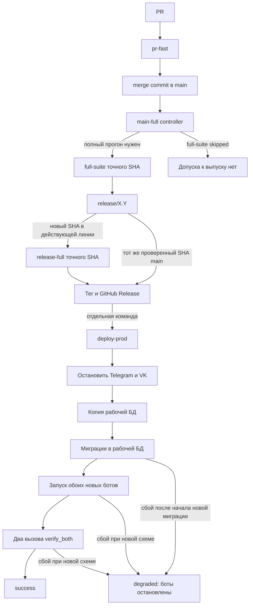
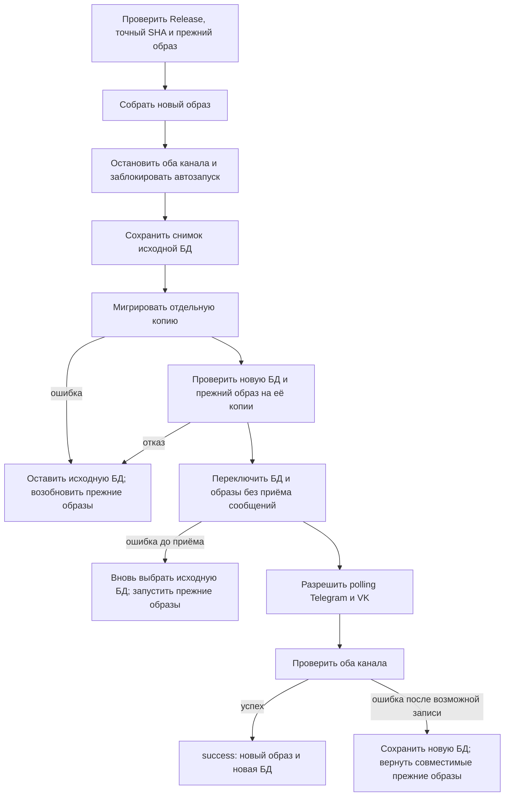

# План: разобраться в CI и упростить выпуск

Цель этой работы — сделать путь от PR до установки версии понятным создателю,
измерить затраты времени и токенов агента, затем улучшить CI и восстановление
после неудачной установки. Это рабочий план к
[пункту бэклога](../BACKLOG.md#разобрать-ci-и-выпуск-вместе-с-создателем).
Действующие правила описаны в [RELEASES.md](../RELEASES.md), команды —
в [OPERATIONS.md](../OPERATIONS.md), последний снимок VPS —
в [PRODUCTION.md](../PRODUCTION.md). Целевая схема ниже ещё не реализована.

## Что уже решили

- `deploy-prod` остаётся отдельной командой после публикации GitHub Release.
  Публикация сама по себе VPS не меняет.
- Для выпуска обязателен успешный **полный CI точного SHA**. Зелёный
  `main-full` с пропущенным `full-suite` допуска не даёт.
- Перед окончательным снимком SQLite оба бота остановлены. Новые миграции
  сначала применяются к **копии**, а исходная БД сохраняется.
- Автоматический возврат рассчитан на одну точную версию, установленную на
  VPS до обновления: её SHA, Docker image ID и схему.
- До возможного приёма сообщений новым кодом можно вернуть прежние БД и
  образы. После него сохраняем новую БД и возвращаем только прежние образы,
  если они проверены на этой новой схеме.
- Проверки и замеры выполняют CI и скрипты установки. Агент получает короткий
  итог и разбирает исключения; `git push` и эксплуатационные действия
  остаются под правилами [AGENTS.md](../../AGENTS.md).

## Как работает выпуск сейчас

`pr-fast` проверяет тестовое слияние PR и короткий набор. `main-full`
запускается после push в `main`, но полный набор обычно назначается после
каждого третьего слияния либо ручным запуском для текущего SHA. Для нового
SHA существующей линии нужен `release-full`. Скрипт допуска сверяет
репозиторий, workflow, ветку, SHA, run/attempt и обязательные jobs/steps.

Сегодня `deploy-prod` делает backup, а затем мигрирует **рабочую** БД.
Новые боты запускаются до записи `success` и во время `verify_both` уже
могут принять сообщение. Если началась новая миграция и переход сорвался,
контроллер сохраняет marker и состояние `degraded`: автоматически запускать
старый образ с неопределённой схемой он не будет.

## К какому пути стремимся

Допуск CI и разделение Release/deploy сохраняются. Меняется работа с БД и
поведение при отказе установки:

До переключения исходная БД не изменена: «вернуть» означает запустить с ней
прежние образы, а не переписать её из backup. Если переключатель уже выбрал
новую БД, но новый код ещё не мог принять события, он вновь выбирает
сохранённую исходную БД. После разрешения polling старый снимок не
подставляется автоматически: это могло бы удалить новые записи.

Пример: оба снимка сначала содержат 100 записей. Новый бот записал № 101,
затем проверка завершилась ошибкой. Контроллер сохраняет обновлённую БД с
101 записью и запускает на ней **проверенный прежний образ**.

## Этапы реализации

### 1. Снять базовые замеры и разобрать текущий выпуск

**Сделать:** по завершённым прогонам и следующему сопоставимому выпуску
собрать wall-clock для PR → CI → Release → deploy, время шагов, число ручных
действий, API retries, ожидания агента и доступный расход Codex tokens.
Отдельно разобрать deploy `v3.0.0` около 3:35: build, backup, migrations,
оба `verify_both`, прежний Docker healthcheck timeout 5 секунд. Объяснить
ложный `unhealthy` после `Health check passed` и красную GitHub annotation
от намеренного `RuntimeError` в `tests/test_pending_input.py:44`.

**Готово, когда:** есть таблица замеров с SHA, источником и временем;
неизвестный расход токенов явно обозначен. На прогонах 30.10.2026 один
`pr-fast` занял около 31 секунды, полный `main-full` — 1:47,
`release-full` — 1:54; это исходные наблюдения, не норматив.

### 2. Оставить постоянные метрики и короткий отчёт

**Сделать:** собирать время GitHub Actions run/jobs/steps для точного SHA.
`deploy-prod` должен записывать начало и конец build, остановки каналов,
backup, migrations и каждого `verify_both`, общий wall-clock и простой.
Один компактный отчёт показывает этап, длительность, run/attempt, результат
и причину отказа. Он доступен и после неуспешного выпуска.

Для Codex проверить поддерживаемый источник счётчиков. В
[`codex exec --json`](https://developers.openai.com/blog/eval-skills)
usage доступен в событии `turn.completed`; это не подтверждает его
доступность в desktop-чате. При отсутствии достоверного счётчика сохранять
`unknown`, а отдельно — число вызовов инструментов и ожиданий. Данные
сессии, секреты и содержимое БД не публиковать в CI.

**Готово, когда:** новый выпуск оставляет короткую историю для сравнения.
После накопления сопоставимых прогонов отчёт показывает отклонение внутри
одного типа работы: `pr-fast` с `pr-fast`, полный CI с полным CI,
deploy с deploy. Долгий этап виден ещё во время выполнения; предупреждение
не прерывает безопасное ожидание и не запускает rollback.

### 3. Упростить дорогие шаги по результатам замеров

**Сделать:** проверить, какие проверки дублируются, где повторяются GitHub
API запросы и установки зависимостей, сколько времени агент тратит на
опросы и чтение логов. Менять по одному подтверждённому узкому месту и
сравнивать до/после на одинаковом типе прогона.

**Готово, когда:** wall-clock, ручные шаги и доступный расход токенов
уменьшились либо документировано, почему изменение не помогло. Допуск
точного SHA, полный набор перед выпуском и отказ при сбое API сохранены.

### 4. Подготовить версию, пригодную для будущего возврата

**Сделать:** изменить startup мигратора так, чтобы предыдущий образ мог
работать с **проверенной совместимой более новой схемой**, не выполняя
неизвестный SQL. Не открывать доступ к любой неизвестной схеме: контроллер
должен допускать только проверенную пару SHA/схем. Сначала выпустить и
установить эту базовую версию. Уже выпущенный строгий образ нельзя
исправить задним числом.

**Готово, когда:** базовая версия стала фактически установленной целью
возврата; несовместимая или не подтверждённая схема по-прежнему отвергается.

### 5. Автоматически проверять совместимость БД

**Сделать:** в полном CI применить миграции к тестовой БД с данными
предыдущего выпуска. На обновлённой копии без доступа к реальным каналам
запустить точный предыдущий образ и проверить startup, чтение и запись;
новый код должен понимать сделанную им запись. Перед deploy повторить
проверку для **фактически установленного** на VPS SHA/image ID. Текущий
`check_full_migrations.py` уже проверяет один repository прежнего кода,
но не полный запуск прежнего образа.

По умолчанию новая схема сохраняет прежний интерфейс таблиц и записи.
Устаревшее поле разрешено удалить, если оно было заранее объявлено к
удалению и предыдущий образ прошёл обязательные сценарии на БД **без
этого поля**. Пометка `@Deprecated` или поиск текста по коду сами по себе
не доказывают совместимость. При неполной проверке поле оставляют.

**Готово, когда:** несовместимая пара или несовпадающий SHA закрывают
установку до остановки ботов; успешный допуск фиксирует обе версии.

Пример, не относящийся к текущей схеме проекта: `v1` использует
`users.name`. В `v2` БД содержит `name` и `display_name`, чтобы
`v1` могла вернуться. Если установленная `v2` уже работает без
`name`, выпуск `v3` может удалить его после проверки образа `v2` на
БД `v3`. Если `v2` ещё использует `name`, поле пока сохраняют.
Совместимость старого и нового представления данных обеспечивает БД;
старый образ при возврате не меняют.

### 6. Мигрировать копию и изменить возврат

**Сделать:** после остановки обоих ботов получить неизменяемый снимок
исходной SQLite, мигрировать отдельную копию и проверить целостность,
схему и данные. Выбрать на стенде механизм переключения, который не
смешивает БД с чужим WAL и после прерывания позволяет определить
активную БД. До первого возможного сообщения ошибка возвращает прежнюю
пару БД/образов. После него ошибка сохраняет новую БД и возвращает
проверенные прежние образы. `down`-миграции не служат общим путём
автоматического возврата: удаление колонки или таблицы может удалить
новые данные.

**Готово, когда:** `deploy-prod` сам фиксирует stage, обе БД, точные
SHA/image ID и границу приёма сообщений; повтор команды не запускает
двух polling-процессов и не теряет записи.

### 7. Испытать штатный путь и отказы на стенде

**Сделать:** прервать preflight, остановку каналов, backup, миграцию
копии, переключение, запуск, обе проверки здоровья и повтор команды.
Проверить marker, lock, timer, image ID, SQLite integrity/foreign keys,
схему, простой и записи после переключения.

| Где произошёл отказ | Ожидаемый результат |
| --- | --- |
| До остановки | Старые боты работают; БД не переключена |
| После остановки, до переключения | Исходная БД цела; старые боты возобновлены |
| При переключении, до приёма сообщений | Активная БД однозначно определена; прежняя пара восстановлена |
| После возможной записи новым кодом | Новая БД сохранена; прежний совместимый образ работает с ней |
| Обе копии недоступны или состояние не доказано | Writers остановлены; причина и данные сохранены для отдельного recovery |

**Готово, когда:** для каждого прерывания известно конечное состояние и
результат повторного запуска. Недоказанная совместимость не объявляется
успешным rollback.

### 8. Завершить приёмку и перенести правила

**Сделать:** повторить замеры, сравнить время и работу агента с этапом 1,
проверить оба канала на тестовом стенде. Согласованные правила перенести в
`RELEASES.md` и `OPERATIONS.md`; перед эксплуатационным действием
заново проверить [PRODUCTION.md](../PRODUCTION.md). Временный каталог
сохранять до слияния всех PR и эксплуатационной приёмки.

**Готово, когда:** проведены штатные и отказные сценарии, замеры до/после
показывают результат, документация и ссылки полны. Затем удалить временный
каталог отдельным завершающим изменением и закрыть пункт бэклога.

## Что ещё нужно решить на стенде

- Как выбирать активную БД так, чтобы прерывание не смешало её с WAL
  другой версии и не оставило неопределённое состояние.
- Как зафиксировать проверенную пару старого образа и новой схемы для
  автоматического допуска без разрешения произвольных неизвестных миграций.
- Какие сценарии чтения и записи обязательны для каждого модуля при
  проверке предыдущего образа.
- Откуда получать достоверное число Codex tokens для работы в desktop-чате;
  пока источника нет, метрика остаётся `unknown`.
