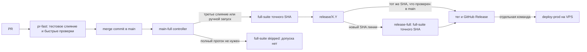
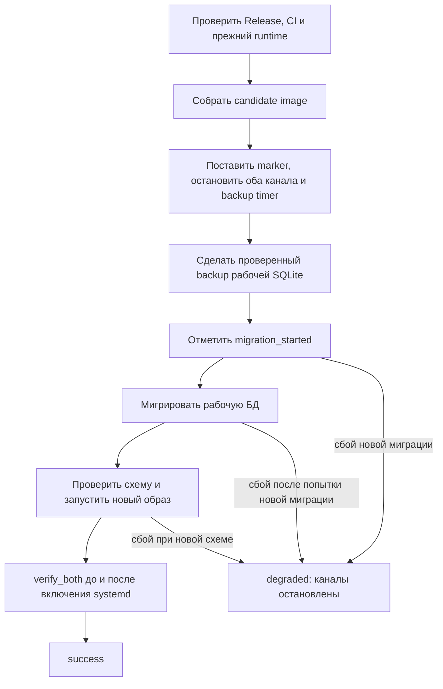
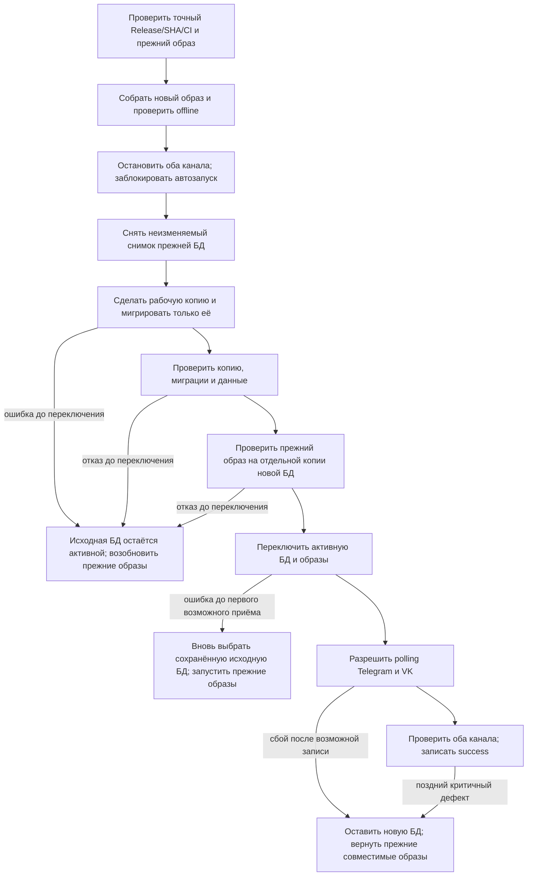

# Разбор CI и безопасного выпуска

Этот рабочий план описывает, как измерить и упростить путь PR → CI → Release →
`deploy-prod`, а затем испытать восстановление предыдущей установленной версии
при ошибке обновления SQLite. Действующие правила находятся в
[RELEASES.md](../RELEASES.md), команды и восстановление — в
[OPERATIONS.md](../OPERATIONS.md), последний документированный снимок VPS — в
[PRODUCTION.md](../PRODUCTION.md). План относится к
[пункту бэклога](../BACKLOG.md#разобрать-ci-и-выпуск-вместе-с-создателем) и не
описывает уже внедрённое поведение.

## Цель и граница

- Создатель понимает, какой SHA проверяет каждый этап CI и почему публикация
  GitHub Release не устанавливает версию на VPS.
- Каждый этап выпуска выдаёт короткий машинный результат и измеримое время;
  агент разбирает исключения, а не опрашивает GitHub и читает полные логи по кругу.
- До запуска нового кода ошибка оставляет прежнюю БД и возвращает прежние
  образы. После начала приёма сообщений ошибка сохраняет новую БД и возвращает
  прежние образы, **только если эта точная пара проверена на совместимость**.
- Цель возврата — точные SHA и image ID версии, установленной на VPS перед
  командой, а не просто предыдущий номер GitHub Release. Поддерживается одна
  такая версия. Отказ при повреждении носителя, недоступности обеих копий или
  недоказанной совместимости остаётся закрытым и требует отдельного recovery.
- Production не меняется на этапе подготовки плана и стендовых испытаний.
  Реальные команды выпуска и установки требуют свежей проверки состояния VPS
  и отдельного эксплуатационного решения.

## Как работает система сейчас

Контроллер `main-full` запускается при push в `main`, но успешный контроллер с
пропущенным `full-suite` не даёт допуска. Для нового SHA существующей релизной
линии нужен `release-full`. Публикация тега и Release не меняет VPS. Допуск
сверяет полный SHA, workflow, run/attempt, обязательные jobs и steps через
`scripts/full_ci_admission.py`.

Пример: после одного нового merge commit `main-full` может завершиться зелёным,
а `full-suite` будет `skipped`. Этот SHA ещё нельзя опубликовать как обычный
релиз. Ручной `main-full` для того же текущего SHA запускает полный набор;
если ветка сдвинулась, проверку повторяют уже для её нового SHA.

Сейчас backup создаётся SQLite Backup API после остановки обоих writers.
Мигратор выполняет очередные SQL-файлы в отдельных транзакциях, но изменяет
рабочую БД. `schema_migrations` хранит номера и имена применённых файлов.
`migration_started` записывается до запуска мигратора. Если кандидат содержит
новые миграции и попытка началась, контроллер не запускает прежний образ
автоматически; он сохраняет marker и состояние `degraded`. Текущий прежний
образ также отвергает незнакомую запись в `schema_migrations` при старте.

`deploy-prod` запускает оба новых канала **до** записи `success`: во время
`verify_both` они уже могут принимать события и записывать данные. Поэтому
старый снимок БД нельзя автоматически подставлять после этого момента.

## Что измерить до изменений

| Участок | Измерение | Источник |
| --- | --- | --- |
| PR → `pr-fast` | wall-clock, ожидание runner, длительность каждого шага | GitHub Actions run/jobs |
| merge → полный допуск | число слияний, пропущенные и полные `main-full`, время полного прогона | GitHub Actions и точный SHA |
| release line → Release | ручные команды, обращения к API, повторы `--check`/`--dry-run`/`--publish` | журнал команд без секретов |
| Release → deploy | build, остановка, backup, migrations, каждое `verify_both`, общий простой обоих каналов | структурированные события controller |
| работа агента | число вызовов инструментов, ожиданий и затраченные Codex tokens | измерение при следующем сопоставимом выпуске |

На прогонах 30.10.2026 один `pr-fast` занял около 31 секунды, полный
`main-full` — около 1:47, `release-full` — около 1:54. Это наблюдение, а не
целевой норматив. Достоверной исторической величины Codex tokens сейчас нет.
Для `v3.0.0` отдельно разобрать deploy около 3:35 и инцидент с прежним
Docker healthcheck timeout 5 секунд; действующий `docker-compose.yml` уже
указывает 30 секунд. Отдельно объяснить красную annotation успешного CI от
намеренного `RuntimeError` в `tests/test_pending_input.py:44`.

## Сохранить измерения для следующих выпусков

Первый замер задаёт базу сравнения, но сбор метрик остаётся частью штатного
маршрута. CI собирает времена run, jobs и steps по GitHub Actions для точного
SHA. Controller печатает структурированные события начала/конца build,
остановки writers, backup, migrations и **каждого** `verify_both`; сохраняет
общий wall-clock и время простоя обоих каналов. Запись содержит версию, SHA,
run/attempt, stage, outcome и длительности, но не содержимое БД, `.env`,
токены доступа или тексты сообщений. Краткий итог доступен после каждого
выпуска, в том числе неуспешного; подробные логи нужны лишь при отклонении.

Токены Codex относятся к работе агента, а не к GitHub runner или VPS.
Проверить наличие поддерживаемого источника счётчиков для текущего способа
запуска Codex. Если задача запускается через `codex exec --json`,
[официальное описание](https://developers.openai.com/blog/eval-skills)
указывает usage в событии `turn.completed`; это не доказывает, что тот же
счётчик доступен в текущем desktop-чате. Для desktop-чата записывать
`input_tokens`/`output_tokens` и источник только при наличии достоверной
метрики; иначе сохранять `unknown`, число вызовов инструментов и ожиданий,
не подменяя их оценкой токенов. Данные сессии агента не публиковать в CI.

После накопления сопоставимых запусков выводить отклонения от базовой линии
по одинаковому типу прогона: `pr-fast` сравнивать с `pr-fast`, полный CI — с
полным CI, deploy — с deploy. Порог времени выбирать по измерениям и
фиксировать отдельно от лимитов безопасности. Сигнал нужен при заметном
замедлении шага, частых API retries, приближении к таймауту `verify_both`
или росте подтверждённого расхода токенов; при отсутствии метрики токенов
выдавать `unknown`, а не тревогу. Пока данных мало, показывать только факт и
историю без вывода о регрессии. Отчёт не меняет exact-SHA допуск и не
запускает повторный CI автоматически.

Во время CI/deploy сравнивать время с последнего события начала этапа с
порогом: затянувшийся build, backup или `verify_both` виден **до** завершения
команды. Предупреждение не прерывает безопасное ожидание и не запускает
автоматический rollback. По окончании записывать фактическую длительность и
причину отказа, если он произошёл.

## Целевой путь установки

`deploy-prod` остаётся одной синхронной командой. Он сам выполняет переходы и
фиксирует stage, SHA, image ID, идентификаторы обеих БД и границу, после
которой могло начаться получение событий. Агент не принимает решения между
шагами. Новый код не должен обрабатывать реальные сообщения до выбора
активной БД. Живой polling можно проверить только после его разрешения;
последующий возврат не подменяет прежний снимок БД.

«Вернуть старую БД» означает восстановить выбор **сохранённой исходной БД**,
если переключатель уже указывал на новую. До переключения исходная БД и так
остаётся активной; копировать backup поверх неё не нужно. Перед повторным
запуском прежних образов controller проверяет её целостность и схему, точные
SHA/image ID и отсутствие запущенного нового writer. При неуспешной проверке
он не объявляет автоматический возврат успешным.

Пример границы: до переключения обе БД содержат 100 записей. Новый бот после
включения polling добавил запись № 101 в обновлённую БД, затем его проверка
завершилась ошибкой. Контроллер возвращает прежний **образ**, работающий с
обновлённой совместимой БД; подмена старым снимком потеряла бы запись № 101.

SQLite Backup API читает согласованное содержимое исходной БД, включая
зафиксированные данные WAL. Миграция рабочей копии может создать собственный
WAL. Механизм переключения БД выбирается только после стендовой проверки
закрытия соединений, согласованности файлов, атомарности выбора активной БД
и восстановления при прерывании в каждой точке. Простой `app.db` rename без
такой проверки в план не заложен.

## Правило совместимости одной пары версий

1. Новая схема сохраняет таблицы, колонки, ограничения и поведение записи,
   необходимые точному образу, установленному до обновления. Поддержка
   гарантируется для **одной предыдущей установленной версии**.
2. Старый образ не меняют в момент отката. Для будущих выпусков нужен
   предварительный базовый выпуск: его мигратор должен принимать проверенный
   более новый журнал миграций, не исполняя неизвестный SQL. Запрет нельзя
   просто отключить для произвольной неизвестной схемы: controller допускает
   только проверенную пару SHA/схем и сохраняет её в manifest.
3. В CI миграции применяются к тестовой БД с данными предыдущего выпуска.
   Скрипт сравнивает прежний и новый schema contract и запускает предыдущий
   точный образ на копии обновлённой БД без доступа к реальным каналам.
   Проверяются полноценный startup, чтение, запись и понимание записей новым
   кодом. Действующий `check_full_migrations.py` уже выполняет узкий probe
   прежнего repository, но не полноценный запуск прежнего образа.
4. Перед deploy controller повторяет допуск для **фактически работающего**
   SHA/image ID на VPS. Непроверенная пара, несовпадающий SHA и сбой проверки
   закрывают установку до переключения, оставляя старую БД и образы.
5. Удаление старого поля разрешается только если оно было заранее объявлено
   устаревшим, а точный образ, к которому возможен возврат, прошёл сценарии
   на схеме **без этого поля**. Скрипт не делает вывод об отсутствии
   использования из одного текстового поиска или пометки `@Deprecated`.
   При неполном покрытии поле сохраняют; в плане удаления указывают выпуск,
   после которого проверку повторят.

Пример для обсуждения, а не описание текущей схемы проекта:

| Установлено до обновления | Новая БД | Условие возврата |
| --- | --- | --- |
| `v1` читает `users.name` | `v2`: `name` + `display_name` | БД поддерживает чтение и запись `name` прежним образом |
| `v2` читает `display_name` | `v3`: `display_name` | `name` можно удалить после проверки образа `v2`; возврат к `v1` уже не обещан |

Если `v2` всё ещё использует `name`, `v3` сохраняет поле. Для согласованности
старых и новых представлений данных можно использовать механизм на стороне
БД; код прежнего образа не меняют при откате. `down`-миграции допустимы как
отдельный инструмент для доказанно обратимых изменений, но не служат общим
автоматическим путём возврата после новых записей: `DROP COLUMN` или
`DROP TABLE` может удалить данные.

## Принятые решения и вопросы для стенда

Принято: боты остановлены перед окончательным снимком; мигрируется копия;
одна предыдущая **установленная** версия служит целью возврата; проверки
совместимости исполняют CI и controller, а не агент; после возможных записей
нового кода прежний снимок не подставляется автоматически.

На стенде выбрать и зафиксировать: механизм выбора активной БД без смешивания
файла с чужим WAL, точный контракт разрешённой будущей схемы для базового
образа, границу первого возможного приёма сообщений, обязательные сценарии
старого кода на новой схеме и способ получения сравнимого числа Codex tokens.
Для каждого решения нужны отказные испытания и измерение простоя.

## Этапы реализации

| Этап | Работа | Проверяемый результат |
| --- | --- | --- |
| 1. Снять базу измерений | Получить timing шагов CI и deploy, ручные шаги, API retries и доступные счётчики Codex tokens на сопоставимом маршруте; определить источники | Таблица с источником, SHA и временем каждого замера; неизвестные величины отмечены |
| 2. Оставить постоянное наблюдение | Собирать структурированные длительности CI/deploy и компактный read-only отчёт по точному SHA: caller, run/attempt, `full-suite`, шаги и причина отказа; ограничить повторные опросы | Для каждого выпуска сохранён короткий итог и история; agent получает сигнал об отклонении без полного лога; exact-SHA допуск не меняется |
| 3. Подготовить базовый выпуск | Изменить startup мигратора для контролируемой совместимости с будущей схемой; добавить проверки неизвестного/несовместимого журнала | Базовая версия установлена и стала реальной целью возврата до первого миграционного выпуска нового маршрута |
| 4. Автоматизировать контракт БД | Дополнить `full-suite` проверкой схем и прежнего образа на обновлённой тестовой БД; определить декларацию устаревших полей и обязательные сценарии | Удаление используемого поля и несовместимое ограничение закрывают допуск; чистый отчёт фиксирует пару SHA |
| 5. Мигрировать копию | Подготовить отдельный слот/копию, проверить backup, миграцию и схему без изменения рабочей БД; спроектировать переключатель | Ошибка до переключения автоматически возвращает прежнюю работающую пару |
| 6. Изменить controller recovery | Зафиксировать границу возможного приёма сообщений; после неё возвращать только прежний образ на совместимой новой БД | Нет потери записей из-за автоматической подмены старым backup; непроверенная пара не запускается |
| 7. Испытать на стенде | Прервать каждую стадию, включая copy, migration, selector, startup и обе проверки каналов; испытать повтор и отказ второго сбоя | Для каждой точки известны stage, активная БД/образ, сохранность записей и действие controller |
| 8. Сравнить и перенести правила | Повторить замеры; согласовать упрощения CI и перенести действующие правила в `RELEASES.md` и `OPERATIONS.md` | Замеры до/после, стендовая приёмка, ссылки и постоянная документация полны |

Пункты 3–7 допускают несколько PR, но временный каталог сохраняется до
эксплуатационной приёмки всей функциональности. Рабочий каталог удаляют
отдельным завершающим изменением после переноса правил; лишь затем закрывают
пункт бэклога и очищают worktree по правилам `AGENTS.md`.

## Отказные сценарии для стенда

| Точка отказа | Ожидаемое безопасное состояние |
| --- | --- |
| Release, CI, образ или место на диске не прошли preflight | Старые боты продолжают работу; БД не переключена |
| Остановка одного канала не подтверждена | Не делать снимок для миграции; вернуть прежний runtime после проверки отсутствия дублей |
| Снимок или миграция копии не прошли | Прежняя БД не изменена; проверить и запустить прежние образы |
| Прерывание в переключателе БД | По атомарному manifest определить активный слот; не запускать канал на неизвестном слоте |
| Новый образ не готов до разрешения polling | Вернуть старую БД и образы, если приём событий доказанно не начинался |
| Ошибка после возможного приёма событий | Сохранить новую БД и вернуть совместимые прежние образы; проверить оба канала |
| Повреждена активная БД либо недоступны обе локальные копии | Сохранить состояние и остановить writers; отдельный recovery с независимой копией и оценкой данных |

Для каждого сценария дополнительно проверить идемпотентность повторной
команды, marker, lock, timer, отсутствие параллельного polling, точные image ID,
schema manifest, SQLite integrity/foreign keys и записи после переключения.
До испытания стенда план не обещает автоматический возврат при любом сбое.

## Критерии завершения

- Создатель может по одному SHA объяснить путь PR, быстрого и полного CI,
  release line, публикации Release и отдельной установки на VPS.
- Замеры **до и после** показывают wall-clock, время простоя обоих каналов,
  число ручных шагов и подтверждённый расход Codex tokens там, где он
  доступен. Постоянные метрики и сигналы сохраняются для будущих выпусков;
  отсутствие счётчика токенов явно отмечено. Сокращение не достигается
  пропуском exact-SHA допуска, backup, миграций или проверок обоих каналов.
- На стенде проверены штатный выпуск, миграция копии, удаление объявленного
  устаревшим поля, несовместимая схема и прерывания на каждой границе.
- Для ошибки до приёма сообщений восстановлена прежняя пара БД/образов; для
  ошибки после приёма сохранены новые записи и возвращён проверенный прежний
  образ. Там, где это нельзя доказать, controller останавливается с точной
  причиной и сохранёнными данными для recovery.
- Действующие правила перенесены в постоянные документы после приёмки;
  временный каталог удалён отдельным изменением, затем закрыт пункт бэклога.
