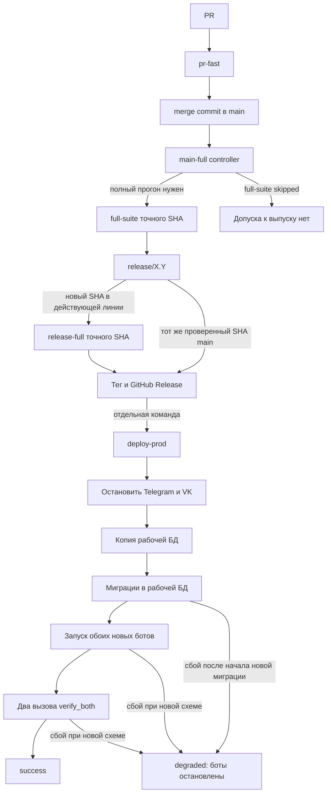
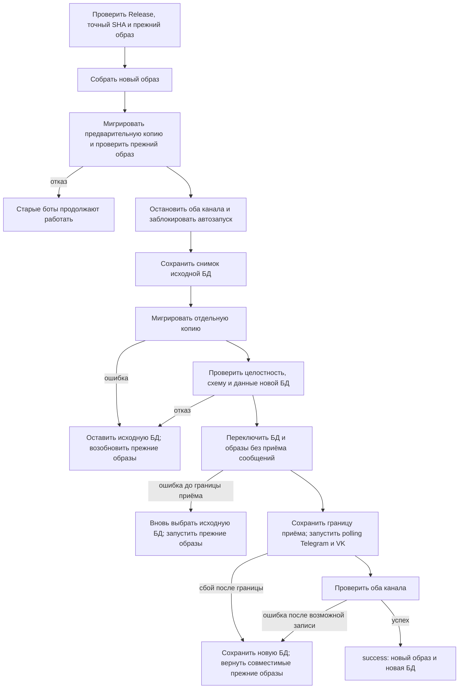

# План: разобраться в CI и упростить выпуск

Цель этой работы — сделать путь от PR до установки версии понятным создателю,
измерить затраты времени и токенов агента, затем улучшить CI и восстановление
после неудачной установки. Это рабочий план к
[пункту бэклога](../BACKLOG.md#разобрать-ci-и-выпуск-вместе-с-создателем).
Действующие правила описаны в [RELEASES.md](../RELEASES.md), команды —
в [OPERATIONS.md](../OPERATIONS.md), последний снимок VPS —
в [PRODUCTION.md](../PRODUCTION.md). Целевая схема ниже ещё не реализована.

## Что уже решили

- `deploy-prod` остаётся отдельной командой после публикации GitHub Release.
  Публикация сама по себе VPS не меняет.
- Для выпуска обязателен успешный **полный CI точного SHA**. Зелёный
  `main-full` с пропущенным `full-suite` допуска не даёт.
- Перед окончательным снимком SQLite оба бота остановлены. Новые миграции
  сначала применяются к **копии**, а исходная БД сохраняется.
- Автоматический возврат рассчитан на одну точную версию, установленную на
  VPS до обновления: её SHA, Docker image ID и схему.
- До сохранения границы возможного приёма сообщений новым кодом можно вернуть
  прежние БД и образы. После неё сохраняем новую БД и возвращаем только
  прежние образы, если они проверены на этой новой схеме.
- Совместимость прежнего образа допускается до остановки ботов на отдельной
  мигрированной копии. После остановки контроллер проверяет результат миграции
  окончательного снимка, не повторяя весь допуск совместимости.
- Отдельно установленный controller snapshot обновляется до применения нового
  порядка deploy; его SHA фиксируется отдельно от SHA выпуска.
- Проверки и замеры выполняют CI и скрипты установки. Агент получает короткий
  итог и разбирает исключения; `git push` и эксплуатационные действия
  остаются под правилами [AGENTS.md](../../AGENTS.md).

## Как работает выпуск сейчас

`pr-fast` проверяет тестовое слияние PR и короткий набор. `main-full`
запускается после push в `main`, но полный набор обычно назначается после
каждого третьего слияния либо ручным запуском для текущего SHA. Для нового
SHA существующей линии нужен `release-full`. Скрипт допуска сверяет
репозиторий, workflow, ветку, SHA, run/attempt и обязательные jobs/steps.

Сегодня `deploy-prod` делает backup, а затем мигрирует **рабочую** БД.
Новые боты запускаются до записи `success` и во время `verify_both` уже
могут принять сообщение. Если началась новая миграция и переход сорвался,
контроллер сохраняет marker и состояние `degraded`: автоматически запускать
старый образ с неопределённой схемой он не будет.

## К какому пути стремимся

Допуск CI и разделение Release/deploy сохраняются. Меняется работа с БД и
поведение при отказе установки:

До переключения исходная БД не изменена: «вернуть» означает запустить с ней
прежние образы, а не переписать её из backup. Если переключатель уже выбрал
новую БД, но граница приёма ещё не сохранена, он вновь выбирает сохранённую
исходную БД. После сохранения границы старый снимок не подставляется
автоматически: это могло бы удалить новые записи.
Совместимость прежнего образа проверяется до остановки на отдельно
мигрированной предварительной копии. После остановки мигрируется окончательный
снимок и проверяется его результат, без повторного допуска совместимости.
Контроллер сохраняет границу возможного приёма сообщений до запуска первого
нового polling-процесса.

Пример: оба снимка сначала содержат 100 записей. Новый бот записал № 101,
затем проверка завершилась ошибкой. Контроллер сохраняет обновлённую БД с
101 записью и запускает на ней **проверенный прежний образ**.

## Этапы реализации

### 1. Снять базовые замеры и разобрать текущий выпуск

**Сделать:** по завершённым прогонам и следующему сопоставимому выпуску
собрать wall-clock для PR → CI → Release → deploy, время шагов, число ручных
действий, API retries, ожидания агента и доступный расход Codex tokens.
Отдельно разобрать deploy `v3.0.0` около 3:35: build, backup, migrations,
оба `verify_both`, прежний Docker healthcheck timeout 5 секунд. Объяснить
ложный `unhealthy` после `Health check passed` и красную GitHub annotation
от намеренного `RuntimeError` в `tests/test_pending_input.py:44`.

**Готово, когда:** есть таблица замеров с SHA, источником и временем;
неизвестный расход токенов явно обозначен. На прогонах 30.10.2026 один
`pr-fast` занял около 31 секунды, полный `main-full` — 1:47,
`release-full` — 1:54; это исходные наблюдения, не норматив.

#### Шаги этапа 1

| Шаг | Исполнитель | Результат |
| --- | --- | --- |
| 1.1. Восстановить маршрут PR → полный CI → Release по завершённым GitHub runs | GPT-6 Sol, medium: выборка API и расчёт длительностей по точным timestamps | Таблица run/attempt, SHA, начала и конца, времени jobs/steps и ссылок на источники в [замерах CI](CI_BASELINE.md) |
| 1.2. Разобрать установку `v3.0.0` и ложный `unhealthy` | GPT-6 Astra, medium: сопоставление журнала, состояния Docker и кода контроллера | Хронология build, backup, migrations, двух `verify_both`, timeout и границ доказанного в [разборе deploy](DEPLOY_V300.md) |
| 1.3. Проверить annotation теста и доступность метрик ручной работы агента | GPT-6 Sol, medium: ограниченная проверка лога и исходника | Причина красной annotation, подтверждённые ручные действия/API retries/ожидания, `unknown` для недоступных Codex tokens в [записи метрик агента](AGENT_BASELINE.md) |
| 1.4. Свести исходные замеры и сверить критерий этапа | GPT-6 Sol, medium: проверка сопоставимости и противоречий источников | [Сводный отчёт](STAGE1_BASELINE.md) со ссылками на три записи, неизвестными значениями и отдельным полем для следующего сопоставимого выпуска |

Рабочие записи шагов 1.1–1.3 не содержат секретов, содержимого БД и полных
логов. Шаг 1.4 не объявляет этап завершённым, пока не добавлен следующий
сопоставимый выпуск; недоступные метрики остаются `unknown`.

### 2. Оставить постоянные метрики и короткий отчёт

**Сделать:** собирать время GitHub Actions run/jobs/steps для точного SHA.
`deploy-prod` должен записывать начало и конец build, остановки каналов,
backup, migrations и каждого `verify_both`, общий wall-clock и простой.
Один компактный отчёт показывает этап, длительность, run/attempt, результат
и причину отказа. Он доступен и после неуспешного выпуска.

Для Codex проверить поддерживаемый источник счётчиков. В
[`codex exec --json`](https://developers.openai.com/blog/eval-skills)
usage доступен в событии `turn.completed`; это не подтверждает его
доступность в desktop-чате. При отсутствии достоверного счётчика сохранять
`unknown`, а отдельно — число вызовов инструментов и ожиданий. Данные
сессии, секреты и содержимое БД не публиковать в CI.

**Готово, когда:** новый выпуск оставляет короткую историю для сравнения.
После накопления сопоставимых прогонов отчёт показывает отклонение внутри
одного типа работы: `pr-fast` с `pr-fast`, полный CI с полным CI,
deploy с deploy. Долгий этап виден ещё во время выполнения; предупреждение
не прерывает безопасное ожидание и не запускает rollback.

#### Шаги этапа 2

| Шаг | Исполнитель | Результат |
| --- | --- | --- |
| 2.1. Собирать run/jobs/steps GitHub Actions | GPT-6 Sol, medium: API, точный SHA и workflow с состояниями skipped/failure | Постоянный краткий отчёт CI и тесты его расчёта; сравнение только одинаковых типов прогонов |
| 2.2. Измерять `deploy-prod` | GPT-6 Astra, medium: критический путь, сохранение отчёта при ошибке и отсутствие влияния предупреждений на rollback | Отметки этапов, общий wall-clock и простой, доступный при отказе отчёт и проверки штатного/отказного пути |
| 2.3. Определить доступные метрики Codex | GPT-6 Sol, medium: проверка документированного счётчика и границ данных desktop-чата | Рабочая запись об источнике tokens, вызовах инструментов и ожиданиях; недоступное значение остаётся `unknown` |
| 2.4. Свести отчёты и проверить критерий этапа | GPT-6 Astra, medium: интеграционная проверка после лимита GPT-6 Sol | Проверка формата, ссылок, отказных сценариев и документации; явная запись о проверенном и ожидающем нового выпуска |
| 2.5. Показывать долгий шаг CI во время выполнения | GPT-6 Astra, medium: процессы CI, timeout и наблюдаемость без вмешательства в допуск | Предупреждение о затянувшемся шаге в живом логе, тест сохранения кода завершения и обновлённая рабочая запись |

Все шаги выполняются в одном worktree этого чата. Для внешнего CI и deploy
действительные времена нового выпуска подтверждаются только после его
завершения; локальные тесты не подменяют такую проверку.

### 3. Упростить дорогие шаги по результатам замеров

**Сделать:** проверить, какие проверки дублируются, где повторяются GitHub
API запросы и установки зависимостей, сколько времени агент тратит на
опросы и чтение логов. Менять по одному подтверждённому узкому месту и
сравнивать до/после на одинаковом типе прогона.

**Готово, когда:** wall-clock, ручные шаги и доступный расход токенов
уменьшились либо документировано, почему изменение не помогло. Допуск
точного SHA, полный набор перед выпуском и отказ при сбое API сохранены.

### 4. Подготовить версию, пригодную для будущего возврата

**Сделать:** изменить startup мигратора так, чтобы предыдущий образ мог
работать с **проверенной совместимой более новой схемой**, не выполняя
неизвестный SQL. Не открывать доступ к любой неизвестной схеме: контроллер
должен допускать только проверенную пару SHA/схем. Сначала выпустить и
установить эту базовую версию. Уже выпущенный строгий образ нельзя
исправить задним числом.

Мапперы базовой версии должны переводить незнакомые значения enum и статусов
из API и data-моделей в `UNKNOWN`. Предметные сценарии обрабатывают это
состояние без падения и без действий, требующих известного смысла статуса.

**Готово, когда:** базовая версия стала фактически установленной целью
возврата; несовместимая или не подтверждённая схема по-прежнему отвергается.
Тесты мапперов и предметных сценариев подтверждают безопасную обработку
подставленного незнакомого значения каждого затронутого enum/status.

### 5. Автоматически проверять совместимость БД

**Сделать:** в полном CI применить миграции к тестовой БД с данными
предыдущего выпуска. На обновлённой копии без доступа к реальным каналам
запустить точный предыдущий образ и проверить startup, чтение и запись;
новый код должен понимать сделанную им запись. Перед deploy повторить
проверку на отдельной копии до остановки ботов для **фактически установленного**
на VPS SHA/image ID, включая безопасную обработку неизвестного enum/status.
Текущий `check_full_migrations.py` уже проверяет один repository прежнего кода,
но не полный запуск прежнего образа.

Выбрать источник точного предыдущего Docker image для CI, способ его проверки
по digest и срок хранения. Сборка прежнего SHA сама по себе не доказывает
совпадение с образом, фактически установленным на VPS. Перед deploy сверять
проверяемый image ID с установленным; при отсутствии образа или несовпадении
пары SHA/image ID закрывать допуск. Для нескольких релизных линий явно
выбирать базовую версию проверки в CI; перед deploy проверять именно версию,
фактически установленную на VPS, даже если она из другой линии.

По умолчанию новая схема сохраняет прежний интерфейс таблиц и записи.
Устаревшее поле разрешено удалить, если оно было заранее объявлено к
удалению и предыдущий образ прошёл обязательные сценарии на БД **без
этого поля**. Пометка `@Deprecated` или поиск текста по коду сами по себе
не доказывают совместимость. При неполной проверке поле оставляют.

**Готово, когда:** несовместимая пара или несовпадающий SHA закрывают
установку до остановки ботов; успешный допуск фиксирует обе версии и точный
image ID прежнего образа. Отсутствующий образ не заменяется неподтверждённой
повторной сборкой.

Пример, не относящийся к текущей схеме проекта: `v1` использует
`users.name`. В `v2` БД содержит `name` и `display_name`, чтобы
`v1` могла вернуться. Если установленная `v2` уже работает без
`name`, выпуск `v3` может удалить его после проверки образа `v2` на
БД `v3`. Если `v2` ещё использует `name`, поле пока сохраняют.
Совместимость старого и нового представления данных обеспечивает БД;
старый образ при возврате не меняют.

### 6. Мигрировать копию и изменить возврат

**Сделать:** после остановки обоих ботов получить неизменяемый снимок
исходной SQLite, мигрировать отдельную копию и проверить целостность,
схему и данные. Выбрать на стенде механизм переключения, который не
смешивает БД с чужим WAL и после прерывания позволяет определить
активную БД. До сохранения границы возможного приёма ошибка возвращает прежнюю
пару БД/образов. После неё ошибка сохраняет новую БД и возвращает
проверенные прежние образы. `down`-миграции не служат общим путём
автоматического возврата: удаление колонки или таблицы может удалить
новые данные.

До использования нового пути отдельно установить проверенный controller
snapshot по [порядку обновления](../OPERATIONS.md#обновить-отдельно-установленный-controller-snapshot).
Проверить, что новый контроллер понимает существующие `state.json`, marker,
lock, настройки Compose/systemd и backup timer; при сбое его установки
восстанавливать прежний snapshot до запуска deploy. SHA контроллера и SHA
устанавливаемого Release записывать отдельно. Состояние, разрешающее
возможный приём сообщений, надёжно сохранять до запуска первого нового
polling-процесса.

**Готово, когда:** `deploy-prod` сам фиксирует stage, обе БД, точные
SHA/image ID, SHA установленного controller snapshot и границу приёма
сообщений до запуска polling; повтор команды не запускает двух
polling-процессов и не теряет записи.

### 7. Испытать штатный путь и отказы на стенде

**Сделать:** прервать preflight, остановку каналов, backup, миграцию
копии, переключение, запуск, обе проверки здоровья и повтор команды.
Проверить marker, lock, timer, image ID, SQLite integrity/foreign keys,
схему, простой и записи после переключения. Отдельно испытать установку
controller snapshot, чтение прежнего `state.json` и прерывание между
сохранением границы приёма и запуском polling.

| Где произошёл отказ | Ожидаемый результат |
| --- | --- |
| До остановки | Старые боты работают; БД не переключена |
| После остановки, до переключения | Исходная БД цела; старые боты возобновлены |
| При переключении, до сохранения границы приёма | Активная БД однозначно определена; прежняя пара восстановлена |
| После сохранения границы, до запуска polling | Новая БД сохранена; прежние совместимые образы запущены на ней |
| После возможной записи новым кодом | Новая БД сохранена; прежний совместимый образ работает с ней |
| Обе копии недоступны или состояние не доказано | Writers остановлены; причина и данные сохранены для отдельного recovery |

**Готово, когда:** для каждого прерывания известно конечное состояние и
результат повторного запуска. Недоказанная совместимость не объявляется
успешным rollback.

### 8. Завершить приёмку и перенести правила

**Сделать:** повторить замеры, сравнить время и работу агента с этапом 1,
проверить оба канала на тестовом стенде. Согласованные правила перенести в
`RELEASES.md` и `OPERATIONS.md`; перед эксплуатационным действием
заново проверить [PRODUCTION.md](../PRODUCTION.md). Временный каталог
сохранять до слияния всех PR и эксплуатационной приёмки.

**Готово, когда:** проведены штатные и отказные сценарии, замеры до/после
показывают результат, документация и ссылки полны. Затем удалить временный
каталог отдельным завершающим изменением и закрыть пункт бэклога.

## Что ещё нужно решить на стенде

- Как выбирать активную БД так, чтобы прерывание не смешало её с WAL
  другой версии и не оставило неопределённое состояние.
- Как зафиксировать проверенную пару старого образа и новой схемы для
  автоматического допуска без разрешения произвольных неизвестных миграций.
- Какие сценарии чтения и записи обязательны для каждого модуля при
  проверке предыдущего образа.
- Где хранить точный образ предыдущего выпуска для CI, сколько его сохранять
  и как подтвердить его digest для каждой релизной линии.
- Откуда получать достоверное число Codex tokens для работы в desktop-чате;
  пока источника нет, метрика остаётся `unknown`.
