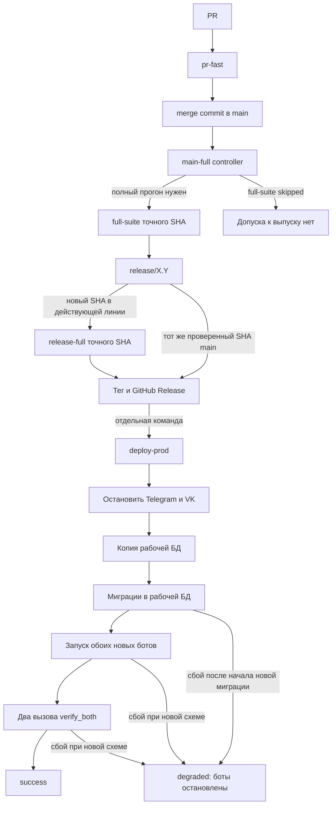
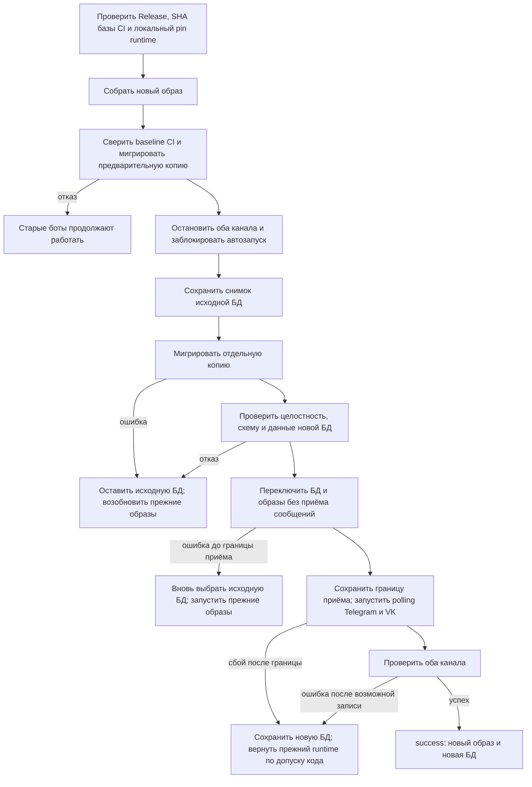

# План: разобраться в CI и упростить выпуск

Цель этой работы — сделать путь от PR до установки версии понятным создателю,
измерить затраты времени и токенов агента, затем улучшить CI и восстановление
после неудачной установки. Это рабочий план к
[пункту бэклога](../BACKLOG.md#разобрать-ci-и-выпуск-вместе-с-создателем).
Действующие правила описаны в [RELEASES.md](../RELEASES.md), команды —
в [OPERATIONS.md](../OPERATIONS.md), последний снимок VPS —
в [PRODUCTION.md](../PRODUCTION.md). Целевая схема ниже ещё не реализована.

## Что уже решили

- `deploy-prod` остаётся отдельной командой после публикации GitHub Release.
  Публикация сама по себе VPS не меняет.
- Для выпуска обязателен успешный **полный CI точного SHA**. Зелёный
  `main-full` с пропущенным `full-suite` допуска не даёт.
- Перед окончательным снимком SQLite оба бота остановлены. Новые миграции
  сначала применяются к **копии**, а исходная БД сохраняется.
- Автоматический возврат рассчитан на одну точную версию, установленную на
  VPS до обновления: её SHA, Docker image ID и схему.
- До сохранения границы возможного приёма сообщений новым кодом можно вернуть
  прежние БД и образы. После неё сохраняем новую БД и возвращаем только
  прежние образы, если repository-код их точного установленного SHA прошёл
  проверку на схеме кандидата, а локальный image ID подтверждает pin runtime.
- CI проверяет код и тесты точного предыдущего релизного SHA на настоящей
  схеме кандидата. До остановки сверяются установленный SHA и допуск CI,
  локальный pin/image ID и миграции предварительной копии. После остановки
  проверяется окончательный снимок; механизм возврата относится к этапу 6.
- Отдельно установленный controller snapshot обновляется до применения нового
  порядка deploy; его SHA фиксируется отдельно от SHA выпуска.
- Проверки и замеры выполняют CI и скрипты установки. Агент получает короткий
  итог и разбирает исключения; `git push` и эксплуатационные действия
  остаются под правилами [AGENTS.md](../../AGENTS.md).

## Как работает выпуск сейчас

`pr-fast` проверяет тестовое слияние PR и короткий набор. `main-full`
запускается после push в `main`, но полный набор обычно назначается после
каждого третьего слияния либо ручным запуском для текущего SHA. Для нового
SHA существующей линии нужен `release-full`. Скрипт допуска сверяет
репозиторий, workflow, ветку, SHA, run/attempt и обязательные jobs/steps.

Сегодня `deploy-prod` делает backup, а затем мигрирует **рабочую** БД.
Новые боты запускаются до записи `success` и во время `verify_both` уже
могут принять сообщение. Если началась новая миграция и переход сорвался,
контроллер сохраняет marker и состояние `degraded`: автоматически запускать
старый образ с неопределённой схемой он не будет.

## К какому пути стремимся

Допуск CI и разделение Release/deploy сохраняются. Меняется работа с БД и
поведение при отказе установки:

До переключения исходная БД не изменена: «вернуть» означает запустить с ней
прежние образы, а не переписать её из backup. Если переключатель уже выбрал
новую БД, но граница приёма ещё не сохранена, он вновь выбирает сохранённую
исходную БД. После сохранения границы старый снимок не подставляется
автоматически: это могло бы удалить новые записи.
CI проверяет прежний repository-код точного SHA на реальной схеме кандидата.
До остановки установленный SHA должен совпасть с проверенной базой CI;
локальный image ID подтверждает фактически закреплённый runtime. При mismatch
контроллер отказывает до остановки. Проверка кода не означает, что сам Docker
image запускался в CI. Затем проверяются миграции предварительной копии.
После остановки мигрируется окончательный снимок и проверяется его результат,
без повторного допуска совместимости.
Контроллер сохраняет границу возможного приёма сообщений до запуска первого
нового polling-процесса.

Пример: оба снимка сначала содержат 100 записей. Новый бот записал № 101,
затем проверка завершилась ошибкой. Контроллер сохраняет обновлённую БД с
101 записью и запускает прежний runtime: его repository-код точного SHA
проверен на новой схеме, а image ID совпадает с сохранённым локальным pin.

## Этапы реализации

### 1. Снять базовые замеры и разобрать текущий выпуск

**Сделать:** по завершённым прогонам и следующему сопоставимому выпуску
собрать wall-clock для PR → CI → Release → deploy, время шагов, число ручных
действий, API retries, ожидания агента и доступный расход Codex tokens.
Отдельно разобрать deploy `v3.0.0` около 3:35: build, backup, migrations,
оба `verify_both`, прежний Docker healthcheck timeout 5 секунд. Объяснить
ложный `unhealthy` после `Health check passed` и красную GitHub annotation
от намеренного `RuntimeError` в `tests/test_pending_input.py:44`.

**Готово, когда:** есть таблица замеров с SHA, источником и временем;
неизвестный расход токенов явно обозначен. На прогонах 30.10.2026 один
`pr-fast` занял около 31 секунды, полный `main-full` — 1:47,
`release-full` — 1:54; это исходные наблюдения, не норматив.

#### Шаги этапа 1

| Шаг | Исполнитель | Результат |
| --- | --- | --- |
| 1.1. Восстановить маршрут PR → полный CI → Release по завершённым GitHub runs | GPT-6 Sol, medium: выборка API и расчёт длительностей по точным timestamps | Таблица run/attempt, SHA, начала и конца, времени jobs/steps и ссылок на источники в [замерах CI](CI_BASELINE.md) |
| 1.2. Разобрать установку `v3.0.0` и ложный `unhealthy` | GPT-6 Astra, medium: сопоставление журнала, состояния Docker и кода контроллера | Хронология build, backup, migrations, двух `verify_both`, timeout и границ доказанного в [разборе deploy](DEPLOY_V300.md) |
| 1.3. Проверить annotation теста и доступность метрик ручной работы агента | GPT-6 Sol, medium: ограниченная проверка лога и исходника | Причина красной annotation, подтверждённые ручные действия/API retries/ожидания, `unknown` для недоступных Codex tokens в [записи метрик агента](AGENT_BASELINE.md) |
| 1.4. Свести исходные замеры и сверить критерий этапа | GPT-6 Sol, medium: проверка сопоставимости и противоречий источников | [Сводный отчёт](STAGE1_BASELINE.md) со ссылками на три записи, неизвестными значениями и отдельным полем для следующего сопоставимого выпуска |

Рабочие записи шагов 1.1–1.3 не содержат секретов, содержимого БД и полных
логов. Шаг 1.4 не объявляет этап завершённым, пока не добавлен следующий
сопоставимый выпуск; недоступные метрики остаются `unknown`.

### 2. Оставить постоянные метрики и короткий отчёт

**Сделать:** собирать время GitHub Actions run/jobs/steps для точного SHA.
`deploy-prod` должен записывать начало и конец build, остановки каналов,
backup, migrations и каждого `verify_both`, общий wall-clock и простой.
Один компактный отчёт показывает этап, длительность, run/attempt, результат
и причину отказа. Он доступен и после неуспешного выпуска.

Для Codex проверить поддерживаемый источник счётчиков. В
[`codex exec --json`](https://developers.openai.com/blog/eval-skills)
usage доступен в событии `turn.completed`; это не подтверждает его
доступность в desktop-чате. При отсутствии достоверного счётчика сохранять
`unknown`, а отдельно — число вызовов инструментов и ожиданий. Данные
сессии, секреты и содержимое БД не публиковать в CI.

**Готово, когда:** новый выпуск оставляет короткую историю для сравнения.
После накопления сопоставимых прогонов отчёт показывает отклонение внутри
одного типа работы: `pr-fast` с `pr-fast`, полный CI с полным CI,
deploy с deploy. Долгий этап виден ещё во время выполнения; предупреждение
не прерывает безопасное ожидание и не запускает rollback.

#### Шаги этапа 2

| Шаг | Исполнитель | Результат |
| --- | --- | --- |
| 2.1. Собирать run/jobs/steps GitHub Actions | GPT-6 Sol, medium: API, точный SHA и workflow с состояниями skipped/failure | Постоянный краткий отчёт CI и тесты его расчёта; сравнение только одинаковых типов прогонов |
| 2.2. Измерять `deploy-prod` | GPT-6 Astra, medium: критический путь, сохранение отчёта при ошибке и отсутствие влияния предупреждений на rollback | Отметки этапов, общий wall-clock и простой, доступный при отказе отчёт и проверки штатного/отказного пути |
| 2.3. Определить доступные метрики Codex | GPT-6 Sol, medium: проверка документированного счётчика и границ данных desktop-чата | Рабочая запись об источнике tokens, вызовах инструментов и ожиданиях; недоступное значение остаётся `unknown` |
| 2.4. Свести отчёты и проверить критерий этапа | GPT-6 Astra, medium: интеграционная проверка после лимита GPT-6 Sol | Проверка формата, ссылок, отказных сценариев и документации; явная запись о проверенном и ожидающем нового выпуска |
| 2.5. Показывать долгий шаг CI во время выполнения | GPT-6 Astra, medium: процессы CI, timeout и наблюдаемость без вмешательства в допуск | Предупреждение о затянувшемся шаге в живом логе, тест сохранения кода завершения и обновлённая рабочая запись |

Все шаги выполняются в одном worktree этого чата. Для внешнего CI и deploy
действительные времена нового выпуска подтверждаются только после его
завершения; локальные тесты не подменяют такую проверку.

### 3. Упростить дорогие шаги по результатам замеров

**Сделать:** проверить, какие проверки дублируются, где повторяются GitHub
API запросы и установки зависимостей, сколько времени агент тратит на
опросы и чтение логов. Менять по одному подтверждённому узкому месту и
сравнивать до/после на одинаковом типе прогона.

**Готово, когда:** wall-clock, ручные шаги и доступный расход токенов
уменьшились либо документировано, почему изменение не помогло. Допуск
точного SHA, полный набор перед выпуском и отказ при сбое API сохранены.

#### Шаги этапа 3

| Шаг | Исполнитель | Результат |
| --- | --- | --- |
| 3.1. Найти подтверждённое узкое место | GPT-6 Sol, medium: сопоставление run/jobs/steps, API запросов и действий агента | Запись исходных времён и выбранного одного узкого места с источниками; неизвестные действия и tokens не заменяются оценкой |
| 3.2. Изменить одно узкое место | GPT-6 Astra, medium: сохранение допуска и отказов при изменении CI/скриптов | Минимальная правка, тесты прежних инвариантов и описание ожидаемого эффекта |
| 3.3. Сравнить одинаковые типы прогонов | GPT-6 Sol, medium: проверка точного SHA и timestamps до/после | Таблица wall-clock и времени затронутого шага для сопоставимых `pr-fast` либо полных CI; отдельная запись о ручных шагах и доступных tokens |
| 3.4. Проверить безопасность и результат | GPT-6 Astra, medium: независимая интеграционная проверка | Подтверждённое улучшение или объяснение отсутствия эффекта; неизменный допуск точного SHA, полного набора и отказ при сбое API |

Измерения разных типов работы не смешиваются. Сначала выбирается узкое место
по шагу 3.1, затем правка и сравнение; остальные предполагаемые оптимизации
не добавляются без отдельного замера.

### 4. Подготовить версию, пригодную для будущего возврата

**Сделать:** изменить startup мигратора так, чтобы предыдущий образ мог
работать с **проверенной совместимой более новой схемой**, не выполняя
неизвестный SQL. Не открывать доступ к любой неизвестной схеме: контроллер
должен допускать только проверенную пару SHA/схем. Сначала выпустить и
установить эту базовую версию. Уже выпущенный строгий образ нельзя
исправить задним числом.

Мапперы базовой версии должны переводить незнакомые значения enum и статусов
из API и data-моделей в `UNKNOWN`. Предметные сценарии обрабатывают это
состояние без падения и без действий, требующих известного смысла статуса.

**Готово, когда:** базовая версия стала фактически установленной целью
возврата; несовместимая или не подтверждённая схема по-прежнему отвергается.
Тесты мапперов и предметных сценариев подтверждают безопасную обработку
подставленного незнакомого значения каждого затронутого enum/status.

#### Шаги этапа 4

| Шаг | Исполнитель | Результат |
| --- | --- | --- |
| 4.1. Уточнить контракт совместимости и границы выпуска | GPT-6 Astra, medium: анализ мигратора, контроллера, образов и данных | Перечень текущих отказов, затронутых enum/status, проверяемой пары SHA/схемы и сценариев для базовой версии |
| 4.2. Разрешить базовой версии проверенную новую схему | GPT-6 Astra, medium: критичный путь startup и запрет неизвестного SQL | Явное ограниченное разрешение с отказом для иной схемы, тесты повторного запуска и отсутствия исполнения неизвестной миграции |
| 4.3. Закрыть неизвестные enum/status безопасным состоянием | GPT-6 Sol, medium: предметные мапперы и сценарии | `UNKNOWN` для затронутых границ API/data, безопасное поведение и тесты с неизвестными значениями |
| 4.4. Независимо проверить контракт и выпускной кандидат | GPT-6 Astra, medium: интеграционная проверка мигратора, контроллера и CI | Подтверждённые локальные и CI-проверки, перечень допустимых пар и отказов, рабочая запись с ограничениями |
| 4.5. Сделать базовую версию установленной целью возврата | GPT-6 Astra, medium: выпуск и эксплуатационная проверка по действующим правилам | Точный SHA/image ID и схема установленной версии; подтверждение, что контроллер использует её как прежнюю цель |

На 02.11.2026 локальная проверка 4.4 завершена: [отчёт ревью](STAGE4_REVIEW.md)
фиксирует исправленные дефекты, 1036 unittest (`OK`, 2 Linux-only skips на Windows)
и три smoke. После возобновления работы пользователем полный CI merge SHA
`dd71c2ba42a0744b5b654cedcf73009ce8879058` прошёл; `v3.1.0` опубликован
и установлен. [Результат 4.5](STAGE4_RELEASE.md) подтверждает текущие
SHA/image ID, `last_good`, схему и метрики. Технический критерий установленной
базовой версии выполнен; живые ответы TG/VK ожидают пользовательской проверки.
Для этапа 5 подготовлен аудит и пересмотрен план; реализация и допуск
будущей схемы не завершены, новый recovery не заявляется.

Шаг 4.5 начинается только после готовности и проверки кандидата. Публикация
Release и установка на VPS остаются разными действиями; до действий на VPS
повторно читают [PRODUCTION.md](../PRODUCTION.md). Если для перехода нужен
новый контракт контроллера, его проверяют отдельно до установки. Этап не
считается завершённым только по локальным тестам или зелёному PR.

### 5. Автоматически проверять совместимость БД

**Сделать:** в полном CI получить код и тесты из **точного SHA предыдущего
релиза** и запустить прежние SQLite repositories с их поведенческими тестами
на изолированных временных БД, созданных настоящими миграциями кандидата.
Проверить все публичные чтения и записи всех repositories; недостающее покрытие
добавить отдельными совместимостными тестами против прежнего API. Код и тесты
уже выпущенной `v3.1.0` задним числом не менять. Источник SQL fixture заменяется
только в одноразовом checkout, до импорта старых тестов; порядок и исключения
описаны в [аудите 5.1](STAGE5_AUDIT.md).

CI выполняет два самостоятельных набора: миграции кандидата и сохранность
данных; поведение прежних repositories на реальной схеме кандидата.
Тесты мигратора с ожиданием конкретного числа версий относятся к первому
набору и обновляются в candidate suite. Синтетические схемы и UNKNOWN-тесты
дают дополнительную проверку, но не заменяют второй набор. CI **не переносит
и не запускает предыдущий Docker image**. Прежний план `docker save/load`
отменён решением пользователя; уже сделанный локальный экспорт не нужен
для допуска и не становится CI artifact.

Блокирующего schema diff нет. Добавление колонки допустимо, если старые
операции работают; удаление неиспользуемой колонки также допустимо после
успешных поведенческих проверок. Сам факт изменения структуры не является
отказом. Новые CHECK, triggers, обязательные поля и изменённая семантика
могут сломать прежние записи; обязательны негативные проверки такого отказа.
Неизменность уже выпущенных SQL, целостность данных и fingerprint точной
проверенной схемы сохраняются: fingerprint связывает допуск со схемой,
а не требует равенства старой и новой структуры.

Перед deploy установить, что фактически установленный SHA равен previous
release SHA из успешного полного CI кандидата. Для другой установленной
версии, в том числе из другой линии, отказать **до остановки ботов**;
получить отдельный полный допуск кандидата для этой точной базы по доверенной
политике выбора baseline. Локально сверить `last_good`, внешний pin,
OCI revision и image ID обоих контейнеров; это проверка текущего runtime,
а не требование перенести этот ID/образ в CI. На отдельной предварительной
копии проверить реальные candidate migrations и сохранность данных.

**Готово, когда:** полный CI подтверждает точную пару previous/candidate SHA,
источник SQL и полное покрытие публичных операций прежних repositories;
несовместимые записи/чтения, отсутствующие проверки, неподтверждённое evidence
и несовпадающий установленный SHA закрывают установку до `writers_stopped`.
Проверки используют только тестовые данные в CI. Рабочая production-БД,
секреты и пользовательские строки в CI не передаются.

#### Шаги этапа 5

| Шаг | Исполнитель | Результат |
| --- | --- | --- |
| 5.1. Зафиксировать baseline и инвентаризацию | GPT-6 Astra, medium: границы SHA, fixtures и публичных SQLite API | Аудит выполнен 02.11.2026: [точные previous/candidate SHA, 26 SQLite-классов / 107 методов и матрица](STAGE5_AUDIT.md). Разделены прямые проверки, косвенные вызовы, 14 неподтверждённых операций и исключения fixtures. 147 локальных tests успешны; это аудит, не допуск совместимости. |
| 5.2. Разделить проверки миграций и прежнего поведения | GPT-6 Astra, medium: изоляция imports и точные Git bytes | Реализован [runner и локальная проверка механизма](STAGE5_RUNNER.md): отдельные точные checkout/venv, SQL-only подстановка до old imports, неизменные старые Python/tests, отдельные результаты candidate migrations/data integrity и old repository behavior. Набор 5.1 и минимальный upgrade seed не являются полным допуском; матрица и CI остаются 5.3/5.4. |
| 5.3. Закрыть всю матрицу операций | GPT-6 Sol, medium: repository API и предметные fixtures | [Матрица 107 операций](STAGE5_MATRIX.md) сопоставлена с прямыми assertions старого или внешнего теста. [Локальный результат](STAGE5_COMPATIBILITY.md): 147 прежних и 26 дополнительных tests, upgrade и двусторонний обмен прошли на реальных SQL/FK/CHECK. Доверенный допуск CI остаётся шагом 5.4. |
| 5.4. Подключить полный CI и доверенное evidence | GPT-6 Astra, medium: baseline policy, полнота и отказы | [Реализация и локальная проверка](STAGE5_CI.md) подготовлены 03.11.2026: обязательный отдельный job, external policy pin, полная матрица/manifest, artifact SHA256 и run/attempt, совместимые и отказные SQL mutations. 1056 unittest успешны (2 Linux-only skips вне compatibility suite), exact-pair runner: 9 + 173 tests без skips. До live CI требуется закрепить reviewed policy commit в repository variable; GitHub run и потребитель predeploy пока не проверены. |
| 5.5. Связать predeploy с проверенной базой | GPT-6 Astra, medium: preflight до остановки | [Локальная реализация и проверка](STAGE5_PREDEPLOY.md) подготовлены 03.11.2026: installed SHA сопоставляется с previous SHA проверенного CI evidence; pin, оба контейнера, image ID и OCI revision сверяются до marker. Online-копия мигрируется настоящим candidate CLI в изолированном контейнере, затем проверяются журнал, схема, целостность и сохранность данных. Недоказанный результат закрывает установку до `writers_stopped`. Живой artifact и Linux Docker/VPS ещё требуют приёмки. |
| 5.6. Независимо проверить границы допуска | GPT-6 Astra, medium: интеграционная проверка успешных и отказных сценариев | [Локальная независимая проверка](STAGE5_REVIEW.md): совместимые изменения проходят 173 tests; сломанные чтения/записи и missing test дают отказ. Настоящий evidence verifier связан с deploy до marker/stop; SAFE-коды сохраняются в private report и stderr. Неизменность old sources/tests, настоящая миграция копии и доступность failed test ID/traceback проверены; живой CI/Linux/VPS остаются ограничениями. |

Этап использует уже выпущенную базу этапа 4 и **не реализует этап 6**:
переключение БД, доставку runtime admission, границу приёма сообщений,
rollback/recovery и установку controller snapshot. До внедрения этапа 6
действующий production recovery остаётся прежним. Зелёные repository tests
не доказывают полный startup образа или готовый возврат.

Пример, не относящийся к текущей схеме проекта: если прежние repositories
больше не используют `users.name`, кандидат может удалить колонку после
проверки всех прежних операций на реальной новой схеме. Если новый CHECK
отвергает прежний `INSERT`, CI обязан отказать, даже когда все прежние
колонки сохранены. Изменения DDL оцениваются по поведению и сохранности данных.

### 6. Мигрировать копию и изменить возврат

**Сделать:** после остановки обоих ботов получить неизменяемый снимок
исходной SQLite, мигрировать отдельную копию и проверить целостность,
схему и данные. Выбрать на стенде механизм переключения, который не
смешивает БД с чужим WAL и после прерывания позволяет определить
активную БД. До сохранения границы возможного приёма ошибка возвращает прежнюю
пару БД/образов. После неё ошибка сохраняет новую БД и возвращает
прежний runtime с допуском его repository-кода по этапу 5 и подтверждённым
локальным pin. `down`-миграции не служат общим путём
автоматического возврата: удаление колонки или таблицы может удалить
новые данные.

До использования нового пути отдельно установить проверенный controller
snapshot по [порядку обновления](../OPERATIONS.md#обновить-отдельно-установленный-controller-snapshot).
Проверить, что новый контроллер понимает существующие `state.json`, marker,
lock, настройки Compose/systemd и backup timer; при сбое его установки
восстанавливать прежний snapshot до запуска deploy. SHA контроллера и SHA
устанавливаемого Release записывать отдельно. Состояние, разрешающее
возможный приём сообщений, надёжно сохранять до запуска первого нового
polling-процесса.

**Готово, когда:** `deploy-prod` сам фиксирует stage, обе БД, точные
SHA/image ID, SHA установленного controller snapshot и границу приёма
сообщений до запуска polling; повтор команды не запускает двух
polling-процессов и не теряет записи.

### 7. Испытать штатный путь и отказы на стенде

**Сделать:** прервать preflight, остановку каналов, backup, миграцию
копии, переключение, запуск, обе проверки здоровья и повтор команды.
Проверить marker, lock, timer, image ID, SQLite integrity/foreign keys,
схему, простой и записи после переключения. Отдельно испытать установку
controller snapshot, чтение прежнего `state.json` и прерывание между
сохранением границы приёма и запуском polling.

| Где произошёл отказ | Ожидаемый результат |
| --- | --- |
| До остановки | Старые боты работают; БД не переключена |
| После остановки, до переключения | Исходная БД цела; старые боты возобновлены |
| При переключении, до сохранения границы приёма | Активная БД однозначно определена; прежняя пара восстановлена |
| После сохранения границы, до запуска polling | Новая БД сохранена; прежние совместимые образы запущены на ней |
| После возможной записи новым кодом | Новая БД сохранена; прежний совместимый образ работает с ней |
| Обе копии недоступны или состояние не доказано | Writers остановлены; причина и данные сохранены для отдельного recovery |

**Готово, когда:** для каждого прерывания известно конечное состояние и
результат повторного запуска. Недоказанная совместимость не объявляется
успешным rollback.

### 8. Завершить приёмку и перенести правила

**Сделать:** повторить замеры, сравнить время и работу агента с этапом 1,
проверить оба канала на тестовом стенде. Согласованные правила перенести в
`RELEASES.md` и `OPERATIONS.md`; перед эксплуатационным действием
заново проверить [PRODUCTION.md](../PRODUCTION.md). Временный каталог
сохранять до слияния всех PR и эксплуатационной приёмки.

**Готово, когда:** проведены штатные и отказные сценарии, замеры до/после
показывают результат, документация и ссылки полны. Затем удалить временный
каталог отдельным завершающим изменением и закрыть пункт бэклога.

## Что ещё нужно решить на стенде

- Как выбирать активную БД так, чтобы прерывание не смешало её с WAL
  другой версии и не оставило неопределённое состояние.
- Как связать допуск прежнего repository-кода на новой схеме с точным
  установленным SHA и локальным pin runtime, не разрешая произвольные миграции.
- Завершить матрицу публичных SQLite API и их поведенческих тестов из точного
  previous release SHA; закрыть пробелы отдельными тестами старого API.
- Закрепить доверенную политику выбора previous release SHA для каждой линии
  и получения нового допуска, если установленная версия отличается от базы CI.
- Откуда получать достоверное число Codex tokens для работы в desktop-чате;
  пока источника нет, метрика остаётся `unknown`.
