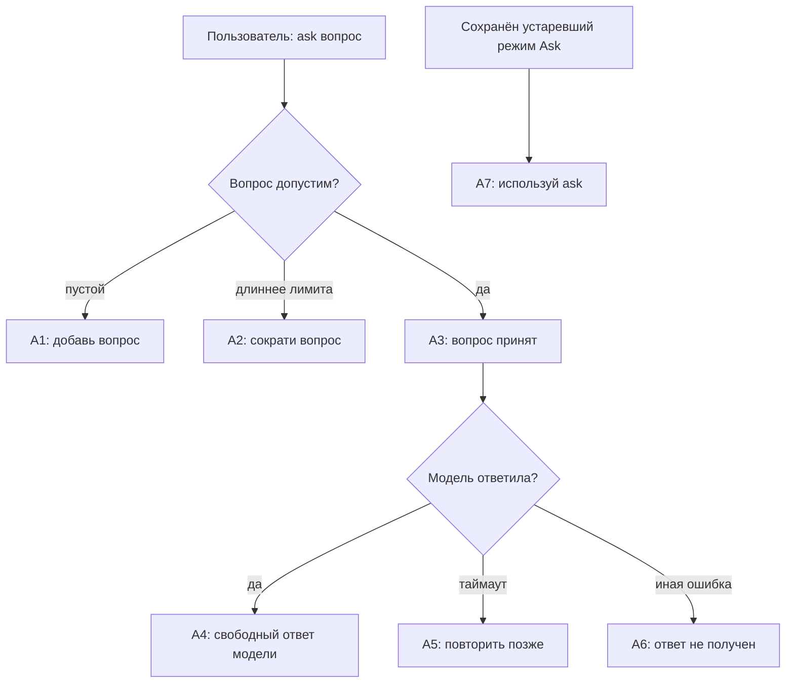

# Ask: сценарий и тексты

Каждая схема сразу сопровождается текущими текстами ответов. Метки на схеме совпадают с ID в таблице ниже. Общий путь сообщения показан в [маршруте](RESPONSE_MAP.md). В колонке «Целевой текст» пока нет согласованной редакции.

## Разовый вопрос Ask

Ask не заменяет текущий режим чата. А3 отправляется перед сетевым запросом,
если доступна фоновая доставка.

### Тексты ответов

Источник: [Ask presentation](../../compadre_assistant/capabilities/ask/presentation/handler.py)
и [use case](../../compadre_assistant/capabilities/ask/domain/use_cases/ask_question.py).

| ID | Условие | Текущий текст | Целевой текст |
| --- | --- | --- | --- |
| А1 | Пустой вопрос | «Напиши вопрос после команды: /ask <вопрос>.» | — |
| А2 | Вопрос длиннее лимита | «Вопрос должен содержать не более {максимум} символов.» | — |
| А3 | Начат запрос к модели | «Вопрос принят. Готовлю ответ…» | — |
| А4 | Ответ модели | `{текст модели}` без добавленного заголовка или истории. | — |
| А5 | Таймаут | «Модель не успела ответить. Попробуй повторить /ask позже.» | — |
| А6 | Иная ошибка модели | «Не удалось получить ответ модели. Попробуй /ask позже.» | — |
| А7 | Сохранённый устаревший режим Ask | «Для вопроса используй /ask <вопрос>.» | — |
