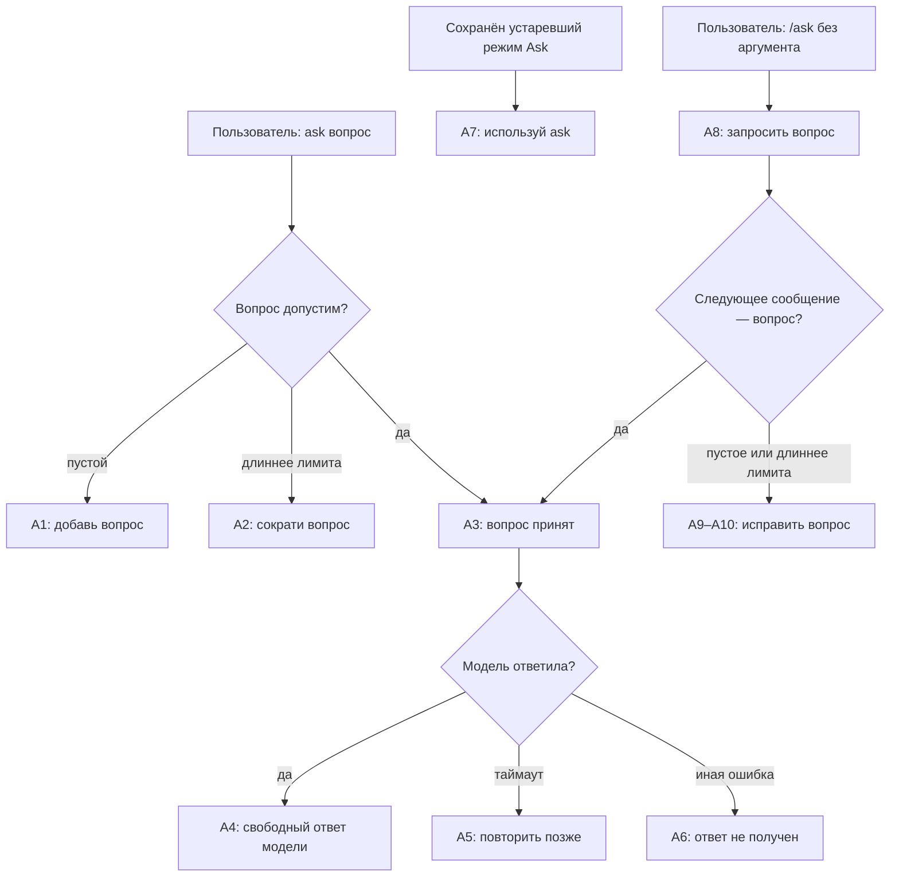

# Ask: сценарий и тексты

Каждая схема сопровождается текущими ответами и целевыми текстами. Метки текущих ответов совпадают с ID в таблице; дополнительные целевые ветки перечислены отдельно. Общий путь сообщения показан в [маршруте](RESPONSE_MAP.md).

## Разовый вопрос Ask

Ask обрабатывает один вопрос без истории переписки и доступа к содержимому
vault. Ask не заменяет текущий режим чата. А3 отправляется перед сетевым
запросом только при доступной фоновой доставке; без неё пользователь получает
результат обработки без отдельной квитанции.

### Тексты ответов

Источник: [Ask presentation](../../compadre_assistant/capabilities/ask/presentation/handler.py)
и [use case](../../compadre_assistant/capabilities/ask/domain/use_cases/ask_question.py).

| ID | Условие | Текущий текст | Целевой текст |
| --- | --- | --- | --- |
| А1 | Пустой вопрос | «Напиши вопрос после команды: /ask <question>.» | не применяется — `/ask` без аргумента запускает пошаговый ввод по А8; пустой прямой вызов с аргументом невозможен |
| А2 | Вопрос длиннее лимита | «Вопрос должен содержать не более {максимум} символов.» | «Вопрос должен содержать не более {максимум} символов. Повтори /ask <question> с допустимым вопросом.» |
| А3 | Начат запрос к модели; квитанция отправляется только при доступной фоновой доставке | «Вопрос принят. Готовлю ответ…» | без изменений |
| А4 | Ответ модели | `{текст модели}` без добавленного заголовка или истории. | без изменений |
| А5 | Таймаут | «Модель не успела ответить. Попробуй повторить /ask позже.» | без изменений |
| А6 | Иная ошибка модели | «Не удалось получить ответ модели. Попробуй /ask позже.» | без изменений |
| А7 | Сохранённый устаревший режим Ask | «Для вопроса используй /ask <question>.» | «Ask не является режимом чата. Чтобы задать один вопрос, вызови /ask <question>. Текущий режим не изменится.» |

## Подстановки и следующий шаг

| ID | Переменные данные | Следующий шаг пользователя |
| --- | --- | --- |
| А1 | В целевом маршруте отдельного ответа нет. | Вызвать `/ask` без аргумента, чтобы начать ожидание вопроса по А8. |
| А2 | Максимум символов берётся из настройки сценария. | Сократить вопрос до указанного лимита и повторить `/ask <question>`. |
| А3 | Нет. | Дождаться ответа модели. Квитанция приходит только при доступной фоновой доставке. |
| А4 | Текст ответа модели; он может содержать Markdown. | Прочитать ответ; дополнительное действие не требуется. |
| А5–А6 | Технические детали ошибки пользователю не выводятся. | Повторить `/ask` позже. |
| А7 | Текст вопроса не показан. | Вызвать `/ask <question>`; сохранённый режим чата не изменится. |

## Новые целевые ветки Ask

Эти ветки описывают целевой ввод значения после `/ask` без аргумента и не
меняют текущие ответы выше. Ожидание привязано к исходному чату, не меняет
активный режим и принимает ровно один вопрос. Любое значение вопроса проверяет
Ask; неверное значение не передаётся активному Obsidian и не продлевает общий
10-минутный срок ожидания.

| ID | Условие | Целевой текст | Подстановки и следующий шаг |
| --- | --- | --- | --- |
| А8 | `/ask` вызвана без аргумента и ожидание вопроса ещё не создано | «Введи один вопрос для модели следующим сообщением. Ожидание действует 10 минут. Для отмены введи /cancel.» | Нет. Отправить вопрос следующим сообщением; прямой вызов `/ask <question>` также остаётся доступен. |
| А9 | После запроса А8 получено пустое или состоящее из пробелов значение | «Вопрос пуст. Отправь непустой вопрос ещё раз или введи /cancel.» | Нет. Ожидание остаётся активным до исходного срока; отправить непустой вопрос или отменить. |
| А10 | После запроса А8 получен вопрос длиннее лимита | «Вопрос должен содержать не более {максимум} символов. Сократи вопрос и отправь его ещё раз или введи /cancel.» | `{максимум}` — настройка Ask. Ожидание остаётся активным до исходного срока; отправить допустимый вопрос или отменить. |

После запроса А8 допустимый вопрос запускает один запрос Ask без отдельного
ответа-подтверждения. Если доступна фоновая доставка, перед запросом отправить
А3; затем вернуть А4 или соответствующий ответ А5–А6. Без фоновой доставки
отправить пользователю только результат запроса. Текст вопроса не повторять;
активный режим не менять.

Отмена, истечение ожидания и утрата доступа не имеют отдельного ответа Ask:
ими владеет ядро. При `/cancel` ядро отправляет общую ветку ЦО1 из [реестра
ядра](CORE.md#новые-целевые-ответы-ядра), а при отсутствии ожидания — ЦО2.
Первое обычное сообщение после 10 минут не принимается как вопрос: ядро
отправляет истечение из ЦВ2 и предлагает повторить `/ask`. Если до обработки
вопроса доступ Ask утрачен, ядро очищает ожидание и сообщает недоступность по
своей ветке В10а/В10б; вопрос не передаётся другой возможности. Ask не отправляет
дубликат общего ответа и не меняет активный режим.
