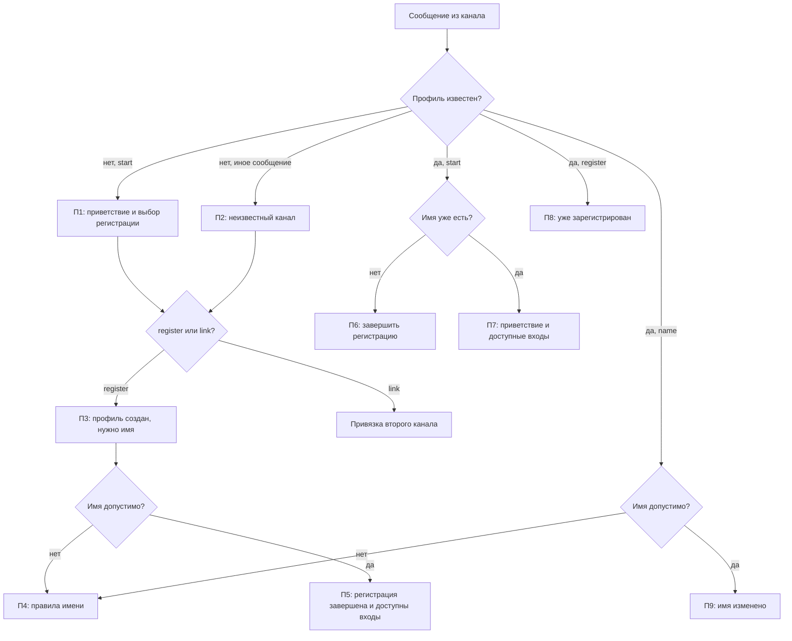
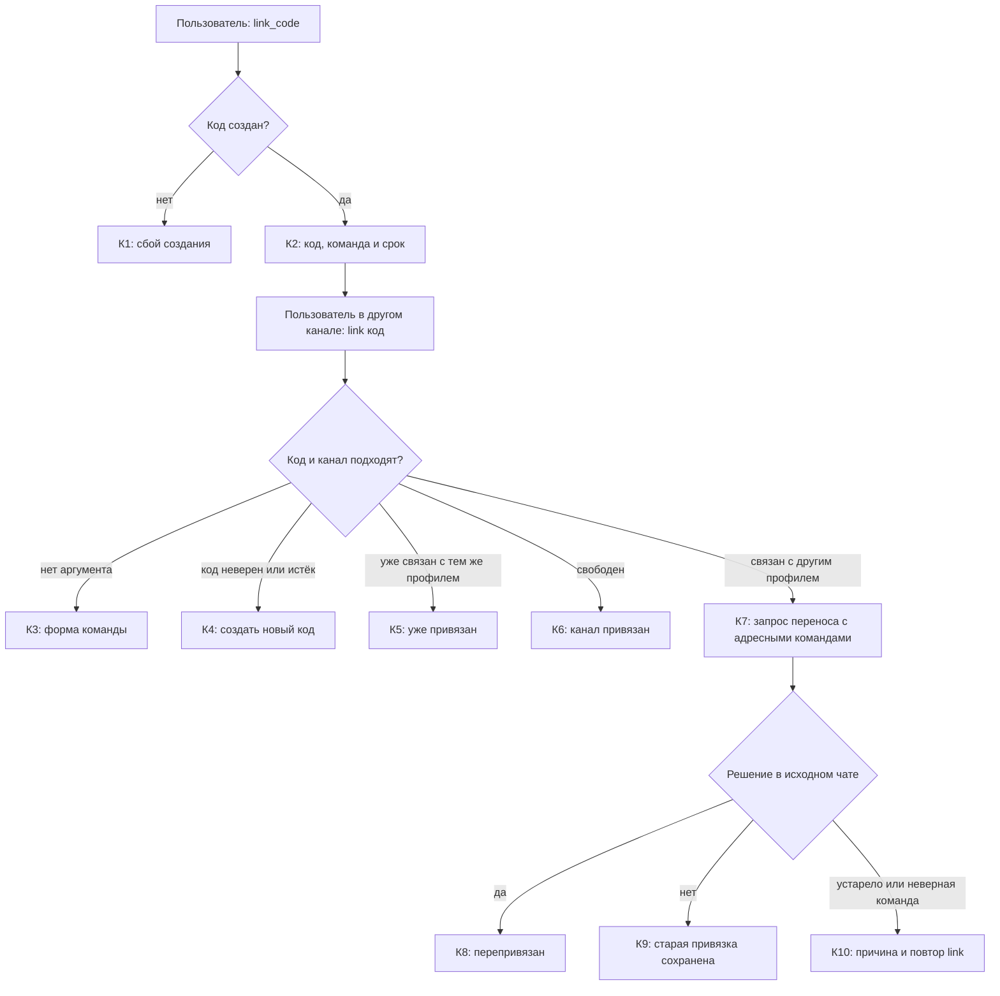
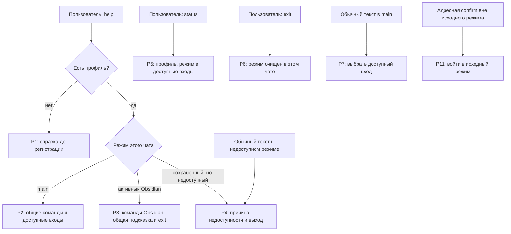
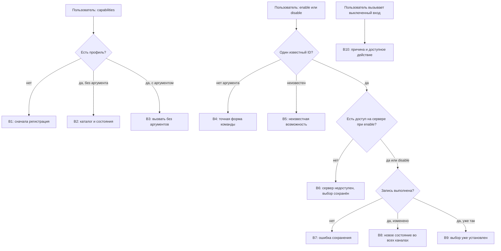

# Ядро: сценарии и тексты

Каждая схема сразу сопровождается текущими текстами ответов. Метки на схеме совпадают с ID в таблице ниже. Общий путь сообщения показан в [маршруте](RESPONSE_MAP.md). В колонке «Целевой текст» пока нет согласованной редакции.

## Первый запуск, регистрация и имя

### Тексты ответов

Источник: [общий форматтер](../../compadre_assistant/core/presentation/responses.py)
и [диспетчер](../../compadre_assistant/core/presentation/incoming/dispatcher.py).

| ID | Условие | Текущий текст | Целевой текст |
| --- | --- | --- | --- |
| П1 | `/start`, профиль не найден | «Compadre Assistant запущен. ⏎ Этот канал пока не зарегистрирован. ⏎ Отправь `/register`, чтобы создать нового пользователя, или `/link <код>`, чтобы привязать этот канал к уже существующему пользователю. ⏎ Все команды: `/help`.» | — |
| П2 | Любая команда, требующая профиля, из неизвестного канала | «Я пока не знаю этот канал. ⏎ Отправь `/register`, чтобы создать нового пользователя, или `/link <код>`, чтобы привязать этот канал к уже существующему пользователю.» | — |
| П3 | Первый `/register` | «Готово, я зарегистрировал тебя. ⏎ Как к тебе обращаться? Пришли имя или название профиля.» | — |
| П4 | Недопустимое имя | «Не получилось сохранить имя. Используй от 1 до 80 символов без ссылки или команды. ⏎ Например: `/name Влад`.» | — |
| П5 | Имя сохранено при регистрации | «Приятно познакомиться, {имя}. ⏎ Регистрация завершена. ⏎ {подсказка входов}» | — |
| П6 | Профиль есть, имя ещё не задано | «Регистрация ещё не завершена. ⏎ Как к тебе обращаться? Пришли имя или название профиля.» | — |
| П7 | `/start` с готовым профилем | «Compadre Assistant запущен. ⏎ Рад тебя видеть, {имя}. ⏎ {подсказка входов}» | — |
| П8 | Повтор `/register` с готовым профилем | «{имя}, ты уже зарегистрирован. ⏎ {подсказка входов}» | — |
| П9 | `/name <имя>` сохранено | «Готово. Теперь буду обращаться к тебе: {имя}.» | — |

## Привязка второго канала и перенос профиля

### Тексты ответов

Источник: [общий форматтер](../../compadre_assistant/core/presentation/responses.py)
и [диспетчер](../../compadre_assistant/core/presentation/incoming/dispatcher.py).

| ID | Условие | Текущий текст | Целевой текст |
| --- | --- | --- | --- |
| К1 | Код создать не удалось | «Не удалось создать код привязки. Попробуй позже.» | — |
| К2 | `/link_code` выполнен | «Код привязки: `{код}` ⏎ Открой другой канал и отправь: `/link {код}` ⏎ Код действует 10 минут.» | — |
| К3 | `/link` без кода | «Пришли команду в формате `/link <код>`.» | — |
| К4 | Код неверен или истёк | «Код привязки не найден или уже истек. Создай новый через `/link_code`.» | — |
| К5 | Канал уже связан | «Этот канал уже привязан к пользователю.» | — |
| К6 | Связь создана | «Готово, я привязал этот канал к твоему пользователю.» | — |
| К7 | Канал принадлежит другому профилю | «Канал уже привязан к другому профилю. Подтверди перенос адресной командой.» + `Перенести identity: /confirm core identity {id} {версия} yes` и `Отменить: /confirm core identity {id} {версия} no` | — |
| К8 | Перенос подтверждён | «Готово, я перепривязал этот канал.»; при наличии профиля добавляется «Теперь он связан с профилем «{имя}».» | — |
| К9 | Перенос отменён | «Ок, оставляю текущую привязку без изменений.» | — |
| К10а | Неверная адресная команда | «Используй адресную команду из актуального запроса привязки.» | — |
| К10б | Перенос устарел или истёк | «Действие недоступно, устарело или истекло. Повтори /link в исходном чате.» | — |

## Справка, статус и режим чата

Р1–Р4 — целевое поведение задачи; текущий `/help` ещё не различает режимы.
Его исходный полный список находится в реестре как шаблон `Р0`.

### Тексты ответов

Источники: [общий форматтер](../../compadre_assistant/core/presentation/responses.py),
[команды](../../compadre_assistant/core/presentation/incoming/commands.py),
[реестр возможностей](../../compadre_assistant/core/presentation/incoming/registry.py).

| ID | Условие | Текущий текст | Целевой текст |
| --- | --- | --- | --- |
| Р0 | Любой `/help` сейчас | Заголовок «Compadre Assistant — справка. ⏎ Доступные команды:», затем все строки общих команд ниже, эффективные входы и **внутренние команды этих возможностей**. При доступных входах перед их списком добавляется заголовок «Возможности:». При неизвестном профиле вместо предметной части: «Ответы `да` и `нет` подтверждают перепривязку канала.» | — |
| Р1 | `/help` до регистрации — целевая ветка | Отдельного текущего текста нет; сейчас действует Р0. | — |
| Р2 | `/help` в `main` — целевая ветка | Отдельного текущего текста нет; сейчас действует Р0. | — |
| Р3 | `/help` в Obsidian — целевая ветка | Отдельного текущего текста нет; сейчас действует Р0. | — |
| Р4 | `/help` при недоступном сохранённом режиме — целевая ветка | Отдельного текущего текста нет; сейчас действует Р0. | — |
| Р5 | `/status` | «Профиль: {имя или „имя ещё не задано“}. ⏎ Режим этого чата: {ID или „не выбран“}. ⏎ {подсказка входов}»; при недоступном режиме добавляется причина из В10. | — |
| Р6 | `/exit` | «Режим этого чата завершён. ⏎ {подсказка входов}» | — |
| Р7а | Обычный текст в `main`, входы есть | «Выбери возможность: {команды входа}. Выбор: `/capabilities`. Справка: `/help`.» | — |
| Р7б | Обычный текст в `main`, входов нет | «Сейчас нет включённых возможностей. Выбор: `/capabilities`. Справка: `/help`.» | — |
| Р8 | Сохранённый режим выключен или недоступен | «Сохранённая возможность этого чата отключена или недоступна. Выйти: `/exit`. ⏎ {причина из В10} ⏎ {подсказка входов}» | — |
| Р9 | Исключение при входе | «Не удалось войти в возможность. Попробуй позже или отправь `/help`.» | — |
| Р10 | Исключение при обработке в режиме | «Не удалось обработать сообщение. Проверь состояние действия перед повторной отправкой.» | — |
| Р11 | Предметная `/confirm` вне исходного режима | «Войди снова через {команда входа}, чтобы завершить действие в исходном чате.»; если вход недоступен — подсказка Р7. | — |
| Р12 | Нет подставленной подсказки входа | Запасные строки «Выбери возможность через `/help`.» или «Справка: `/help`.». | — |

#### Текущие строки общих команд внутри Р0

| Команда | Текущая строка справки | Целевой текст |
| --- | --- | --- |
| `/confirm` | «`/confirm <модуль> <операция> <id> <версия> <yes\|no>` — подтвердить конкретное действие» | — |
| `/start` | «`/start` — проверить подключение бота и канала» | — |
| `/help` | «`/help` — показать список доступных команд» | — |
| `/exit` | «`/exit` — выйти из активного режима этого чата» | — |
| `/register` | «`/register` — зарегистрироваться» | — |
| `/name` | «`/name <имя>` — изменить имя или название профиля» | — |
| `/status` | «`/status` — показать состояние подключения» | — |
| `/capabilities` | «`/capabilities` — показать личный выбор и серверную доступность возможностей» | — |
| `/enable` | «`/enable <id>` — включить доступную возможность для своего профиля» | — |
| `/disable` | «`/disable <id>` — выключить возможность для своего профиля, сохранив режим и данные» | — |
| `/link_code` | «`/link_code` — создать код привязки второго канала» | — |
| `/link` | «`/link <код>` — привязать канал по полученному коду» | — |

Заголовки групп Р0: «Основные», «Связь Telegram и VK», «Личные возможности». При доступных входах за ними следует заголовок «Возможности:».
Строка входа Ask: «`/ask` — один вопрос модели без истории: /ask <вопрос>».
Строка входа Obsidian: «`/obsidian` — работа со статьями и Obsidian vault;
выход: `/exit`». В Р0 за ней следуют команды из раздела «Вход в Obsidian и сообщение внутри режима».

## Личный выбор возможностей

### Тексты ответов

Источники: [диспетчер](../../compadre_assistant/core/presentation/incoming/dispatcher.py)
и [реестр возможностей](../../compadre_assistant/core/presentation/incoming/registry.py).

| ID | Условие | Текущий текст | Целевой текст |
| --- | --- | --- | --- |
| В1 | Выбор до регистрации | «Сначала зарегистрируйся: `/register`.» | — |
| В2 | `/capabilities` | «Личные возможности: ⏎ `{id}` — {описание}. Личный выбор: {включена/выключена}; сервер: {доступна/недоступна}. ⏎ Управление: `/enable <id>`, `/disable <id>`. Выбор действует во всех привязанных каналах.» При пустом каталоге: «Сейчас нет известных возможностей.» | — |
| В3 | `/capabilities` с аргументом | «Используй `/capabilities` без аргументов.» | — |
| В4 | `/enable` или `/disable` без одного ID | «Используй `{команда} <id>`. Список: `/capabilities`.» | — |
| В5 | Неизвестный ID | «Неизвестная возможность. Используй `{команда} <id>`. Список: `/capabilities`.» | — |
| В6 | `/enable` при глобальном выключении | «Возможность `{id}` недоступна на сервере. Личный выбор не изменён. Список: `/capabilities`.» | — |
| В7 | Ошибка записи | «Не удалось сохранить выбор. Попробуй позже.» | — |
| В8 | Выбор изменён | «Возможность `{id}` {включена/выключена}. Выбор действует во всех привязанных каналах. Режим и данные сохранены.» | — |
| В9 | Выбор уже такой | «Возможность `{id}` уже {включена/выключена}. Выбор действует во всех привязанных каналах. Режим и данные сохранены.» | — |
| В10а | Вход выключен лично | «Возможность `{id}` лично выключена. Включить: `/enable {id}`. Список: `/capabilities`.» | — |
| В10б | Вход недоступен на сервере | «Возможность `{id}` недоступна на сервере. Список: `/capabilities`.» | — |
