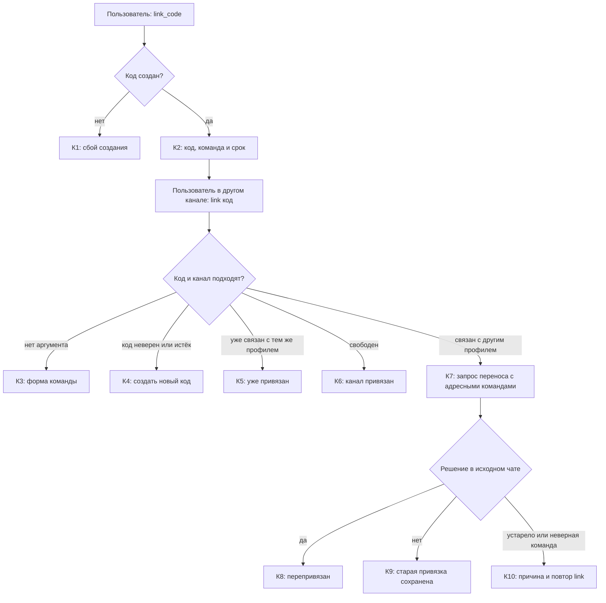
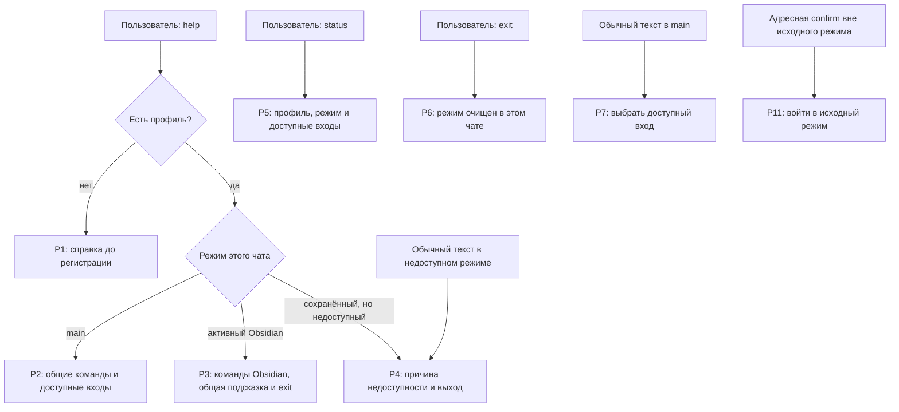
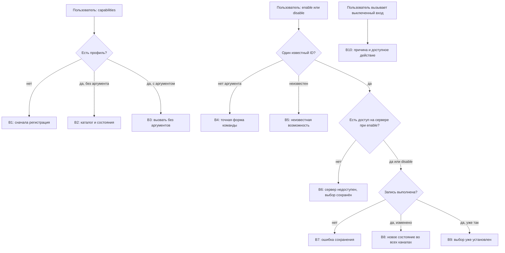

# Ядро: сценарии и тексты

Каждая схема сопровождается текущими текстами ответов и целевой редакцией. Метки на схеме совпадают с ID в таблице ниже. Общий путь сообщения показан в [маршруте](RESPONSE_MAP.md); новые целевые сценарии выделены отдельно.

## Первый запуск, регистрация и имя

### Тексты ответов

Источник: [общий форматтер](../../compadre_assistant/core/presentation/responses.py)
и [диспетчер](../../compadre_assistant/core/presentation/incoming/dispatcher.py).

| ID | Условие | Текущий текст | Целевой текст |
| --- | --- | --- | --- |
| П1 | `/start`, профиль не найден | «Compadre Assistant запущен. ⏎ Этот канал пока не зарегистрирован. ⏎ Отправь `/register`, чтобы создать нового пользователя, или `/link <код>`, чтобы привязать этот канал к уже существующему пользователю. ⏎ Все команды: `/help`.» | «Compadre Assistant запущен. Этот канал пока не зарегистрирован. Чтобы создать профиль, отправь /register. Чтобы привязать канал к существующему профилю, вызови /link и отправь код следующим сообщением. Если код уже есть, можно сразу отправить /link <код>.» |
| П2 | Любая команда, требующая профиля, из неизвестного канала | «Я пока не знаю этот канал. ⏎ Отправь `/register`, чтобы создать нового пользователя, или `/link <код>`, чтобы привязать этот канал к уже существующему пользователю.» | «Я пока не знаю этот канал. Чтобы создать профиль, отправь /register. Чтобы привязать канал к существующему профилю, вызови /link и отправь код следующим сообщением. Если код уже есть, можно сразу отправить /link <код>.» |
| П3 | Первый `/register` | «Готово, я зарегистрировал тебя. ⏎ Как к тебе обращаться? Пришли имя или название профиля.» | «Как к тебе обращаться? Пришли имя или название профиля. Профиль будет создан после принятия имени; ожидание действует 10 минут. Для отмены введи /cancel.» |
| П4 | Недопустимое имя при регистрации или при прямом `/name <имя>` | «Не получилось сохранить имя. Используй от 1 до 80 символов без ссылки или команды. ⏎ Например: `/name Влад`.» | «Имя не принято. Используй от 1 до 80 символов без ссылки или команды. {если активно ожидание имени после /register или /name: отправь исправленное имя ещё раз; для отмены введи /cancel; если ожидания нет и вызвана /name <имя>: повтори команду в форме /name <имя> с исправленным именем}.» |
| П5 | Имя сохранено при регистрации | «Приятно познакомиться, {имя}. ⏎ Регистрация завершена. ⏎ {подсказка входов}» | без изменений |
| П6 | Профиль есть, имя ещё не задано | «Регистрация ещё не завершена. ⏎ Как к тебе обращаться? Пришли имя или название профиля.» | не применяется — причина: миграция назначает существующим профилям без имени значение «Анатолий»; новое имя пользователь задаёт через `/name`. |
| П7 | `/start` с готовым профилем | «Compadre Assistant запущен. ⏎ Рад тебя видеть, {имя}. ⏎ {подсказка входов}» | без изменений |
| П8 | Повтор `/register` с готовым профилем | «{имя}, ты уже зарегистрирован. ⏎ {подсказка входов}» | без изменений |
| П9 | `/name <имя>` сохранено | «Готово. Теперь буду обращаться к тебе: {имя}.» | без изменений |

## Привязка второго канала и перенос профиля

### Тексты ответов

Источник: [общий форматтер](../../compadre_assistant/core/presentation/responses.py)
и [диспетчер](../../compadre_assistant/core/presentation/incoming/dispatcher.py).

| ID | Условие | Текущий текст | Целевой текст |
| --- | --- | --- | --- |
| К1 | Код создать не удалось | «Не удалось создать код привязки. Попробуй позже.» | без изменений |
| К2 | `/link_code` выполнен | «Код привязки: `{код}` ⏎ Открой другой канал и отправь: `/link {код}` ⏎ Код действует 10 минут.» | без изменений |
| К3 | `/link` без кода | «Пришли команду в формате `/link <код>`.» | «Пришли код привязки следующим сообщением. Ожидание действует 10 минут. Для отмены введи /cancel.» |
| К4 | Код неверен или истёк при прямом `/link <код>` или в активном ожидании после `/link` | «Код привязки не найден или уже истек. Создай новый через `/link_code`.» | «Код привязки не принят. {если введён прямой /link <код>: повтори /link <код> с действующим кодом; если код введён в активном ожидании после /link: отправь исправленный код ещё раз до истечения ожидания, отмена: /cancel}. Если истёк сам код, получи новый через /link_code в уже привязанном канале; код действует 10 минут.» |
| К5 | Канал уже связан | «Этот канал уже привязан к пользователю.» | без изменений |
| К6 | Связь создана | «Готово, я привязал этот канал к твоему пользователю.» | без изменений |
| К7 | Канал принадлежит другому профилю | «Канал уже привязан к другому профилю. Подтверди перенос адресной командой.» + `Перенести identity: /confirm core identity {id} {версия} yes` и `Отменить: /confirm core identity {id} {версия} no` | без изменений |
| К8 | Перенос подтверждён | «Готово, я перепривязал этот канал.»; при наличии профиля добавляется «Теперь он связан с профилем «{имя}».» | без изменений |
| К9 | Перенос отменён | «Ок, оставляю текущую привязку без изменений.» | без изменений |
| К10а | Неверная адресная команда | «Используй адресную команду из актуального запроса привязки.» | без изменений |
| К10б | Перенос устарел или истёк | «Действие недоступно, устарело или истекло. Повтори /link в исходном чате.» | «Это действие устарело или истекло. Повтори /link в исходном чате, чтобы получить актуальные команды.» |

## Справка, статус и режим чата

Р1–Р4 — целевое поведение задачи; текущий `/help` ещё не различает режимы.
Его исходный полный список находится в реестре как шаблон `Р0`.

### Тексты ответов

Источники: [общий форматтер](../../compadre_assistant/core/presentation/responses.py),
[команды](../../compadre_assistant/core/presentation/incoming/commands.py),
[реестр возможностей](../../compadre_assistant/core/presentation/incoming/registry.py).

| ID | Условие | Текущий текст | Целевой текст |
| --- | --- | --- | --- |
| Р0 | Любой `/help` сейчас | Заголовок «Compadre Assistant — справка. ⏎ Доступные команды:», затем все строки общих команд ниже, эффективные входы и **внутренние команды этих возможностей**. При доступных входах перед их списком добавляется заголовок «Возможности:». При неизвестном профиле вместо предметной части: «Ответы `да` и `нет` подтверждают перепривязку канала.» | Универсальный список заменяется контекстными ответами Р1–Р4. Во время ожидания к ним добавляется ЦР5; актуальные подтверждения выводятся отдельным блоком. Не показывать команды недоступных возможностей. |
| Р1 | `/help` до регистрации — целевая ветка | Отдельного текущего текста нет; сейчас действует Р0. | «Доступные действия: /register — создать профиль; /link — ввести код привязки к существующему профилю. Если код уже есть, можно сразу отправить /link <код>.» При ожидании имени этот блок заменяется напоминанием и `/cancel` из ЦР5. |
| Р2 | `/help` в `main` — целевая ветка | Отдельного текущего текста нет; сейчас действует Р0. | «Основные команды: {краткие описания общих команд для профиля}. Возможности: {точные команды входа и краткие описания всех эффективно доступных возможностей}.» Добавлять /cancel только при активном ожидании ввода; подтверждения показывать отдельным блоком по ЦП1–ЦП3. |
| Р3 | `/help` в Obsidian — целевая ветка | Отдельного текущего текста нет; сейчас действует Р0. | «Команды Obsidian: {публичный каталог команд активной возможности}. Выйти: /exit. Общие команды: /status, /capabilities, /link_code. Полный список общих команд: /exit, затем /help. {если Ask доступен: /ask — задать один вопрос без смены режима}.» Условные /cancel и подтверждения показывать только при наличии соответствующего ожидания. |
| Р4 | `/help` при недоступном сохранённом режиме — целевая ветка | Отдельного текущего текста нет; сейчас действует Р0. | «Режим {id} недоступен: {причина}. Выйти: /exit. Доступные возможности: {точные команды входа и краткие описания эффективно доступных возможностей}.» При отсутствии входов сообщить, что сейчас нет доступных возможностей. |
| Р5 | `/status` | «Профиль: {имя или „имя ещё не задано“}. ⏎ Режим этого чата: {ID или „не выбран“}. ⏎ {подсказка входов}»; при недоступном режиме добавляется причина из В10. | без изменений |
| Р6 | `/exit` | «Режим этого чата завершён. ⏎ {подсказка входов}» | без изменений |
| Р7а | Обычный текст в `main`, входы есть | «Выбери возможность: {команды входа}. Выбор: `/capabilities`. Справка: `/help`.» | без изменений |
| Р7б | Обычный текст в `main`, входов нет | «Сейчас нет включённых возможностей. Выбор: `/capabilities`. Справка: `/help`.» | без изменений |
| Р8 | Сохранённый режим выключен или недоступен | «Сохранённая возможность этого чата отключена или недоступна. Выйти: `/exit`. ⏎ {причина из В10} ⏎ {подсказка входов}» | без изменений |
| Р9 | Исключение при входе | «Не удалось войти в возможность. Попробуй позже или отправь `/help`.» | без изменений |
| Р10 | Исключение при обработке в режиме | «Не удалось обработать сообщение. Проверь состояние действия перед повторной отправкой.» | без изменений |
| Р11 | Предметная `/confirm` вне исходного режима | «Войди снова через {команда входа}, чтобы завершить действие в исходном чате.»; если вход недоступен — подсказка Р7. | без изменений |
| Р12 | Нет подставленной подсказки входа | Запасные строки «Выбери возможность через `/help`.» или «Справка: `/help`.». | без изменений |

#### Текущие строки общих команд внутри Р0

| Команда | Текущая строка справки | Целевой текст |
| --- | --- | --- |
| `/confirm` | «`/confirm <модуль> <операция> <id> <версия> <yes\|no>` — подтвердить конкретное действие» | В общий список не включать. При наличии актуальных действий показывать точные адресные команды; /confirm без аргументов показывать только при полном успешном снимке с одним или несколькими действиями. |
| `/start` | «`/start` — проверить подключение бота и канала» | `/start` — проверить подключение и получить подсказку для текущего состояния. |
| `/help` | «`/help` — показать список доступных команд» | `/help` — показать команды для текущего состояния и чата. |
| `/exit` | «`/exit` — выйти из активного режима этого чата» | `/exit` — выйти из режима этого чата. |
| `/register` | «`/register` — зарегистрироваться» | `/register` — создать профиль после ввода имени. |
| `/name` | «`/name <имя>` — изменить имя или название профиля» | `/name` — изменить имя профиля; затем введи новое имя. Вызов `/name <имя>` также поддерживается. |
| `/status` | «`/status` — показать состояние подключения» | `/status` — показать профиль и режим этого чата. |
| `/capabilities` | «`/capabilities` — показать личный выбор и серверную доступность возможностей» | `/capabilities` — показать личный выбор и доступность возможностей. |
| `/enable` | «`/enable <id>` — включить доступную возможность для своего профиля» | `/enable` — выбрать доступную возможность и включить её в профиле; можно сразу указать ID: `/enable <id>`. |
| `/disable` | «`/disable <id>` — выключить возможность для своего профиля, сохранив режим и данные» | `/disable` — выбрать включённую возможность и выключить её в профиле; можно сразу указать ID: `/disable <id>`. Режим и данные сохраняются. |
| `/link_code` | «`/link_code` — создать код привязки второго канала» | `/link_code` — создать код привязки второго канала. Код действует 10 минут. |
| `/link` | «`/link <код>` — привязать канал по полученному коду» | `/link` — ввести код привязки; можно сразу указать его: `/link <код>`. Код действует 10 минут. |

Заголовки групп Р0: «Основные», «Связь Telegram и VK», «Личные возможности». При доступных входах за ними следует заголовок «Возможности:».
Строка входа Ask: «`/ask` — один вопрос модели без истории: /ask <вопрос>».
Строка входа Obsidian: «`/obsidian` — работа со статьями и Obsidian vault;
выход: `/exit`». В Р0 за ней следуют команды из раздела «Вход в Obsidian и сообщение внутри режима».

## Личный выбор возможностей

### Тексты ответов

Источники: [диспетчер](../../compadre_assistant/core/presentation/incoming/dispatcher.py)
и [реестр возможностей](../../compadre_assistant/core/presentation/incoming/registry.py).

| ID | Условие | Текущий текст | Целевой текст |
| --- | --- | --- | --- |
| В1 | Выбор до регистрации | «Сначала зарегистрируйся: `/register`.» | без изменений |
| В2 | `/capabilities` | «Личные возможности: ⏎ `{id}` — {описание}. Личный выбор: {включена/выключена}; сервер: {доступна/недоступна}. ⏎ Управление: `/enable <id>`, `/disable <id>`. Выбор действует во всех привязанных каналах.» При пустом каталоге: «Сейчас нет известных возможностей.» | «Личные возможности: ⏎ `{id}` — {описание}. Личный выбор: {включена/выключена}; сервер: {доступна/недоступна}. ⏎ Чтобы выбрать возможность следующим сообщением, вызови /enable или /disable. Если ID уже известен, укажи его сразу: /enable <id> или /disable <id>. Выбор действует во всех привязанных каналах.» При пустом каталоге: «Сейчас нет известных возможностей.» |
| В3 | `/capabilities` с аргументом | «Используй `/capabilities` без аргументов.» | без изменений |
| В4 | Неверная форма прямого вызова `/enable` или `/disable` | «Используй `{команда} <id>`. Список: `/capabilities`.» | «Укажи один ID в команде /enable <id> или /disable <id>. Чтобы выбрать возможность следующим сообщением, вызови /enable или /disable без аргументов.» |
| В5 | Неизвестный ID | «Неизвестная возможность. Используй `{команда} <id>`. Список: `/capabilities`.» | «Неизвестная возможность {id}. Посмотри /capabilities. {Если ID введён в ожидании выбора после /enable или /disable: ожидание продолжается; введи один известный ID ещё раз или /cancel. Если вызвана команда с аргументом: повтори /enable <id> или /disable <id> с известным ID.}» |
| В6 | `/enable` при глобальном выключении | «Возможность `{id}` недоступна на сервере. Личный выбор не изменён. Список: `/capabilities`.» | «Возможность {id} недоступна на сервере. Личный выбор не изменён. Посмотри /capabilities и выбери другую доступную возможность либо введи /cancel, если выбор ещё ожидается.» |
| В7 | Ошибка записи | «Не удалось сохранить выбор. Попробуй позже.» | «Не удалось сохранить выбор. Личный выбор не изменён. Попробуй позже; чтобы начать выбор заново, вызови /enable или /disable.» |
| В8 | Выбор изменён | «Возможность `{id}` {включена/выключена}. Выбор действует во всех привязанных каналах. Режим и данные сохранены.» | без изменений |
| В9 | Выбор уже такой | «Возможность `{id}` уже {включена/выключена}. Выбор действует во всех привязанных каналах. Режим и данные сохранены.» | без изменений |
| В10а | Вход выключен лично | «Возможность `{id}` лично выключена. Включить: `/enable {id}`. Список: `/capabilities`.» | без изменений |
| В10б | Вход недоступен на сервере | «Возможность `{id}` недоступна на сервере. Список: `/capabilities`.» | без изменений |

### Новые целевые ответы ядра

Эти строки описывают целевые сценарии, которых сейчас нет; они не являются
текущими ответами. Команды в целевых формулировках записаны обычным текстом,
чтобы сообщение работало в канале без меню и специального оформления.

| Метка | Условие | Целевой текст |
| --- | --- | --- |
| ЦВ1 | Команда без аргумента начинает ожидание значения в этом чате | Для `/register`: «Как к тебе обращаться? Пришли имя или название профиля. Ожидание действует 10 минут. Для отмены введи /cancel.» Для `/link`: «Пришли код привязки. Ожидание действует 10 минут. Для отмены введи /cancel.» Для `/name`: «Пришли новое имя профиля. Ожидание действует 10 минут. Для отмены введи /cancel.» Для `/enable`, если есть варианты: «Выбери одну возможность, которую нужно включить: {список доступных для включения ID и описаний}. Ожидание действует 10 минут. Для отмены введи /cancel.» Если вариантов нет, ожидание не создаётся и ответ: «Нет возможностей, которые можно включить. Посмотри /capabilities.» Для `/disable`, если есть варианты: «Выбери одну возможность, которую нужно выключить: {список включённых ID и описаний}. Ожидание действует 10 минут. Для отмены введи /cancel.» Если вариантов нет, ожидание не создаётся и ответ: «Нет включённых возможностей. Посмотри /capabilities.» Прямые вызовы `/link <код>`, `/name <имя>`, `/enable <id>` и `/disable <id>` остаются доступны; `/register <имя>` не поддерживается. |
| ЦВ2 | Введено недопустимое значение при активном ожидании или обычное сообщение впервые обнаружило истечение срока | Пока ожидание активно: «Значение не принято. {понятная причина и допустимый формат}. Отправь исправленное значение ещё раз или введи /cancel.» Для имени указывать ограничение от 1 до 80 символов без ссылки или команды; для кода — причину отказа, если известна; для `/enable` и `/disable` — выбрать ID из предложенного списка. Неверный ввод не продлевает 10-минутное ожидание. После истечения: «Срок ожидания ввода истёк. Повтори {команда}, чтобы начать заново.» Просроченное сообщение не принимает отправленное значение; следующая команда обрабатывается обычным порядком. |
| ЦО1 | `/cancel` завершает активное ожидание ввода | «Ввод отменён. Активный режим этого чата не изменён.» |
| ЦО2 | `/cancel` вызвана без активного ожидания ввода | «В этом чате нечего отменять. Продолжай текущий режим или вызови нужную команду.» |
| ЦР1 | `/help` до регистрации | «Доступные действия: /register — создать профиль; /link — ввести код привязки к существующему профилю. Если код уже есть, можно сразу отправить /link <код>.» При актуальном ожидании переноса identity отдельно показать точные адресные команды из исходного чата. |
| ЦР2 | `/help` в `main` с готовым профилем | «Основные команды: {общие команды профиля с краткими описаниями}. Возможности: {команды входа во все эффективно доступные возможности с краткими описаниями}.» Показывать только доступное на сервере и включённое в профиле; `/ask` обозначать как один вопрос без смены режима. |
| ЦР3 | `/help` в активном Obsidian | «Команды Obsidian: {публичный каталог команд активной возможности}. Выйти: /exit. Общие команды: /status, /capabilities, /link_code. Полная общая справка: /exit, затем /help. {если Ask доступен: /ask — задать один вопрос без смены режима}.» Добавлять `/cancel` и действия подтверждения только при наличии актуального ожидания. |
| ЦР4 | `/help` при сохранённом, но недоступном режиме | «Режим {id} недоступен: {причина}. Выйти: /exit. Доступные возможности: {команды входа во все другие эффективно доступные возможности с краткими описаниями}.» Если входов нет, вместо списка сообщить: «Сейчас нет доступных возможностей.» |
| ЦР5 | `/help` во время ожидания ввода или подтверждения | В дополнение к базовому контексту показать конкретный следующий шаг: «Ожидается {имя / код привязки / ID возможности / вопрос для Ask / ID статьи Obsidian}. Отправь значение следующим сообщением. Ввод можно отменить: /cancel.» Для ожидания имени после `/register` показать «Регистрация не завершена. Как к тебе обращаться? Пришли имя или название профиля. Отмена: /cancel.» Для подтверждения использовать только ЦП1–ЦП3 и актуальные полные адресные команды. Просроченное или недоступное ожидание не показывать. |
| ЦП1 | `/confirm` без аргументов; полный успешный снимок содержит актуальные ожидающие действия | «Доступные действия: {подпись действия}. {полная адресная команда выбора yes}. {полная адресная команда выбора no}.» Повторить для каждого действия. Показать `/confirm` без аргументов как путь к этому списку, когда в полном успешном снимке есть хотя бы одно актуальное действие; просмотр ничего не подтверждает. |
| ЦП2 | `/confirm` без аргументов; полный успешный снимок пуст | «В этом чате нет действий, которые нужно подтвердить.» |
| ЦП3 | `/confirm` без аргументов; снимок неполон или источник недоступен | Если известные действия получены: «Список действий неполный: часть источников подтверждений недоступна. Доступные действия: {подписи и точные адресные команды}.» Если не получено ни одного действия: «Не удалось получить полный список действий для подтверждения. Попробуй позже.» Не показывать голую `/confirm` как общий путь выбора; уже полученную точную адресную команду можно использовать до истечения действия. |

## Подстановки и следующий шаг

В таблицах ниже указаны только переменные данные и действие после ответа;
текущие тексты остаются в реестрах выше.

| ID | Переменные данные | Следующий шаг пользователя |
| --- | --- | --- |
| П1–П2 | Нет. | Выбрать `/register` либо ввести полученный в другом канале код через `/link <код>`. |
| П3 | Имя, ожидаемое после `/register`; профиль и привязка канала ещё не созданы. | Отправить имя следующим сообщением; если 10-минутное ожидание истечёт, снова вызвать `/register`. |
| П4 | Введённое недопустимое значение не повторяется. | При активном ожидании отправить исправленное имя или отменить ввод через `/cancel`; при прямом `/name <имя>` повторить команду с исправленным именем. |
| П6 | — | не применяется — причина: после миграции существующие профили без имени получают имя «Анатолий». |
| П5, П7, П8 | Имя профиля и доступные команды входа. | Выбрать команду входа из подсказки; для П7/П8 дополнительных действий нет, если вход не нужен. |
| П9 | Сохранённое имя профиля. | Дополнительное действие не требуется. |
| К1, К3, К5–К6, К9, К10а | Нет. | К1: повторить `/link_code`; К3: ввести код следующим сообщением; К5–К6 и К9: действие завершено; К10а: использовать актуальную адресную команду из запроса переноса. |
| К2 | Одноразовый код; срок действия — 10 минут. | В другом канале ввести `/link {код}` до истечения срока. |
| К4 | Неверный или истёкший код; активное ожидание после `/link` указывается отдельно. | При прямом вызове повторить `/link <код>` с действующим кодом; при активном ожидании отправить исправленный код ещё раз или ввести `/cancel`. Если истёк код, получить новый через `/link_code` в привязанном канале. |
| К7 | ID и версия подтверждения; обе адресные команды содержат эти значения. | В исходном канале выполнить точную команду переноса или отмены из ответа в течение срока действия подтверждения (10 минут). |
| К8 | Имя целевого профиля, если оно задано. | Перепривязка завершена; дополнительное действие не требуется. |
| К10б | Нет. | Повторить `/link` в исходном чате; старое подтверждение использовать нельзя. |
| Р0 | Общий список команд, эффективные входы, их описания и команды возможностей. | Выбрать подходящую команду из справки. Для неизвестного канала выбрать `/register` или `/link <код>`. |
| Р1–Р4 | Целевые ветки; сейчас вместо них показывается Р0. | Следующий шаг определяется выбранной командой из контекстной целевой справки. |
| Р5 | Имя/состояние имени, ID режима, доступные входы и при недоступности причина из В10. | Использовать подсказанную команду; если режим выбран ошибочно, вызвать `/exit`. |
| Р6 | Подсказка доступных входов. | Выбрать вход, если нужно продолжить работу. |
| Р7а | Доступные команды входа. | Вызвать одну из показанных команд. |
| Р7б | Нет. | Открыть `/capabilities` или `/help`; доступного входа сейчас нет. |
| Р8 | Причина недоступности и доступные команды входа. | Вызвать `/exit` либо выбрать доступный вход. |
| Р9 | Техническая ошибка не выводится. | Повторить вход позже или вызвать `/help`. |
| Р10 | Техническая ошибка не выводится. | Проверить состояние действия, затем решить, безопасно ли повторить сообщение. |
| Р11 | Команда входа, если она доступна. | В исходном чате вызвать эту команду и продолжить подтверждение; если вход недоступен, перейти по подсказке Р7. |
| Р12 | Нет. | Вызвать `/help`. |
| В1, В3–В5, В7 | В В3–В5 подставляются команда и/или ID; текущее неизвестное значение не повторяется. | В1: зарегистрироваться; В3: вызвать `/capabilities` без аргументов; В4: указать один ID или вызвать команду без аргумента для выбора; В5: выбрать известный ID, а `/cancel` использовать только если ожидание выбора ещё активно; В7: повторить позже. |
| В2 | Каталог ID, описания, личный выбор и доступность сервера; при пустом каталоге данных нет. | Выбрать ID и вызвать `/enable <id>` или `/disable <id>`. |
| В6 | ID возможности. | Личный выбор не изменён; обновить список через `/capabilities` и выбрать другую возможность, либо отменить только если выбор всё ещё ожидается. |
| В8–В9 | ID и состояние личного выбора. | Выбор завершён; дополнительное действие не требуется. |
| В10а | ID выключенной возможности. | Вызвать `/enable {id}` либо посмотреть `/capabilities`. |
| В10б | ID и серверная доступность. | Возможность недоступна; проверить `/capabilities` позже. |
| ЦВ1–ЦВ2 | Команда-владелец значения, формат/список ID и исходный срок ожидания 10 минут. Значение не повторять в ответе. | ЦВ1: отправить значение следующим сообщением или выполнить прямой вызов с аргументом там, где он поддерживается; ЦВ2: при активном ожидании исправить значение до истечения срока либо ввести `/cancel`; после истечения повторить исходную команду. |
| ЦО1–ЦО2 | Активное ожидание ввода, если оно есть; активный режим чата. | После отмены режим остаётся прежним; без ожидания продолжить текущий режим либо вызвать нужную команду. |
| ЦР1–ЦР5 | Состояние регистрации, режим чата, доступные входы, ожидание и точные адресные действия из актуального снимка. | Выполнить выбранную команду, ввести ожидаемое значение, отменить ввод через `/cancel` или использовать точную адресную команду подтверждения. |
| ЦП1–ЦП3 | Актуальные действия, их подписи, полные адресные команды и полнота снимка источников. | Выполнить выбранную точную команду; если список неполный или недоступен, повторить просмотр позже либо использовать уже полученную адресную команду до истечения действия. |

Адресное подтверждение переноса канала связано с каналом и чатом, из которого
отправлен `/link`. Для него требуется точная адресная команда с ID и версией
из К7; простые `да`/`нет` ядро для переноса не принимает. Код и подтверждение
действуют 10 минут.
