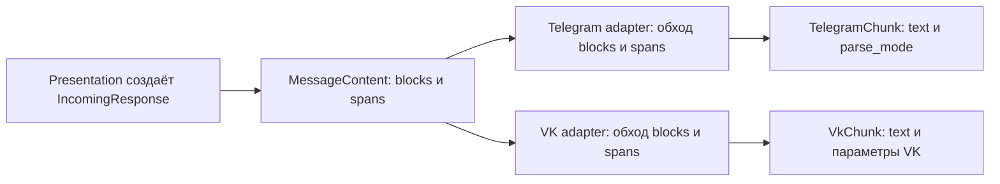

# Представление сообщений в Telegram и VK — проект решения

Этот документ показывает предлагаемый контракт ответа на конкретных моделях
данных: как [тексты из реестра](RESPONSE_MAP.md) превращаются в сообщение и как
адаптеры выводят его по [правилам сообщений](MESSAGE_RULES.md). Код ниже —
эскиз будущего API, а не описание уже реализованных классов. Возможности
оформления VK для сообщений бота нужно подтвердить отдельно.

## Что передаётся адаптеру сейчас

`IncomingResponse` содержит `text: str`, `error` и набор
`ConfirmationAction`. Метод `render_text()` добавляет адресные команды
действий к строке. Telegram и VK отправляют результат как обычный текст —
как при немедленном ответе, так и при доставке `BackgroundReply`.

```text
IncomingResponse(text="Путь: notes")
    → render_text()
    → "Путь: notes"
    → адаптер Telegram или VK
```

Строка не сообщает адаптеру, что `notes` — значение для копирования. Если
вписать в неё `<code>notes</code>`, VK получит и эти символы. Поэтому текст
и пометки оформления предлагается передавать отдельными полями.

## Какие поля будут у сообщения

Минимальная модель в `core/presentation`:

```python
class TextStyle(StrEnum):
    PLAIN = "plain"        # Обычный текст.
    EMPHASIS = "emphasis"  # Короткий смысловой акцент.
    CODE = "code"          # Команда, путь или значение для копирования.


@dataclass(frozen=True, slots=True)
class TextSpan:
    text: str
    style: TextStyle = TextStyle.PLAIN


@dataclass(frozen=True, slots=True)
class Paragraph:
    spans: tuple[TextSpan, ...]


@dataclass(frozen=True, slots=True)
class ListItem:
    spans: tuple[TextSpan, ...]


@dataclass(frozen=True, slots=True)
class BulletList:
    items: tuple[ListItem, ...]


@dataclass(frozen=True, slots=True)
class MessageContent:
    blocks: tuple[Paragraph | BulletList, ...]
```

`MessageContent.blocks` задаёт порядок абзацев и списков. У каждого абзаца
или пункта списка есть `spans` — последовательность текстовых фрагментов.
`TextSpan.text` содержит символы, `TextSpan.style` — пожелание к их виду.
Это типизированные данные: собственного языка тегов и парсера строк нет.

Для короткого ответа достаточно одного `Paragraph` с одним `TextSpan`.
Короткий акцентный абзац может служить заголовком. Отдельные типы для
заголовков, ошибок и каждого сценария пока не нужны; новый тип добавляем,
когда реальный ответ нельзя ясно собрать из этих полей.

`IncomingResponse` получает `content: MessageContent` вместо `text: str`:

```python
@dataclass(frozen=True, slots=True)
class IncomingResponse:
    content: MessageContent
    error: Exception | None = None
    actions: tuple[ConfirmationAction, ...] = ()
    suggested_actions: tuple[ReplyAction, ...] = ()
```

`ConfirmationAction(action_id, label, command)` остаётся отдельной моделью.
Её `command` хранит полный текстовый способ принять или отклонить конкретное
действие. Адаптер может показать кнопку, а при отсутствии кнопок — вывести
`label` и `command` отдельными строками после `MessageContent`. Он не
разбирает смысл подтверждения. Поле
`suggested_actions` описано в [проекте подсказок](COMMAND_HINTS.md): оно
позволяет показывать под конкретным ответом только уместные следующие
действия. Для него действует тот же текстовый путь. Оно не заменяет полный
контекстный `/help`. После перевода
всех вызывающих мест прежний `render_text()` удаляется.

## Как presentation собирает ответ

Например, Obsidian сообщает об успешном подключении хранилища:

```python
content = MessageContent(blocks=(
    Paragraph(spans=(
        TextSpan("Хранилище заметок (vault) подключено.", TextStyle.EMPHASIS),
    )),
    Paragraph(spans=(
        TextSpan("Репозиторий: "),
        TextSpan("owner/repo", TextStyle.CODE),
    )),
    Paragraph(spans=(
        TextSpan("Путь: "),
        TextSpan("notes", TextStyle.CODE),
    )),
))
response = IncomingResponse(content=content)
```

Это пример формы данных, а не утверждённая новая текстовка. Слова и условия
показа определяет `capabilities/obsidian/presentation`. Для `/help` свой
`MessageContent` собирает `core/presentation`, для Ask —
`capabilities/ask/presentation`. Они не вставляют HTML Telegram или разметку
VK в `TextSpan.text`.

Для точного оформления команд справки `HelpSection` передаёт записи команды
отдельными полями, а не готовыми строками. Канонический эскиз записи
`CapabilityCommand` и его параметров приведён в
[проекте подсказок](COMMAND_HINTS.md#публичный-каталог-команд-возможностей).
Тогда ядро создаёт `TextSpan("/ask", CODE)` без поиска команды в тексте и
строит синтаксис из точного имени и параметров. Выбор доступных разделов
`/help` остаётся правилом ядра.

Имя, URL, ID, путь, diff, статья и результат LLM подставляются в `text` как
данные. Синтаксис Markdown из diff, статьи или результата LLM остаётся
буквальным содержимым: нельзя разбирать его как доверенную разметку и затем
вставлять в Telegram HTML. При выводе Telegram экранирует каждый динамический
`TextSpan.text` как HTML-текст; поддерживаемые теги добавляет только renderer
вокруг явно помеченных span. Это относится также к `<`, `>`, `&`, кавычкам,
обратным слешам и тексту, который уже похож на HTML. VK в подтверждённом
текстовом варианте отправляет значение без преобразования в разметку.

Если продукт позднее захочет показать Markdown/diff с выделением, потребуется
отдельный парсер с ограниченным набором разрешённых конструкций и явный
конвертер в `MessageContent`. Результат LLM нельзя напрямую использовать как
HTML, Markdown для VK или готовый фрагмент разметки.

## Как адаптер читает модель

Граница между `presentation` и адаптером — `IncomingResponse` с
`MessageContent` и действиями. Это общий интерфейс данных. Отдельный `Protocol` для
рендереров пока не нужен: каждый адаптер вызывает свою функцию вывода.



Для `Paragraph` адаптер последовательно обрабатывает `spans`. Для
`BulletList` — каждый `ListItem` и его `spans`, добавляя маркер пункта.
Между блоками ставит переносы строк. Каналы различаются обработкой `style`:

```python
# Эскиз внутри Telegram-адаптера, не готовая реализация.
def render_span(span: TextSpan) -> str:
    safe_text = html.escape(span.text)
    if span.style == TextStyle.EMPHASIS:
        return f"<b>{safe_text}</b>"
    if span.style == TextStyle.CODE:
        return f"<code>{safe_text}</code>"
    return safe_text
```

Telegram-адаптер передаёт собранный текст с `parse_mode="HTML"` и экранирует
**каждый** `TextSpan.text`, включая данные из внешних источников. Отдельная
проба `parse_mode=HTML` показала жирный/моноширинный текст и корректный вывод
экранированных спецсимволов в проверенном Telegram-клиенте; штатный адаптер
при этом отправляет обычный текст без `parse_mode`, где Markdown-маркеры
показались буквально. Проверка не фиксирует
версию клиента, а значит подтверждает только наблюдённый результат этой
пробы, не поведение всех клиентов.

VK-адаптер проходит по тем же полям. В проверенном VK-клиенте маркеры Markdown
и HTML-подобный текст отображались буквально; подтверждённый путь оформления
для бота поэтому ограничен обычным текстом. Для любого неподтверждённого или
недоступного стиля адаптер выводит исходный `span.text` как обычный текст,
не добавляя видимые Markdown/HTML-маркеры. Отдельная обязательная функция
`render_plain` не нужна. Точная версия Telegram- и VK-клиентов не была
зафиксирована, поэтому эти результаты не задают поведение прочих версий.

В примере выше Telegram получит:

```html
<b>Хранилище заметок (vault) подключено.</b>

Репозиторий: <code>owner/repo</code>

Путь: <code>notes</code>
```

Если нужное оформление VK недоступно, его адаптер отправит:

```text
Хранилище заметок (vault) подключено.

Репозиторий: owner/repo

Путь: notes
```

Оформление выбирается **до отправки**. После неопределённой ошибки API не
следует повторно отправлять тот же ответ обычным текстом: первый вариант
мог уже дойти до пользователя. В Telegram-пробе штатный splitter сформировал
две части; первая доставилась, а подтверждение второй не было получено до
отдельной повторной отправки. Итоговый текст был подтверждён владельцем, но
причина неопределённого результата и гарантия доставки всех частей не
установлены. В VK-пробе две нумерованные части длиной 3471 и 3470 символов
приняты API; владелец подтвердил непрерывный порядок строк 001–150. Эти
наблюдения не гарантируют атомарную доставку или
повторную отправку без дублей.

## Где находятся модели и как доставляются ответы

`MessageContent`, его блоки и сборка `ConfirmationAction` принадлежат
`core/presentation`. Тексты Ask и Obsidian собирает `presentation`
соответствующей возможности. Вывод в канал находится внутри существующих
`presentation/telegram` и `presentation/vk`. Адаптеры не выбирают условия
показа текста и не знают предметных сценариев. Новые модели не требуются в
`domain`, `data`, SQLite или bootstrap.

Один и тот же вывод внутри каждого адаптера обслуживает немедленный
`IncomingResponse` и `BackgroundReply.response`, приходящий через
`ReplyDeliveryPort`. Короткие ответы адаптера до входа в ядро, например
просьбу прислать текст, он может собрать из `MessageContent` локально.

Каждый адаптер возвращает готовые к отправке части своего канала:

```text
Telegram adapter: render(response, limit) → tuple[TelegramChunk, ...]
VK adapter:       render(response, limit) → tuple[VkChunk, ...]
```

`TelegramChunk` хранит текст и нужный `parse_mode`, `VkChunk` — текст и
подтверждённые параметры отправки VK. Адаптер другого канала может
возвращать только текстовые части: модель ответа не требует от него меню,
кнопок или богатого оформления. Для длинного ответа адаптер делит
блоки **до окончательной сериализации**; слишком большой блок делит по
безопасным текстовым границам, сохраняя порядок блоков и пунктов. По
возможности целиком оставляет команду, URL и путь; слишком длинное значение
делит только по границе текста, не меняя его содержимое. После разбиения
каждый Telegram-фрагмент получает корректную HTML-разметку с закрытыми тегами
внутри именно этого фрагмента; длину проверяют после сериализации по готовому
фрагменту и лимиту канала. Отправка частей выполняется последовательно.
Текущая проверка не доказывает отсутствие потерь при неопределённой ошибке:
повторять можно только ту часть, про которую канал достоверно подтвердил
недоставку. Если результат отправки неизвестен, не пересылать весь ответ в
plain-виде и не утверждать, что клиент получил все части; зафиксировать
неопределённый статус и дать возможность безопасно запросить результат снова.

## Что подтверждено для VK и что остаётся открытым

Сейчас VK-адаптер передаёт в `messages.send` строку `message`. В
[схеме VK API 5.199](https://github.com/VKCOM/vk-api-schema/blob/master/messages/methods.json)
у `messages.send` не указан параметр `parse_mode` или `entities`. Ветка
`master` mutable, поэтому ссылка не фиксирует неизменный снимок схемы. Это не
доказывает отсутствие других способов оформления. Проба бота в личном диалоге
подтвердила буквальный показ Markdown-маркеров и HTML-подобного текста,
переносов и списков, а также приём двух последовательно отправленных частей.
Точная версия клиента не записана; ссылки не отправлялись, поэтому preview и
оформление в других версиях клиента остаются непроверенными. До отдельного
подтверждения каждого стиля VK-рендерер выводит содержимое как обычный текст.

Для целевых текстов этапа 4 выбран только текстовый fallback в обоих
адаптерах. Markdown backticks в реестрах — редакторское обозначение команд и
значений для копирования. При реализации presentation передаёт значение в
`TextSpan` без этих редакторских ограничителей, а plain renderer выводит
`span.text` без изменений. Он не удаляет backticks из произвольного текста,
статьи или результата LLM. Например, строка
`Подтвердить: /confirm obsidian disconnect 42 3 yes` содержит полную команду
без буквальных backticks. Списки и переносы передаются обычными символами и LF.

Оформление, меню и кнопки остаются выключенными до сквозной проверки этапа 8.
Для Telegram не подтверждены версии клиентов, публикация и фактический показ
командного меню, получение callback event/payload и ответ на callback; HTML
probe выполнен только в одном клиенте, а экранирование подставленных данных и
разбиение сериализованной HTML-разметки не проверены. Для VK не проверены
версии клиентов, URL preview, замена клавиатуры и обработка с ack события
штатным адаптером. Оба штатных адаптера пока не реализуют обработку callback/
`message_event` и ответное подтверждение. Принятие нескольких частей API не
доказывает их атомарную доставку: VK-порядок проверен на двух частях, а в
Telegram вторую часть пришлось отправить отдельно после неподтверждённой
первой попытки. Проверку границ длинных сообщений и поведение при частичном
сбое завершить на этапе 8.

## Порядок внедрения

1. Добавить `MessageContent` и его блоки; реализовать сборку действий.
   Проверить на примере, что оба адаптера получают одинаковые данные.
2. Реализовать обход блоков внутри Telegram и VK. Проверить экранирование
   переменных значений, переносы строк и читаемый вывод без оформления.
3. Перевести общие ответы, контекстный `/help`, Ask, Obsidian, немедленные и
   фоновые пути на `IncomingResponse.content`. Заполнить целевые тексты в
   реестре; уже удачные ответы отметить «без изменений». После перевода всех
   вызывающих мест удалить `render_text()` и строковые обходные пути.
4. Проверить сценарии справки, подтверждения, длинные ответы и смысловое
   совпадение Telegram/VK. В тестовом диалоге проверить вид оформления.

Представление ответа не меняет доступ пользователя, активный режим, смысл
команды, сохранность данных или результат предметного действия.
