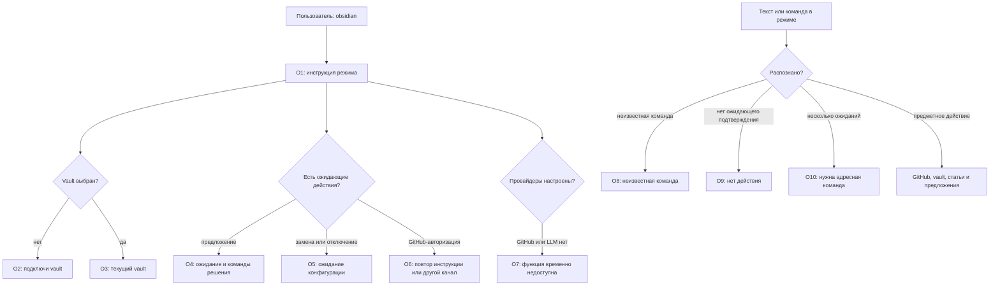
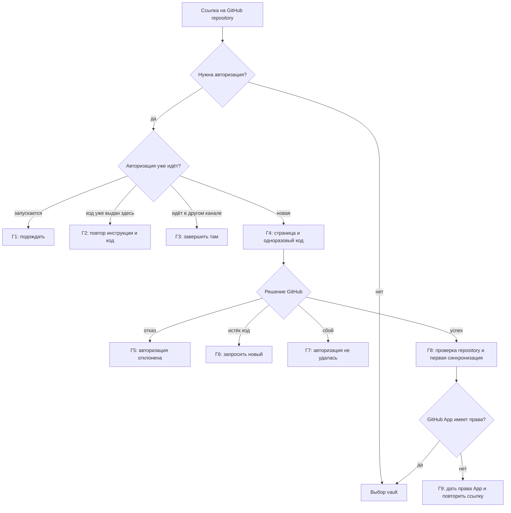
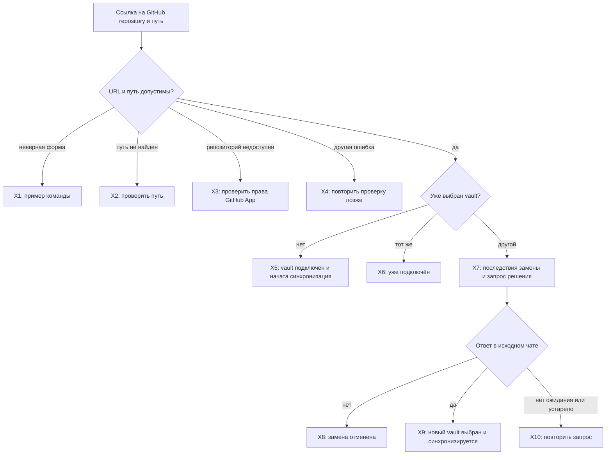
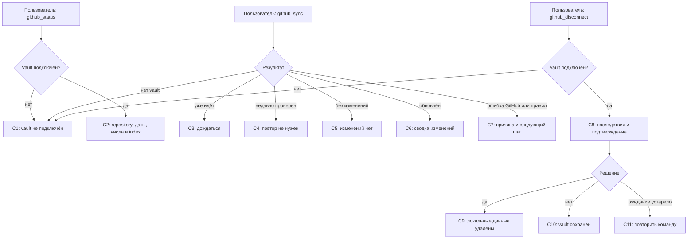
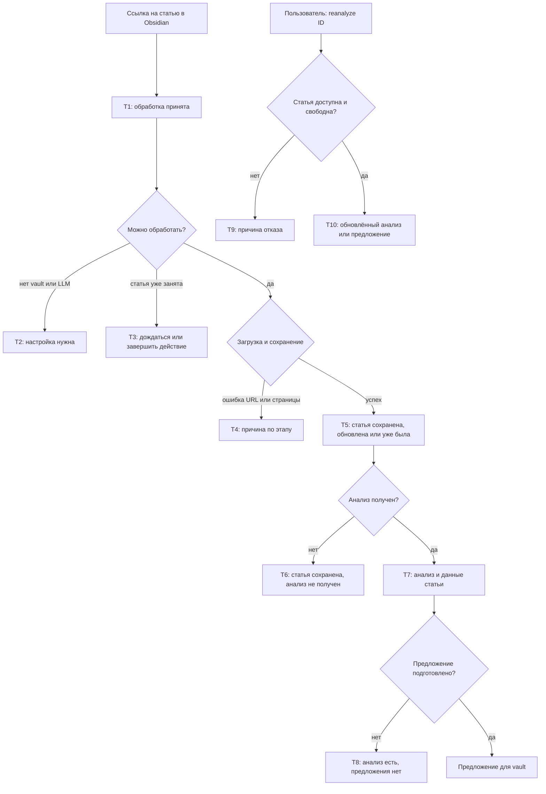
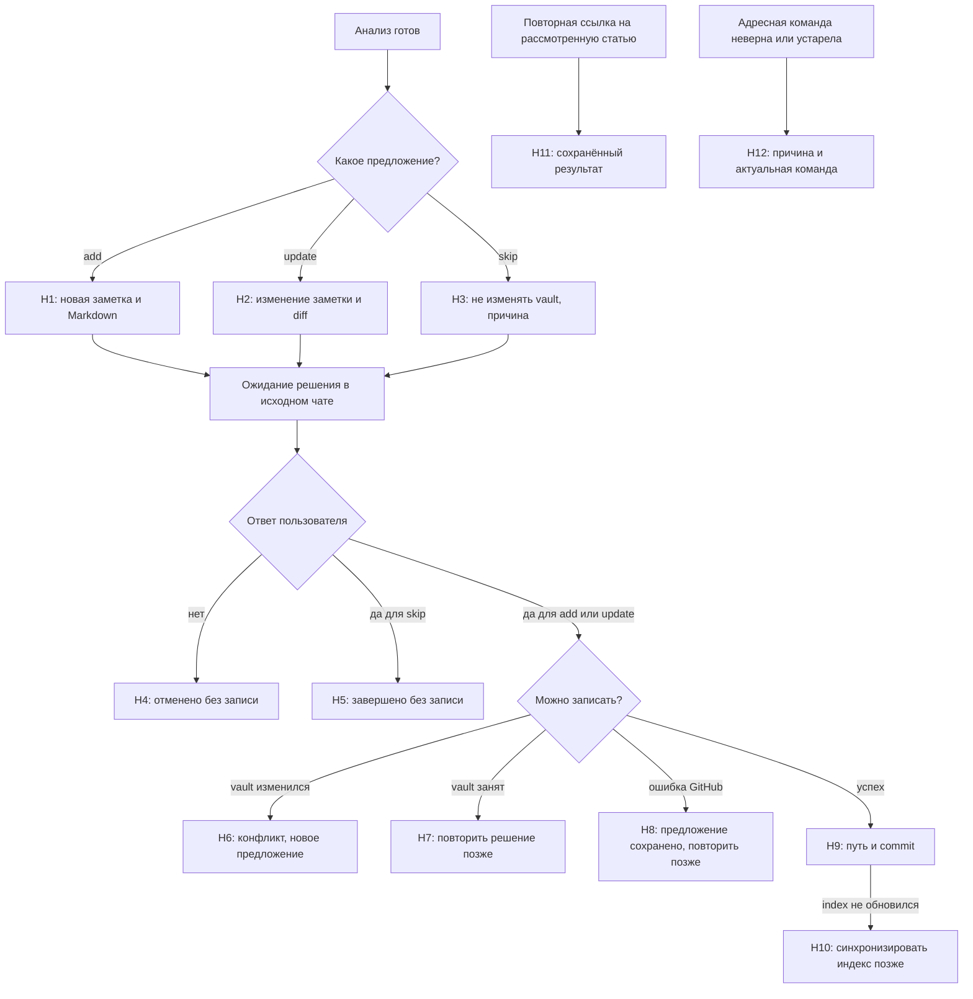

# Obsidian: сценарии и тексты

Каждая схема сразу сопровождается текущими текстами ответов. Метки на схеме совпадают с ID в таблице ниже. Общий путь сообщения показан в [маршруте](RESPONSE_MAP.md). В колонке «Целевой текст» пока нет согласованной редакции.

## Вход в Obsidian и сообщение внутри режима



О1–О7 собираются в один ответ; это не семь отдельных сообщений.

### Тексты ответов

Источники: [обработчик Obsidian](../../compadre_assistant/capabilities/obsidian/presentation/processing.py),
[предметные команды](../../compadre_assistant/capabilities/obsidian/presentation/commands.py).

| ID | Условие | Текущий текст | Целевой текст |
| --- | --- | --- | --- |
| О1 | `/obsidian` без аргумента | «Режим Obsidian. Выход: `/exit`. ⏎ Пришли ссылку на статью для анализа и предложения изменения заметки. ⏎ Ссылка на GitHub-репозиторий подключает или заменяет vault; после ссылки можно указать папку. ⏎ Команды: `/github_status`, `/github_sync`, `/github_disconnect`, `/reanalyze <id>`.» | — |
| О2 | Vault не выбран | «Твой Obsidian vault не подключён. Пришли ссылку на GitHub-репозиторий с vault.» | — |
| О3 | Vault выбран | «Подключён vault: `{owner}/{repository}`{, папка: путь}.» | — |
| О4 | Есть ожидающий proposal | «Ожидаю подтверждения предложения{ для пути}. ⏎ Ответь строго «да», чтобы применить, или «нет», чтобы отменить.» + адресные команды `Подтвердить`/`Отменить`. | — |
| О5 | Ожидает замена или отключение | «Ожидается подтверждение {замены/отключения} vault (ID {id}).» + адресные команды. | — |
| О6 | Есть текущая GitHub-авторизация | Повтор инструкции из Г2 либо сообщение Г3. | — |
| О7а | GitHub не настроен | «Провайдер GitHub не настроен на сервере.» | — |
| О7б | LLM не настроен | «Провайдер LLM не настроен на сервере; анализ статей пока недоступен.» | — |
| О8 | Неизвестная slash-команда | «Неизвестная команда Obsidian. Доступные команды: /help.» | — |
| О9 | Простое `да`/`нет` без ожидания | «В этом чате нет ожидающего действия.» | — |
| О10 | Несколько ожиданий | «Ответ неоднозначен: укажи ID и версию операции командой /confirm из актуального ответа.» | — |
| О11 | Неверная `/confirm obsidian` | «Используй /confirm obsidian <proposal\|replace\|disconnect> <id> <версия> <yes\|no>.» | — |
| О12 | Подтверждение или GitHub-функция недоступны | «Подтверждение Obsidian недоступно.» / «Подключение GitHub недоступно.» | — |

Текущий `/help` добавляет следующие предметные строки даже вне режима:
«`/github_status` — показать состояние локальной копии vault»,
«`/github_sync` — проверить GitHub и синхронизировать vault»,
«`/github_disconnect` — отключить vault после подтверждения»,
«`/reanalyze <ID статьи>` — выполнить анализ статьи повторно».
Заголовки: «Obsidian vault» и «Статьи». Затем следуют инструкции:
«Войди через `/obsidian [текст или URL]`. Подключение vault выполняется внутри
этого режима», «После настройки пришли HTTP/HTTPS-ссылку — сохранить и
проанализировать статью» и «Ответы `да` и `нет` выбирают единственное ожидание
этого чата; при нескольких используй адресную команду `/confirm`.»

## GitHub-авторизация



### Тексты ответов

Источник: [Obsidian responses](../../compadre_assistant/capabilities/obsidian/presentation/responses.py).

| ID | Условие | Текущий текст | Целевой текст |
| --- | --- | --- | --- |
| Г1 | Авторизация запускается | «Авторизация GitHub уже запускается. Подожди несколько секунд.» | — |
| Г2 | Код уже выдан | «Авторизация уже ожидает подтверждения. ⏎ 1. Открой страницу авторизации: {URL} ⏎ 2. Введи одноразовый код: `{код}` ⏎ После авторизации бот сам продолжит подключение vault. Временный GitHub token не сохраняется.» | — |
| Г3 | Подключение выполняется в другом связанном канале | «Подключение GitHub уже выполняется в другом привязанном канале. Заверши его там или дождись истечения одноразового кода.» | — |
| Г4 | Новый Device Flow | «Для проверки repository необходимо авторизовать GitHub. ⏎ 1. Открой страницу авторизации: {URL} ⏎ 2. Введи одноразовый код: `{код}` ⏎ После авторизации бот сам продолжит подключение vault. Временный GitHub token не сохраняется.» | — |
| Г5 | Пользователь отклонил GitHub | «Авторизация GitHub отклонена. Чтобы повторить, снова пришли ссылку на repository.» | — |
| Г6 | Код истёк | «Код авторизации GitHub истёк. Снова пришли ссылку на repository, чтобы получить новый.» | — |
| Г7а | Не удалось начать авторизацию | «Не удалось начать авторизацию GitHub. Попробуй позже.» | — |
| Г7б | Не удалось завершить авторизацию | «Не удалось завершить авторизацию GitHub. Снова пришли ссылку на repository или попробуй позже.» | — |
| Г8 | Авторизация успешна | «GitHub авторизован. Начинаю проверку репозитория и первую синхронизацию.» | — |
| Г9 | App не имеет доступа | «GitHub-аккаунт авторизован, но GitHub App пока не имеет доступа к нужному repository. {URL настройки App} Выбери repository и разреши `Contents: read and write`, затем снова пришли его ссылку.» | — |

Если `GITHUB_CONNECT_STARTED` не содержит данных Device Flow, ответом служит
«Авторизация GitHub запускается. Подожди несколько секунд.»; это отдельный
вариант Г1 без слова «уже».

## Подключение и замена vault



После Х5 и Х9 может добавляться успех или ошибка первой синхронизации;
подключение при этом остаётся сохранённым, если форматтер прямо сообщает это.

### Тексты ответов

Источник: [Obsidian responses](../../compadre_assistant/capabilities/obsidian/presentation/responses.py),
[обработчик](../../compadre_assistant/capabilities/obsidian/presentation/processing.py).

| ID | Условие | Текущий текст | Целевой текст |
| --- | --- | --- | --- |
| Х1 | Некорректная ссылка на repository | «Пришли обычную ссылку на GitHub repository: ⏎ `https://github.com/owner/repository` ⏎ или `https://github.com/owner/repository vault/path`. ⏎ Если vault находится в корне repository, путь указывать не нужно.» | — |
| Х2 | Путь не найден | «Указанный vault path не найден или ведёт не к каталогу. ⏎ Проверь путь относительно корня repository.» | — |
| Х3 | Репозиторий недоступен App | «GitHub App не получила доступ на чтение и запись этого repository. ⏎ Проверь URL, добавь repository в настройках GitHub App и разреши `Contents: read and write`. {URL настройки App} ⏎ После настройки снова пришли ссылку на repository.» | — |
| Х4 | Не удалось проверить repository | «Не удалось проверить GitHub repository. Попробуй позже.» | — |
| Х5 | Vault выбран | «Obsidian vault подключён. ⏎ Repository: `{owner}/{repository}` ⏎ Ветка: `{ветка}` ⏎ Vault path: `{путь или „корень repository“}`» + итог первой синхронизации из раздела «Статус, синхронизация и отключение vault». | — |
| Х6 | Тот же vault уже выбран | «Этот Obsidian vault уже подключён.» + описание repository, ветки, пути и при наличии sync-результат. | — |
| Х7 | Предлагается заменить vault | «Предлагается новый vault.» + описание нового repository, ветки, пути + «Он заменит текущее подключение и его локальные данные. ⏎ Продолжить? Ответь `да` или `нет`.» + адресные команды. | — |
| Х8 | Замена отменена | «Замена отменена. Текущий vault сохранён.» + описание текущего vault. | — |
| Х9 | Vault заменён | «Obsidian vault заменён.» + описание нового vault и результат синхронизации. | — |
| Х10а | Нет ожидающей замены | «Нет ожидающей замены vault. Сначала пришли ссылку на новый GitHub repository.» | — |
| Х10б | Подтверждение устарело или пришло из другого чата | «Действие устарело. Войди снова в /obsidian для актуального ожидания.» / «Заверши действие в исходном чате; операция здесь недоступна.» | — |
| Х11 | Подключение сохранено, первая синхронизация не завершилась | «Первая синхронизация не завершилась. Подключение сохранено; повтори через `/github_sync`.»; при ошибке правил — текст С7 и «Подключение сохранено. После исправления запусти `/github_sync`.» | — |
| Х12 | GitHub нужно авторизовать | «Для продолжения регистрации необходимо авторизовать GitHub.» | — |

## Статус, синхронизация и отключение vault



С2, С4–С6 могут дополнительно сообщать о покрытии semantic index.

### Тексты ответов

Источник: [Obsidian responses](../../compadre_assistant/capabilities/obsidian/presentation/responses.py).

| ID | Условие | Текущий текст | Целевой текст |
| --- | --- | --- | --- |
| С1 | Vault отсутствует | «Obsidian vault ещё не подключён.» | — |
| С2 | `/github_status` с vault | «Obsidian vault: `{owner}/{repository}` ⏎ Ветка: `{ветка}` ⏎ Vault path: `{путь или „корень repository“}` ⏎ Локально заметок: {число} ⏎ Файлов правил: {число} ⏎ Последняя проверка: {дата или „ещё не проверялся“} ⏎ Последняя успешная синхронизация: {дата или „ещё не синхронизировался“}» + строка semantic index из С12. | — |
| С3 | Синхронизация уже идёт | «Этот vault уже синхронизируется. Дождись завершения.» | — |
| С4 | Vault проверен недавно | «Vault недавно проверен, повторный запрос к GitHub не требуется. ⏎ Локально заметок: {число}. Файлов правил: {число}.» | — |
| С5 | На GitHub нет изменений | «Vault проверен: изменений нет. ⏎ Локально заметок: {число}. Файлов правил: {число}.» | — |
| С6 | Синхронизация обновила vault | «Vault синхронизирован. ⏎ Заметок: {всего}; скачано: {число}; добавлено: {число}; обновлено: {число}; удалено: {число}. ⏎ Файлов правил: {число}.» | — |
| С7а | Общая ошибка синхронизации | «Не удалось синхронизировать Obsidian vault с GitHub. Локальная копия не была помечена как актуальная. Попробуй позже.» | — |
| С7б | Нет обязательной конфигурации | «В корне vault не найден обязательный `{путь файла}`. ⏎ Создай или исправь файл вручную и повтори синхронизацию. ⏎ Пример: {YAML-пример}» | — |
| С7в | Нет файла правил | «Не найден обязательный файл правил: `{путь}`.» + та же инструкция и YAML-пример. | — |
| С7г | Конфигурация некорректна | «`{путь файла}` заполнен некорректно.» + та же инструкция и YAML-пример. | — |
| С7д | Нет подробной ошибки правил | «`{путь файла}` необходимо исправить перед продолжением.» | — |
| С8 | Запрос отключения | «Отключить Obsidian vault `{owner}/{repository}`? ⏎ Локальный Markdown и связанные metadata будут удалены. Сам GitHub repository не изменится; профиль, связанные каналы, статьи и анализы сохранятся. ⏎ Ответь `да` или `нет`.» + адресные команды. | — |
| С9 | Vault отключён | «Obsidian vault отключён, локальный Markdown удалён. ⏎ GitHub repository не изменён. Профиль, связанные каналы, статьи и анализы сохранены.» | — |
| С10 | Отключение отменено | «Отключение отменено. Текущий Obsidian vault сохранён.» | — |
| С11 | Нет ожидания отключения | «Нет ожидающего подтверждения отключения. Сначала отправь `/github_disconnect`.» | — |
| С12а | Semantic index не настроен | «Semantic index: не настроен.» | — |
| С12б | Индекс готов | «Semantic index: готов (embeddings: {число} из {число}).»; после sync может добавляться «Embeddings: добавлено: {число}; переиспользовано: {число}.» | — |
| С12в | Индекс частичный | «⚠️ Semantic index пока не готов: сохранено embeddings {число} из {число}. ⏎ Осталось обработать {число} chunks. Пока поиск работает через FTS fallback.» | — |
| С13 | Нет сводки синхронизации | «Синхронизация vault завершилась без доступной сводки.» | — |
| С14 | Подтверждение vault устарело/занято | «Ожидание завершено, устарело или истёк срок действия.» / «Конфигурация vault уже изменилась.» / «Конфигурация vault изменилась. Повтори запрос.» / «Конфигурация vault уже ожидает решения в исходном чате.» / «Vault занят синхронизацией или записью. Повтори решение позже.» | — |

В ответах С7б–С7г бот показывает пример содержимого
[`.knowledge-catcher.yml`](../../compadre_assistant/resources/.knowledge-catcher.yml):

```yaml
version: 1

instructions:
  - memory-bank/AGENTS.md.txt
  - memory-bank/docs/agent-preflight.md.txt
  - memory-bank/docs/content-conventions.md.txt
  - memory-bank/docs/note-types.md.txt
  - memory-bank/docs/project-structure.md.txt
  - memory-bank/docs/workflows.md.txt
```

## Статья, анализ и повторный анализ



К Т5–Т8 может добавляться предупреждение об использованной локальной копии
vault или временно недоступных embeddings.

### Тексты ответов

Источники: [Obsidian responses](../../compadre_assistant/capabilities/obsidian/presentation/responses.py),
[обработчик](../../compadre_assistant/capabilities/obsidian/presentation/processing.py).

| ID | Условие | Текущий текст | Целевой текст |
| --- | --- | --- | --- |
| Т1 | Долгая обработка началась | «Принял, обрабатываю. Это может занять немного времени.» | — |
| Т2а | Vault не подключён | «{имя}, твой Obsidian vault не подключён. ⏎ Пришли ссылку на GitHub-репозиторий с Obsidian vault.» | — |
| Т2б | LLM не настроен | «Провайдер LLM не настроен на сервере; анализ статей пока недоступен.» | — |
| Т3а | Тот же URL уже обрабатывается | «Эта статья уже обрабатывается. Повтори ссылку после завершения.» | — |
| Т3б | Предложение ждёт в другом чате | «Эта статья уже обрабатывается. Заверши действие в исходном чате.» | — |
| Т4а | URL не распознан | «Не удалось разобрать ссылку. Проверь URL и пришли его еще раз.» | — |
| Т4б | Загрузка страницы не удалась | «Не удалось загрузить страницу по ссылке. Проверь, что она открывается в браузере, или попробуй позже.» | — |
| Т4в | Текст не извлечён | «Страница загрузилась, но текст статьи извлечь не получилось. Можно попробовать другую ссылку на эту же публикацию.» | — |
| Т4г | Запись статьи не удалась | «Не удалось сохранить статью. Попробуй позже.» | — |
| Т4д | Прочая ошибка обработки | «Не удалось обработать ссылку. Попробуй отправить ее позже.» | — |
| Т5а | Новая статья | «Готово: статья сохранена.» + «Название: {название} ⏎ Статус: {статус} ⏎ ID статьи: {id} ⏎ Текст: {число} символов». | — |
| Т5б | Статья обновлена | «Готово: статья обновлена.» + те же поля. | — |
| Т5в | Статья уже была сохранена | «Эта статья уже была сохранена.» + те же поля. | — |
| Т6 | Анализ не удался | «Статью удалось сохранить, но анализ пока не получился. Попробуй отправить ссылку позже.» | — |
| Т7а | Новый анализ | Первая фраза Т5а/Т5б/Т5в по результату обработки статьи, затем «Анализ готов. ⏎⏎ Название: {название} ⏎ ID статьи: {id} ⏎⏎ {текст анализа LLM}». Статус и длина текста из Т5 здесь не выводятся. | — |
| Т7б | Сохранённый анализ | Первая фраза Т5а/Т5б/Т5в по результату обработки статьи, затем «Использую сохраненный анализ. ⏎⏎ Название: {название} ⏎ ID статьи: {id} ⏎⏎ {текст анализа LLM}». Статус и длина текста из Т5 здесь не выводятся. | — |
| Т8 | Предложение не подготовлено | «Анализ статьи сохранён, но предложение для Obsidian подготовить не удалось. Vault не изменён. Попробуй позже.» | — |
| Т9а | `/reanalyze` без числового ID | «Пришли команду в формате `/reanalyze <ID статьи>`.» | — |
| Т9б | Статья недоступна профилю | «Статья недоступна в этом профиле.» | — |
| Т9в | У статьи активное действие | «У этой статьи есть активное действие. Заверши его в исходном чате перед повторным анализом.» | — |
| Т9г | Статья уже обрабатывается | «Эта статья уже обрабатывается. Повтори команду после завершения.» | — |
| Т9д | Повторный анализ не удался | «Не удалось обновить анализ статьи. Проверь ID статьи или попробуй позже.» | — |
| Т10 | Повторный анализ готов | «Анализ обновлен. ⏎ Название: {название} ⏎ ID статьи: {id} ⏎ {текст анализа LLM}»; при новом proposal вместо этого показывается предложение из раздела «Предложение, подтверждение и запись заметки». | — |
| Т11 | Ссылка на статью отсутствует | «Пришли ссылку на статью, и я попробую ее сохранить.» | — |
| Т12 | Невозможно подготовить сводку | «Статья обработана, но результат не удалось подготовить.» / «Анализ готов, но результат не удалось подготовить.» / «Анализ обновлен, но результат не удалось подготовить.» | — |

#### Дополнение к ответам об обработке статьи

| ID | Условие | Текущий текст | Целевой текст |
| --- | --- | --- | --- |
| Т13а | Другая синхронизация идёт | «⚠️ Vault сейчас синхронизируется в другом связанном канале, поэтому использована текущая локальная копия.» | — |
| Т13б | Embeddings временно недоступны | «⚠️ Заметки и полнотекстовый индекс актуальны, но embeddings временно недоступны. Поиск выполнен через FTS fallback.» | — |
| Т13в | GitHub не обновился | «⚠️ Не удалось обновить vault из GitHub, поэтому использована последняя локальная копия.» | — |
| Т13г | Данные предупреждения | «Локально заметок: {число}.»; при наличии даты — «Последняя успешная проверка GitHub: {дата и время} UTC.» | — |
| Т14 | Значения статуса статьи | «новая», «загружается», «текст извлечен», «анализируется», «проанализирована», «ждет разбора для Obsidian», «разобрана», «ошибка обработки». | — |
| Т15 | Запасные значения полей | Название: «без заголовка»; ID: «не сохранен». | — |

## Предложение, подтверждение и запись заметки



Адресные команды показывают ID и версию ожидания. Простое `да`/`нет`
принимается только при одном ожидании исходного чата.

### Тексты ответов

Источник: [Obsidian responses](../../compadre_assistant/capabilities/obsidian/presentation/responses.py)
и [обработчик](../../compadre_assistant/capabilities/obsidian/presentation/processing.py).

| ID | Условие | Текущий текст | Целевой текст |
| --- | --- | --- | --- |
| Н1 | Proposal `add` | «Анализ готов. Предложение для Obsidian: создать новую заметку. ⏎ Путь: `{путь}` ⏎ Причина: {причина} ⏎ Предлагаемый Markdown: {предпросмотр} ⏎ Vault не изменён. Ответь «да», чтобы применить изменение, или «нет», чтобы отменить предложение.» | — |
| Н2 | Proposal `update` | «Анализ готов. Предложение для Obsidian: обновить существующую заметку. ⏎ Путь: `{путь}` ⏎ Причина: {причина} ⏎ Предлагаемый diff: {предпросмотр} ⏎ Vault не изменён. Ответь «да», чтобы применить изменение, или «нет», чтобы отменить предложение.» Если diff пуст, под заголовком «Предлагаемый diff» показывается предложенный Markdown. | — |
| Н3 | Proposal `skip` | «Анализ готов. Предложение для Obsidian: ничего не менять. ⏎ Причина: {причина} ⏎ Vault не изменён. Ответь «да», чтобы завершить review без изменений, или «нет», чтобы отменить предложение.» | — |
| Н4 | Предложение отменено | «Предложение отменено. Vault не изменён, статья остаётся доступной для нового review.» | — |
| Н5 | `skip` подтверждён | «Review завершён без изменений Obsidian vault.» | — |
| Н6 | Vault изменился после подготовки | «Vault изменился после подготовки предложения. Ничего не перезаписано. Отправь ссылку на статью ещё раз, чтобы подготовить новое предложение по актуальной версии.» | — |
| Н7 | Vault занят другой операцией | «Vault сейчас занят синхронизацией или записью из другого связанного канала. Предложение сохранено; повтори «да» позже.» | — |
| Н8 | Запись GitHub не удалась | «Не удалось записать изменение в GitHub. Предложение и текст статьи сохранены; можно безопасно повторить «да» позже.» | — |
| Н9 | `add`/`update` применён | «Изменение применено к `{путь}` прямым commit. ⏎ Commit: `{SHA}`»; запасной текст без proposal: «Предложение применено.» | — |
| Н10 | Заметка сохранена, индекс не обновлён | «Заметка сохранена, но поисковый индекс пока не обновлён. Повтори позже `/github_sync`.» | — |
| Н11а | Статья уже рассмотрена как `skip` | При наличии анализа — «Сохранённый анализ: ⏎ {текст анализа LLM} ⏎⏎». Затем: «Эта статья уже прошла review: было решено не изменять vault. ⏎ Причина: {причина}» | — |
| Н11б | Уже создана или обновлена заметка | При наличии анализа — «Сохранённый анализ: ⏎ {текст анализа LLM} ⏎⏎». Затем: «Эта статья уже прошла review: {создана/обновлена} заметка `{путь}`. ⏎ Commit: `{SHA}` ⏎ Повторная загрузка страницы и LLM-анализ не выполнялись.» | — |
| Н11в | Нет данных proposal | «Эта статья уже прошла review.» | — |
| Н12а | Ожидания нет | «Сейчас нет действия, которое нужно подтвердить. ⏎ Сначала пришли ссылку на другой repository или `/link <код>`.» | — |
| Н12б | Действие из другого чата | «Заверши действие в исходном чате; операция здесь недоступна.» | — |
| Н12в | Действие устарело | «Действие устарело. Войди снова в /obsidian для актуального ожидания.» | — |
| Н13 | Proposal ждёт решения | «Ожидаю подтверждения предложения{ для пути}. ⏎ Ответь строго «да», чтобы применить, или «нет», чтобы отменить.» | — |
| Н14 | Не удалось подготовить сводку proposal | «Предложение для Obsidian подготовлено, но сводка недоступна.» | — |
| Н15 | Длинное превью | После первых 2000 символов: «[Предпросмотр сокращён.]» | — |
| Н16 | Адресные действия | `Подтвердить: /confirm obsidian {операция} {id} {версия} yes` и `Отменить: /confirm obsidian {операция} {id} {версия} no`. | — |
