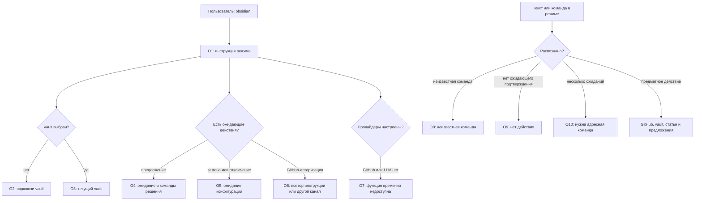
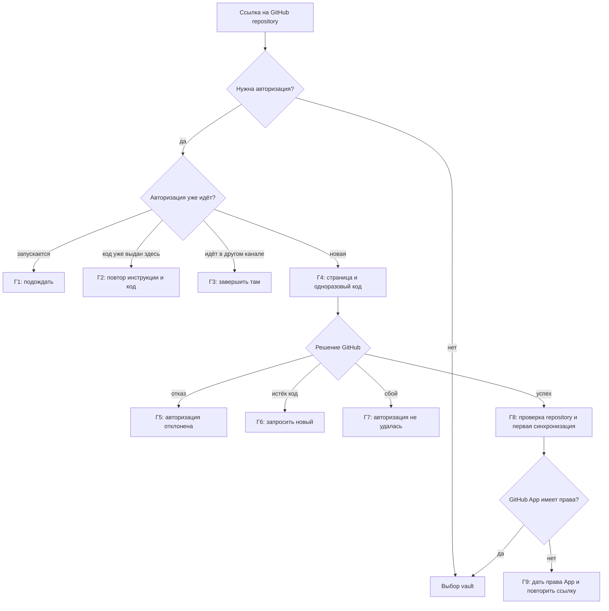
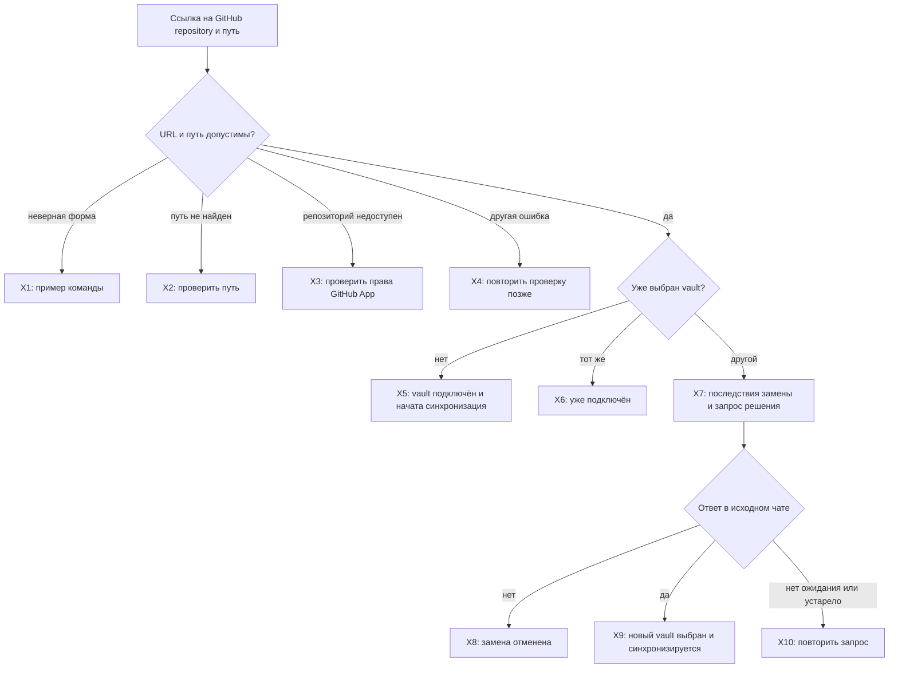
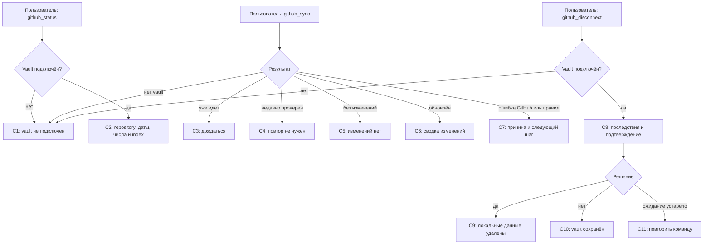
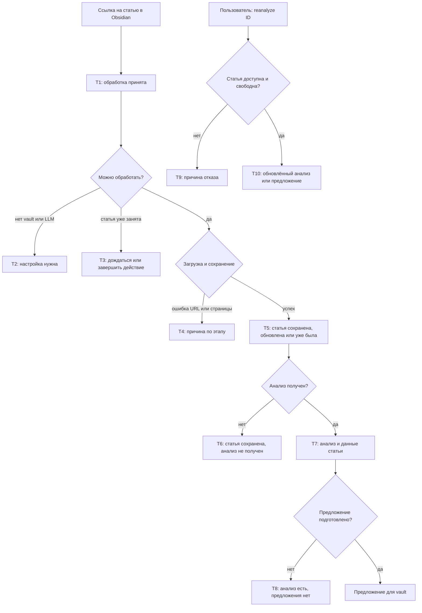
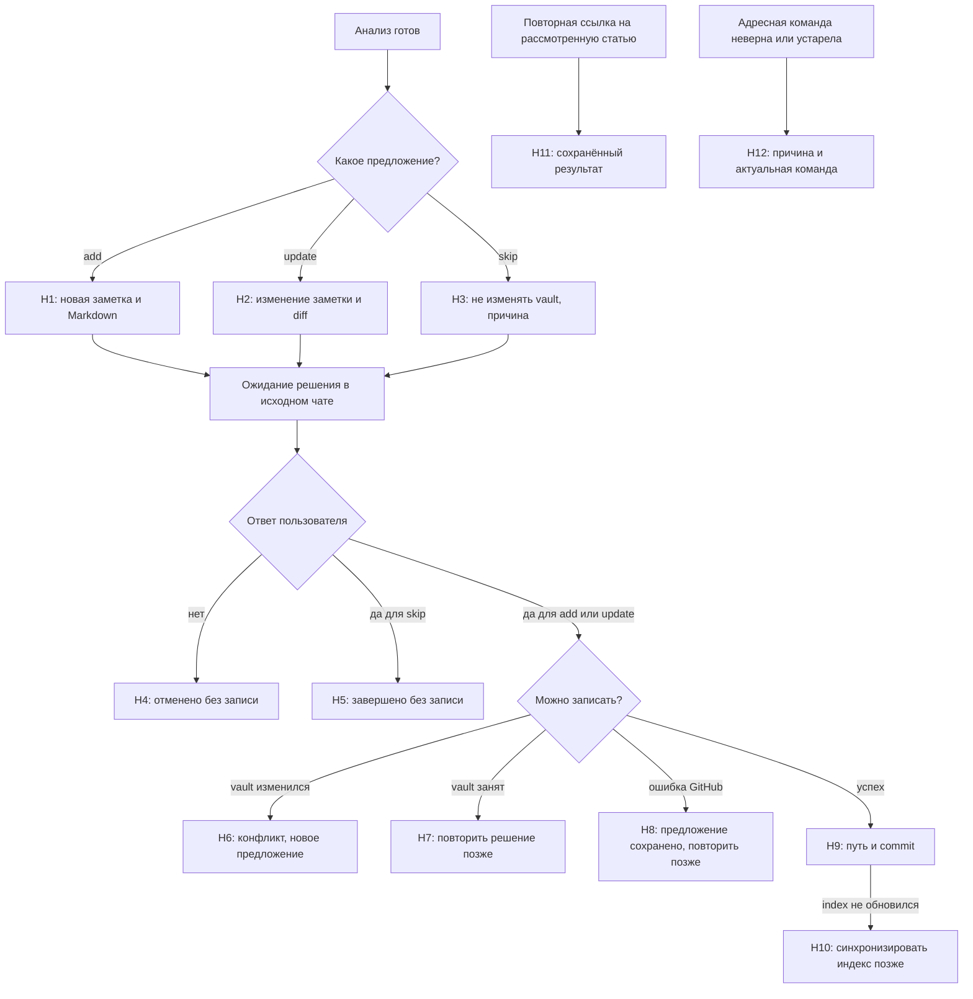

# Obsidian: сценарии и тексты

Каждая схема сопровождается текущими текстами ответов и целевой редакцией. Метки на схеме совпадают с ID в таблице ниже. Общий путь сообщения показан в [маршруте](RESPONSE_MAP.md); новые целевые сценарии выделены отдельно.

## Вход в Obsidian и сообщение внутри режима



О1–О7 собираются в один ответ; это не семь отдельных сообщений.

### Тексты ответов

Источники: [обработчик Obsidian](../../compadre_assistant/capabilities/obsidian/presentation/processing.py),
[предметные команды](../../compadre_assistant/capabilities/obsidian/presentation/commands.py).

| ID | Условие | Текущий текст | Целевой текст |
| --- | --- | --- | --- |
| О1 | `/obsidian` без аргумента | «Режим Obsidian. Выход: `/exit`. ⏎ Пришли ссылку на статью для анализа и предложения изменения заметки. ⏎ Ссылка на GitHub-репозиторий подключает или заменяет vault; после ссылки можно указать папку. ⏎ Команды: `/vault_status`, `/vault_sync`, `/vault_disconnect`, `/reanalyze <id>`.» | Режим Obsidian включён. Пришли ссылку на статью для анализа или ссылку на GitHub repository, чтобы подключить либо заменить хранилище заметок (vault). После ссылки на repository можно указать папку vault. Команды: /vault_status — показать состояние vault; /vault_sync — проверить GitHub и обновить локальную копию; /vault_disconnect — отключить vault после подтверждения; /reanalyze <article_id> — повторить анализ. Чтобы выйти из режима, вызови /exit. |
| О2 | Vault не выбран | «Твой Obsidian vault не подключён. Пришли ссылку на GitHub-репозиторий с vault.» | Хранилище заметок (vault) не подключено. Пришли ссылку на GitHub repository, чтобы подключить его. |
| О3 | Vault выбран | «Подключён vault: `{owner}/{repository}`{, папка: путь}.» | Подключено хранилище: {owner}/{repository}{, папка: путь}. Пришли ссылку на статью для анализа или используй команды режима. |
| О4 | Есть ожидающий proposal | «Ожидаю подтверждения предложения{ для пути}. ⏎ Ответь строго «да», чтобы применить, или «нет», чтобы отменить.» + адресные команды `Подтвердить`/`Отменить`. | Если предложение создаёт заметку (add) или обновляет существующую (update), ответь «да», чтобы применить изменение; ответь «нет», чтобы отменить предложение и оставить vault без изменений. Если действие предложения — skip, ответь «да», чтобы завершить review без изменений, или «нет», чтобы отменить предложение. ⏎ Подтвердить: /confirm obsidian proposal {id} {версия} yes ⏎ Отменить: /confirm obsidian proposal {id} {версия} no |
| О5 | Ожидает замена или отключение | «Ожидается подтверждение {замены/отключения} vault (ID {id}).» + адресные команды. | Ожидает подтверждения {замены/отключения} хранилища (ID {id}). {Если ожидается замена: подтвердить — /confirm obsidian replace {id} {версия} yes; отменить — /confirm obsidian replace {id} {версия} no. Если ожидается отключение: подтвердить — /confirm obsidian disconnect {id} {версия} yes; отменить — /confirm obsidian disconnect {id} {версия} no.} Ожидание действует 10 минут с момента создания. Решение доступно только в исходном чате и при выборе проверяется повторно. |
| О6 | Есть текущая GitHub-авторизация | Повтор инструкции из Г2 либо сообщение Г3. | Если код выдан в этом чате: открой страницу {URL} и введи одноразовый код {код}. После подтверждения бот продолжит проверку repository и подключение vault; временный GitHub token не сохраняется. Если авторизация идёт в другом связанном канале: заверши её в исходном канале либо дождись истечения одноразового кода и снова пришли ссылку на repository. |
| О7а | GitHub не настроен | «Провайдер GitHub не настроен на сервере.» | Подключение GitHub сейчас недоступно: провайдер GitHub не настроен на сервере. |
| О7б | LLM не настроен | «Провайдер LLM не настроен на сервере; анализ статей пока недоступен.» | Анализ статей сейчас недоступен: провайдер LLM не настроен на сервере. Подключение vault и команды его обслуживания доступны отдельно, если настроен GitHub. |
| О8 | Неизвестная slash-команда | «Неизвестная команда Obsidian. Доступные команды: /help.» | Не знаю такой команды Obsidian. Вызови /help, чтобы посмотреть доступные в этом чате команды. |
| О9 | Простое `да`/`нет` без ожидания | «В этом чате нет ожидающего действия.» | В этом чате нет действия Obsidian, которое можно подтвердить. Чтобы посмотреть команды режима, вызови /help. |
| О10 | Несколько ожиданий | «Ответ неоднозначен: укажи ID и версию операции командой /confirm из актуального ответа.» | Есть несколько ожидающих действий, поэтому ответ «да» или «нет» неоднозначен. Выбери нужное действие точной командой /confirm из его ответа; команда содержит ID и версию. |
| О11 | Неверная `/confirm obsidian` | «Используй /confirm obsidian <proposal\|replace\|disconnect> <id> <version> <yes\|no>.» | Неверный формат команды подтверждения. Используй /confirm obsidian <proposal\|replace\|disconnect> <id> <version> <yes\|no>. Команда должна содержать тип операции, ID, версию и решение yes или no. |
| О12 | Подтверждение или GitHub-функция недоступны | «Подтверждение Obsidian недоступно.» / «Подключение GitHub недоступно.» | Если недоступна служба подтверждений Obsidian: «Служба подтверждений Obsidian недоступна. Действие не обработано; повтори точную команду /confirm после восстановления службы». Если на сервере не настроен GitHub: «Подключение GitHub сейчас недоступно». |

Текущий `/help` добавляет следующие предметные строки даже вне режима:
«`/vault_status` — показать состояние локальной копии vault»,
«`/vault_sync` — проверить GitHub и синхронизировать vault»,
«`/vault_disconnect` — отключить vault после подтверждения»,
«`/reanalyze <article_id>` — выполнить анализ статьи повторно».
Заголовки: «Obsidian vault» и «Статьи». Затем следуют инструкции:
«Войди через `/obsidian [текст или URL]`. Подключение vault выполняется внутри
этого режима», «После настройки пришли HTTP/HTTPS-ссылку — сохранить и
проанализировать статью» и «Ответы `да` и `нет` выбирают единственное ожидание
этого чата; при нескольких используй адресную команду `/confirm`.»

В обработчике также принимаются `yes`, `no`, `y` и `n` без учёта регистра;
они выбирают единственное ожидающее действие исходного чата.

## GitHub-авторизация



### Тексты ответов

Источник: [Obsidian responses](../../compadre_assistant/capabilities/obsidian/presentation/responses.py).

| ID | Условие | Текущий текст | Целевой текст |
| --- | --- | --- | --- |
| Г1 | Авторизация запускается | «Авторизация GitHub уже запускается. Подожди несколько секунд.» | Авторизация GitHub запускается. Подожди несколько секунд, затем повтори ссылку на repository, если подключение не продолжилось. |
| Г2 | Код уже выдан | «Авторизация уже ожидает подтверждения. ⏎ 1. Открой страницу авторизации: {URL} ⏎ 2. Введи одноразовый код: `{код}` ⏎ После авторизации бот сам продолжит подключение vault. Временный GitHub token не сохраняется.» | Авторизация GitHub ждёт подтверждения. ⏎ 1. Открой страницу: {URL} ⏎ 2. Введи одноразовый код: {код}. ⏎ После подтверждения бот продолжит проверку repository и подключение vault. Временный GitHub token не сохраняется. |
| Г3 | Подключение выполняется в другом связанном канале | «Подключение GitHub уже выполняется в другом привязанном канале. Заверши его там или дождись истечения одноразового кода.» | Авторизация GitHub уже выполняется в другом связанном канале. Заверши её в исходном канале либо дождись истечения одноразового кода и снова пришли ссылку на repository. |
| Г4 | Новый Device Flow | «Для проверки repository необходимо авторизовать GitHub. ⏎ 1. Открой страницу авторизации: {URL} ⏎ 2. Введи одноразовый код: `{код}` ⏎ После авторизации бот сам продолжит подключение vault. Временный GitHub token не сохраняется.» | Чтобы проверить repository, авторизуй GitHub. ⏎ 1. Открой страницу: {URL} ⏎ 2. Введи одноразовый код: {код}. ⏎ После подтверждения бот проверит repository и продолжит подключение vault. Временный GitHub token не сохраняется. |
| Г5 | Пользователь отклонил GitHub | «Авторизация GitHub отклонена. Чтобы повторить, снова пришли ссылку на repository.» | Авторизация GitHub отклонена; repository не подключён. Чтобы начать заново, снова пришли ссылку на repository. |
| Г6 | Код истёк | «Код авторизации GitHub истёк. Снова пришли ссылку на repository, чтобы получить новый.» | Срок одноразового кода GitHub истёк, поэтому авторизация не завершена. Снова пришли ссылку на repository, чтобы получить новый код. |
| Г7а | Не удалось начать авторизацию | «Не удалось начать авторизацию GitHub. Попробуй позже.» | Не удалось начать авторизацию GitHub. Снова пришли ссылку на repository, чтобы повторить запрос. |
| Г7б | Не удалось завершить авторизацию | «Не удалось завершить авторизацию GitHub. Снова пришли ссылку на repository или попробуй позже.» | Не удалось завершить авторизацию GitHub; подключение vault не продолжено. Снова пришли ссылку на repository, чтобы повторить авторизацию. |
| Г8 | Авторизация успешна | «GitHub авторизован. Начинаю проверку репозитория и первую синхронизацию.» | GitHub авторизован. Проверяю repository и начинаю первую синхронизацию vault. Дождись следующего сообщения с результатом. |
| Г9 | App не имеет доступа | «GitHub-аккаунт авторизован, но GitHub App пока не имеет доступа к нужному repository. {URL настройки App} Выбери repository и разреши `Contents: read and write`, затем снова пришли его ссылку.» | Аккаунт GitHub авторизован, но GitHub App не имеет доступа к repository. Открой настройки App: {URL настройки App}. Выбери repository и выдай разрешение Contents: read and write, затем снова пришли ссылку на repository. |

Если `GITHUB_CONNECT_STARTED` не содержит данных Device Flow, ответом служит
«Авторизация GitHub запускается. Подожди несколько секунд.»; это отдельный
вариант Г1 без слова «уже».

## Подключение и замена vault



После Х5 и Х9 может добавляться успех или ошибка первой синхронизации;
подключение при этом остаётся сохранённым, если форматтер прямо сообщает это.

### Тексты ответов

Источник: [Obsidian responses](../../compadre_assistant/capabilities/obsidian/presentation/responses.py),
[обработчик](../../compadre_assistant/capabilities/obsidian/presentation/processing.py).

| ID | Условие | Текущий текст | Целевой текст |
| --- | --- | --- | --- |
| Х1 | Некорректная ссылка на repository | «Пришли обычную ссылку на GitHub repository: ⏎ `https://github.com/owner/repository` ⏎ или `https://github.com/owner/repository vault/path`. ⏎ Если vault находится в корне repository, путь указывать не нужно.» | Не удалось распознать ссылку или путь к vault. Пришли GitHub repository в одном из форматов: ⏎ https://github.com/owner/repository ⏎ https://github.com/owner/repository vault/path ⏎ Если vault находится в корне repository, путь не нужен. |
| Х2 | Путь не найден | «Указанный vault path не найден или ведёт не к каталогу. ⏎ Проверь путь относительно корня repository.» | Папка vault не найдена или указанный путь ведёт не к папке. Проверь путь относительно корня repository и снова пришли ссылку с правильным путём. |
| Х3 | Репозиторий недоступен App | «GitHub App не получила доступ на чтение и запись этого repository. ⏎ Проверь URL, добавь repository в настройках GitHub App и разреши `Contents: read and write`. {URL настройки App} ⏎ После настройки снова пришли ссылку на repository.» | GitHub App не может читать и записывать этот repository. Проверь URL, затем открой настройки App: {URL настройки App}. Добавь repository и выдай разрешение Contents: read and write. После этого снова пришли ссылку на repository. |
| Х4 | Не удалось проверить repository | «Не удалось проверить GitHub repository. Попробуй позже.» | Не удалось проверить GitHub repository. Повтори ссылку на repository позже. |
| Х5 | Vault выбран | «Obsidian vault подключён. ⏎ Repository: `{owner}/{repository}` ⏎ Ветка: `{ветка}` ⏎ Vault path: `{путь или „корень repository“}`» + итог первой синхронизации из раздела «Статус, синхронизация и отключение vault». | Хранилище подключено: {owner}/{repository}, ветка {ветка}, папка {путь или «корень repository»}. ⏎ Первая синхронизация с GitHub: {результат из С4–С7}. Подключение сохранено; если синхронизация не завершилась, исправь указанную причину и вызови /vault_sync. |
| Х6 | Тот же vault уже выбран | «Этот Obsidian vault уже подключён.» + описание repository, ветки, пути и при наличии sync-результат. | Это хранилище уже подключено: {owner}/{repository}, ветка {ветка}, папка {путь или «корень repository»}. {если доступен результат синхронизации: {сводка из С4–С7}} |
| Х7 | Предлагается заменить vault | «Предлагается новый vault.» + описание нового repository, ветки, пути + «Он заменит текущее подключение и его локальные данные. ⏎ Продолжить? Ответь `да` или `нет`.» + адресные команды. | Подключить {новый owner}/{новый repository}, ветка {ветка}, папка {путь или «корень repository»}, вместо текущего vault? При подтверждении текущее подключение и его локальные данные будут заменены; repository на GitHub не изменится. ⏎ Ответь «да», чтобы заменить, или «нет», чтобы сохранить текущее подключение. Ожидание действует 10 минут. ⏎ Подтвердить: /confirm obsidian replace {id} {версия} yes ⏎ Отменить: /confirm obsidian replace {id} {версия} no |
| Х8 | Замена отменена | «Замена отменена. Текущий vault сохранён.» + описание текущего vault. | Замена отменена. Текущее подключение и его локальные данные сохранены: {owner}/{repository}, ветка {ветка}, папка {путь или «корень repository»}. |
| Х9 | Vault заменён | «Obsidian vault заменён.» + описание нового vault и результат синхронизации. | Хранилище заменено на {owner}/{repository}, ветка {ветка}, папка {путь или «корень repository»}. {Если в ответе есть сводка синхронизации, приложи её из С4–С7.} |
| Х10а | Нет ожидающей замены | «Нет ожидающей замены vault. Сначала пришли ссылку на новый GitHub repository.» | Нет ожидающей замены. Пришли ссылку на новый GitHub repository, чтобы запросить подключение или замену vault. |
| Х10б | Подтверждение устарело или пришло из другого чата | «Действие устарело. Войди снова в /obsidian для актуального ожидания.» / «Заверши действие в исходном чате; операция здесь недоступна.» | Если запрос устарел, снова пришли ссылку на новый repository, чтобы создать актуальный запрос. Если сообщение пришло из другого чата, продолжи действие в исходном чате. |
| Х11 | Подключение сохранено, первая синхронизация не завершилась | «Первая синхронизация не завершилась. Подключение сохранено; повтори через `/vault_sync`.»; при ошибке правил — текст С7 и «Подключение сохранено. После исправления запусти `/vault_sync`.» | Подключение vault сохранено, но первая синхронизация не завершилась. {Причина из С7}. Исправь файл правил, если это указано, затем вызови /vault_sync. |
| Х12 | GitHub нужно авторизовать | «Для продолжения регистрации необходимо авторизовать GitHub.» | Чтобы продолжить подключение vault, авторизуй GitHub по инструкции в следующем сообщении. |

## Статус, синхронизация и отключение vault



С2, С4–С6 могут дополнительно сообщать о покрытии semantic index.

### Тексты ответов

Источник: [Obsidian responses](../../compadre_assistant/capabilities/obsidian/presentation/responses.py).

| ID | Условие | Текущий текст | Целевой текст |
| --- | --- | --- | --- |
| С1 | Vault отсутствует | «Obsidian vault ещё не подключён.» | Хранилище заметок (vault) не подключено. Чтобы подключить его, пришли ссылку на GitHub repository. |
| С2 | `/vault_status` с vault | «Obsidian vault: `{owner}/{repository}` ⏎ Ветка: `{ветка}` ⏎ Vault path: `{путь или „корень repository“}` ⏎ Локально заметок: {число} ⏎ Файлов правил: {число} ⏎ Последняя проверка: {дата или „ещё не проверялся“} ⏎ Последняя успешная синхронизация: {дата или „ещё не синхронизировался“}» + строка semantic index из С12. | Хранилище: {owner}/{repository}, ветка {ветка}, папка {путь или «корень repository»}. ⏎ В локальной копии: заметок {число}, файлов правил {число}. ⏎ GitHub проверялся: {дата или «ещё не проверялся»}. Последняя успешная синхронизация в локальную копию: {дата или «ещё не синхронизировалась»}. ⏎ Индекс: {строка из С12}. |
| С3 | Синхронизация уже идёт | «Этот vault уже синхронизируется. Дождись завершения.» | Синхронизация vault с GitHub уже идёт. После завершения вызови /vault_status, чтобы проверить состояние локальной копии. |
| С4 | Vault проверен недавно | «Vault недавно проверен, повторный запрос к GitHub не требуется. ⏎ Локально заметок: {число}. Файлов правил: {число}.» | GitHub проверялся недавно, поэтому новый запрос не выполнялся. В локальной копии: заметок {число}, файлов правил {число}. |
| С5 | На GitHub нет изменений | «Vault проверен: изменений нет. ⏎ Локально заметок: {число}. Файлов правил: {число}.» | GitHub проверен: изменений для локальной копии нет. В ней {число} заметок и {число} файлов правил. |
| С6 | Синхронизация обновила vault | «Vault синхронизирован. ⏎ Заметок: {всего}; скачано: {число}; добавлено: {число}; обновлено: {число}; удалено: {число}. ⏎ Файлов правил: {число}.» | Локальная копия vault обновлена из GitHub. Заметок: всего {число}, скачано {число}, добавлено {число}, обновлено {число}, удалено {число}. Файлов правил: {число}. {если настроен индекс: данные из С12б или С12в}. |
| С7а | Общая ошибка синхронизации | «Не удалось синхронизировать Obsidian vault с GitHub. Локальная копия не была помечена как актуальная. Попробуй позже.» | Не удалось завершить синхронизацию vault с GitHub. Локальная копия не помечена как актуальная; её содержимое могло не обновиться. Повтори /vault_sync позже. |
| С7б | Нет обязательной конфигурации | «В корне vault не найден обязательный `{путь файла}`. ⏎ Создай или исправь файл вручную и повтори синхронизацию. ⏎ Пример: {YAML-пример}» | Не найден обязательный файл конфигурации {путь файла}; синхронизация не завершена. Создай или исправь файл вручную по примеру ниже, затем вызови /vault_sync. ⏎ {YAML-пример} |
| С7в | Нет файла правил | «Не найден обязательный файл правил: `{путь}`.» + та же инструкция и YAML-пример. | Не найден обязательный файл правил {путь}; синхронизация не завершена. Создай или исправь файл вручную по примеру ниже, затем вызови /vault_sync. ⏎ {YAML-пример} |
| С7г | Конфигурация некорректна | «`{путь файла}` заполнен некорректно.» + та же инструкция и YAML-пример. | Файл конфигурации {путь файла} заполнен некорректно; синхронизация не завершена. Исправь его по примеру ниже и вызови /vault_sync. ⏎ {YAML-пример} |
| С7д | Нет подробной ошибки правил | «`{путь файла}` необходимо исправить перед продолжением.» | Файл правил {путь файла} нужно исправить; синхронизация не завершена. Исправь файл и вызови /vault_sync. |
| С8 | Запрос отключения | «Отключить Obsidian vault `{owner}/{repository}`? ⏎ Локальный Markdown и связанные metadata будут удалены. Сам GitHub repository не изменится; профиль, связанные каналы, статьи и анализы сохранятся. ⏎ Ответь `да` или `нет`.» + адресные команды. | Отключить хранилище {owner}/{repository}? При подтверждении локальные Markdown-файлы и связанные metadata будут удалены. Repository на GitHub не изменится; профиль, связанные каналы, статьи и анализы сохранятся. ⏎ Ответь «да», чтобы отключить, или «нет», чтобы оставить vault подключённым. Ожидание действует 10 минут. ⏎ Подтвердить: /confirm obsidian disconnect {id} {версия} yes ⏎ Отменить: /confirm obsidian disconnect {id} {версия} no |
| С9 | Vault отключён | «Obsidian vault отключён, локальный Markdown удалён. ⏎ GitHub repository не изменён. Профиль, связанные каналы, статьи и анализы сохранены.» | Vault отключён. Локальные Markdown-файлы удалены; repository на GitHub не изменён. Профиль, связанные каналы, статьи и анализы сохранены. |
| С10 | Отключение отменено | «Отключение отменено. Текущий Obsidian vault сохранён.» | Отключение отменено. Текущий vault и его локальная копия сохранены. |
| С11 | Нет ожидания отключения | «Нет ожидающего подтверждения отключения. Сначала отправь `/vault_disconnect`.» | Нет запроса на отключение vault. Вызови /vault_disconnect, чтобы запросить отключение. |
| С12а | Semantic index не настроен | «Semantic index: не настроен.» | Семантический индекс не настроен. Поиск использует текстовый индекс FTS. |
| С12б | Индекс готов | «Semantic index: готов (embeddings: {число} из {число}).»; после sync может добавляться «Embeddings: добавлено: {число}; переиспользовано: {число}.» | Семантический индекс готов: embeddings {число} из {число}. {если синхронизация создала сводку embeddings: добавлено {число}, переиспользовано {число}}. |
| С12в | Индекс частичный | «⚠️ Semantic index пока не готов: сохранено embeddings {число} из {число}. ⏎ Осталось обработать {число} chunks. Пока поиск работает через FTS fallback.» | Семантический индекс ещё обрабатывается: embeddings {число} из {число}, осталось chunks {число}. Пока индекс не готов, поиск работает через FTS fallback. |
| С13 | Нет сводки синхронизации | «Синхронизация vault завершилась без доступной сводки.» | Синхронизация vault завершилась, но подробная сводка недоступна. Вызови /vault_status, чтобы проверить состояние локальной копии. |
| С14 | Подтверждение vault устарело/занято | «Ожидание завершено, устарело или истёк срок действия.» / «Конфигурация vault уже изменилась.» / «Конфигурация vault изменилась. Повтори запрос.» / «Конфигурация vault уже ожидает решения в исходном чате.» / «Vault занят синхронизацией или записью. Повтори решение позже.» | Если срок подтверждения истёк или конфигурация изменилась, начни исходное действие заново и подтверди новый запрос. Если запрос уже ожидает решения, выбери его в исходном чате. Если vault занят синхронизацией или записью, дождись её завершения и повтори точную команду подтверждения. |

В ответах С7б–С7г бот показывает пример содержимого
[`.knowledge-catcher.yml`](../../compadre_assistant/resources/.knowledge-catcher.yml):

```yaml
version: 1

instructions:
  - memory-bank/AGENTS.md.txt
  - memory-bank/docs/agent-preflight.md.txt
  - memory-bank/docs/content-conventions.md.txt
  - memory-bank/docs/note-types.md.txt
  - memory-bank/docs/project-structure.md.txt
  - memory-bank/docs/workflows.md.txt
```

## Статья, анализ и повторный анализ



К Т5–Т8 может добавляться предупреждение об использованной локальной копии
vault или временно недоступных embeddings.

### Тексты ответов

Источники: [Obsidian responses](../../compadre_assistant/capabilities/obsidian/presentation/responses.py),
[обработчик](../../compadre_assistant/capabilities/obsidian/presentation/processing.py).

| ID | Условие | Текущий текст | Целевой текст |
| --- | --- | --- | --- |
| Т1 | При доступной фоновой доставке, до обработки сообщения с поддерживаемым URL или текста, начинающегося с `/reanalyze` | «Принял, обрабатываю. Это может занять немного времени.» Квитанция отправляется до обработки и может предшествовать отказу для некорректной команды с таким префиксом. | без изменений |
| Т2а | Vault не подключён | «{имя}, твой Obsidian vault не подключён. ⏎ Пришли ссылку на GitHub-репозиторий с Obsidian vault.» | «{имя}, хранилище заметок (vault) Obsidian не подключено. ⏎ Пришли ссылку на GitHub-репозиторий с хранилищем заметок.» |
| Т2б | LLM не настроен | «Провайдер LLM не настроен на сервере; анализ статей пока недоступен.» | «Анализ статей пока недоступен: на сервере не настроен провайдер LLM.» |
| Т3а | Тот же URL уже обрабатывается | «Эта статья уже обрабатывается. Повтори ссылку после завершения.» | без изменений |
| Т3б | Предложение ждёт в другом чате | «Эта статья уже обрабатывается. Заверши действие в исходном чате.» | «Для этой статьи уже ожидается решение. Заверши его в исходном чате.» |
| Т4а | URL не распознан | «Не удалось разобрать ссылку. Проверь URL и пришли его еще раз.» | «Не удалось распознать ссылку. Проверь URL и отправь её ещё раз.» |
| Т4б | Загрузка страницы не удалась | «Не удалось загрузить страницу по ссылке. Проверь, что она открывается в браузере, или попробуй позже.» | без изменений |
| Т4в | Текст не извлечён | «Страница загрузилась, но текст статьи извлечь не получилось. Можно попробовать другую ссылку на эту же публикацию.» | без изменений |
| Т4г | Запись статьи не удалась | «Не удалось сохранить статью. Попробуй позже.» | без изменений |
| Т4д | Прочая ошибка обработки | «Не удалось обработать ссылку. Попробуй отправить ее позже.» | «Не удалось обработать ссылку. Отправь её ещё раз позже.» |
| Т5а | Новая статья | «Готово: статья сохранена.» + «Название: {название} ⏎ Статус: {статус} ⏎ ID статьи: {id} ⏎ Текст: {число} символов». | без изменений |
| Т5б | Статья обновлена | «Готово: статья обновлена.» + те же поля. | без изменений |
| Т5в | Статья уже была сохранена | «Эта статья уже была сохранена.» + те же поля. | без изменений |
| Т6 | Анализ не удался | «Статью удалось сохранить, но анализ пока не получился. Попробуй отправить ссылку позже.» | без изменений |
| Т7а | Новый анализ | Первая фраза Т5а/Т5б/Т5в по результату обработки статьи, затем «Анализ готов. ⏎⏎ Название: {название} ⏎ ID статьи: {id} ⏎⏎ {текст анализа LLM}». Статус и длина текста из Т5 здесь не выводятся. | без изменений |
| Т7б | Сохранённый анализ | Первая фраза Т5а/Т5б/Т5в по результату обработки статьи, затем «Использую сохраненный анализ. ⏎⏎ Название: {название} ⏎ ID статьи: {id} ⏎⏎ {текст анализа LLM}». Статус и длина текста из Т5 здесь не выводятся. | «{фраза Т5а/Т5б/Т5в по результату обработки статьи} ⏎ Использую сохранённый анализ. ⏎⏎ Название: {название} ⏎ ID статьи: {id} ⏎⏎ {текст анализа LLM}» |
| Т8 | Предложение не подготовлено | «Анализ статьи сохранён, но предложение для Obsidian подготовить не удалось. Vault не изменён. Попробуй позже.» | «Анализ статьи сохранён, но подготовить предложение для Obsidian не удалось. Хранилище не изменено. Попробуй позже.» |
| Т9а | `/reanalyze` вызвана с аргументом, который не является числовым ID | «Пришли команду в формате `/reanalyze <article_id>`.» | «Для повторного анализа нужен числовой ID статьи. Используй `/reanalyze <article_id>`.» |
| Т9б | Статья недоступна профилю | «Статья недоступна в этом профиле.» | без изменений |
| Т9в | У статьи активное действие | «У этой статьи есть активное действие. Заверши его в исходном чате перед повторным анализом.» | «Для этой статьи уже ожидается действие. Заверши его в исходном чате перед повторным анализом.» |
| Т9г | Статья уже обрабатывается | «Эта статья уже обрабатывается. Повтори команду после завершения.» | без изменений |
| Т9д | Повторный анализ не удался | «Не удалось обновить анализ статьи. Проверь ID статьи или попробуй позже.» | без изменений |
| Т10 | Повторный анализ готов | «Анализ обновлен. ⏎ Название: {название} ⏎ ID статьи: {id} ⏎ {текст анализа LLM}»; при новом proposal вместо этого показывается предложение из раздела «Предложение, подтверждение и запись заметки». | «Анализ обновлён. ⏎ Название: {название} ⏎ ID статьи: {id} ⏎⏎ {текст анализа LLM}»; если подготовлено новое предложение, вместо анализа показать соответствующий текст Н1, Н2 или Н3. |
| Т11 | Ссылка на статью отсутствует | «Пришли ссылку на статью, и я попробую ее сохранить.» | «Пришли ссылку на статью, чтобы я попробовал её сохранить.» |
| Т12 | Невозможно подготовить сводку | «Статья обработана, но результат не удалось подготовить.» / «Анализ готов, но результат не удалось подготовить.» / «Анализ обновлен, но результат не удалось подготовить.» | без изменений |

#### Дополнение к ответам об обработке статьи

| ID | Условие | Текущий текст | Целевой текст |
| --- | --- | --- | --- |
| Т13а | Другая синхронизация идёт | «⚠️ Vault сейчас синхронизируется в другом связанном канале, поэтому использована текущая локальная копия.» | «⚠️ Хранилище сейчас синхронизируется в другом связанном канале. Для этой операции использована текущая локальная копия.» |
| Т13б | Embeddings временно недоступны | «⚠️ Заметки и полнотекстовый индекс актуальны, но embeddings временно недоступны. Поиск выполнен через FTS fallback.» | «⚠️ Заметки и полнотекстовый индекс актуальны, но семантический поиск временно недоступен. Поиск выполнен через полнотекстовый поиск (FTS fallback).» |
| Т13в | GitHub не обновился | «⚠️ Не удалось обновить vault из GitHub, поэтому использована последняя локальная копия.» | «⚠️ Не удалось обновить хранилище из GitHub. Использована последняя локальная копия.» |
| Т13г | Данные предупреждения | «Локально заметок: {число}.»; при наличии даты — «Последняя успешная проверка GitHub: {дата и время} UTC.» | без изменений |
| Т14 | Значения статуса статьи | «новая», «загружается», «текст извлечен», «анализируется», «проанализирована», «ждет разбора для Obsidian», «разобрана», «ошибка обработки». | без изменений |
| Т15 | Запасные значения полей | Название: «без заголовка»; ID: «не сохранен». | без изменений |
| Т16 | `/reanalyze` вызвана без аргумента в активном режиме Obsidian | — | «Укажи числовой ID статьи для повторного анализа. Ожидание действует 10 минут. Для отмены введи /cancel.» |
| Т17 | Следующим сообщением введено некорректное значение ID при ожидании `/reanalyze` | — | «Не удалось распознать ID статьи. Введи числовой ID или отмени ввод командой `/cancel`. Ожидание ID продолжается.» |

## Предложение, подтверждение и запись заметки



Адресные команды показывают ID и версию ожидания. Простые `да`, `нет`, `yes`,
`no`, `y` и `n` принимаются только при одном ожидании исходного чата.

### Тексты ответов

Источник: [Obsidian responses](../../compadre_assistant/capabilities/obsidian/presentation/responses.py)
и [обработчик](../../compadre_assistant/capabilities/obsidian/presentation/processing.py).

| ID | Условие | Текущий текст | Целевой текст |
| --- | --- | --- | --- |
| Н1 | Proposal `add` | «Анализ готов. Предложение для Obsidian: создать новую заметку. ⏎ Путь: `{путь}` ⏎ Причина: {причина} ⏎ Предлагаемый Markdown: {предпросмотр} ⏎ Vault не изменён. Ответь «да», чтобы применить изменение, или «нет», чтобы отменить предложение.» | «Анализ готов. Предлагаю создать новую заметку. ⏎ Путь: {путь} ⏎ Причина: {причина} ⏎ Предлагаемый текст заметки: ⏎ {Markdown новой заметки} ⏎ Хранилище пока не изменено. Если в этом чате ожидает только одно действие Obsidian, ответь «да», чтобы применить предложение, или «нет», чтобы отменить его. {если в чате ожидают несколько действий Obsidian: ⏎ Подтвердить: /confirm obsidian proposal {id} {версия} yes ⏎ Отменить: /confirm obsidian proposal {id} {версия} no}» |
| Н2 | Proposal `update` | «Анализ готов. Предложение для Obsidian: обновить существующую заметку. ⏎ Путь: `{путь}` ⏎ Причина: {причина} ⏎ Предлагаемый diff: {предпросмотр} ⏎ Vault не изменён. Ответь «да», чтобы применить изменение, или «нет», чтобы отменить предложение.» Если diff пуст, под заголовком «Предлагаемый diff» показывается предложенный Markdown. | «Анализ готов. Предлагаю обновить существующую заметку. ⏎ Путь: {путь} ⏎ Причина: {причина} ⏎ Предлагаемый diff: ⏎ {diff или, если он пуст, Markdown заметки} ⏎ Хранилище пока не изменено. Если в этом чате ожидает только одно действие Obsidian, ответь «да», чтобы применить предложение, или «нет», чтобы отменить его. {если в чате ожидают несколько действий Obsidian: ⏎ Подтвердить: /confirm obsidian proposal {id} {версия} yes ⏎ Отменить: /confirm obsidian proposal {id} {версия} no}» |
| Н3 | Proposal `skip` | «Анализ готов. Предложение для Obsidian: ничего не менять. ⏎ Причина: {причина} ⏎ Vault не изменён. Ответь «да», чтобы завершить review без изменений, или «нет», чтобы отменить предложение.» | «Анализ готов. Предлагаю не менять хранилище. ⏎ Причина: {причина} ⏎ Хранилище пока не изменено. Если в этом чате ожидает только одно действие Obsidian, ответь «да», чтобы завершить рассмотрение без изменений, или «нет», чтобы отменить предложение. {если в чате ожидают несколько действий Obsidian: ⏎ Подтвердить: /confirm obsidian proposal {id} {версия} yes ⏎ Отменить: /confirm obsidian proposal {id} {версия} no}» |
| Н4 | Предложение отменено | «Предложение отменено. Vault не изменён, статья остаётся доступной для нового review.» | «Предложение отменено. Хранилище не изменено; статью можно отправить на новое рассмотрение.» |
| Н5 | `skip` подтверждён | «Review завершён без изменений Obsidian vault.» | «Рассмотрение завершено. Хранилище не изменено.» |
| Н6 | Vault изменился после подготовки | «Vault изменился после подготовки предложения. Ничего не перезаписано. Отправь ссылку на статью ещё раз, чтобы подготовить новое предложение по актуальной версии.» | «Хранилище изменилось после подготовки предложения, поэтому запись отменена и чужие изменения не перезаписаны. Отправь ссылку на статью ещё раз, чтобы подготовить предложение по актуальной версии.» |
| Н7 | Vault занят другой операцией | «Vault сейчас занят синхронизацией или записью из другого связанного канала. Предложение сохранено; повтори «да» позже.» | «Хранилище сейчас занято синхронизацией или записью из другого связанного канала. Предложение сохранено. После завершения операции, если в этом чате ожидает только одно действие Obsidian, ответь «да», чтобы повторить запись, или «нет», чтобы отменить предложение. {если в чате ожидают несколько действий Obsidian: ⏎ Подтвердить: /confirm obsidian proposal {id} {версия} yes ⏎ Отменить: /confirm obsidian proposal {id} {версия} no}» |
| Н8 | Запись GitHub не удалась | «Не удалось записать изменение в GitHub. Предложение и текст статьи сохранены; можно безопасно повторить «да» позже.» | «Не удалось записать изменение в GitHub. Предложение и текст статьи сохранены. После устранения ошибки, если в этом чате ожидает только одно действие Obsidian, ответь «да», чтобы повторить запись, или «нет», чтобы отменить предложение. {если в чате ожидают несколько действий Obsidian: ⏎ Подтвердить: /confirm obsidian proposal {id} {версия} yes ⏎ Отменить: /confirm obsidian proposal {id} {версия} no}» |
| Н9 | `add`/`update` применён | «Изменение применено к `{путь}` прямым commit. ⏎ Commit: `{SHA}`»; запасной текст без proposal: «Предложение применено.» | «Изменение записано в GitHub прямым commit. ⏎ Путь: {путь} ⏎ Commit: {SHA}»; если данные предложения недоступны: «Предложение применено.» |
| Н10 | Заметка сохранена, индекс не обновлён | «Заметка сохранена, но поисковый индекс пока не обновлён. Повтори позже `/vault_sync`.» | «Заметка записана в GitHub, но поисковый индекс ещё не обновлён. Запусти `/vault_sync`, чтобы обновить его.» |
| Н11а | Статья уже рассмотрена как `skip` | При наличии анализа — «Сохранённый анализ: ⏎ {текст анализа LLM} ⏎⏎». Затем: «Эта статья уже прошла review: было решено не изменять vault. ⏎ Причина: {причина}» | При наличии сохранённого анализа сначала показать «Сохранённый анализ: ⏎ {текст анализа LLM} ⏎⏎». Затем: «Эта статья уже рассмотрена: было решено не менять хранилище. ⏎ Причина: {причина}» |
| Н11б | Уже создана или обновлена заметка | При наличии анализа — «Сохранённый анализ: ⏎ {текст анализа LLM} ⏎⏎». Затем: «Эта статья уже прошла review: {создана/обновлена} заметка `{путь}`. ⏎ Commit: `{SHA}` ⏎ Повторная загрузка страницы и LLM-анализ не выполнялись.» | При наличии сохранённого анализа сначала показать «Сохранённый анализ: ⏎ {текст анализа LLM} ⏎⏎». Затем сообщить: «Эта статья уже рассмотрена: {создана/обновлена} заметка {путь}. ⏎ Commit: {SHA} ⏎ Страница повторно не загружалась, анализ заново не запускался.» |
| Н11в | Нет данных proposal | «Эта статья уже прошла review.» | «Эта статья уже рассмотрена.» |
| Н12а | Ожидания нет | «Сейчас нет действия, которое нужно подтвердить. ⏎ Сначала пришли ссылку на другой repository или `/link <code>`.» | «Сейчас нет ожидающего действия для подтверждения. ⏎ Чтобы подключить другой repository, пришли его ссылку; для привязки канала введи `/link <code>`.» |
| Н12б | Действие из другого чата | «Заверши действие в исходном чате; операция здесь недоступна.» | без изменений |
| Н12в | Действие устарело | «Действие устарело. Войди снова в /obsidian для актуального ожидания.» | «Это действие устарело. Вызови `/obsidian` в нужном чате, чтобы получить актуальное состояние.» |
| Н13 | Proposal ждёт решения | «Ожидаю подтверждения предложения{ для пути}. ⏎ Ответь строго «да», чтобы применить, или «нет», чтобы отменить.» | «Ожидаю решения по предложению{если известен путь: для заметки {путь}}. Если в этом чате ожидает только одно действие Obsidian, ответь «да», чтобы применить предложение, или «нет», чтобы отменить его. {если в чате ожидают несколько действий Obsidian: ⏎ Подтвердить: /confirm obsidian proposal {id} {версия} yes ⏎ Отменить: /confirm obsidian proposal {id} {версия} no}» |
| Н14 | Не удалось подготовить сводку proposal | «Предложение для Obsidian подготовлено, но сводка недоступна.» | без изменений |
| Н15 | Длинное превью | После первых 2000 символов: «[Предпросмотр сокращён.]» | «[Предпросмотр сокращён.]» |
| Н16 | Адресные действия | `Подтвердить: /confirm obsidian {операция} {id} {версия} yes` и `Отменить: /confirm obsidian {операция} {id} {версия} no`. | «Подтвердить: /confirm obsidian {операция} {id} {версия} yes ⏎ Отменить: /confirm obsidian {операция} {id} {версия} no»; включать обе команды в сообщение, когда требуется адресное решение. Обычному пользователю предлагать ответы «да» и «нет» только если это единственное ожидающее действие Obsidian в исходном чате. |

## Подстановки и следующий шаг

В таблице перечислены только ID и данные для подстановки или действия после
ответа. Тексты остаются в реестрах выше.

| ID | Переменные данные | Следующий шаг пользователя |
| --- | --- | --- |
| О1 | Команды режима статичны. | Выбрать команду, отправить ссылку на статью или repository. |
| О2 | Нет. | Отправить ссылку на GitHub repository с vault. |
| О3 | Владелец, repository и необязательный путь. | Отправить статью либо вызвать нужную команду режима. |
| О4–О5 | Путь proposal или тип операции; ID, версия и адресные команды подтверждения. | Выбрать действие. Выполнить соответствующую точную `/confirm obsidian …` из ответа в исходном чате; простое решение допустимо только при одном ожидании в этом чате. |
| О6 | URL и одноразовый код из Г2 либо сведения о подключении в другом канале (Г3). | Перейти по URL и ввести код; если операция идёт в другом канале, продолжить её там. |
| О7а–О7б, О12 | Нет. | Настройка отсутствует или функция недоступна; дождаться настройки сервера. |
| О8 | Текущая неизвестная команда не повторяется. | Вызвать команду из справки Obsidian или `/help`. |
| О9 | Нет. | Сначала создать действие, требующее подтверждения. |
| О10–О11 | Для актуального действия нужны операция, ID и версия; формат команды перечисляет допустимые операции. | Скопировать точную адресную команду из актуального ответа; проверить, что она выполняется в исходном чате. |
| Г1 | Нет. | Подождать несколько секунд, затем повторить запрос repository, если подключения нет. |
| Г2, Г4 | URL проверки и одноразовый код. | Открыть URL, ввести код и дождаться фонового продолжения подключения. |
| Г3 | Исходный связанный канал и срок одноразового кода. | Завершить авторизацию в указанном исходном канале либо повторить ссылку после истечения кода. |
| Г5–Г6 | Нет; повторная попытка выдаст новый код. | Снова отправить ссылку на repository. |
| Г7а | Нет. | Повторить ссылку позже. |
| Г7б | Нет. | Повторить ссылку на repository или запрос позже. |
| Г8 | Нет. | Дождаться фонового результата проверки и первой синхронизации. |
| Г9 | Необязательный URL настроек GitHub App. | Выдать App доступ к repository с `Contents: read and write`, затем снова отправить ссылку. |
| Х1 | В примере — владелец, repository и необязательный путь vault. | Исправить URL или путь и отправить ссылку снова. |
| Х2 | Путь относительно корня repository. | Исправить путь и повторить ссылку. |
| Х3 | Необязательный URL настроек GitHub App. | Выдать App права на repository и повторить ссылку. |
| Х4 | Нет. | Повторить проверку repository позже. |
| Х5–Х6 | Владелец, repository, ветка, путь, сводка первой синхронизации и состояние semantic index. | Для Х5 дождаться результата первой синхронизации; для Х6 действие уже выполнено. |
| Х7 | Владелец, repository, ветка, путь, ID/версия и адресные команды. | Подтвердить или отменить замену в исходном чате. Конфигурационное ожидание действует 10 минут; точная команда содержит ID и версию. |
| Х8–Х9 | Владелец, repository, ветка, путь и при замене результат синхронизации. | Х8: действие завершено. Х9: дождаться результата первой синхронизации. |
| Х10а | Нет. | Отправить ссылку на новый GitHub repository. |
| Х10б | Нет. | Войти через `/obsidian` в исходном чате, чтобы получить актуальное ожидание. |
| Х11 | При ошибке правил — путь конфигурации и YAML-пример. | Исправить файл правил и запустить `/vault_sync`. |
| Х12 | Нет. | Пройти GitHub Device Flow по следующему ответу. |
| С1, С3, С7а, С7д, С9–С11, С13 | Нет, кроме причин ошибки в С7а/С7д, которые не раскрываются. | С1: подключить repository; С3: дождаться текущей синхронизации; С7а: повторить позже; С7д: исправить файл правил и повторить `/vault_sync`; С9–С10: отключение завершено или отменено; С11: вызвать `/vault_disconnect`; С13: повторить `/vault_sync`, чтобы получить сводку. |
| С2 | Repository, ветка, путь, числа заметок и файлов правил, даты проверки и синхронизации, покрытие embeddings. | Состояние показано; дополнительное действие не требуется, если нет предупреждения об индексе. |
| С4–С6 | Счётчики заметок и файлов правил; в С6 — счётчики изменений и данные embeddings. | Синхронизация завершена; дополнительное действие не требуется. |
| С7б–С7г | Путь файла/правила и YAML-пример. | Создать или исправить файл вручную, затем повторить `/vault_sync`. |
| С8 | Владелец/repository, ID/версия и адресные команды. | Подтвердить или отменить отключение в исходном чате; ожидание конфигурации действует 10 минут. |
| С12а–С12в | Покрытие embeddings и число оставшихся chunks, если индекс частичный. | С12а: индекс не настроен; С12б: готов; С12в: дождаться обработки chunks или пользоваться FTS fallback. |
| С14 | Нет; показывается конкретная причина изменения, занятости, существующего ожидания либо истечения срока. | Если ожидание уже есть — решить его в исходном чате; если vault занят — повторить решение позже; если конфигурация изменилась или ожидание истекло — повторить исходный запрос. |
| Т1 | Нет. | Дождаться итогового ответа в том же чате. |
| Т2а | Имя профиля. | Отправить ссылку на GitHub repository с vault. |
| Т2б | Нет. | Дождаться настройки LLM на сервере. |
| Т3а, Т3б | URL статьи не повторяется; Т3б относится к действию из другого чата. | Т3а: повторить URL после завершения обработки; Т3б: завершить ожидание в исходном чате. |
| Т4а–Т4в | URL не повторяется. | Исправить URL, проверить доступность страницы или отправить другую ссылку на публикацию. |
| Т4г–Т4д, Т6, Т8, Т9д | Техническая ошибка не показывается. | Повторить ссылку или `/reanalyze` позже согласно команде, приведённой в ответе. |
| Т5а–Т5в | Название, статус, ID статьи и длина текста. | Статья сохранена; дополнительное действие не требуется, если не предложен review. |
| Т7а–Т7б | Название, ID и текст анализа LLM; начальная фраза зависит от результата сохранения статьи. | Прочитать анализ; если подготовлено предложение, перейти к Н1–Н3. |
| Т9а | ID статьи должен быть числовым, но неверное значение не повторяется. | Ввести `/reanalyze <article_id>` с числовым ID. |
| Т9б | Введённый ID не повторяется. | Выбрать доступную своему профилю статью и повторить `/reanalyze`. |
| Т9в | ID статьи не повторяется. | Завершить активное действие в исходном чате. |
| Т9г | ID статьи не повторяется. | Повторить `/reanalyze` после завершения обработки. |
| Т10 | Название, ID и текст анализа LLM; при proposal вместо них показывается предложение. | Прочитать результат; при предложении выбрать действие по Н1–Н3. |
| Т11 | Нет. | Отправить ссылку на статью. |
| Т12 | Конкретная отсутствующая сводка (обработка, анализ или повторный анализ). | Повторить исходный запрос позже. |
| Т13а–Т13в | Причина локального fallback. | Результат уже получен из локальной копии; после восстановления GitHub можно вызвать `/vault_sync`. |
| Т13г | Число локальных заметок и необязательная дата последней успешной проверки GitHub. | Дополнительное действие не требуется. |
| Т14–Т15 | Значение статуса, резервное название и ID. | Это поля результата; дополнительное действие не требуется. |
| Т16 | Нет; ожидается числовой ID. | Ввести числовой ID следующим сообщением; можно вместо этого вызвать `/reanalyze <article_id>` напрямую. Ожидание можно отменить через `/cancel`. |
| Т17 | Некорректное введённое значение не повторяется. | Повторить ввод числового ID либо вызвать `/cancel`. |
| Н1–Н3 | Путь, причина, предпросмотр Markdown или diff; для длинного содержимого предпросмотр сокращается после 2000 символов; ID и версия предложения подставляются в адресные команды, если в чате несколько действий Obsidian. | Ответить «да» или «нет» только если это единственное ожидающее действие Obsidian в исходном чате; иначе выбрать одну из двух показанных адресных команд. |
| Н4–Н5 | Нет. | Отмена или review без изменений завершены. |
| Н6 | Нет. | Повторно отправить ссылку на статью для предложения по актуальному vault. |
| Н7–Н8 | Предложение сохраняется; ID и версия этого предложения подставляются в две адресные команды из Н16, если в чате несколько действий Obsidian. | После освобождения хранилища или устранения ошибки ответить «да» или «нет» только если это единственное ожидающее действие Obsidian в исходном чате; иначе выбрать показанную адресную команду с нужным ID и версией. |
| Н9 | Путь и SHA commit. | Изменение применено; дополнительное действие не требуется, кроме Н10 при предупреждении об индексе. |
| Н10 | Нет. | Запустить `/vault_sync`. |
| Н11а | Необязательный сохранённый анализ LLM и причина решения `skip`. | Review уже завершён; дополнительное действие не требуется. |
| Н11б | Необязательный сохранённый анализ, путь заметки и SHA commit. | Review уже завершён; повторная загрузка и анализ не выполнялись. |
| Н11в | Нет. | Дополнительное действие не требуется. |
| Н12а | Нет. | Создать новое ожидающее действие: отправить ссылку на repository или использовать `/link <code>`. |
| Н12б | Исходный чат. | Перейти в указанный исходный чат и завершить действие там. |
| Н12в | Нет. | Вызвать `/obsidian`, чтобы получить актуальное ожидание. |
| Н13 | Необязательный путь proposal и адресные ID/версия. | При единственном ожидающем действии Obsidian ответить «да» или «нет» в исходном чате; при нескольких действиях Obsidian — выполнить показанную адресную команду с нужными ID и версией. |
| Н14 | Нет. | Повторить подготовку review, отправив ссылку на статью. |
| Н15 | Показаны первые 2000 символов Markdown или diff; остаток скрыт. | Проверить доступное превью и выбрать действие либо отменить предложение. |
| Н16 | Операция, ID и версия. | Скопировать нужную команду целиком и выполнить её в исходном чате. |

Для простых решений Obsidian принимаются `да`, `нет`, `yes`, `no`, `y` и `n`
без учёта регистра только при единственном ожидающем действии Obsidian в том
же исходном чате.
Любое адресное решение сверяется с исходными каналом и чатом, статусом, ID и
версией. Предложения статьи не имеют срока ожидания подтверждения; пять минут
в коде относятся к lease выполнения записи. Замена и отключение vault имеют
срок ожидания по умолчанию 10 минут. Если ожидание истекло, получить новое
через исходное действие. Фоновая обработка статьи и GitHub возвращает итог в
тот же сохранённый адрес.
