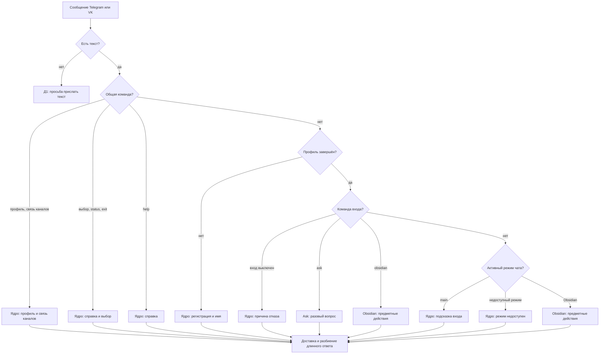

# Маршрут одного сообщения

Эта схема показывает общий путь сообщения. Подробные схемы и соответствующие
им тексты собраны вместе по функциональностям: [ядро](CORE.md),
[Ask](ASK.md), [Obsidian](OBSIDIAN.md). Общие дополнения находятся ниже.
Схемы описывают реализованное поведение на 22.10.2026; отдельные ветки
контекстного `/help` помечены как целевое поведение задачи.

Общие команды ядра обрабатываются перед активным режимом. Ask отвечает на
один вопрос и не меняет режим. Obsidian может сначала подтвердить приём,
а результат прислать позже в тот же чат. Telegram и VK получают готовый
ответ от общего обработчика и разбивают длинный текст при доставке.

## Как читать материалы

1. Начните с общего маршрута выше и откройте нужную функциональность.
2. Идите по стрелкам сценария согласно действию пользователя и состоянию.
3. Под схемой найдите метку ответа, условие и текущий текст.
4. Замечания к формулировке оставляйте с меткой, например «Т4б» или «Н9».

Результат LLM, Markdown статьи и другие данные пользователя не имеют конечного
набора фраз. Реестр фиксирует шаблон вокруг них и способ их подстановки.

## Ответ до входа в ядро

| ID | Когда пользователь его получает | Текущий текст | Целевой текст |
| --- | --- | --- | --- |
| Д1 | Сообщение без текста: вложение или другой нетекстовый тип. [Telegram](../../compadre_assistant/presentation/telegram/bot.py) и [VK](../../compadre_assistant/presentation/vk/bot.py) отвечают до передачи события ядру. | «Пришли текстовое сообщение или выбери возможность через `/help`.» | — |

## Подстановки и следующий шаг

| ID | Переменные данные | Следующий шаг пользователя |
| --- | --- | --- |
| Д1 | Нет. | Отправить текст или вызвать `/help`, чтобы выбрать возможность. |

## Самопроверка перед редактурой

После согласования формулировок нужно сопоставить записи реестра с каждым
`IncomingMessageResultType`, `ObsidianResultType`, прямым `IncomingResponse`,
`text_override`, `str(error)`, строкой descriptor и подписью
`ConfirmationAction`. Это позволит обнаружить пропущенный текст до изменения
кода. Сейчас реестр подготовлен как рабочий черновик для просмотра; отметка
«целевая» отсутствует у всех строк.

В таблицах `⏎` означает перевод строки, а `{…}` — значение,
подставляемое во время работы. Один ответ может состоять из нескольких строк.
Метки не задают порядок действий: `Т4б` — вариант ответа `Т4` при ошибке
загрузки статьи. Колонка «Целевой текст» пока не заполнена.
