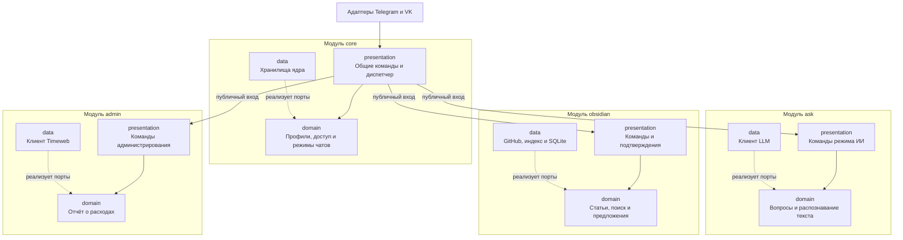

# План переработки меню

Выполнять этапы по порядку. После каждого проверить указанный результат.
[Список задач](TASKS.md) содержит исходные требования.

## 1. Удалить фоновый учёт вызовов ИИ

Проверить потребителей `ask_usage`, затем убрать фоновую запись и её
настройки. Сначала убрать этот код, чтобы не переносить его при переименовании.
Если потребуется удаление таблицы, определить судьбу накопленных данных и
порядок отдельной миграции по [правилам совместимости](../RELEASES.md#вывести-из-использования-поле-sqlite).
Применённые миграции сохранить.

**Проверить:** вопросы и распознавание фото работают без фоновой записи, а
`/llm_costs` по-прежнему получает статистику из Timeweb.

## 2. Переименовать модуль ИИ в `ai`

Переименовать пакет `ask` и связанные имена. Перед изменением внешних настроек
и сохранённых идентификаторов сверить действующую конфигурацию и миграции.
Сохранить команду входа `/ai` и команду вопроса `/ask`. Вместе с кодом
обновить импорты и тесты. Просмотреть всю документацию проекта, включая
[README.md](../../README.md), и обновить название модуля, пути и ссылки на
него, а также примеры и схемы, затронутые переименованием.

**Проверить:** вход и команды ИИ работают в Telegram и VK, а у существующих
профилей сохраняются доступ и активные режимы. В описаниях текущего
устройства используется `ai`, а обновлённые ссылки ведут к нужным файлам
и разделам.

## 3. Добавить `/settings` и сократить главное меню

Собрать настройки профиля, связь Telegram и VK и управление доступными
возможностями через публичные операции ядра. Обновить главное меню и
контекстную `/help` по согласованному [списку задач](TASKS.md).

**Проверить в обоих каналах:** регистрацию и привязку до входа в настройки,
видимость доступных возможностей, вход и выход, ввод и отмену, подтверждения
и ручной ввод команд. Проверить ограничения личного чата для `/admin`.

## 4. Обновить схему модулей и сгруппировать бэклог

Перерисовать [схему «Границы модулей»](../ARCHITECTURE.md#границы-модулей)
по эскизу ниже. Дать ядру и каждой возможности отдельную рамку со слоями
`presentation`, `domain` и `data`. Показать адаптеры каналов вне рамок и
различить передачу события через публичный вход и реализацию портов. Сверить
схему с кодом после этапов 1–3 и показать связи с CLI и внешними системами,
где они помогают понять границы. В эскизе используется `ask`. В итоговой
схеме использовать `ai` и добавить `settings`.

В [бэклоге](../BACKLOG.md) сверить ссылки и разделы в обе стороны, разобраться
с пунктом «Тарифы Ask» и расположить разделы по темам оглавления.

**Проверить:** схема отражает реализованные модули и связи, каждый раздел
задачи представлен в оглавлении, а каждая ссылка ведёт к своему разделу.

## 5. Добавить проверку ссылок Markdown в CI

Проверять относительные ссылки и якоря во всех Markdown-файлах проекта при
каждом PR. Сообщать файл, строку и причину ошибки. Проверка примеров CLI
остаётся задачей [бэклога](../BACKLOG.md#проверка-документации-в-ci).

**Проверить:** текущие документы проходят проверку, а удаление или переименование
заголовка даёт ошибку по ссылке, даже если файл со ссылкой не менялся.
