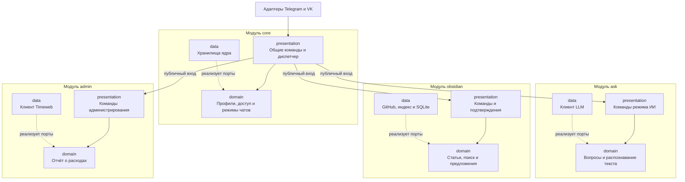

# План переработки меню

Выполнять этапы по порядку. После каждого проверить указанный результат.
[Список задач](TASKS.md) содержит исходные требования.

## 1. Удалить фоновый учёт вызовов ИИ

Проверить потребителей `ask_usage`, затем убрать фоновую запись и её
настройки. Сначала убрать этот код, чтобы не переносить его при переименовании.
Если потребуется удаление таблицы, определить судьбу накопленных данных и
порядок отдельной миграции по [правилам совместимости](../RELEASES.md#вывести-из-использования-поле-sqlite).
Применённые миграции сохранить.

**Проверить:** вопросы и распознавание фото работают без фоновой записи, а
`/llm_costs` по-прежнему получает статистику из Timeweb.

## 2. Переименовать модуль ИИ в `ai`

Переименовать пакет `ask` и связанные имена. Перед изменением внешних настроек
и сохранённых идентификаторов сверить действующую конфигурацию и миграции.
Сохранить команду входа `/ai` и команду вопроса `/ask`. Вместе с кодом
обновить импорты и тесты. Просмотреть всю документацию проекта, включая
[README.md](../../README.md), и обновить название модуля, пути и ссылки на
него, а также примеры и схемы, затронутые переименованием.

**Проверить:** вход и команды ИИ работают в Telegram и VK, а у существующих
профилей сохраняются доступ и активные режимы. В описаниях текущего
устройства используется `ai`, а обновлённые ссылки ведут к нужным файлам
и разделам.

## 3. Добавить `/settings` и сократить главное меню

Собрать настройки профиля, связь Telegram и VK и управление доступными
возможностями через публичные операции ядра. Обновить главное меню и
контекстную `/help` по согласованному [списку задач](TASKS.md).

**Проверить в обоих каналах:** регистрацию и привязку до входа в настройки,
видимость доступных возможностей, вход и выход, ввод и отмену, подтверждения
и ручной ввод команд. Проверить ограничения личного чата для `/admin`.

## 4. Обновить документацию по архитектуре

### Обновить схему модулей

Перерисовать [схему «Границы модулей»](../ARCHITECTURE.md#границы-модулей)
по эскизу ниже. Дать ядру и каждой возможности отдельную рамку со слоями
`presentation`, `domain` и `data`. Показать адаптеры каналов вне рамок и
различить передачу события через публичный вход и реализацию портов. Сверить
схему с кодом после этапов 1–3 и показать связи с CLI и внешними системами,
где они помогают понять границы. В эскизе используется `ask`. В итоговой
схеме использовать `ai` и добавить `settings`.

### Вынести подробности из общего обзора

В [ARCHITECTURE.md](../ARCHITECTURE.md) оставить новую схему модулей,
краткий путь сообщения, общие правила зависимостей и ссылки на профильные
документы. Кратко описать роль `settings` и дать ссылку на операции ядра.

Распределить технические подробности по файлам:

| Файл | Содержание |
| --- | --- |
| `docs/architecture/CORE.md` | Диспетчер, меню и справка, профили, доступ, режимы чатов, ожидания, кнопки, общие подтверждения и сборка зависимостей. |
| `docs/architecture/OBSIDIAN.md` | Подключение vault, синхронизация, индекс и поиск, обработка статьи, предложение и запись в GitHub. |
| `docs/architecture/AI.md` | Обработка вопросов и фото, контракты и зависимости модуля ИИ. |
| `docs/architecture/ADMIN.md` | Допуск к отчёту и получение статистики из Timeweb. |

В обзоре сослаться на существующие инструкции по [GitHub App](../GITHUB_APP.md),
[релизам](../RELEASES.md) и [эксплуатации](../OPERATIONS.md). Сценарии и тексты
ответов описывать в [реестрах пользовательских сообщений](../USER_MESSAGES.md).
Обновить входящие ссылки на перемещённые разделы, включая ссылки из
[карты кода](../CODE_MAP.md).

**Проверить:** схема совпадает с реализованными модулями, из обзора можно
найти подробности о каждом модуле, действующие правила сохранились, а ссылки
ведут к новым разделам.

## 5. Сгруппировать бэклог и добавить проверку ссылок в CI

1. Подготовить и запустить локально проверку относительных ссылок и якорей во
   всех Markdown-файлах проекта. Для каждой ошибки показать файл, строку и
   причину.
2. В [бэклоге](../BACKLOG.md) сверить ссылки и разделы в обе стороны,
   разобраться с пунктом «Тарифы Ask» и расположить разделы по темам
   оглавления. Исправить обнаруженные битые ссылки и повторить проверку.
3. Когда документация проходит проверку, подключить её к CI для каждого PR.

Проверка примеров CLI остаётся задачей
[бэклога](../BACKLOG.md#проверка-документации-в-ci).

**Проверить:** каждый раздел задачи представлен в оглавлении, каждая ссылка
ведёт к своему разделу, а все документы проходят проверку. Удаление или
переименование заголовка должно давать ошибку по ссылке, даже если файл со
ссылкой не менялся.

## 6. Выпустить, принять на production и закрыть функциональность

1. Подготовить изменения этапов 1–5 к слиянию и выпуску по
   [маршруту релиза](../RELEASES.md#маршрут-выпуска). Получить явное согласие
   пользователя перед `git push`.
2. Перед работой с VPS прочитать [правила production](../PRODUCTION.md).
   Установить принятый выпуск по [порядку выкладки](../OPERATIONS.md) и
   зафиксировать эксплуатационную приёмку в Telegram и VK. Проверить главное
   меню и `/settings`, входы в возможности, доступ к `/admin` и получение
   отчёта о расходах. При сбое действовать по инструкции возврата.
3. После приёмки перенести из этого каталога действующие правила, сценарии
   и ограничения, которых ещё нет в постоянной документации. Проверить
   полноту переноса и ссылки, затем отдельным завершающим изменением удалить
   временный каталог с планом и рабочими материалами. После удаления закрыть
   выполненные пункты бэклога.
4. После слияния всех PR проверить чистоту worktree и основной рабочей папки,
   обновить локальный `main` только быстрым переходом вперёд, архивировать
   worktree и завершить работу с веткой по
   [правилам проекта](../../AGENTS.md#рабочий-порядок).

**Проверить:** выпуск принят в обоих каналах, актуальная информация доступна
в постоянных документах, временный каталог удалён и выполненные задачи закрыты.
