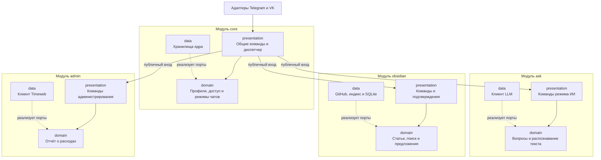

# Отложенные задачи

- Переименовать модуль `ask` и связанные названия в `ai`. Сохранить команду входа `/ai`.
- Удалить фоновую запись метаданных вызовов ИИ. Отчёт о расходах уже получает данные из Timeweb.
- Проверить в [бэклоге](../BACKLOG.md), есть ли у каждой ссылки в списке групп свой раздел и есть ли у каждого раздела ссылка из группы. Проверить в том числе пункт «Тарифы Ask», для которого сейчас нет раздела. Сгруппировать сами разделы по тем же темам, что и в списке.
- Добавить возможность `/settings` и сократить главное меню после регистрации.
  - На главной показать доступные входы `/ai`, `/obsidian`, `/settings` и `/admin` (только для доверенного профиля в личном чате).
  - В настройках собрать профиль (`/name` и сведения из `/status`), привязку Telegram и VK (`/link_code`, `/link`) и управление доступными возможностями (`/capabilities`, `/enable`, `/disable`). Настройки используют публичные операции ядра.
  - До регистрации показать `/register` и `/link`. Сохранить прямой ввод `/link <code>` в новом канале. Оставить `/start` и контекстную `/help` общими командами, показывать `/exit` в режиме, а `/cancel` и `/confirm` — при наличии соответствующего действия.
- Добавить [проверку документации в CI](../BACKLOG.md#проверка-документации-в-ci) для каждого PR. Проверять относительные ссылки и якоря во всех Markdown-файлах проекта, а аргументы отмеченных примеров CLI сверять с парсером приложения без запуска самих команд. В ошибке указывать файл, строку и причину.

## Обновить схему «Границы модулей»

В [разделе архитектуры](../ARCHITECTURE.md#границы-модулей) показать ядро и каждую возможность в своей рамке. Внутри каждой рамки явно обозначить слои `presentation`, `domain` и `data`. Адаптеры каналов показать вне рамок модулей. Отдельно обозначить передачу события через публичный вход возможности и реализацию портов внутри модуля.

Ниже выбранный эскиз. Он показывает структуру схемы. При переносе сверить названия, состав модулей и связи с кодом целевой версии, включая CLI и внешние зависимости, если они нужны для понимания границ.

