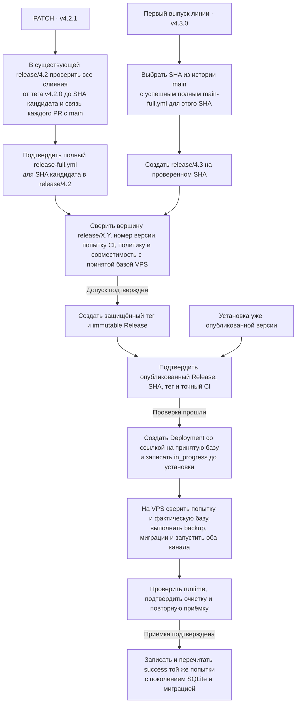

# Исправить выпуск PATCH и сократить чтения GitHub

План от 19.11.2026. Отправная точка — [задача бэклога](../BACKLOG.md#исправить-patch-выпуск-из-main-и-измерить-запросы-к-github-api). Действующие процедуры — [выпуски](../RELEASES.md), [эксплуатация](../OPERATIONS.md) и [метрики](../DEPLOY_METRICS.md).

## Подготовить кандидата и выложить обычный выпуск

Целевая схема Deployment v2. Для примера PATCH повышает версию с `v4.2.0` до `v4.2.1`, а первый выпуск новой линии получает номер `v4.3.0`. В обоих случаях workflow публикации запускается из защищённой `main`.

**Граница общей выкладки** — опубликованный Release прошёл сверку с тегом, запрошенным SHA и закреплённой попыткой CI. Дальше создание Deployment, установка, приёмка и восстановление одинаковы для обеих линий. Предыдущий тег PATCH определяет только диапазон исправлений. Для проверки совместимости обоих выпусков используется последняя принятая установка VPS.

## Провести один PATCH

Пример: D17 подтверждает установленную v4.2.0. Оператор запускает Production release из защищённой main для v4.2.1 и указывает полный SHA вершины release/4.2. Рабочий код runner взят из main. Предыдущий тег линии определяет диапазон исправлений, а D17 определяет установленную базу совместимости.

1. Runner через GitHub API сверяет вершину release/4.2 и проходит по первым родителям кандидата до предыдущего тега линии. Для каждого слияния подтверждает релизный PR и слитый PR в main либо достижимый Hotfix-Main-Commit. Проверяет полный CI точного SHA, попытку, доказательство совместимости SQLite, актуальную приёмку и policy pin. Перед записью повторяет проверки изменяемых условий. Создаёт защищённый тег и immutable Release. Ручная публикация дополнительно требует чистого checkout точного SHA.
2. Runner проверяет готовый Release. До SSH создаёт D18 для этой попытки установки. В payload формата v2 сохраняет версию схемы, ключ попытки, версию и SHA кандидата, тип выпуска, Release ID, CI run/attempt и ссылку непосредственно на принятую базу D17 (SHA, Deployment ID и status ID из допуска). Добавляет in_progress. Повтор той же попытки использует D18.
3. Контроллер VPS под блокировкой проверяет владельца попытки, репозиторий, окружение, задачу, SHA, актуальность D18 и совпадение ссылки на D17 с базой из тега. Проверяет доверенный success D17 и фактический last_good на сервере. Выполняет штатные проверки, backup, миграции, переключение SQLite и запуск обоих каналов. Перед переключением перепроверяет изменяемые условия.
4. Runner подтверждает установленный runtime и очистку старого поколения. В статусе success D18 сохраняет результат свежей приёмки. Предлагаемый формат description: `v1 gen=<32 hex> migration=<имя>`. Проверить алфавит, предельную длину 140 символов и представимость имени до установки. Точное поколение и миграцию сверить после установки. После POST перечитать результат. Новый CI использует D18.

**Новое правило выбора.** Для v2 смотрим последнюю созданную попытку production. Это меняет исходное правило бэклога о максимальном времени success по всей истории. Успех выбирает саму запись. Подтверждённый возврат после неудачной попытки указывает прямо на последнюю принятую базу. Незавершённость, неоднозначность, неизвестный статус или недоверенный автор закрывают новый допуск. Выделить production для записей этого контракта или закрывать допуск при посторонней записи. При явной новой установке прежнего SHA нужен новый Deployment; разрешение downgrade и совместимость данных требуют отдельного допуска.

## Продолжить после обрыва

| Момент обрыва | Действие после сверки GitHub и VPS |
| --- | --- |
| Тег создан, Release отсутствует | Сохранить действующую процедуру ручного разбора занятого имени. |
| Release готов, ответ создания D18 потерян | Под общей блокировкой проверить последнюю попытку и устойчивый ключ. При совпадении продолжить её; при неопределённом результате остановиться до сверки. |
| У D18 нет статуса либо стоит in_progress | Новая попытка ждёт. Resume проверяет состояние контроллера: начать установку только при доказанном отсутствии старта, продолжить восстановление по сохранённому этапу либо подтвердить уже установленный runtime. |
| Достоверно подтверждён возврат на D17 | Завершить D18 статусом failure с проверяемым результатом возврата. Только в этом случае разрешить выбор D17 по прямой ссылке. При неясном runtime продолжать восстановление. |
| Потерян ответ после очистки или записи success | Перечитать статус и свежую приёмку того же runtime. Подтвердить уже выполненное либо завершить отсутствующий шаг. |

## Реализовать и принять по этапам

### Этап 1. Зафиксировать исходный расход

На уровне HTTP считать попытки, страницы, ошибки и суммарное время по этапу и месту выполнения (runner/VPS); загрузку из хранилища после редиректа учитывать отдельно. Сохранять агрегаты без URL с параметрами, токенов и тел. На одинаковых фикстурах измерить первую публикацию, установку готового Release, resume и отказ при разных SHA. Для сопоставимого успешного исходного маршрута дать старому публикатору требуемый checkout. Критерий — воспроизводимая таблица с условиями измерения.

Замер, команда воспроизведения и охват зафиксированы в [исходном расходе HTTP](BASELINE.md).

| Шаг | Проверяемый результат | Рекомендуемая модель |
| --- | --- | --- |
| 1. Измерить обращения HTTP-клиентов | Страницы, ошибки и скачивание после редиректа учтены без записи чувствительных данных. | 6.2 Sol (высокий) |
| 2. Подключить отчёты runner и VPS | Агрегаты доступны при успехе и отказе; сохранены выходные контракты. | 6.2 Astra (средний) |
| 3. Воспроизвести исходные сценарии | Таблица для четырёх сценариев разделяет runner, VPS и storage; указаны параметры фикстур и условия замера. | 6.2 Astra (средний) |

### Этап 2. Исправить PATCH отдельно

Изменить publish_release и check_hotfix_pairs, передавать уже выбранный результат CI внутри одной подготовки. Кешировать родителей и список миграций по неизменяемому SHA. Интеграция через release_production с настоящим публикатором, подменены только внешние сервисы. Разные SHA и два merge проходят до установки; сдвиг вершины, неполная история, неверная связь или CI блокируют публикацию. Проверить ручной путь, аварийный контракт и готовый Release.

[Повторный замер и условия интеграции](BASELINE.md#сравнить-расход-после-исправления-patch) фиксируют результат этапа.

| Шаг | Проверяемый результат | Рекомендуемая модель |
| --- | --- | --- |
| 1. Разделить проверки истории PATCH и локального checkout | Обход по первым родителям через GitHub проверяет каждый merge. Ручной и аварийный пути сохраняют свои условия допуска. | 6.2 Astra (средний) |
| 2. Подключить публикатор из main | Подготовка использует выбранную попытку CI и кеш по SHA. Изменяемые условия проверяются повторно до записи. | 6.2 Astra (средний) |
| 3. Проверить путь от workflow до установки | Две пары PR проходят при разных SHA. Ошибочный допуск останавливает запись и SSH. Счётчики сопоставлены с этапом 1. | 6.2 Sol (высокий) |

### Этап 3. Подготовить читателей v1/v2

Реализовать разбор статуса, быструю выборку свежей попытки и проверку предыдущей по ID. Зафиксировать точные API-вызовы, проверку числового status ID, доверенного автора, равных времён и неполных ответов; использовать ограниченное число записей даже для истории статусов. Проверить права реальных типов токенов CI и VPS. Сверить старые теги, отчёты CI поддерживаемых линий и исторические приёмки. Писатель пока выпускает v1. Однократно при переходе выбрать стартовую базу по старому правилу, сверить с VPS и исключить гонку с выпуском.

| Шаг | Проверяемый результат | Рекомендуемая модель |
| --- | --- | --- |
| 1. Найти последнюю попытку и текущий статус | Отсортированная выборка GraphQL и ограниченные чтения REST дают проверенные числовые ID. Неоднозначный или неполный ответ закрывает допуск. | 6.2 Astra (средний) |
| 2. Подключить чтение v2 и ссылку на принятую базу | CI и контроллер понимают оба формата. Проверены смешанная история, повтор SHA, возврат и стоимость чтения. | 6.2 Sol (высокий) |
| 3. Проверить совместимость и права | Проверены исторические записи и доступ читателей. Описан порядок сверки стартовой базы под блокировкой. Для CI зафиксирован результат с реальным токеном workflow. | 6.2 Sol (высокий) |

[Контракт читателя](READERS.md) описывает ограниченные запросы, формат результата, условия возврата и порядок включения в закреплённом CI и контроллере.

### Этап 4. Связать runner, resume и контроллер

Реализовать ранний D18, владение попыткой, общий запрет параллельных установок, переходы статусов и повтор после потери ответа. Обновить ограниченный SSH-контракт и controller snapshot. Проверить все строки таблицы обрывов, повтор одного SHA, устаревший runner, отказ при неподтверждённом возврате и несовместимом контроллере. До включения писателя v2 проверить все читатели, доверенный CI harness и policy pin.
### Этап 5. Проверить экономию и включить v2

Сравнить до/после на одинаковых PATCH, числе PR и объёме истории; отдельно проверить 16 и 1000 Deployment при фиксированном PATCH. Критерий — число HTTP-чтений выбора базы одинаково при обоих объёмах. Показать отдельно весь runner, VPS, чтение базы, новые записи и время. При 16 записях прежние три обхода списков стоят 51 запрос при одной странице на список; это ориентир, не замер полной выкладки. Перед работой на VPS применить [правила production](../PRODUCTION.md). В согласованное окно сначала обновить и проверить snapshot, затем включить писатель; зафиксировать живой PATCH, Release, D18, точный runtime и фактические метрики. При проблемах закрыть новые попытки, завершить открытую и сохранить чтение v2 при откате писателя.
### Этап 6. Закрыть функциональность

После приёмки обновить схему маршрута в [RELEASES.md](../RELEASES.md) по общей схеме выше, сверив её с реализованным процессом. Критерий переноса: в постоянном документе видны обе ветви подготовки, их источники полного CI, точка перехода к общей выкладке и путь до подтверждённого success. Перенести действующий контракт, команды восстановления и результаты в профильные документы. Проверить полноту переноса и ссылки, удалить временный каталог отдельным завершающим изменением, затем закрыть задачу бэклога. После слияния завершить работу с веткой и worktree по [правилам проекта](../../AGENTS.md).

Выполнять этапы по порядку. При команде «выполняй план поэтапно» применяется цикл из AGENTS.md: один субагент на этап, проверка шагов до правок, отдельный русский коммит и приёмка каждого шага.
