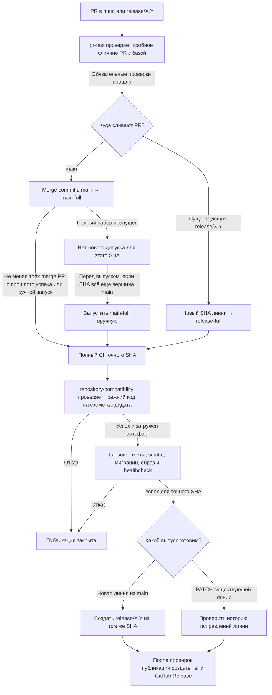
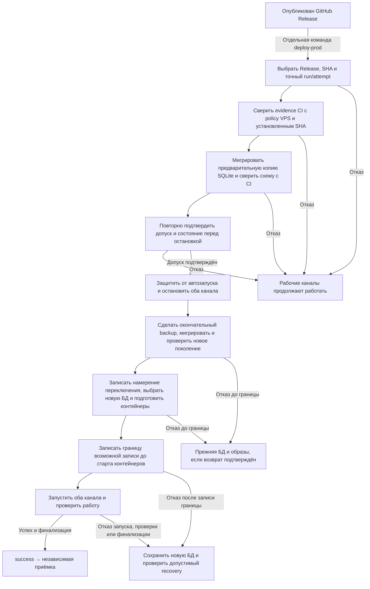

# Как CI допускает выпуск и как VPS переключает SQLite

Этот разбор помогает пройти путь от PR до установки и понять, почему один и тот
же коммит может быть готов к публикации, но ещё не допущен на конкретный VPS.
Здесь показан обычный выпуск. Условия допуска описаны в [RELEASES.md](../RELEASES.md),
команды и аварийный маршрут — в [OPERATIONS.md](../OPERATIONS.md).

## Пройти CI от PR до публикации

Для PR в `release/*` обязателен ещё `hotfix-deps`. Зелёный `pr-fast`
позволяет двигаться к merge, а для публикации нужен успешный полный CI
конкретного коммита после merge. Зелёный контроллер с пропущенным `full-suite`
нового допуска не даёт. При создании линии на проверенном SHA из `main`
используется уже прошедший `main-full` этого SHA.
Контроллер переиспользует уже успешный полный прогон того же SHA. Если
предыдущая полная попытка этого SHA не прошла, нужен явный rerun.

Оба полных workflow получают предыдущий SHA из reviewed policy, закреплённой
переменной `COMPATIBILITY_POLICY_SHA`. `repository-compatibility` проверяет
прежний код на мигрированной тестовой БД кандидата. В артефакт попадают точная
пара коммитов, отчёты тестов и fingerprint схемы. Fingerprint — контрольный
отпечаток структуры SQLite, с которым сервер сравнит схему своей копии.
GitHub Release фиксирует SHA кандидата и ссылку на конкретный run/attempt.

## Проверить допуск на VPS и переключить SQLite

Эта схема восстанавливает схему переключения из [плана прошлого выпуска](https://github.com/karateka-git/compadre-assistant/blob/cc5077160243ceb69f3ced7a35b7ccc9ded50791/docs/ci-release-review/PLAN.md)
по действующей реализации SQLite v2. На VPS установка начинается отдельной
командой `deploy-prod`.

Селектор выпуска читает GitHub Release, тег, ветку и закреплённый результат
полного CI. `verifier` (`verify_evidence`) проверяет, что результат относится
к нужному workflow, SHA, run/attempt и обязательным jobs. Он сверяет проверенную
policy и байты workflow, прежний immutable Release/tag и установленный SHA,
проверяет происхождение, срок, хеш и содержимое артефакта. Проверка мигрированной
копии на VPS идёт отдельным шагом после получения evidence.

Предварительная копия проверяет применимость миграций к рабочей схеме, пока
боты ещё работают. Окончательный снимок делают после остановки обоих каналов,
чтобы в новом поколении были и записи, поступившие во время предварительной
проверки. Если новый бот успел записать сообщение № 101 и затем упал, возврат
на прежнюю БД с 100 сообщениями потерял бы запись. Поэтому после сохранения
границы возможной записи остаётся новая БД. Возврат прежнего кода на неё
требует подтверждённого допуска совместимости. Подробные варианты recovery
разбираются в [пункте 2 плана](PLAN.md).

## Пройти пример v3.2.0

1. Для кандидата `cabc0e24…` прошёл полный
   [main-full 42249037867/1](https://github.com/karateka-git/compadre-assistant/actions/runs/42249037867/attempts/1).
   На том же SHA создали `release/3.2`, затем опубликовали
   [v3.2.0](https://github.com/karateka-git/compadre-assistant/releases/tag/v3.2.0).
2. Сервер переходил с v3.1.0 на v3.2.0. Исходный `deploy-prod` прошёл до
   финализации, где завершился `degraded`. Forward recovery завершил тот же
   выпуск на уже выбранной новой БД. [Итог установки](../RELEASE_REVIEW.md)
3. После отмены ротации базы новый полный CI снова проверял совместимость с
   v3.1.0 при установленной v3.2.0. Это пример зелёного CI, который не давал
   допуска к следующей установке на этом VPS. [Снимок состояния](../PRODUCTION.md)

Следующий шаг пункта 1 — разобрать каждую проверку `verifier` по входу,
источнику и причине отказа, затем посчитать GitHub-запросы на обычном пути и
при повторной сверке. Отдельно нужны примеры для несовпадения базы, отказа
доступа (403) и недоступности GitHub. Пример v3.2.0 основан на сохранённом
отчёте выпуска. Актуальные настройки GitHub и состояние VPS требуют свежей сверки.

После разбора сохранить схему CI в постоянной документации выпуска, а схему
переключения SQLite — рядом с порядком установки в эксплуатационной
документации. Проверить обе схемы перед удалением рабочего каталога в пункте 7.
