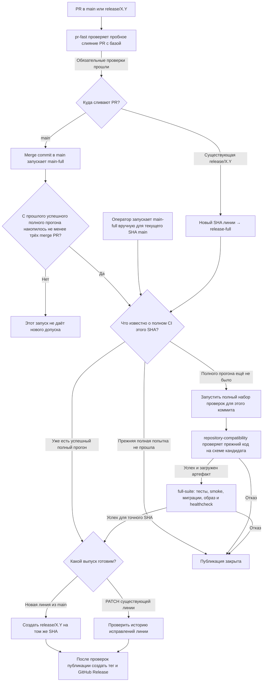
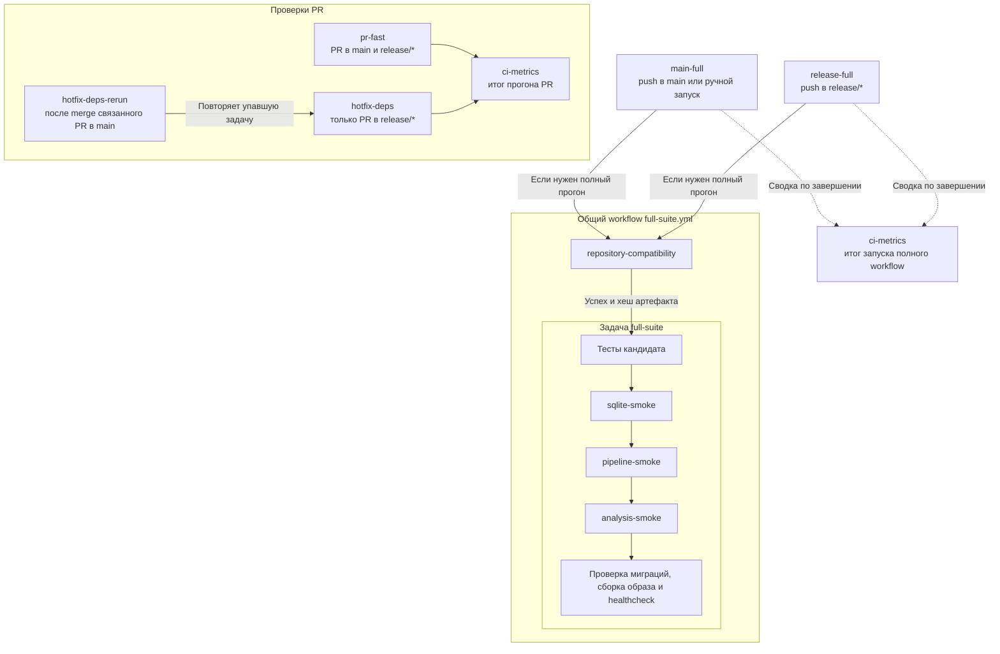
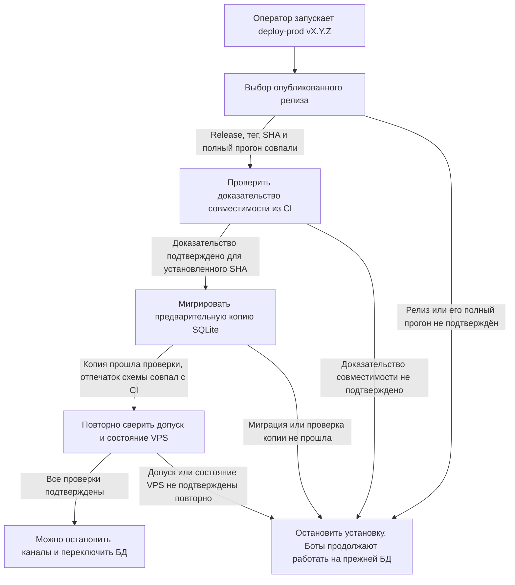
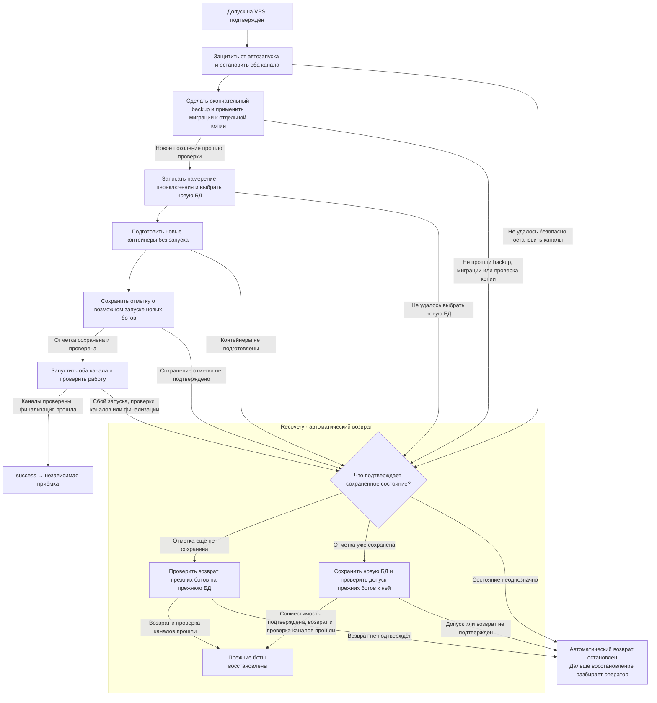

# Как CI допускает выпуск и как VPS переключает SQLite

Этот разбор помогает пройти путь от PR до установки и понять, почему один и тот
же коммит может быть готов к публикации, но ещё не допущен на конкретный VPS.
Здесь показан обычный выпуск. Условия допуска описаны в [RELEASES.md](../RELEASES.md),
команды и аварийный маршрут — в [OPERATIONS.md](../OPERATIONS.md).

## Пройти CI от PR до публикации

Для PR в `release/*` обязателен ещё `hotfix-deps`. Зелёный `pr-fast`
позволяет двигаться к merge, а для публикации нужен успешный полный CI
конкретного коммита после merge. Зелёный контроллер с пропущенным `full-suite`
нового допуска не даёт. Перед выпуском можно отдельно запустить `main-full`
вручную. Такой запуск пропускает проверку порога в три PR, но по-прежнему
проверяет текущую вершину `main` и результаты полного CI этого SHA.
Если `main` сдвинулся, ручной запуск проверит новую вершину. При создании
линии на проверенном SHA из `main` используется уже прошедший `main-full`.
Если полная попытка этого же SHA не прошла, для повторной проверки нужен
`rerun` той попытки.

При полном прогоне GitHub Actions берёт конкретный коммит по его SHA,
проверяет совместимость прежнего кода со схемой этого кандидата, затем
запускает тесты, миграции, сборку и healthcheck образа кандидата. Результат
относится к этому коммиту. Следующий коммит получает собственный SHA и
требует собственного допуска.

Оба полных workflow получают предыдущий SHA из reviewed policy, закреплённой
переменной `COMPATIBILITY_POLICY_SHA`. `repository-compatibility` проверяет
прежний код на мигрированной тестовой БД кандидата. В артефакт попадают точная
пара коммитов, отчёты тестов и fingerprint схемы. Fingerprint — контрольный
отпечаток структуры SQLite, с которым сервер сравнит схему своей копии.
GitHub Release фиксирует SHA кандидата и ссылку на конкретный run/attempt.

## Понять проверки CI

### Как связаны проверки

`main-full` и `release-full` вызывают один и тот же `full-suite.yml`, когда
нужен полный прогон. Сначала выполняется задача `repository-compatibility`,
затем задача `full-suite`. Различаются события запуска, целевые ветки и правила
решения о прогоне. Например, при создании `release/X.Y` на уже проверенном
SHA контроллер `release-full` сверяет результат `main-full` для этого коммита.
`ci-metrics` собирает итог запуска, в том числе когда полный набор пропущен.

`hotfix-deps-rerun` запускается по событию в `main` и повторяет уже
существующую задачу `hotfix-deps` в прогоне связанного PR. Слияние PR в
`main` само по себе не создаёт события для открытого PR в `release/*`.
При ручном повторе той же задачи оператор выполняет действие, которое
`hotfix-deps-rerun` автоматизирует.

### Что проверяют задачи и команды

| Имя в GitHub Actions | Когда работает | Что проверяет и что даёт результат |
| --- | --- | --- |
| [`pr-fast`](../../.github/workflows/pr-fast.yml) | При событиях PR в `main` и `release/*`. | Проверяет пробное слияние PR с базой: синтаксис Python, отслеживаемые файлы, миграции, ссылки связанных hotfix PR, короткий набор тестов и конфигурацию Compose. Обязательная проверка для merge. |
| [`hotfix-deps`](../../.github/workflows/pr-fast.yml) | Отдельная задача в том же workflow для PR в `release/*`. | Проверяет, что связанный PR уже слит в `main` или что указанный коммит входит в историю `main`. Обязательная проверка для merge в релизную линию. |
| [`hotfix-deps-rerun`](../../.github/workflows/hotfix-deps-rerun.yml) | После слияния PR в `main`. | Для связанных открытых hotfix PR повторно запускает актуальную задачу `hotfix-deps`, если она завершилась ошибкой и основание в `main` теперь подтверждено. |
| [`main-full`](../../.github/workflows/main-full.yml) | После push в `main` или по ручному запуску. | Контроллер решает, нужен ли полный прогон, и определяет базу совместимости. Успешный полный прогон точного SHA нужен для новой релизной линии. |
| [`release-full`](../../.github/workflows/release-full.yml) | После push в `release/*`. | Для нового SHA существующей линии контроллер запускает полный набор, если нужен новый прогон. При создании линии контроллер сверяет успешный `main-full` того же SHA. |
| [`repository-compatibility`](../../.github/workflows/full-suite.yml) | Первый job полного набора. | Проверяет прежний код на схеме кандидата для точной пары SHA и сохраняет отчёты и отпечаток схемы. `full-suite` требует успеха этой задачи и хеша её артефакта. |
| [`full-suite`](../../.github/workflows/full-suite.yml) | После успешной проверки совместимости. | Сверяет SHA, запускает все unit-тесты, три автономных smoke-проверки (SQLite, pipeline, analysis), проверяет миграции на свежей и прежней тестовых БД, собирает образ и проверяет его healthcheck. |
| `sqlite-smoke` | Первая smoke-команда в `full-suite`, после unit-тестов. | Применяет миграции на временной БД и проверяет запись и чтение статьи. |
| `pipeline-smoke` | Вторая smoke-команда в `full-suite`. | Проверяет обработку статьи на временной БД с подставными загрузчиком HTML и извлекателем текста. |
| `analysis-smoke` | Третья smoke-команда в `full-suite`, перед отдельной проверкой миграций. | Проверяет анализ статьи на временной БД с подставным LLM-анализатором. |
| `ci-metrics` | После проверок PR или полного CI, в том числе при отказах и пропусках. | Собирает время и результаты задач и шагов. Это сводка измерений. Решение о допуске принимается по обязательным задачам и шагам. |

Smoke — короткая проверка целого сценария. Все три команды выполняются по
порядку внутри одного шага `Run three autonomous smoke checks`. В интерфейсе
GitHub Actions они видны в журнале этого шага.
[Описание smoke-команд](../RUN.md#7-проверить-sqlite-контур)

## Проверить допуск на VPS

Оператор запускает `deploy-prod vX.Y.Z` с конкретной версией. Контроллер
находит опубликованный Release этой версии и выполняет проверки до остановки
ботов. Если любой шаг отклонён, установка заканчивается до переключения БД.

| Если проверка не прошла | Что это означает |
| --- | --- |
| Выбор релиза | Например, тег указывает на другой SHA или закреплённая попытка CI не подтверждает этот коммит. |
| Доказательство совместимости | Например, CI проверил переход с v3.1.0, а VPS уже работает на v3.2.0, или артефакт недоступен. |
| Предварительная копия | Миграция не прошла, проверка обнаружила проблему с данными или схема копии отличается от проверенной CI. |
| Повторная сверка | Пока проверяли копию, изменились условия, на которых был выдан допуск, или их больше нельзя подтвердить. |

Селектор выпуска читает GitHub Release, тег, ветку и закреплённый результат
полного CI. `verifier` (`verify_evidence`) проверяет, что результат относится
к нужному workflow, SHA, run/attempt и обязательным jobs. Он сверяет проверенную
policy и байты workflow, прежний immutable Release/tag и установленный SHA,
проверяет происхождение, срок, хеш и содержимое артефакта. Проверка мигрированной
копии на VPS идёт отдельным шагом после получения evidence.

## Переключить поколение SQLite

Здесь восстановлена схема из [плана прошлого выпуска](https://github.com/karateka-git/compadre-assistant/blob/cc5077160243ceb69f3ced7a35b7ccc9ded50791/docs/ci-release-review/PLAN.md)
по действующему протоколу переключения поколений БД (v2).

В рамке recovery показан автоматический возврат после сбоя установки.
Контроллер определяет, с какой БД можно безопасно работать, и пытается
вернуть прежних ботов. Если безопасный возврат подтвердить не удалось,
дальнейшее восстановление планирует оператор. Один из таких путей —
forward recovery, при котором оператор завершает установку новой версии
на уже выбранной новой БД при выполнении условий процедуры.

После выбора нового файла контроллер ещё может вернуться к прежней БД,
если сохранённое состояние подтверждает, что отметки о возможном запуске нет.
После сохранения отметки остаётся новая БД, даже если команда запуска
завершилась ошибкой.

Предварительная копия проверяет применимость миграций к рабочей схеме, пока
боты ещё работают. Окончательный снимок делают после остановки обоих каналов,
чтобы в новом поколении были и записи, поступившие во время предварительной
проверки. Если новый бот успел записать сообщение № 101 и затем упал, возврат
на прежнюю БД с 100 сообщениями потерял бы запись. Поэтому после сохранения
границы возможной записи остаётся новая БД. Возврат прежнего кода на неё
требует подтверждённого допуска совместимости. Подробные варианты recovery
разбираются в [пункте 2 плана](PLAN.md).

## Пройти пример v3.2.0

1. Для кандидата `cabc0e24…` прошёл полный
   [main-full 42249037867/1](https://github.com/karateka-git/compadre-assistant/actions/runs/42249037867/attempts/1).
   На том же SHA создали `release/3.2`, затем опубликовали
   [v3.2.0](https://github.com/karateka-git/compadre-assistant/releases/tag/v3.2.0).
2. Сервер переходил с v3.1.0 на v3.2.0. Исходный `deploy-prod` прошёл до
   финализации, где завершился `degraded`. Forward recovery завершил тот же
   выпуск на уже выбранной новой БД. [Итог установки](../RELEASE_REVIEW.md)
3. После отмены ротации базы новый полный CI снова проверял совместимость с
   v3.1.0 при установленной v3.2.0. Это пример зелёного CI, который не давал
   допуска к следующей установке на этом VPS. [Снимок состояния](../PRODUCTION.md)

Следующий шаг пункта 1 — разобрать каждую проверку `verifier` по входу,
источнику и причине отказа, затем посчитать GitHub-запросы на обычном пути и
при повторной сверке. Отдельно нужны примеры для несовпадения базы, отказа
доступа (403) и недоступности GitHub. Пример v3.2.0 основан на сохранённом
отчёте выпуска. Актуальные настройки GitHub и состояние VPS требуют свежей сверки.

После разбора сохранить схему CI в постоянной документации выпуска, а схему
переключения SQLite — рядом с порядком установки в эксплуатационной
документации. Проверить обе схемы перед удалением рабочего каталога на
завершающем этапе плана.
