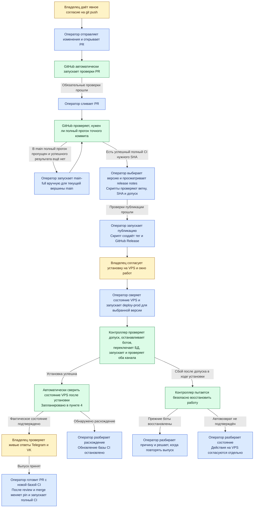
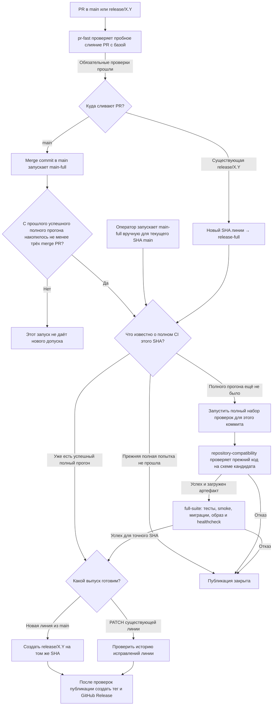
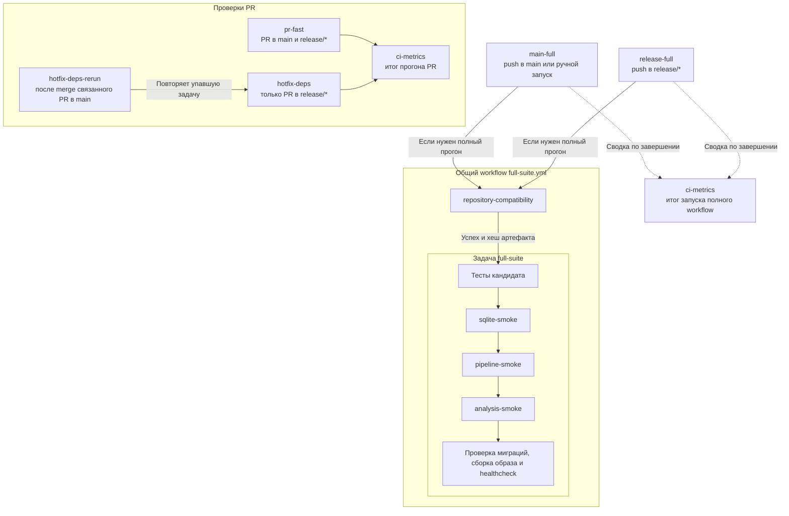
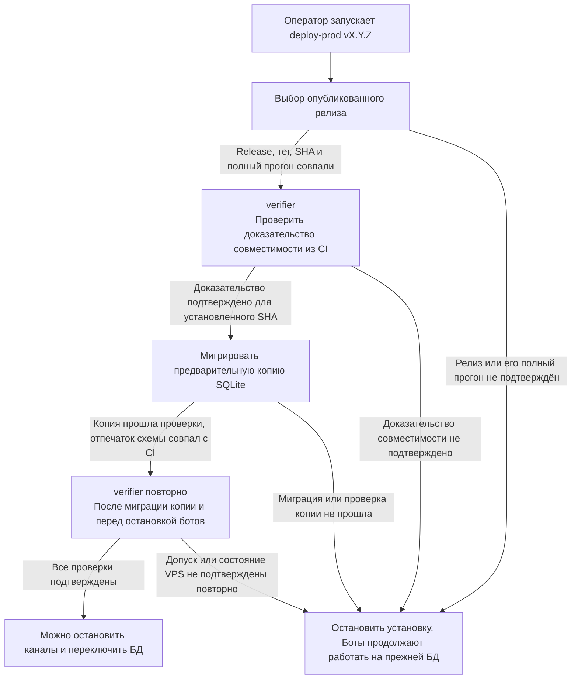
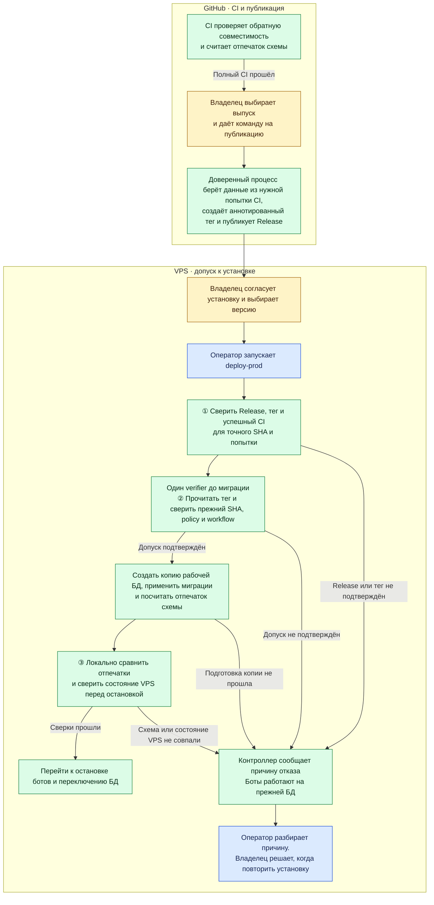
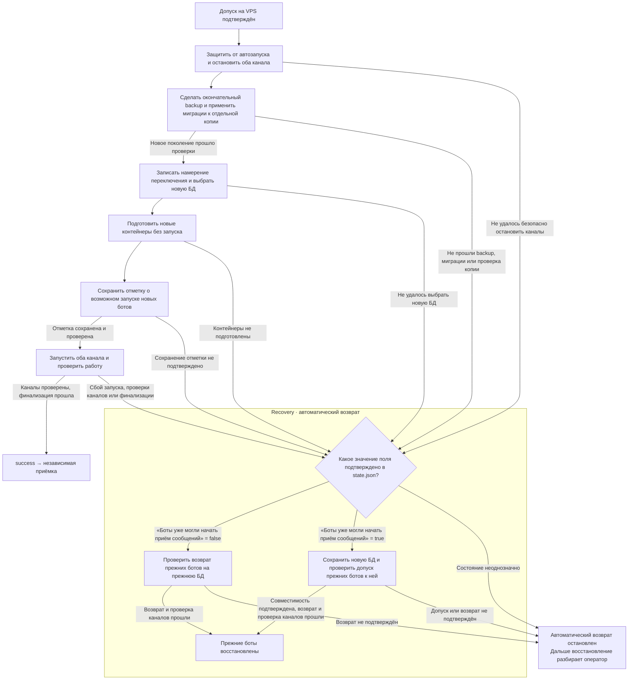

# Как CI допускает выпуск и как VPS переключает SQLite

Этот разбор помогает пройти путь от PR до установки и понять, почему один и тот
же коммит может быть готов к публикации, но ещё не допущен на конкретный VPS.
Здесь показан обычный выпуск. Условия допуска описаны в [RELEASES.md](../RELEASES.md),
команды и аварийный маршрут — в [OPERATIONS.md](../OPERATIONS.md).
Согласованные изменения показаны отдельно в
[целевой схеме допуска](#целевая-схема-допуска-в-пункте-4).

До переноса в постоянную документацию обновляем схемы и пояснения здесь
вместе с каждым изменением описанной логики. Запланированное поведение
помечаем отдельно от действующего.

## Кто выполняет каждый шаг выпуска

Схема показывает порядок обычного выпуска и отмечает запланированную
автоматическую сверку после установки. Оператором может быть человек или
Codex с нужным доступом. Владелец даёт согласие там, где этого требуют
правила проекта, и проверяет живые ответы ботов.

Жёлтые блоки — участие владельца, синие — действия оператора, зелёные —
автоматика. Codex может подготовить версию и release notes, сверить результаты
CI, выполнить проверки без записи и провести техническую приёмку с нужным
доступом. Решение нужно, если версия, состав выпуска или действие при сбое
не определены. Обязательные проверки PR и действия контроллера после запуска
`deploy-prod` выполняются автоматически.

Сверку состояния VPS после установки пока выполняет оператор. В [пункте 4
плана](PLAN.md) её автоматизируем: сверим SHA, `last_good`, выбранную БД,
оба канала и backup timer. Проверка живых ответов остаётся отдельным шагом
владельца.

При новой релизной линии оператор также создаёт `release/X.Y` на проверенном
SHA и публикует ветку после разрешения записи. Если CI завершился отказом,
оператор разбирает результат до публикации. Если отказал допуск на VPS,
команда завершается до остановки каналов. Обновление установленного
контроллера, когда оно требуется, отдельно согласуют перед установкой.
Порядок ручных шагов приведён в [OPERATIONS.md](../OPERATIONS.md#подготовка-и-запуск-версии).

## Пройти CI от PR до публикации

Для PR в `release/*` обязателен ещё `hotfix-deps`. Зелёный `pr-fast`
позволяет двигаться к merge, а для публикации нужен успешный полный CI
конкретного коммита после merge. Зелёный контроллер с пропущенным `full-suite`
нового допуска не даёт. Перед выпуском можно отдельно запустить `main-full`
вручную. Такой запуск пропускает проверку порога в три PR, но по-прежнему
проверяет текущую вершину `main` и результаты полного CI этого SHA.
Если `main` сдвинулся, ручной запуск проверит новую вершину. При создании
линии на проверенном SHA из `main` используется уже прошедший `main-full`.
Если полная попытка этого же SHA не прошла, для повторной проверки нужен
`rerun` той попытки.

При полном прогоне GitHub Actions берёт конкретный коммит по его SHA,
проверяет совместимость прежнего кода со схемой этого кандидата, затем
запускает тесты, миграции, сборку и healthcheck образа кандидата. Результат
относится к этому коммиту. Следующий коммит получает собственный SHA и
требует собственного допуска.

Оба полных workflow получают предыдущий SHA из reviewed policy, закреплённой
переменной `COMPATIBILITY_POLICY_SHA`. `repository-compatibility` проверяет
прежний код на мигрированной тестовой БД кандидата. В артефакт попадают точная
пара коммитов, отчёты тестов и fingerprint схемы. Fingerprint — контрольный
отпечаток структуры SQLite, с которым сервер сравнит схему своей копии.
GitHub Release фиксирует SHA кандидата и ссылку на конкретный run/attempt.

## Понять проверки CI

### Как связаны проверки

`main-full` и `release-full` вызывают один и тот же `full-suite.yml`, когда
нужен полный прогон. Сначала выполняется задача `repository-compatibility`,
затем задача `full-suite`. Различаются события запуска, целевые ветки и правила
решения о прогоне. Например, при создании `release/X.Y` на уже проверенном
SHA контроллер `release-full` сверяет результат `main-full` для этого коммита.
`ci-metrics` собирает итог запуска, в том числе когда полный набор пропущен.

`hotfix-deps-rerun` запускается по событию в `main` и повторяет уже
существующую задачу `hotfix-deps` в прогоне связанного PR. Слияние PR в
`main` само по себе не создаёт события для открытого PR в `release/*`.
При ручном повторе той же задачи оператор выполняет действие, которое
`hotfix-deps-rerun` автоматизирует.

### Что проверяют задачи и команды

| Имя в GitHub Actions | Когда работает | Что проверяет и что даёт результат |
| --- | --- | --- |
| [`pr-fast`](../../.github/workflows/pr-fast.yml) | При событиях PR в `main` и `release/*`. | Проверяет пробное слияние PR с базой: синтаксис Python, отслеживаемые файлы, миграции, ссылки связанных hotfix PR, короткий набор тестов и конфигурацию Compose. Обязательная проверка для merge. |
| [`hotfix-deps`](../../.github/workflows/pr-fast.yml) | Отдельная задача в том же workflow для PR в `release/*`. | Проверяет, что связанный PR уже слит в `main` или что указанный коммит входит в историю `main`. Обязательная проверка для merge в релизную линию. |
| [`hotfix-deps-rerun`](../../.github/workflows/hotfix-deps-rerun.yml) | После слияния PR в `main`. | Для связанных открытых hotfix PR повторно запускает актуальную задачу `hotfix-deps`, если она завершилась ошибкой и основание в `main` теперь подтверждено. |
| [`main-full`](../../.github/workflows/main-full.yml) | После push в `main` или по ручному запуску. | Контроллер решает, нужен ли полный прогон, и определяет базу совместимости. Успешный полный прогон точного SHA нужен для новой релизной линии. |
| [`release-full`](../../.github/workflows/release-full.yml) | После push в `release/*`. | Для нового SHA существующей линии контроллер запускает полный набор, если нужен новый прогон. При создании линии контроллер сверяет успешный `main-full` того же SHA. |
| [`repository-compatibility`](../../.github/workflows/full-suite.yml) | Первый job полного набора. | Проверяет прежний код на схеме кандидата для точной пары SHA и сохраняет отчёты и отпечаток схемы. `full-suite` требует успеха этой задачи и хеша её артефакта. |
| [`full-suite`](../../.github/workflows/full-suite.yml) | После успешной проверки совместимости. | Сверяет SHA, запускает все unit-тесты, три автономных smoke-проверки (SQLite, pipeline, analysis), проверяет миграции на свежей и прежней тестовых БД, собирает образ и проверяет его healthcheck. |
| `sqlite-smoke` | Первая smoke-команда в `full-suite`, после unit-тестов. | Применяет миграции на временной БД и проверяет запись и чтение статьи. |
| `pipeline-smoke` | Вторая smoke-команда в `full-suite`. | Проверяет обработку статьи на временной БД с подставными загрузчиком HTML и извлекателем текста. |
| `analysis-smoke` | Третья smoke-команда в `full-suite`, перед отдельной проверкой миграций. | Проверяет анализ статьи на временной БД с подставным LLM-анализатором. |
| `ci-metrics` | После проверок PR или полного CI, в том числе при отказах и пропусках. | Собирает время и результаты задач и шагов. Это сводка измерений. Решение о допуске принимается по обязательным задачам и шагам. |

Smoke — короткая проверка целого сценария. Все три команды выполняются по
порядку внутри одного шага `Run three autonomous smoke checks`. В интерфейсе
GitHub Actions они видны в журнале этого шага.
[Описание smoke-команд](../RUN.md#7-проверить-sqlite-контур)

## Проверить допуск на VPS

Оператор запускает `deploy-prod vX.Y.Z` с конкретной версией. Контроллер
находит опубликованный Release этой версии и выполняет проверки до остановки
ботов. Если любой шаг отклонён, установка заканчивается до переключения БД.
Для обычного аннотированного тега на SQLite v2 действует
[маршрут с одним verifier](#целевая-схема-допуска-в-пункте-4). Ниже показан
маршрут с артефактом для ранее опубликованных тегов, аварийной установки
и установок на прежнем протоколе SQLite.

| Если проверка не прошла | Что это означает |
| --- | --- |
| Выбор релиза | Например, тег указывает на другой SHA или закреплённая попытка CI не подтверждает этот коммит. |
| Доказательство совместимости | Например, CI проверил переход с v3.1.0, а VPS уже работает на v3.2.0, или артефакт недоступен. |
| Предварительная копия | Миграция не прошла, проверка обнаружила проблему с данными или схема копии отличается от проверенной CI. |
| Повторная сверка | Пока проверяли копию, изменились условия, на которых был выдан допуск, или их больше нельзя подтвердить. |

### Первый вызов verifier

Контроллер передаёт в [`verify_evidence()`](../../scripts/predeploy_compatibility.py)
три ориентира. Из выбранного Release он берёт SHA кандидата и закреплённые
run/attempt, то есть номер запуска CI и номер его попытки. На VPS он сверяет
SHA работающих контейнеров с `last_good` и читает SHA проверенной policy из
файла `compatibility-policy.sha`. Policy задаёт ожидаемый предыдущий релиз
и список обязательных тестов.

| Что сверяет verifier | Зачем |
| --- | --- |
| **Прогон CI.** Из GitHub Actions берёт репозиторий, файл workflow, ветку, SHA, run/attempt и результаты задач. Сверяет их с выбранным Release и требованиями допуска. Для обычного выпуска должны пройти контроллер, `repository-compatibility` и `full-suite` с обязательными шагами. | Чтобы зелёный результат другого коммита или попытки либо запуск с пропущенным полным набором не дал допуск. |
| **Предыдущая версия.** Сравнивает `previous_sha` из закреплённой policy с установленным SHA. Через GitHub сверяет ID и тег неизменяемого Release прежней версии и проверяет, что тег напрямую указывает на этот коммит. | Чтобы CI доказал переход с версии, которая действительно работает на VPS. |
| **Как были запущены проверки.** Сравнивает байты `main-full.yml`, `release-full.yml` и `full-suite.yml` на коммите кандидата и на закреплённом коммите policy. Хеши policy и проверочных файлов сравнивает с теми, которые CI записал в доказательство. | Чтобы изменение кандидатом workflow или набора правил не могло само по себе поменять условия допуска. |
| **Какой ZIP скачан.** Ищет один артефакт с именем для точного run/attempt, сверяет принадлежность к запуску и SHA, проверяет срок хранения. SHA-256 скачанного ZIP должен совпасть с хешем в метаданных GitHub. | Чтобы исключить устаревший, чужой или повреждённый архив. |
| **Что внутри ZIP.** Сравнивает `evidence.json` с ожидаемыми SHA, run/attempt, workflow, baseline и хешами проверочных файлов и файлов самого архива. Проверяет результаты в `report.json` и сверяет идентификаторы тестов прежнего кода с полным списком из policy. | Чтобы подтвердить выполнение ожидаемых тестов, даже если в отчёте уже есть общий флаг успеха. |

В отчёте должна совпасть схема из четырёх проверок: свежая БД кандидата,
БД после обновления со старой версии, БД во время тестов прежнего кода и
БД при проверке кандидатом записей, сделанных прежним кодом. Для закреплённого
набора прежних тестов проверяются точные 173 идентификатора, количество
запусков и отсутствие пропусков и ошибок. Отчёт также сверяется по источникам
импортов и составу миграций.

Например, если на VPS стоит v3.2.0, а закреплённая policy указывает на
v3.1.0, сравнение `previous_sha` завершится отказом. Зелёный прогон с этой
policy описывает другой переход.
[Исторический пример после отмены ротации базы](../RELEASE_REVIEW.md#сохранить-границы-следующего-выпуска)

Результат — ID и хеш артефакта, SHA policy и отпечаток ожидаемой схемы.
На следующем шаге контроллер применяет миграции к предварительной копии БД
с VPS и сравнивает получившуюся схему с этим отпечатком.

### Зачем verifier вызывается повторно

На схеме повторы собраны в одном блоке. В штатной установке с протоколом
переключения поколений БД (v2) это **два вызова после первого**:

1. **Сразу после миграции предварительной копии.** Контроллер перечитывает
   закреплённый SHA policy, снова проверяет доказательство и сравнивает
   результат с первым вызовом. Например, артефакт мог истечь или быть удалён,
   пока шла миграция. Затем контроллер повторно сверяет установленную версию.
2. **Перед остановкой ботов.** После подготовки установки контроллер заново
   сверяет выбранный Release, установленную версию и образ кандидата. Он
   снова запускает verifier, сравнивает результат с сохранённым и проверяет,
   что закреплённый SHA policy и SHA контроллера остались прежними.

Оба повтора заново проверяют существующее доказательство из GitHub. Тесты
совместимости в GitHub Actions выполнялись при исходном прогоне CI. Если на
повторной сверке доказательство изменилось или недоступно, установка
останавливается до выключения ботов.
[Подготовка и финальная сверка в коде контроллера](../../scripts/deploy_prod.py)

#### Сколько запросов делает verifier

| Что читает один успешный вызов для обычного выпуска | Запросы к GitHub API при одной странице на список |
| --- | ---: |
| Метаданные workflow, список прогонов точного SHA и задачи закреплённой попытки | 3 |
| Закреплённые policy и проверочные файлы | 6 |
| Release и тег прежней версии | 2 |
| Три файла workflow по SHA policy и те же три по SHA кандидата | 6 |
| Список артефактов прогона и запрос ZIP по ID | 2 |
| **Итого** | **19** |

Первый вызов, повтор после миграции копии и повтор перед остановкой делают
по 19 запросов, всего 57. При одной переадресации загрузка ZIP добавляет
ещё один HTTP-запрос к хранилищу на вызов. Дополнительные страницы увеличивают
число запросов, а ранний отказ может его уменьшить. Запросы селектора релиза,
`git fetch` и возможного восстановления считаются отдельно. Расчёт проверен
локально с настоящим verifier и тестовыми ответами API.

#### Можно ли оставить только финальный повтор

Между повторами контроллер ещё раз сверяет релиз, локальные теги и образы,
проверяет конфигурацию запуска и отсутствие дублирующего polling и снимает
состояние таймера. Подготовленное состояние `ready` в v2 записывается после
финального допуска. Боты всё это время работают на прежней БД. За это время
артефакт может истечь или исчезнуть, в GitHub может появиться новая попытка
CI, а доступ к API или локальный pin policy могут измениться. Промежуточный
вызов лишь обнаруживает отказ раньше. Финальный проверяет те же условия ближе к
остановке и дополнительно сверяет выбранный Release, работающий образ,
образ кандидата и контроллер.

Для SQLite v2 рассматривали вариант с первым вызовом и финальным повтором.
Он сохранял локальные проверки и сравнение финального результата с тем,
по которому проверили копию. Такой вариант дал бы 38 запросов вместо 57
при одностраничных ответах. В старом режиме финальный вызов отсутствует,
поэтому там повтор после копии пока нужен.

При финальном отказе до остановки каналов контроллер сообщает
`failed_preflight` и сохраняет завершённое состояние предыдущего выпуска.
Боты, выбранная БД и контракт их штатного запуска остаются прежними.
После паузы повторный `deploy-prod` проверяет допуск заново.

В ранее сохранённом `failed_preflight` контроллер сверяет прежнее поколение
с фактическим selector. Если прежний контроллер успел записать новый ID
перехода, восстанавливается только подтверждённая прежняя привязка. При
наличии критического маркера или расхождении selector с сохранённым
состоянием продолжают действовать защиты восстановления.

### Целевая схема допуска в пункте 4

Жёлтые блоки обозначают решения владельца, синие — действия оператора
(владельца или Codex по его команде), зелёные — автоматику.

Тег указывает на SHA кандидата. Доверенный процесс публикации записывает в
аннотацию SHA прежней версии и закреплённой policy, ID прогона, номер попытки
и отпечаток схемы из этой же попытки CI. Селектор сверяет попытку с манифестом
Release, а после загрузки тега VPS сверяет SHA объекта и целевого коммита.

На шаге 4.2 обычная публикация проверяет полное доказательство CI ещё до
создания Git-объекта тега. Токен публикации должен читать Actions, Contents
и Variables, включая внешний `COMPATIBILITY_POLICY_SHA`. Если pin или
доказательство недоступны, проверка заканчивается до создания тега. Ранее
опубликованные прямые теги и аварийный маршрут сохраняют прежнюю проверку.

До первой публикации в новом формате нужно установить совместимый
контроллер на VPS и подготовить полный CI с поддержкой аннотированного
тега в роли базы. Старый контроллер отклонит новый тег при выборе Release.

Селектор подтверждает успешную задачу `repository-compatibility` в точной
попытке CI и сверяет SHA кандидата с тегом и Release. До миграции один вызов
`verifier` перечитывает аннотацию из загруженного объекта Git, сверяет прежний
SHA с подтверждённым `last_good` и policy с локальным pin. Он читает policy
и три workflow из pinned commit через GitHub Contents, затем сравнивает
workflow с файлами в точном локальном Git-коммите кандидата.

Авторизованный процесс публикации отвечает за достоверность полей аннотации
и проверяет полное доказательство до записи тега. Immutable Release
подтверждает сохранность тега после публикации. Текущая проверка ruleset
подтверждает запрет изменения и удаления тега, а идентичность автора
аннотации остаётся условием контролируемой публикации.

После миграции контроллер сравнивает отпечаток копии с отпечатком из
аннотации. Перед остановкой он повторяет только локальные проверки тега,
pin, checkout, установленной версии и образа кандидата. Отдельный JSON
или ZIP из Actions Artifacts на этом пути VPS не загружает.

На изолированном сценарии старый verifier сделал 19 запросов за вызов,
а новый — 4 за всю подготовку. Селектор Release и загрузка тега в этот
замер не входят. После миграции предварительной копии запросов к GitHub
в новом допуске нет. Если позднее требуется recovery, контроллер заново
проверяет Release, попытку и доказательство по формату, сохранённому
для конкретного перехода.

### Как новая схема обработает отказ GitHub

В [целевой схеме из пункта 4](PLAN.md) `deploy-prod` прерывает попытку до
остановки ботов, если не может получить доказательство допуска из GitHub.
Telegram и VK продолжают работать на прежней версии и прежней БД.

| Где возник отказ | Что происходит |
| --- | --- |
| При выборе опубликованного релиза | `deploy-prod` прерывает подготовку до первого вызова `verifier`. |
| При единственном вызове `verifier` | Допуск не подтверждён. Контроллер завершает попытку до миграции копии БД. |

Оператор видит этап отказа, его причину и сообщение, что переключение не
началось. Токен и другие секреты в диагностике не выводятся.

| Причина | Когда повторить `deploy-prod` |
| --- | --- |
| GitHub ответил `403` из-за прав доступа | После восстановления доступа к нужному ресурсу с VPS. |
| GitHub ответил `403` или `429` из-за лимита | После указанного GitHub времени ожидания. Для этого GitHub может вернуть `Retry-After` или, при исчерпанном основном лимите, `X-RateLimit-Reset`. [Документация GitHub](https://docs.github.com/en/rest/using-the-rest-api/troubleshooting-the-rest-api#rate-limit-errors) |
| GitHub не отвечает или возвращает `5xx` | После восстановления доступа с VPS и окончания паузы перед повтором, если она задана. |

При повторе оператор снова указывает тот же релиз, а `deploy-prod` заново
проходит допуск и локальную сверку схемы. Восстановление здесь не нужно,
поскольку переключение ещё не начиналось. Повтор следует выполнять после
устранения причины отказа и истечения паузы контроллера.

## Переключить поколение SQLite

Здесь восстановлена схема из [плана прошлого выпуска](https://github.com/karateka-git/compadre-assistant/blob/cc5077160243ceb69f3ced7a35b7ccc9ded50791/docs/ci-release-review/PLAN.md)
по действующему протоколу переключения поколений БД (v2).

В рамке recovery показан автоматический возврат после сбоя установки.
Контроллер определяет, с какой БД можно безопасно работать, и пытается
вернуть прежних ботов. Если безопасный возврат подтвердить не удалось,
дальнейшее восстановление планирует оператор. Один из таких путей —
forward recovery, при котором оператор завершает установку новой версии
на уже выбранной новой БД при выполнении условий процедуры.

«Боты уже могли начать приём сообщений» — поле
`admission_may_have_started` в `state.json`. После выбора нового файла
контроллер ещё может вернуться к прежней БД при подтверждённом `false`.
При `true` остаётся новая БД, даже если команда запуска завершилась ошибкой.
Если значение поля нельзя подтвердить, действует ветка остановки
автоматического возврата.

Предварительная копия проверяет применимость миграций к рабочей схеме, пока
боты ещё работают. Окончательный снимок делают после остановки обоих каналов,
чтобы в новом поколении были и записи, поступившие во время предварительной
проверки. Если новый бот успел записать сообщение № 101 и затем упал, возврат
на прежнюю БД с 100 сообщениями потерял бы запись. Поэтому после сохранения
границы возможной записи остаётся новая БД. Возврат прежнего кода на неё
требует подтверждённого допуска совместимости. Подробные варианты recovery
разбираются в [пункте 2 плана](PLAN.md).

## Пройти пример v3.2.0

1. Для кандидата `cabc0e24…` прошёл полный
   [main-full 42249037867/1](https://github.com/karateka-git/compadre-assistant/actions/runs/42249037867/attempts/1).
   На том же SHA создали `release/3.2`, затем опубликовали
   [v3.2.0](https://github.com/karateka-git/compadre-assistant/releases/tag/v3.2.0).
2. Сервер переходил с v3.1.0 на v3.2.0. Исходный `deploy-prod` прошёл до
   финализации, где завершился `degraded`. Forward recovery завершил тот же
   выпуск на уже выбранной новой БД. [Итог установки](../RELEASE_REVIEW.md)
3. После отмены ротации базы новый полный CI снова проверял совместимость с
   v3.1.0 при установленной v3.2.0. Это пример зелёного CI, который не давал
   допуска к следующей установке на этом VPS. [Снимок состояния](../PRODUCTION.md)

Пример v3.2.0 основан на сохранённом отчёте выпуска. Актуальные настройки
GitHub и состояние VPS требуют свежей сверки.

После слияния изменений и эксплуатационной приёмки перенести отсюда все
актуальные схемы и важные пояснения в постоянную документацию. Назначение
документов и порядок проверки переноса описаны в
[пункте 9 плана](PLAN.md#9-завершить-функциональность).
