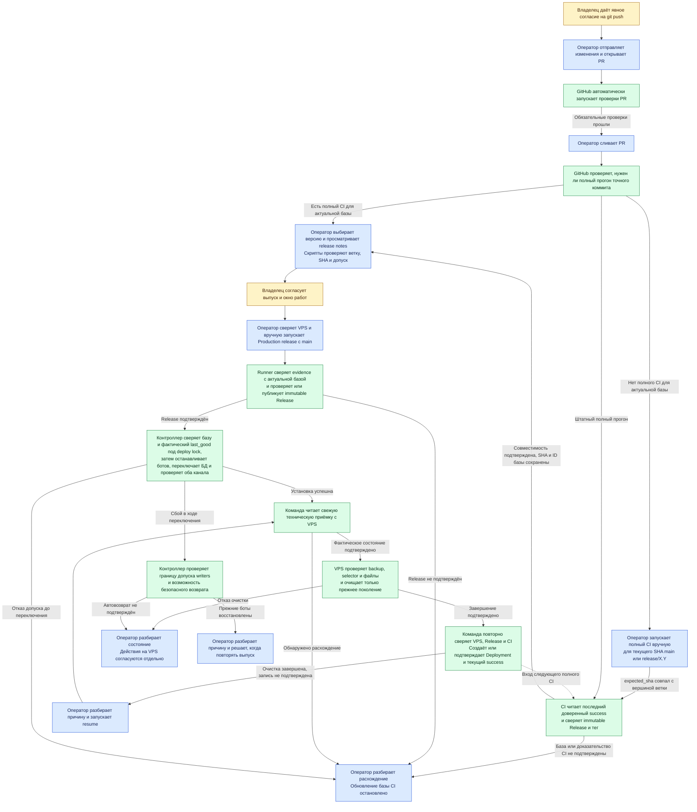
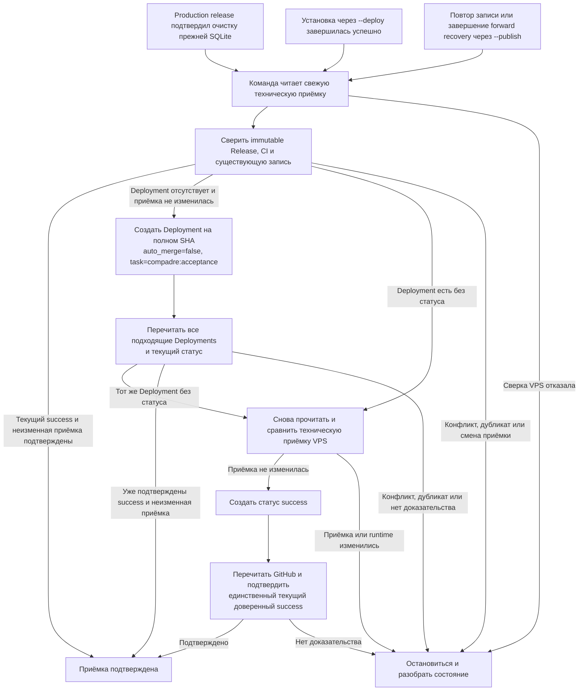
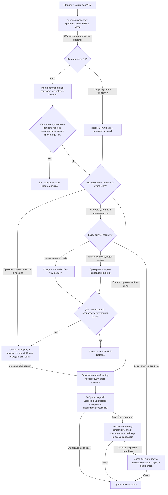
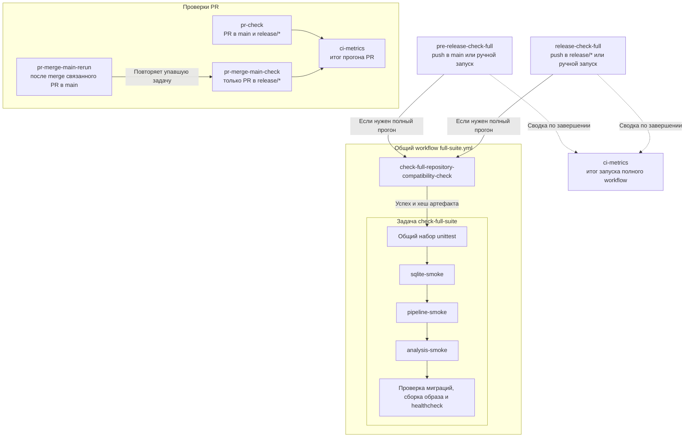
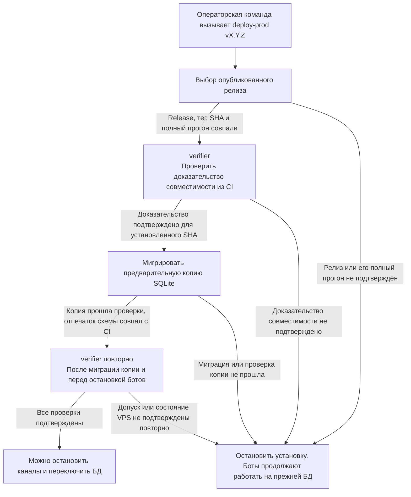
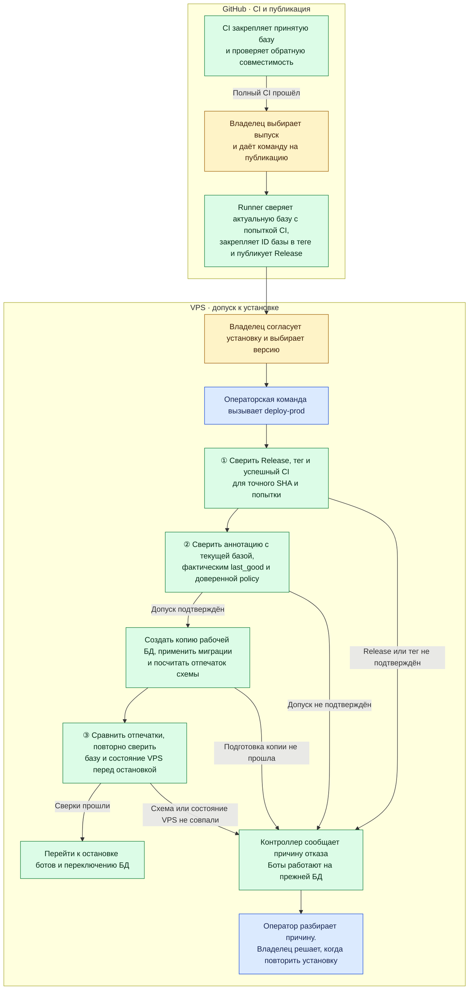
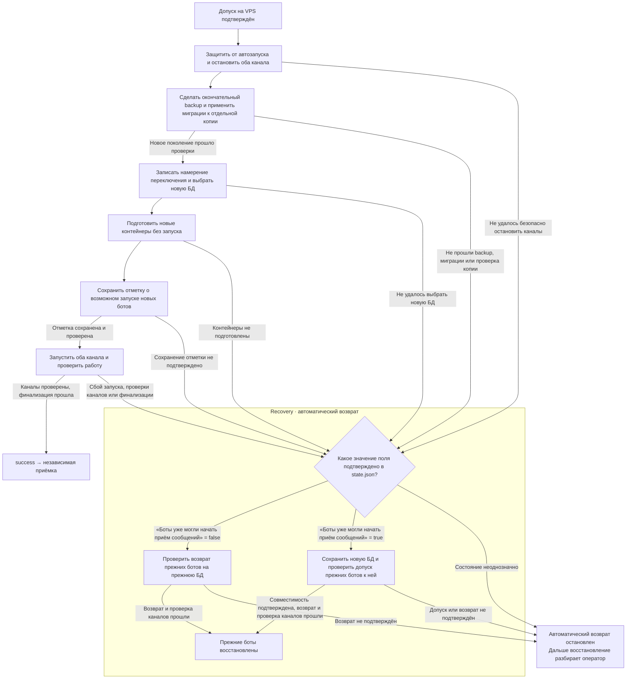

# Как CI допускает выпуск и как VPS переключает SQLite

Этот разбор помогает пройти путь от PR до установки и понять, почему один и тот
же коммит может быть готов к публикации, но ещё не допущен на конкретный VPS.
Здесь показан обычный выпуск. Условия допуска описаны в [RELEASES.md](../RELEASES.md),
команды и аварийный маршрут — в [OPERATIONS.md](../OPERATIONS.md).
Обычная установка использует [допуск по аннотированному тегу](#допуск-по-аннотированному-тегу).

До переноса в постоянную документацию обновляем схемы и пояснения здесь
вместе с каждым изменением описанной логики. Запланированное поведение
помечаем отдельно от действующего.

## Кто выполняет каждый шаг выпуска

Схема показывает обычный выпуск из GitHub Actions и выбор базы после
перехода на policy v2. Оператор запускает выпуск вручную после выбора
версии и проверки точного SHA.
[Как переключить policy](../OPERATIONS.md#обновить-доверенную-политику-полного-ci)
Оператором может быть человек или Codex с нужным доступом. Владелец даёт
согласие там, где этого требуют правила проекта.

Жёлтые блоки — участие владельца, синие — действия оператора, зелёные —
автоматика. Пунктир от Deployment показывает вход следующего полного CI.
После записи `success` новый прогон стартует по обычным событиям ветки или
вручную. Codex может подготовить
версию и release notes, сверить результаты CI, выполнить проверки без записи
и провести техническую приёмку с нужным доступом. Решение нужно, если версия,
состав выпуска или действие при сбое не определены. Обязательные проверки PR
и действия контроллера после запуска `deploy-prod` выполняются автоматически.

Контроллер после новой установки сверяет точный SHA, `last_good`, выбранную
БД, оба канала и состояние таймера backup. Техническая приёмка читает VPS
после локальной записи `success`. Контроллер очищает прежнее поколение
после подтверждения перехода, затем runner повторно сверяет приёмку и
записывает Deployment. Для уже установленного обычного выпуска оператор
может запустить `resume`, чтобы завершить или подтвердить очистку и записать
Deployment без новой установки. Проверка живых ответов служит отдельной
пользовательской диагностикой.
[Порядок выпуска и повтора](ACTIONS_RELEASE.md)

Для исторического `v3.2.0` владелец подтвердил ответы обоих каналов для
конкретного `runtime_id`, а тег `production/v3.2.0` фиксирует приёмку и
SQLite на момент проверки. Сводка по этому выпуску читает аннотацию тега.
[Команды тега установки](../OPERATIONS.md#зафиксировать-приёмку-тегом-установки),
[Сводка SQLite](../OPERATIONS.md#посмотреть-sqlite-опубликованной-версии)

Начиная с `v3.3.0`, приёмку фиксирует Deployment `environment=production`,
`task=compadre:acceptance` на полном SHA выпуска. Его payload версии 1
связывает immutable Release, попытку CI и принятое поколение SQLite.
После перехода на policy v2 каждый полный CI выбирает самый поздний
текущий доверенный `success` по времени статуса. CI проверяет авторов
записи и статуса, версию, ID Release и полный SHA тега. Набор
`SHA + Release ID + Deployment ID + status ID` сохраняется на всю попытку.
Если выбор неоднозначен или GitHub недоступен, полный CI завершает
проверку отказом.
[Формат записи и права](DEPLOYMENT_RECORD.md),
[первая запись](DEPLOYMENT_TRANSITION.md#первая-запись-для-v330)

Read-only проверка сверяет все страницы Deployments, доверенного автора и
текущий статус со свежей приёмкой, Release и миграцией точного SHA. Сводка
нового выпуска показывает поколение SQLite только при проверенном `success`;
без записи оно остаётся неизвестным. [Порядок проверки и замер запросов](DEPLOYMENT_RECORD.md#проверить-запись-без-изменения-github)

Операторская команда `--deploy` сверяет Release и доверенного автора до
установки. После успешного `deploy-prod` она читает техническую приёмку,
сверяет CI и перед каждым POST снова подтверждает ту же приёмку с VPS.
После каждого POST команда перечитывает GitHub. При потере ответа она
начинает следующий сеанс с чтения GitHub. [Порядок публикации и повтора](DEPLOYMENT_ON_DEPLOY.md)
[Локальный протокол перехода и отказов](DEPLOYMENT_TRANSITION.md)

GitHub и VPS закрепляют SHA проверенного коммита, из которого читаются
workflow, проверочный код и policy с матрицей SQLite repository API. Изменение
матрицы требует review, если меняется проверяемый контракт. После принятия
следующего выпуска policy остаётся прежней.
[Обновить доверенную политику](../OPERATIONS.md#обновить-доверенную-политику-полного-ci)

При новой релизной линии оператор также создаёт `release/X.Y` на проверенном
SHA и публикует ветку после разрешения записи. Если CI завершился отказом,
оператор разбирает результат до публикации. Если отказал допуск на VPS,
команда завершается до остановки каналов. Обновление установленного
контроллера, когда оно требуется, отдельно согласуют перед установкой.
Порядок ручных шагов приведён в [OPERATIONS.md](../OPERATIONS.md#подготовка-и-запуск-версии).

### Подтвердить приёмку и безопасно повторить запись

Для обычного выпуска runner запускает эту цепочку после подтверждения
очистки в workflow `Production release`. Для отдельной установки и записи оператор запускает
`scripts.publish_deployment_acceptance` с `--deploy`. После установки команда
получает свежую приёмку, которая подтверждает `last_good`, SHA работающих
контейнеров, выбранную SQLite, оба канала и backup timer. Токен доверенного
автора с правом `Deployments: write` используется на runner или машине
оператора, где запущена команда. На VPS остаётся `Deployments: read`.
После сбоя записи или отдельного успешного
forward recovery оператор использует `--publish`, который начинает новую
сверку без установки. [Условия установки и повтора](DEPLOYMENT_ON_DEPLOY.md)

Ответ на любой POST может потеряться после записи. Поэтому операторский
сценарий всегда перечитывает GitHub и не повторяет POST вслепую. Если чтение
не удалось, сеанс останавливается; следующий запуск снова начинает с чтения.
Конфликт payload, автора, окружения, задачи, SHA или статуса передают владельцу
без перезаписи. Одновременные сеансы создания записи не допускаются: GitHub
не обеспечивает уникальность пары SHA, task и environment. Локальные
[сценарии потери ответа и 403](DEPLOYMENT_TRANSITION.md#проверить-сбой-и-безопасный-повтор)
показывают границы этого процесса.

Исторический тег `production/v3.2.0` остаётся источником для сводки этого
выпуска. После перехода на policy v2 базу CI подтверждает Deployment с
текущим доверенным `success`. Сводка SQLite показывает данные принятой БД.
Текущее состояние VPS проверяет контроллер через `last_good` и runtime.

## Пройти CI от PR до публикации

Для PR в `release/*` обязателен ещё `pr-merge-main-check`. Зелёный `pr-check`
позволяет двигаться к merge, а для публикации нужен успешный полный CI
конкретного коммита после merge. Зелёный контроллер с пропущенным `check-full-suite`
нового допуска не даёт. Ручной запуск `pre-release-check-full` или
`release-check-full` требует `expected_sha`, совпадающий с текущей вершиной
ветки. Он запускает полный набор для того же SHA, если база сменилась или
прежняя попытка отказала. При создании новой линии на проверенном SHA из
`main` используется уже прошедший `pre-release-check-full`, если
доказательство совместимости по-прежнему соответствует принятой базе.
[Как повторить CI](../OPERATIONS.md#повторить-полный-ci-для-точного-sha)

При полном прогоне GitHub Actions берёт конкретный коммит по его SHA,
проверяет совместимость прежнего кода со схемой этого кандидата, затем
запускает тесты, миграции, сборку и healthcheck образа кандидата. Результат
относится к этому коммиту. Следующий коммит получает собственный SHA и
требует собственного допуска.

Оба полных workflow получают предыдущий SHA из GitHub Deployments.
`check-full-repository-compatibility-check` сверяет ту же принятую базу
и читает правила из Git-байтов по внешнему `COMPATIBILITY_POLICY_SHA`.
В артефакт версии 2 попадают точная пара SHA, реквизиты принятой базы,
отчёты тестов и fingerprint схемы. Fingerprint — контрольный отпечаток
структуры SQLite, с которым VPS сравнит схему своей копии. GitHub Release
фиксирует SHA кандидата и ссылку на конкретный run/attempt. Аннотация
релизного тега закрепляет реквизиты базы из этой попытки.

## Понять проверки CI

Схемы используют имена из пункта 7 [плана](PLAN.md). Пути файлов `.yml`
сохранились, поэтому в ссылках на workflow и манифестах выпуска встречаются
`main-full.yml` и `release-full.yml`.

### Как связаны проверки

`pre-release-check-full` и `release-check-full` вызывают один и тот же `full-suite.yml`, когда
нужен полный прогон. Сначала выполняется задача `check-full-repository-compatibility-check`,
затем задача `check-full-suite`. Различаются события запуска, целевые ветки и правила
решения о прогоне. Например, при создании `release/X.Y` на уже проверенном
SHA контроллер `release-check-full` сверяет результат `pre-release-check-full` для этого коммита.
`ci-metrics` собирает итог запуска, в том числе когда полный набор пропущен.
Сравнение длительности использует только прогоны с новым набором имён.
Первый прогон после переключения показывает свои замеры без сравнения с
прежними именами.

`pr-merge-main-rerun` запускается по событию в `main` и повторяет уже
существующую задачу `pr-merge-main-check` в прогоне связанного PR. Слияние PR в
`main` само по себе не создаёт события для открытого PR в `release/*`.
При ручном повторе той же задачи оператор выполняет действие, которое
`pr-merge-main-rerun` автоматизирует.

### Что проверяют задачи и команды

| Имя в GitHub Actions | Когда работает | Что проверяет и что даёт результат |
| --- | --- | --- |
| [`pr-check`](../../.github/workflows/pr-fast.yml) | При событиях PR в `main` и `release/*`. | Проверяет пробное слияние PR с базой: синтаксис Python, отслеживаемые файлы, миграции, ссылки связанных hotfix PR, короткий набор тестов и конфигурацию Compose. Обязательная проверка для merge. |
| [`pr-merge-main-check`](../../.github/workflows/pr-fast.yml) | Отдельная задача в том же workflow для PR в `release/*`. | Проверяет, что связанный PR уже слит в `main` или что указанный коммит входит в историю `main`. Обязательная проверка для merge в релизную линию. |
| [`pr-merge-main-rerun`](../../.github/workflows/hotfix-deps-rerun.yml) | После слияния PR в `main`. | Для связанных открытых hotfix PR повторно запускает актуальную задачу `pr-merge-main-check`, если она завершилась ошибкой и основание в `main` теперь подтверждено. |
| [`pre-release-check-full`](../../.github/workflows/main-full.yml) | После push в `main` или по ручному запуску. | Контроллер решает, нужен ли полный прогон, и определяет базу совместимости. Успешный полный прогон точного SHA нужен для новой релизной линии. |
| [`release-check-full`](../../.github/workflows/release-full.yml) | После push в `release/*` или по ручному запуску. | Для нового SHA существующей линии контроллер запускает полный набор, если нужен новый прогон. При создании линии контроллер сверяет успешный `pre-release-check-full` того же SHA. |
| [`check-full-repository-compatibility-check`](../../.github/workflows/full-suite.yml) | Первый job полного набора. | Проверяет прежний код на схеме кандидата для точной пары SHA и сохраняет отчёты и отпечаток схемы. `check-full-suite` требует успеха этой задачи и хеша её артефакта. |
| [`check-full-suite`](../../.github/workflows/full-suite.yml) | После успешной проверки совместимости. | Сверяет SHA, запускает все unit-тесты, три автономных smoke-проверки (SQLite, pipeline, analysis), проверяет миграции на свежей и прежней тестовых БД, собирает образ и проверяет его healthcheck. |
| `sqlite-smoke` | Первая smoke-команда в `check-full-suite`, после unit-тестов. | Применяет миграции на временной БД и проверяет запись и чтение статьи. |
| `pipeline-smoke` | Вторая smoke-команда в `check-full-suite`. | Проверяет обработку статьи на временной БД с подставными загрузчиком HTML и извлекателем текста. |
| `analysis-smoke` | Третья smoke-команда в `check-full-suite`, перед отдельной проверкой миграций. | Проверяет анализ статьи на временной БД с подставным LLM-анализатором. |
| `ci-metrics` | После проверок PR или полного CI, в том числе при отказах и пропусках. | Собирает время и результаты задач и шагов. Это сводка измерений. Решение о допуске принимается по обязательным задачам и шагам. |

Smoke — короткая проверка целого сценария. Все три команды выполняются по
порядку внутри одного шага `Run three autonomous smoke checks`. В интерфейсе
GitHub Actions они видны в журнале этого шага. Из общего набора `unittest`
удалены обёртки, которые повторяли те же три сценария. На VPS при подготовке
кандидата все три команды отдельно запускаются внутри собранного образа.
[Описание smoke-команд](../RUN.md#7-проверить-sqlite-контур)

## Проверить допуск на VPS

Операторская команда с `--deploy` вызывает `deploy-prod vX.Y.Z` по SSH.
Контроллер находит опубликованный Release этой версии и выполняет проверки
до остановки ботов. Если любой шаг отклонён, установка заканчивается до
переключения БД.
Для обычного аннотированного тега на SQLite v2 действует
[маршрут проверки аннотации](#допуск-по-аннотированному-тегу). Ниже показан
маршрут с артефактом для ранее опубликованных тегов, аварийной установки
и установок на прежнем протоколе SQLite.

| Если проверка не прошла | Что это означает |
| --- | --- |
| Выбор релиза | Например, тег указывает на другой SHA или закреплённая попытка CI не подтверждает этот коммит. |
| Доказательство совместимости | Например, CI проверил переход с v3.1.0, а VPS уже работает на v3.2.0, или артефакт недоступен. |
| Предварительная копия | Миграция не прошла, проверка обнаружила проблему с данными или схема копии отличается от проверенной CI. |
| Повторная сверка | Пока проверяли копию, изменились условия, на которых был выдан допуск, или их больше нельзя подтвердить. |

### Первый вызов verifier

Контроллер передаёт в [`verify_evidence()`](../../scripts/predeploy_compatibility.py)
три ориентира. Из выбранного Release он берёт SHA кандидата и закреплённые
run/attempt, то есть номер запуска CI и номер его попытки. На VPS он сверяет
SHA работающих контейнеров с `last_good` и читает SHA проверенной policy из
файла `compatibility-policy.sha`. Policy задаёт список обязательных тестов
и доверенные Git-байты проверок. Принятую базу задаёт текущий доверенный
`success` в Deployments.

| Что сверяет verifier | Зачем |
| --- | --- |
| **Прогон CI.** Из GitHub Actions берёт репозиторий, файл workflow, ветку, SHA, run/attempt и результаты задач. Сверяет их с выбранным Release и требованиями допуска. Для обычного выпуска должны пройти контроллер, `check-full-repository-compatibility-check` и `check-full-suite` с обязательными шагами. | Чтобы зелёный результат другого коммита или попытки либо запуск с пропущенным полным набором не дал допуск. |
| **Предыдущая версия.** Сверяет доверенный Deployment, его текущий статус и immutable Release с доказательством CI и установленным SHA. | Чтобы CI доказал переход с версии, которая действительно работает на VPS. |
| **Как были запущены проверки.** Сравнивает байты `main-full.yml`, `release-full.yml` и `full-suite.yml` на коммите кандидата и на закреплённом коммите policy. Хеши policy и проверочных файлов сравнивает с теми, которые CI записал в доказательство. | Чтобы изменение кандидатом workflow или набора правил не могло само по себе поменять условия допуска. |
| **Какой ZIP скачан.** Ищет один артефакт с именем для точного run/attempt, сверяет принадлежность к запуску и SHA, проверяет срок хранения. SHA-256 скачанного ZIP должен совпасть с хешем в метаданных GitHub. | Чтобы исключить устаревший, чужой или повреждённый архив. |
| **Что внутри ZIP.** Сравнивает `evidence.json` с ожидаемыми SHA, run/attempt, workflow, baseline и хешами проверочных файлов и файлов самого архива. Проверяет результаты в `report.json` и сверяет идентификаторы тестов прежнего кода с полным списком из policy. | Чтобы подтвердить выполнение ожидаемых тестов, даже если в отчёте уже есть общий флаг успеха. |

В отчёте должна совпасть схема из четырёх проверок: свежая БД кандидата,
БД после обновления со старой версии, БД во время тестов прежнего кода и
БД при проверке кандидатом записей, сделанных прежним кодом. Для закреплённого
набора прежних тестов проверяются точные 173 идентификатора, количество
запусков и отсутствие пропусков и ошибок. Отчёт также сверяется по источникам
импортов и составу миграций.

Например, если VPS уже обновился, а запись о приёмке новой версии ещё
не подтверждена, предыдущая база разойдётся с `last_good`. Контроллер
остановит следующий выпуск. Завершите приёмку установленной версии и
повторите полный CI кандидата на новой базе.
[Исторический пример после отмены ротации базы](../RELEASE_REVIEW.md#сохранить-границы-следующего-выпуска)

Результат — ID и хеш артефакта, SHA policy и отпечаток ожидаемой схемы.
На следующем шаге контроллер применяет миграции к предварительной копии БД
с VPS и сравнивает получившуюся схему с этим отпечатком.

### Зачем verifier вызывается повторно

На схеме повторы собраны в одном блоке. В штатной установке с протоколом
переключения поколений БД (v2) это **два вызова после первого**:

1. **Сразу после миграции предварительной копии.** Контроллер перечитывает
   закреплённый SHA policy, снова проверяет доказательство и сравнивает
   результат с первым вызовом. Например, артефакт мог истечь или быть удалён,
   пока шла миграция. Затем контроллер повторно сверяет установленную версию.
2. **Перед остановкой ботов.** После подготовки установки контроллер заново
   сверяет выбранный Release, установленную версию и образ кандидата. Он
   снова запускает verifier, сравнивает результат с сохранённым и проверяет,
   что закреплённый SHA policy и SHA контроллера остались прежними.

Оба повтора заново проверяют существующее доказательство из GitHub. Тесты
совместимости в GitHub Actions выполнялись при исходном прогоне CI. Если на
повторной сверке доказательство изменилось или недоступно, установка
останавливается до выключения ботов.
[Подготовка и финальная сверка в коде контроллера](../../scripts/deploy_prod.py)

#### Исторический замер verifier для policy v1

Замер относится к прежнему формату артефакта. При policy v2 чтение
Deployments и доверенных файлов учитывается отдельно.

| Что читает один успешный вызов для обычного выпуска | Запросы к GitHub API при одной странице на список |
| --- | ---: |
| Метаданные workflow, список прогонов точного SHA и задачи закреплённой попытки | 3 |
| Закреплённые policy и проверочные файлы | 6 |
| Release и тег прежней версии | 2 |
| Три файла workflow по SHA policy и те же три по SHA кандидата | 6 |
| Список артефактов прогона и запрос ZIP по ID | 2 |
| **Итого** | **19** |

Первый вызов, повтор после миграции копии и повтор перед остановкой делают
по 19 запросов, всего 57. При одной переадресации загрузка ZIP добавляет
ещё один HTTP-запрос к хранилищу на вызов. Дополнительные страницы увеличивают
число запросов, а ранний отказ может его уменьшить. Запросы селектора релиза,
`git fetch` и возможного восстановления считаются отдельно. Расчёт проверен
локально с настоящим verifier и тестовыми ответами API.

#### Можно ли оставить только финальный повтор

Между повторами контроллер ещё раз сверяет релиз, локальные теги и образы,
проверяет конфигурацию запуска и отсутствие дублирующего polling и снимает
состояние таймера. Подготовленное состояние `ready` в v2 записывается после
финального допуска. Боты всё это время работают на прежней БД. За это время
артефакт может истечь или исчезнуть, в GitHub может появиться новая попытка
CI, а доступ к API или локальный pin policy могут измениться. Промежуточный
вызов лишь обнаруживает отказ раньше. Финальный проверяет те же условия ближе к
остановке и дополнительно сверяет выбранный Release, работающий образ,
образ кандидата и контроллер.

Для SQLite v2 рассматривали вариант с первым вызовом и финальным повтором.
Он сохранял локальные проверки и сравнение финального результата с тем,
по которому проверили копию. Такой вариант дал бы 38 запросов вместо 57
при одностраничных ответах. В старом режиме финальный вызов отсутствует,
поэтому там повтор после копии пока нужен.

При финальном отказе до остановки каналов контроллер сообщает
`failed_preflight` и сохраняет завершённое состояние предыдущего выпуска.
Боты, выбранная БД и контракт их штатного запуска остаются прежними.
После паузы повторный `deploy-prod` проверяет допуск заново.

При подготовке выпуска после очистки прежнего поколения контроллер сохраняет
контракт запуска предыдущего выпуска и проверяет исходную SQLite по его
selector и записи об очистке. Если подготовка прервана до критического
маркера, контроллер возвращает checkout к принятому SHA, сверяет работающую
пару и таймер, затем восстанавливает состояние `success` прежнего выпуска
без перезапуска каналов.

В ранее сохранённом `failed_preflight` контроллер сверяет прежнее поколение
с фактическим selector. Если прежний контроллер успел записать новый ID
перехода, восстанавливается только подтверждённая прежняя привязка. При
наличии критического маркера или расхождении selector с сохранённым
состоянием продолжают действовать защиты восстановления.

### Допуск по аннотированному тегу

Жёлтые блоки обозначают решения владельца, синие — действия оператора
(владельца или Codex по его команде), зелёные — автоматику.

Тег указывает на SHA кандидата. Аннотация версии 2 закрепляет SHA прежнего
выпуска, ID Release, Deployment и статуса, SHA policy, точный run/attempt
и отпечаток схемы. Публикатор сверяет evidence с текущей базой до создания
тега и повторно перед публикацией Release. Токен публикации читает Actions,
Contents, Variables и Deployments.

Под deploy lock контроллер сверяет аннотацию с актуальной базой,
фактическим `last_good` и локальным pin. Он сравнивает три workflow из
закреплённого коммита policy с байтами в Git кандидата. После миграции
предварительной копии контроллер сравнивает отпечаток схемы с аннотацией.
Перед остановкой он повторно сверяет принятую базу, тег, pin, checkout,
установленную версию и образ. Для обычного аннотированного выпуска VPS
получает отпечаток из тега. Аварийный путь проверяет артефакт точной
попытки совместимости.

При восстановлении начатого перехода контроллер проверяет прежнюю базу
по сохранённым ID Deployment и статуса. Старая аннотация версии 1
сохраняет прежний формат проверки для ранее опубликованных выпусков
и записанного состояния перехода.

### Как контроллер обрабатывает отказ GitHub

`deploy-prod` прерывает попытку до остановки ботов, если не может получить
доказательство допуска из GitHub.
Telegram и VK продолжают работать на прежней версии и прежней БД.

| Где возник отказ | Что происходит |
| --- | --- |
| При выборе опубликованного релиза | `deploy-prod` прерывает подготовку до первого вызова `verifier`. |
| При проверке evidence и принятой базы | Допуск не подтверждён. Контроллер завершает попытку до миграции копии БД. |
| При повторной сверке перед остановкой | Условия допуска больше нельзя подтвердить. Контроллер оставляет ботов на прежней БД. |

Оператор видит этап отказа, его причину и сообщение, что переключение не
началось. Токен и другие секреты в диагностике не выводятся.

| Причина | Когда повторить `deploy-prod` |
| --- | --- |
| GitHub ответил `403` из-за прав доступа | После восстановления доступа к нужному ресурсу с VPS. |
| GitHub ответил `403` или `429` из-за лимита | После указанного GitHub времени ожидания. Для этого GitHub может вернуть `Retry-After` или, при исчерпанном основном лимите, `X-RateLimit-Reset`. [Документация GitHub](https://docs.github.com/en/rest/using-the-rest-api/troubleshooting-the-rest-api#rate-limit-errors) |
| GitHub не отвечает или возвращает `5xx` | После восстановления доступа с VPS и окончания паузы перед повтором, если она задана. |

При повторе оператор снова указывает тот же релиз, а `deploy-prod` заново
проходит допуск и локальную сверку схемы. Восстановление здесь не нужно,
поскольку переключение ещё не начиналось. Повтор следует выполнять после
устранения причины отказа и истечения паузы контроллера.

## Переключить поколение SQLite

Здесь восстановлена схема из [плана прошлого выпуска](https://github.com/karateka-git/compadre-assistant/blob/cc5077160243ceb69f3ced7a35b7ccc9ded50791/docs/ci-release-review/PLAN.md)
по действующему протоколу переключения поколений БД (v2).

В рамке recovery показан автоматический возврат после сбоя установки.
Контроллер определяет, с какой БД можно безопасно работать, и пытается
вернуть прежних ботов. Если безопасный возврат подтвердить не удалось,
дальнейшее восстановление планирует оператор. Один из таких путей —
forward recovery, при котором оператор завершает установку новой версии
на уже выбранной новой БД при выполнении условий процедуры.

`success` в локальном состоянии завершает техническую часть установки.
Для выбора нового выпуска базой CI требуется подтверждённая запись в
GitHub Deployments. При обычной или аварийной установке с успешной точной
попыткой полного CI её пишет `--deploy`. После отдельного forward recovery
её завершает `--publish` по
[порядку приёмки](#подтвердить-приёмку-и-безопасно-повторить-запись).

«Боты уже могли начать приём сообщений» — поле
`admission_may_have_started` в `state.json`. После выбора нового файла
контроллер ещё может вернуться к прежней БД при подтверждённом `false`.
При `true` остаётся новая БД, даже если команда запуска завершилась ошибкой.
Если значение поля нельзя подтвердить, действует ветка остановки
автоматического возврата.

После очистки прежнего поколения контроллер читает завершённое состояние
без старого файла. Пока записи `old_generation_cleanup` нет,
контроллер по-прежнему проверяет оба поколения. Точная запись после удаления
разрешает технической приёмке, штатному boot и ночному backup проверять
выбранную новую БД без `old`; неполное состояние и одновременное наличие
intent с записью завершения закрывают этот путь.
Команда очистки теперь сверяет старую БД, backup и открытые Linux FD под
deploy lock до записи точного durable intent, удаляет только
зарегистрированные старые файлы и записывает завершение после синхронизации
каталога. При прерывании повтор
проверяет оставшиеся inode по intent; до завершения отсутствие `old` закрывает
штатное чтение. Отказные границы и локальные маршруты обычного, аварийного
выпуска и forward recovery испытаны на отдельных временных SQLite с текущими
миграциями на Windows. После очистки повторная приёмка сохраняет `runtime_id`,
а следующий переход берёт исходную БД из прежнего `new` и строит
`selector_rebind`; selector на удалённый `old` закрывает чтение. Модель
публикации Deployments подтверждает тот же SHA без обращения к GitHub.
Linux-проверка `/proc` испытана на временной SQLite в изолированном
контейнере: открытый old FD даёт отказ до intent, повтор после закрытия
завершается. Обычные fixture тесты прошли также от непривилегированного
пользователя с изоляцией только системного `/proc` gate. На `v3.3.0`
прежнее поколение удалили после отдельной живой проверки и согласия.
[Условия допуска и контракт очистки](SQLITE_CLEANUP.md)
[Команда оператора и безопасный повтор](../OPERATIONS.md#удалить-прежнее-поколение-sqlite-после-приёмки)

Предварительная копия проверяет применимость миграций к рабочей схеме, пока
боты ещё работают. Окончательный снимок делают после остановки обоих каналов,
чтобы в новом поколении были и записи, поступившие во время предварительной
проверки. Если новый бот успел записать сообщение № 101 и затем упал, возврат
на прежнюю БД с 100 сообщениями потерял бы запись. Поэтому после сохранения
границы возможной записи остаётся новая БД. Возврат прежнего кода на неё
требует подтверждённого допуска совместимости. Исходы возврата, условия
безопасного повтора и границы ручного вмешательства собраны в
[отчёте об испытаниях восстановления](RECOVERY_TRIALS.md#решение-по-восстановлению).

## Пройти пример v3.2.0

1. Для кандидата `cabc0e24…` прошёл полный
   [main-full 42249037867/1](https://github.com/karateka-git/compadre-assistant/actions/runs/42249037867/attempts/1).
   На том же SHA создали `release/3.2`, затем опубликовали
   [v3.2.0](https://github.com/karateka-git/compadre-assistant/releases/tag/v3.2.0).
2. Сервер переходил с v3.1.0 на v3.2.0. Исходный `deploy-prod` прошёл до
   финализации, где завершился `degraded`. Forward recovery завершил тот же
   выпуск на уже выбранной новой БД. [Итог установки](../RELEASE_REVIEW.md)
3. После отмены ротации базы новый полный CI снова проверял совместимость с
   v3.1.0 при установленной v3.2.0. Это пример зелёного CI, который не давал
   допуска к следующей установке на этом VPS. [Снимок состояния](../PRODUCTION.md)

Пример v3.2.0 основан на сохранённом отчёте выпуска. Актуальные настройки
GitHub и состояние VPS требуют свежей сверки.

После слияния изменений и эксплуатационной приёмки перенести отсюда все
актуальные схемы и важные пояснения в постоянную документацию. Назначение
документов и порядок проверки переноса описаны в
[пункте 10 плана](PLAN.md).
