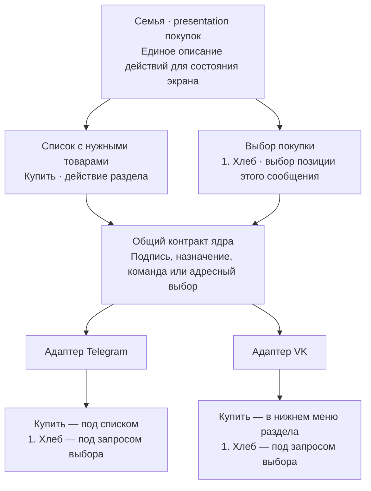

# Требования к действиям экрана и навигации

Цель — дать пользователю понятный следующий шаг в Telegram и VK и описывать каждое действие экрана один раз для обоих каналов. Покупки служат первым сквозным сценарием. После них проверяем ответы ядра, настроек, ИИ, Obsidian и Admin по [задаче бэклога](../BACKLOG.md#актуализировать-пользовательские-сообщения-и-навигацию) и [правилам сообщений](../USER_MESSAGES.md).

## Область применения

Общий контракт ответа применяется везде, где ядро или возможность отправляет пользователю сообщение в Telegram или VK. Он охватывает главное меню, регистрацию, настройки, справку, запросы ввода, подтверждения, результаты и ошибки. Набор действий может быть пустым. Текстовый ответ сам по себе не требует кнопок или смены меню.

Владелец каждого экрана описывает его действия в своём presentation-слое. Общие типы принадлежат ядру. Новая возможность использует их через публичный контракт, а адаптеры применяют правила размещения независимо от модуля-источника.

## Пример целевого устройства

Список и выбор — два последовательных экрана. Нажатие «Купить» открывает выбор. Нажатие «1. Хлеб» относится к товару, который пользователь видел в этом сообщении. Вручную покупку можно выбрать номером из запроса. Синтаксис команд раздела доступен в `/help`.

## Кто за что отвечает

| Компонент | Требование |
| --- | --- |
| Presentation владельца экрана | Из состояния сценария формирует текст и действия. В одном месте задаёт подпись, условие доступности, назначение действия и его цель. Различает действия раздела, выбор конкретного объекта, переход и отмену ввода. Для перехода указывает, к какому экрану и странице он относится. |
| Ядро | Предоставляет общий контракт для экрана и контекста раздела. Сохраняет привязку адресного выбора к сообщению. При исполнении проверяет профиль, чат, режим, доступ и актуальность привязки, передаёт предметную проверку владельцу. Ручная команда и кнопка приводят к одному сценарию. |
| Адаптер Telegram | Отображает основные действия и выбор под соответствующим сообщением. Собирает клавиатуру с учётом ограничений канала. Сохраняет доступ к справке через меню команд. |
| Адаптер VK | Выводит действия раздела в нижнем меню, а выбор конкретного сообщения — под ним. Учитывает контекст перехода: возврат из выбора относится к этому выбору. При неизменном меню сохраняет его, при смене доставляет новое вместе с содержательным ответом. Учитывает одну клавиатуру на сообщение. |

Адаптер применяет правила к назначению и области действия. Названия команд покупок, членство в семье, статус товара и цель «Назад» остаются у владельца сценария. При разбиении списка на страницы адаптер учитывает лимиты канала, а сценарий сохраняет соответствие показанных номеров товарам. Контракт должен позволять получить актуальные действия раздела и при отдельном запросе меню.

## Что проверить при приёмке

### Мессенджеры в настройках

В личном чате раздел «Мессенджеры» показывает доступные для этой установки каналы и их связь с текущим профилем. Если второй канал свободен у профиля, «Привязать VK» или «Привязать Telegram» сразу выдаёт код на 10 минут и ссылку на диалог с ботом этой установки. Для уже связанного канала достаточно действия «Открыть бота». Перечень мессенджеров и ссылки на переход размещаются в настройках. При первом входе пользователь выбирает между созданием профиля и вводом имеющегося кода.

В настройках команда `/connect <messenger>` заменяет `/link_code`. Например, в Telegram кнопка «Привязать VK» вызывает `/connect vk`. Команда `/connect` без аргумента предлагает выбрать доступный мессенджер.

При первом входе в целевом канале «У меня есть код» открывает ввод кода. Если у аккаунта уже есть профиль, в настройках этого канала действие называется «Привязать VK к другому профилю» или «Привязать Telegram к другому профилю». Нажатие запрашивает код, а перенос требует отдельного подтверждения. Справка сохраняет ручной путь через `/link <код>`. Приёмка охватывает оба направления связи.

### Экраны и действия

- В пустом списке виден первый полезный шаг «Добавить». Для списка с доступной покупкой пройти «Купить» → выбор товара → обновлённый список. Сравнить результат кнопки и ручного пути в обоих каналах.
- Из выбора «Назад» возвращает на исходную страницу списка с учётом его сокращения. Из списка «Назад» открывает меню семьи. «Отмена» и `/cancel` закрывают ввод и сохраняют режим. `/exit` завершает режим этого чата.
- После перехода, повторного нажатия, изменения списка или утраты доступа старая кнопка не должна изменять другой товар. Пользователь получает путь к актуальному экрану. Проверить также ошибку доставки нового экрана до снятия старых кнопок.
- Сверить затронутые ответы со сценариями в [реестрах сообщений](../USER_MESSAGES.md). Справка даёт точный синтаксис и условия доступа, запрос ввода объясняет следующий шаг, при недоступности кнопок остаётся рабочий текстовый путь.
- На телефоне в Telegram и VK пройти изменённые переходы, проверить длинные подписи, размещение кнопок и доставку нижнего меню. Зафиксировать результаты по каждому каналу в [плане](PLAN.md).
